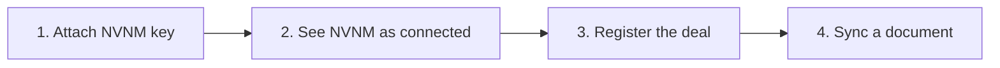
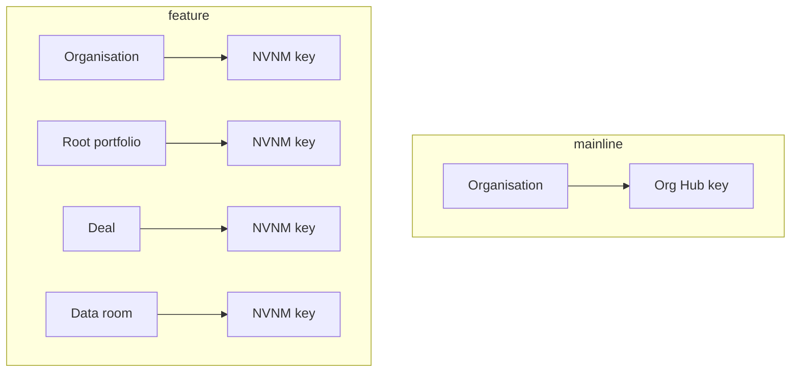
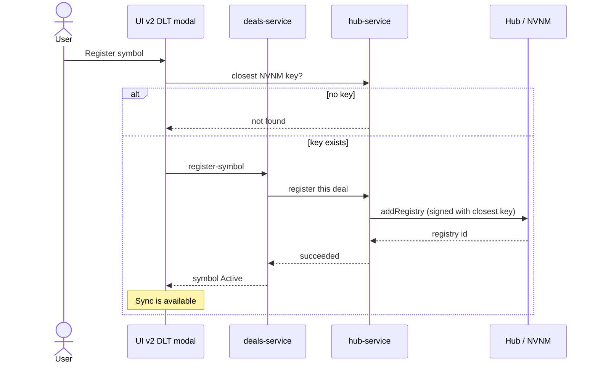
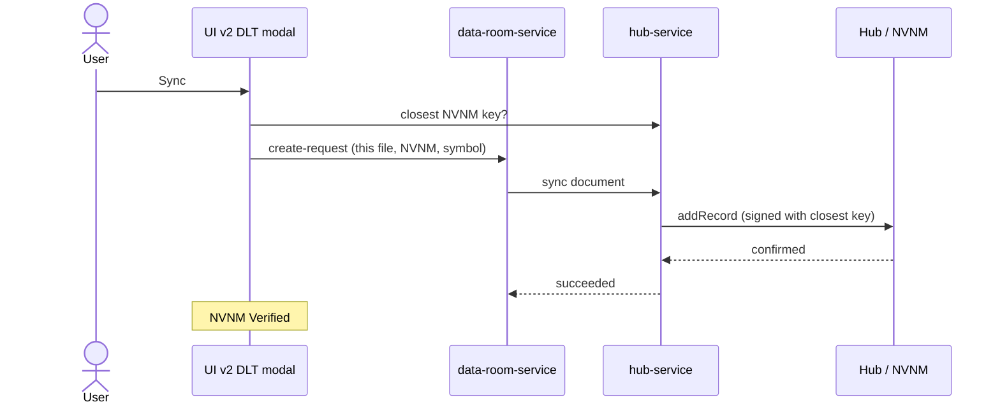

# Hub Keys Everywhere — feature branch vs mainline

Ticket: **INV-42086**. Branches: `INV-42086-hub-keys-everywhere` in **inveniam.io** and **inveniam-v2**.

Compared to the default line (`develop` / `master` — the line that is in production today). This is the product picture: what a user or operator can do, and which paths exist. It is not a changelog of how the design evolved.

---

## One sentence

On mainline, NVNM Hub keys and DLT validation are **organisation-only**, and UI v2 cannot register a deal for validation. On this branch, an NVNM key can sit on **organisation, portfolio, deal, or data room**; v2 **finds the closest key**, **registers the deal**, and **syncs documents** with that key.

---

## What mainline already does (unchanged)

These paths are the same on the feature branch as on mainline:

| Path | What happens |
| ---- | ------------ |
| **Add Hub Key (organisation)** | Organisation Blockchain still adds / views / edits org-level keys for every ledger (Ethereum, Metachain, NVNM, …). |
| **Tokenization / other ledgers** | Still organisation-level. No portfolio / deal / data-room keys. |
| **DLT Sync for non-NVNM** | Still uses the organisation Hub key. |
| **v1 frontend register / tokenization** | Still exists. This branch does not replace v1 for other networks. |
| **One registry per deal** | Still true: every document in a deal anchors into that deal’s NVNM registry. |

Mainline **cannot**:

- Attach an NVNM key below the organisation.
- Show NVNM as connected in the data room when only a portfolio / deal / data-room key exists.
- Register the NVNM deal from UI v2 (operators had to record the registry id by hand).
- Sign Register or Sync with anything other than the organisation key.

---

## What the feature branch adds

Four customer-facing paths. They only apply to **NVNM**.



Closest key wins at every step after attach:

```
data room  →  deal  →  root portfolio  →  organisation
```

A more specific key hides a broader one. Nested sub-portfolios are not their own key level; the portfolio key lives on the **root** portfolio.

---

### Path 1 — Attach an NVNM key

**Where:** organisation, portfolio, deal, or data room (separate “scoped” Add Hub Key, NVNM only).

**What it does:** stores the key at that level. It does **not** by itself register the deal or create the on-chain registry.

**vs mainline:** mainline only has the organisation Add Hub Key, for all ledgers. This branch adds attach-below-org for NVNM. It does **not** add a full key-admin screen (list / edit / delete) at portfolio, deal, or data room. Organisation Blockchain still lists org keys only.



---

### Path 2 — See NVNM as a connected validation service

**Where:** data room (“Connected validation services”).

**What it does:** if any NVNM key exists at or above this data room, NVNM appears as connected — including when the key was added on the portfolio or deal, not on this room.

**vs mainline:** mainline only surfaces NVNM when the deal already has a hub-connected integration setting (typically after org-level connect). A Vault-only scoped key would not show.

---

### Path 3 — Register the deal (one time)

**Where:** file → DLT Management → NVNM → **Register symbol**.

Shown when a closest key exists but the deal has no Active NVNM registry yet.

**What it does:**

1. Re-checks that a closest NVNM key still exists.
2. Creates the deal’s NVNM validation setting if it is missing.
3. Asks Hub to create the on-chain anchoring registry (`addRegistry`).
4. Writes the returned `registryId` as the deal’s NVNM **symbol**.
5. Button becomes **Sync**.

If the chain rejects the write, Register stays available and the user can retry.

**vs mainline:** this path does not exist in v2. The registry had to be created / recorded outside the product (v1 or DB).



---

### Path 4 — Sync a document

**Where:** same DLT Management modal → **Sync** (after Register is Active).

**What it does:** anchors that file’s fingerprint into the deal’s registry (`addRecord`), signed with the **same closest NVNM key** used for Register.

**vs mainline:** Sync already existed, but it only signed with the **organisation** key. A portfolio- or deal-only key would fail (“Hub credentials were not found”). On this branch, Sync works when the only key is below the organisation.



---

## How the two products split

| Repo / branch | Owns |
| ------------- | ---- |
| **inveniam-v2** `INV-42086-hub-keys-everywhere` | Scoped Add Hub Key UI; closest-key calls; NVNM in connected services; Register / Sync in the DLT modal; waiting / success / failure in that modal. |
| **inveniam.io** `INV-42086-hub-keys-everywhere` | Store keys at each level; closest-key lookup; sign Register and Sync with that key; create-if-missing NVNM deal setting; write back the registry id; scoped-key events that do **not** kick off org tokenization. |

They ship together. v2 without the backend cannot attach or resolve scoped keys. Backend without v2 has no product surface for Register or scoped attach.

---

## What this branch deliberately does not change

Same boundaries as the PoC — not missing work hidden in the diff:

- No full Hub-key management (view / change / remove) below the organisation.
- No dashboard of scoped keys on Organisation Blockchain.
- Other networks stay organisation-level.
- Moving a deal to another portfolio is not re-bound.
- Deals created before this work may not have a portfolio mapping until they are touched or backfilled.
- Nested sub-portfolios are not a separate key slot.
- Hub wallet funding and NVNM network health are unchanged. If the chain is down, Register / Sync fail after Inveniam’s steps succeed.

---

## Related

- [PM Overview](PM%20Overview%20Hub%20Keys%20Everywhere%20PoC.md) — slide / briefing copy
- [HOW-TO Enable DLT Validation (NVNM)](HOW-TO%20Enable%20DLT%20Validation%20(NVNM).md) — click path and env setup
- [INDEX](INV-42086%20-%20Hub%20Keys%20Everywhere/INDEX.md) — ADRs (design history; not required to understand the picture above)
