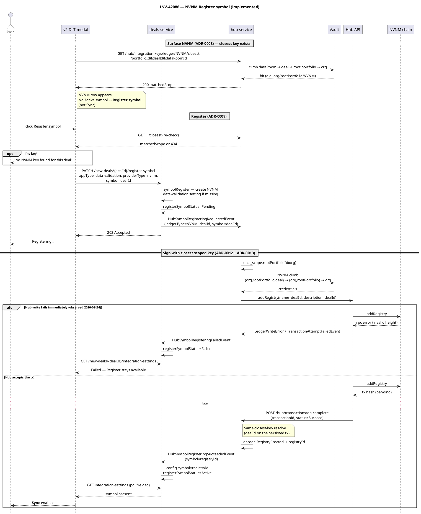

# NVNM Register And Sign — Final Flow

- **Status**: Implemented (2026-08-24). Live-verified through Hub `addRegistry`; NVNM chain then failed with an RPC height error (expected).
- **Area**: inveniam-v2 UI + deals-service + hub-service + Hub API
- **Related**: [ADR-0007](ADR-0007%20Server-Side%20Closest%20Hub%20Key%20Resolution.md), [ADR-0008](ADR-0008%20Surface%20Scoped%20NVNM%20As%20Connected%20Validation%20Service.md), [ADR-0009](ADR-0009%20In-App%20NVNM%20Register%20Symbol%20Flow.md), [ADR-0012](ADR-0012%20Path%20Seeker%20Reconstruct%20Scope%20Then%20Closest.md), [ADR-0013](ADR-0013%20Local%20Deal%20To%20Portfolio%20Projection%20For%20Scope%20Resolution.md)

What a connected-but-unregistered NVNM deal does in v2 now, from the DLT modal through Hub.

## Summary

A scoped NVNM Hub key lives in **Vault only**. It never creates a deal integration setting. v2 still needs two things before Sync can work:

1. **A resolvable key** — closest climb finds NVNM at or above the data room ([ADR-0007](ADR-0007%20Server-Side%20Closest%20Hub%20Key%20Resolution.md) / [ADR-0008](ADR-0008%20Surface%20Scoped%20NVNM%20As%20Connected%20Validation%20Service.md)). That is what shows the NVNM row and the **Register symbol** button.
2. **A per-deal anchoring registry** — NVNM `config.symbol` **is** the on-chain `registryId`. Without it, Sync fails with `symbol should not be empty`.

**Register symbol** (Phase C / [ADR-0009](ADR-0009%20In-App%20NVNM%20Register%20Symbol%20Flow.md)) is one click, NVNM-only, no form. The encoder still hardcodes `name = description = dealId`.

On click the modal re-runs closest search. If a key exists it `PATCH`es ` /new-deals/:dealId/register-symbol`. deals-service **creates the NVNM `data-validation` setting if missing**, sets Pending, and emits `HubSymbolRegisteringRequestedEvent`. HTTP **202**.

hub-service then signs that Register the same way it signs Sync ([ADR-0012](ADR-0012%20Path%20Seeker%20Reconstruct%20Scope%20Then%20Closest.md)): `dealId` → `deal_scope` root portfolio ([ADR-0013](ADR-0013%20Local%20Deal%20To%20Portfolio%20Projection%20For%20Scope%20Resolution.md)) → Vault climb `{org, rootPortfolio, deal}` → `{org, rootPortfolio}` → org. Signing does **not** use a data-room Vault rung. UI closest search **does** pass `dataRoomId` (write path still stores keys there).

Hub API `addRegistry` is the chain call.

| Outcome | What happens |
| ------- | ------------ |
| **Write fails immediately** (what we saw: `rpc error … invalid height`) | No `on-complete`. hub-service emits `HubSymbolRegisteringFailedEvent`. deals-service sets `registerSymbolStatus=Failed`. Button stays **Register symbol**. |
| **Write accepted** | Hub later `POST /hub/transactions/on-complete`. hub-service decodes `RegistryCreated` → `registryId`, emits `HubSymbolRegisteringSucceededEvent`. deals-service writes `config.symbol = registryId`, `Active`. Modal reload → **Sync**. |

Verified 2026-08-24 on deal `5b75a6e5-…`: create-if-missing + 202 + `HubSymbolRegisteringRequestedEvent` + `registerSymbol request NVNM` + Hub `addRegistry` RPC fail + `HubSymbolRegisteringFailedEvent`. Closest key was the **root portfolio** Vault path.

Standalone diagram: [NVNM Register Symbol Sequence.puml](NVNM%20Register%20Symbol%20Sequence.puml).

## Sequence

## After a successful register

Sync reuses the same Path Seeker credential resolve (`syncDocument` + `onComplete`). Documents `addRecord` into the deal's one registry (`config.symbol`).

## Still out of scope

- Deal / portfolio relocation (`deal_scope` not updated on move).
- Vault-walk fallback on a projection miss (degrades to org).
- Custom registry name/metadata.

## Related

- [INDEX](Hub%20Keys%20Everywhere%20(INV-42086)/INDEX.md)
- [IMPLEMENTATION PLAN Scoped NVNM Sign And Register](IMPLEMENTATION%20PLAN%20Scoped%20NVNM%20Sign%20And%20Register.md)
- [HOW-TO Enable DLT Validation (NVNM)](HOW-TO%20Enable%20DLT%20Validation%20(NVNM).md)
- [ADR-0009 In-App NVNM Register Symbol Flow](ADR-0009%20In-App%20NVNM%20Register%20Symbol%20Flow.md)
