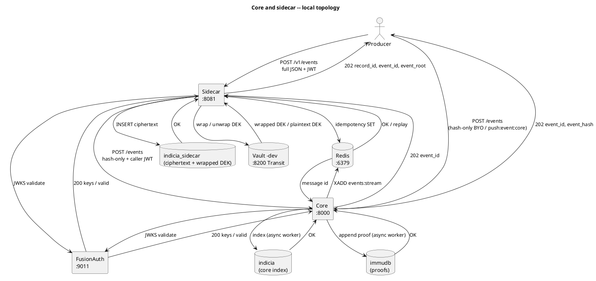
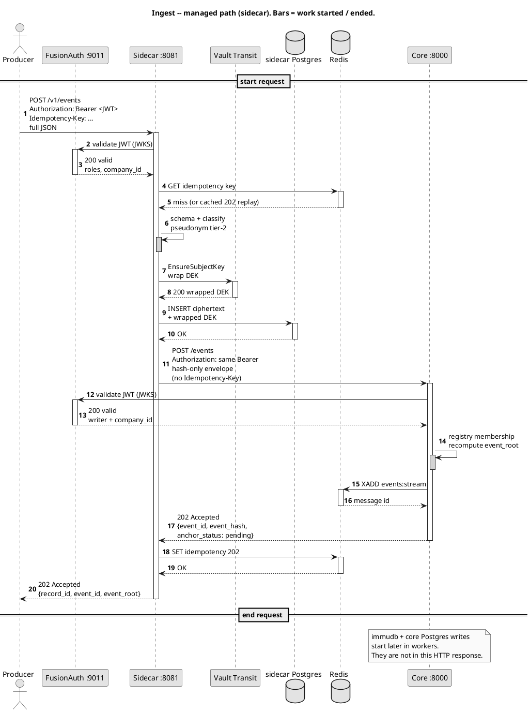
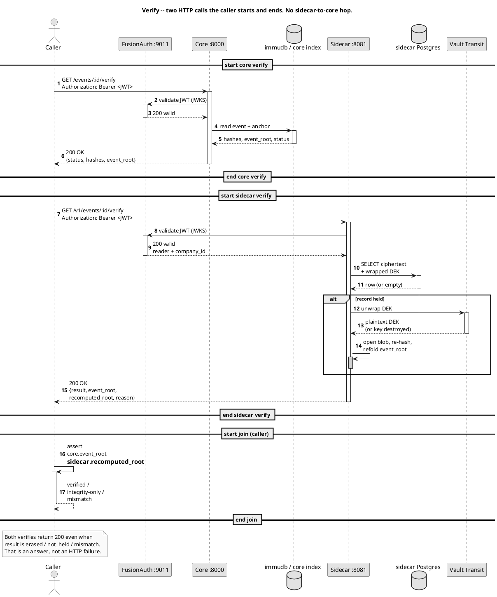

# Core and Sidecar

**Summary**: Two processes, two ports, two databases. They look independent and mostly are. The only runtime coupling on the write path is one HTTP POST of a hash-only envelope, using the caller’s FusionAuth JWT.

**Sources**: `cmd/api`; `cmd/sidecar`; `internal/sidecar/coreclient/client.go`; `internal/api/router.go`; `docs/api/ARCHITECTURE.md`; `docs/guides/ENVIRONMENT_VARIABLES.md`; local `Taskfile.yml`.

**Last updated**: 2026-09-02 (PlantUML: activations + responses)

---

Render the diagrams with the Obsidian PlantUML plugin or https://www.plantuml.com/plantuml.

## Topology

Core never calls the sidecar. Core never talks to Vault. The dashed-looking independence is real for storage; the write path is one HTTP hop.

## Local URLs

| | Core (`cmd/api`) | Sidecar (`cmd/sidecar`) |
| --- | --- | --- |
| Listen | `:8000` | `:8081` (`INDICIA_SIDECAR_LISTEN_ADDR`) |
| Health | `GET /health` | `GET /health` |
| Ingest | `POST /events` — hash-only envelope | `POST /v1/events` — full JSON |
| Verify / read | `GET /events/:id/verify` (hashes, never content) | `GET /v1/events/:id`, `…/verify` (content) |

`task push:event` hits `:8081`. `task push:event:core` hits `:8000`. How to start both: [New Developer Onboarding](New%20Developer%20Onboarding.md) §7.

## The one hop

After classify / pseudonym / seal / store, the sidecar’s `coreclient` does:

`POST {INDICIA_SIDECAR_CORE_URL}/events` → locally `http://localhost:8000/events`

It forwards the **caller’s** `Authorization` header. It does **not** mint a sidecar service token, and it does **not** forward `Idempotency-Key` (the core keys idempotency on tenant+key without hashing the body; a forwarded key would stamp the wrong event id) (source: `internal/sidecar/coreclient/client.go`).

That is the only sidecar → core call. The core never calls the sidecar. The core never talks to Vault.

This sequence stops at `202`. It does not show a second replica, a tenant destroy loop, or cache broadcast. That missing slice is [Slice 2c Tenant Offboard](Slice%202c%20Tenant%20Offboard.md) diagram 2.

## What they do not share

- **Postgres.** Core index vs sidecar **record store** (`INDICIA_SIDECAR_RECORD_STORE_DSN` must not be the core DB; Taskfile uses `indicia_sidecar`).
- **Vault.** Sidecar-only (`INDICIA_KEYVAULT_*`). Core has no `INDICIA_KEYVAULT_*` and starts without it.
- **Content.** Core never receives plaintext.

## What they share, independently

- **FusionAuth** — each process validates the same JWT (JWKS). Sharing the IdP is intended; see [BYO Producer](BYO%20Producer.md) for what that does *not* mean for a customer hasher.
- **Redis** — same local instance in the Taskfile, different jobs: core worker streams vs sidecar ingest idempotency. The sidecar **refuses to start** without `INDICIA_SIDECAR_REDIS_ADDR`.

## Verify is not a sidecar→core call

No endpoint returns `verified`. The caller hits core `/verify` and sidecar `GET /v1/events/:id/verify` and joins on `event_root` (source: D2 / `VERIFICATION_RECIPE.md`).

## Local Vault `-dev`

`task vault:up` is `vault server -dev` on `127.0.0.1:8200`, Transit enabled, token pinned to `root`, env in `.data/vault-dev.env`. It comes up **already unsealed** (not the same thing as production KMS auto-unseal). Storage is in-memory: restart wipes every Transit key. Ciphertext rows stay; they cannot be opened. Core hash-only proofs are unaffected.

Production keys Vault auto-unseals via a cloud KMS DevOps owns. Restart there keeps Transit keys (source: `KEYVAULT_KEY_STORE_STORAGE_REQUIREMENTS.md`).

## Related pages

- [New Developer Onboarding](New%20Developer%20Onboarding.md)
- [BYO Producer](BYO%20Producer.md)
- [Slice 2c Tenant Offboard](Slice%202c%20Tenant%20Offboard.md)
- [ADR-0001 Acknowledged Sidecar Cache Purge](../decisions/ADR-0001%20Acknowledged%20Sidecar%20Cache%20Purge.md)
- [TOCTOU](TOCTOU.md)
- [Open Questions](INV-42236%20-%20Inveniam%20Indicia/wiki/Open%20Questions.md)
- [Wiki Index](INV-42236%20-%20Inveniam%20Indicia/wiki/index.md)
