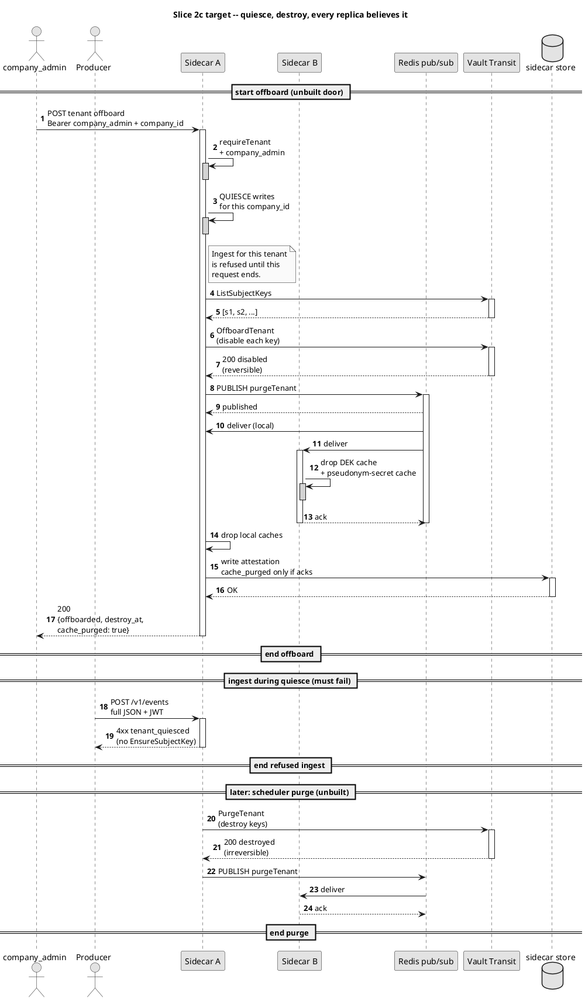
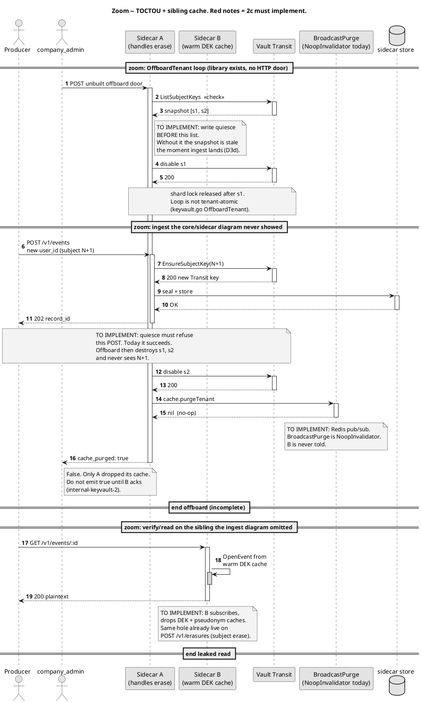

# Slice 2c Tenant Offboard

**Summary**: Launch-gating leftover after 2a/2b: whole-tenant offboard/purge plus Redis pub/sub so every sidecar replica drops cached keys. One change — do not split the HTTP door from the invalidator or from the three latent findings that become live when the first caller is wired.

**Sources**: `HANDOFF_2026-08-17_initial-import-team-onboarding.md` §4 item 2; `SEPARATION_OF_CONCERNS_SLICE_2B_RECORD_STORE.md` §3; `DECISION_SET_2026-08-10_VERIFY_ERASURE_RBAC.md` D3d and §3 item 6; `SECURITY_ASSESSMENT_2026-08-14_BACKLOG.md`; `SECURITY_ASSESSMENT_2026-08-17.md` (DATA-PROTECTION-001).

**Last updated**: 2026-09-03 (ADR-0003 Accepted)

---

The 2026-08-17 handoff lists this as launch-gating item 2. Decision-set §3 item 6 (“tenant offboard door”) is the same work, not a second ticket (source: `HANDOFF_2026-08-17_initial-import-team-onboarding.md`, `DECISION_SET_2026-08-10_VERIFY_ERASURE_RBAC.md`).

Render with the Obsidian PlantUML plugin or https://www.plantuml.com/plantuml. The ingest hop these diagrams zoom is [Core and Sidecar](Core%20and%20Sidecar.md).

## 1. Expected — how 2c should work

Whole-tenant death is one HTTP door plus a later purge. Writes for that tenant are frozen for the whole call. Vault disable/destroy is global; every sidecar replica drops DEK and pseudonym caches over Redis pub/sub. `cache_purged: true` only after the broadcast is acknowledged. Ingest during quiesce is refused, so `EnsureSubjectKey` cannot mint a leftover (source: D3d; `keyvault.go` OffboardTenant comment; `internal-keyvault-2`).

The path below is the **target**. The door itself is unbuilt (`API_SPECIFICATION.md`: whole-tenant offboard is not available).

## 2. Zoom — what the ingest diagram missed (to implement)

[Core and Sidecar](Core%20and%20Sidecar.md) ingest ends at sidecar `202`. It never shows a second replica, a tenant destroy loop, or a cache bus. Zoom into that missing slice. Today both hazards are real in code; they stay latent for **tenant** death only because nothing calls `OffboardTenant` / `PurgeTenant`. Sibling-cache is already live for **subject** erase (source: `internal-keyvault-1`, `internal-keyvault-2`, `NoopInvalidator`).

Boxes marked **TO IMPLEMENT** are 2c. Do not ship the HTTP door without them.

## What already shipped vs what 2c still owns

| Slice | What it did |
| ----- | ----------- |
| **2a** | Keyvault library: `EraseSubject`, `OffboardTenant`, `PurgeTenant`. Library only (source: `SEPARATION_OF_CONCERNS_SLICE_2A_KEYVAULT.md`). |
| **2b** (after D3) | Sidecar + **per-subject** erasure door: `POST /v1/erasures/preview`, `POST /v1/erasures`, `GET /v1/erasures` (source: Slice 2b §3 dated amendment; D3). |
| **2c** (unbuilt) | Whole-**tenant** offboard/purge HTTP door + offboard→purge scheduler + Redis pub/sub + erasure runbook (source: Slice 2b §3). |

`OffboardTenant` / `PurgeTenant` exist in `internal/keyvault/keyvault.go` and are tested. Nothing in production calls them (source: `SECURITY_ASSESSMENT_2026-08-14_BACKLOG.md`). The API spec says whole-tenant offboard is not available (source: `API_SPECIFICATION.md`).

D3d deferred the door: the methods’ own comments require tenant-wide write quiescing. Exposing them now ships a documented [TOCTOU](TOCTOU.md) as an API (source: D3d).

## Two-phase tenant death

- **Offboard** — disable keys: instant, reversible inertness (source: `SEPARATION_OF_CONCERNS_SLICE_2A_KEYVAULT.md`, `CRYPTO_SHRED_SPIKE_FINDINGS.md`).
- **Purge** — destroy keys: irreversible. A scheduler, not a single button — real HSM destruction takes days (source: spike findings §3). Unverified here: exact provider SLA in the first managed deploy.

## Why cache invalidation is the same change

Destroying a key in Vault is global. In-process caches are not.

Each sidecar replica keeps:

- **DEK cache** — unwrapped data-encryption keys. `OpenEvent` can serve plaintext from cache without a Vault round-trip (source: `internal-keyvault-2`).
- **Pseudonym-secret cache** — per-tenant HMAC key, documented as valid until process restart (source: `internal-sidecar-1`).

Today the invalidator is a `NoopInvalidator`. `BroadcastPurge` is a no-op. `EraseSubject` already ships and reports `cache_purged: true` after a **local** purge only (source: `internal-keyvault-2`).

With two replicas behind a load balancer:

1. Replica A handles `POST /v1/erasures` — Vault key gone, A’s cache cleared, attestation says purged.
2. Replica B still has the DEK warm.
3. `GET /v1/events/:id` on B returns plaintext for an “erased” subject.

That is DATA-PROTECTION-001 / `internal-keyvault-2` (source: `SECURITY_ASSESSMENT_2026-08-17.md`). It is why 2c is launch-gating even if nobody offboards a tenant: **per-subject erase is already live**.

Planned fix: Redis pub/sub so `purgeSubject` / `purgeTenant` evict every replica; do not emit `cache_purged: true` unless a broadcast was acknowledged. Until then: pin the sidecar to a single replica (source: `internal-keyvault-2`, 2026-08-17 assessment top priority 1). Whether deploy manifests actually pin replica count is unverified — the assessment said no in-repo manifest commits one.

The same pub/sub is what tenant event-type registration wants later for schema-cache invalidation (source: `TENANT_EVENT_TYPE_REGISTRATION_DESIGN.md`). 2c owns the bus; other features reuse it.

## Three latent findings — do not decouple

Unreachable is not a fix. These stay dormant only because nobody calls `OffboardTenant` / `PurgeTenant`. Wiring the door without closing them makes them live on day one (source: `SECURITY_ASSESSMENT_2026-08-14_BACKLOG.md` cross-cutting theme; handoff §4).

| ID | Gap | When it bites |
| -- | --- | ------------- |
| `internal-keyvault-1` | [TOCTOU](TOCTOU.md) in the tenant destroy loop | First production caller |
| `internal-sidecar-1` | Pseudonym-secret cache has no invalidation hook | First `PurgeTenant` caller |
| `internal-keyvault-2` | Sibling DEK cache + false `cache_purged: true` | Multi-replica + any erase (already a risk for subject erase) |

Close all three in the same change that adds the first caller. Do not ship the HTTP door, then “add pub/sub later.”

Related but already reachable (not latent): `internal-keyvault-3` / DATA-PROTECTION-002 — ingest can `EnsureSubjectKey` after a subject erase and mint a new key. Needs a durable tombstone/fence on the write path. Docs say it folds into 2c; it does **not** wait for the offboard door (source: `internal-keyvault-3`).

## One sentence

Slice 2c is: make whole-tenant death real, and make every replica believe it.

How replicas learn “forgotten”: [ADR-0003 Shared Redis Forget Set](../decisions/ADR-0003%20Shared%20Redis%20Forget%20Set.md) (**Accepted**). This feature = person graveyard + Redis set for the **existing** erase door. Company HTTP door / tenant walk is **out of this feature** ([Open Questions](INV-42236%20-%20Inveniam%20Indicia/wiki/Open%20Questions.md) #7); §3b is the later contract. Not implemented yet.

## Related pages

- [ADR-0003 Shared Redis Forget Set](../decisions/ADR-0003%20Shared%20Redis%20Forget%20Set.md)
- [ADR-0002 Forget Table Before Cache](../decisions/ADR-0002%20Forget%20Table%20Before%20Cache.md)
- [ADR-0001 Acknowledged Sidecar Cache Purge](../decisions/ADR-0001%20Acknowledged%20Sidecar%20Cache%20Purge.md)
- [New Developer Onboarding](New%20Developer%20Onboarding.md)
- [Core and Sidecar](Core%20and%20Sidecar.md)
- [BYO Producer](BYO%20Producer.md)
- [TOCTOU](TOCTOU.md)
- [Write the Person Graveyard](Write%20the%20Person%20Graveyard.md)
- [Repository Docs](Repository%20Docs.md)
- [Open Questions](INV-42236%20-%20Inveniam%20Indicia/wiki/Open%20Questions.md)
- [Wiki Index](INV-42236%20-%20Inveniam%20Indicia/wiki/index.md)
- [Decision register](../decisions/INDEX.md)
