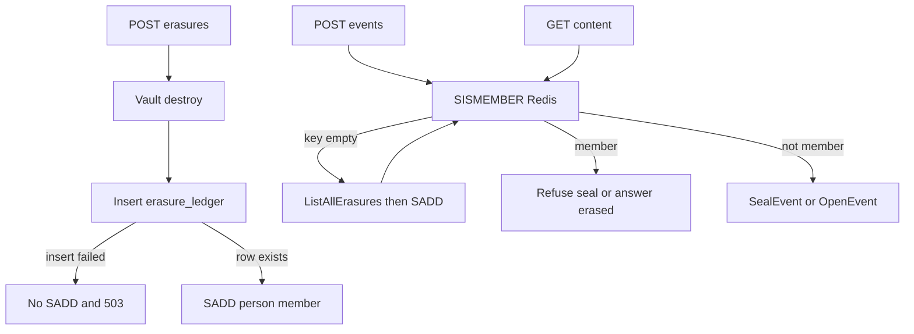

# Write the Person Graveyard

**Summary**: Tutorial + how-to for landing [ADR-0003 Shared Redis Forget Set](../decisions/ADR-0003%20Shared%20Redis%20Forget%20Set.md) on **person erase only**. Written for a programmer who is new to Go (same spirit as *Let's Go*): eleven build steps, each teaching the syntax it uses, then a complete edit, then a complete test. You write the code. No company HTTP door, no `SREM`, no per-request lock (parked: [Open Questions](Inveniam%20Indicia%20(INV-42236)/wiki/Open%20Questions.md) #5, #6, #7).

**Sources**: [ADR-0003 Shared Redis Forget Set](../decisions/ADR-0003%20Shared%20Redis%20Forget%20Set.md); sidecar doors `internal/sidecar/http/{erasure,handler,read}.go`; ledger `internal/sidecar/store/erasure.go`; `cmd/sidecar/main.go`; repo docs review 2026-09-03 (`DECISION_SET_2026-08-10_VERIFY_ERASURE_RBAC.md` D3/D5, `SECURITY_ASSESSMENT_2026-08-17.md` DP-001/DP-002, `API_SPECIFICATION.md`, `feature_summaries/IDEMPOTENCY.md`, `standards/CODING_STANDARDS.md`).

**Last updated**: 2026-09-07 (Steps 9–10 rewritten as paste-ready tutorial: stack field + full heal test; lint + exact API-spec / playbook edits.)

---

**How to read this page.** You have a programming background but little Go. This page is an implementation guide **and** a tutorial (same spirit as Alex Edwards' *Let's Go*): each step teaches the syntax it uses, then shows a complete edit, then a complete test. Read once top to bottom without typing, then keep it open and do the steps in order — every step compiles and its tests pass before you move on.

Code snippets marked `FILE:` name the exact destination and show **`import` when a new file needs it** (or name imports already in an existing file). Snippets marked *pattern only* are shapes to recognize, not blocks to paste. When stuck on a Go idiom, ask — teach, do not paste the finished sidecar.

## What you are building and why

After a person is erased (`POST /v1/erasures` — Vault key destroy + a Postgres `erasure_ledger` row), two things still go wrong today:

1. **Stale RAM (hole 1):** another sidecar replica can `OpenEvent` and hit a cached DEK — no Vault call — so old events still decrypt.
2. **Remint (hole 2):** ingest never consults the ledger, so `EnsureSubjectKey` mints a fresh key and new events for the erased person open as if they were new.

The fix (ADR-0003): **Postgres stays the durable record; a shared Redis set becomes the hot fence.** One global key `sidecar:forgotten`, same Redis the fleet already shares for idempotency. Erase adds a member; ingest and read check membership *before* touching crypto.



**Five iron rules** (every step below serves one of them; a reviewer will check all five):

1. **Write order**: Vault destroy → ledger insert → `SADD`. Never `SADD` when the insert failed.
2. **Fence before crypto**: membership check before `SealEvent` (ingest) and before `OpenEvent` (read).
3. **Union only**: nothing ever calls `SREM`, `DEL`, or replaces the key. The set only grows.
4. **Empty Redis heals from Postgres** — all tenants' rows, not just the caller's.
5. **Redis error = 503.** Never guess "not forgotten" when you could not ask.

## Already decided — do not re-litigate while coding

| Question | Answer | Details |
| --- | --- | --- |
| Code naming | Package `forget`, type `forget.Subjects`, interface `ForgetSet`, methods `MarkForgotten` / `IsForgotten`. "Graveyard" is vault prose only, never code | Step 1 |
| Heal scope | One global key; heal hydrates ALL rows via new `ListAllErasures` | Step 0, Step 2; [Open Questions](Inveniam%20Indicia%20(INV-42236)/wiki/Open%20Questions.md) #8 |
| Erased-subject ingest response | `410 Gone` + error code `subject_erased`, refusal logged at `Warn` | Step 6 |
| "Erasure survives re-appearance" (D3) conflict | Interim permanent ban accepted; exit is the un-forget follow-up | [JIRA Tasks](JIRA%20Tasks.md) Task 1; [findings](ADR-0003%20Landing%20Review%20Findings.md) Finding 2 |
| `cache_purged` field | Deprecated — do not touch it in this change | [JIRA Tasks](JIRA%20Tasks.md) Task 2 |
| Locking (R2), company door, `SREM` | All out of scope | "Out of this work" below |

## Go primer — four habits you will use in every step

Read these once; the steps assume them.

**1. `context.Context` is always the first parameter.** Every cancellable call in this repo looks like `Do(ctx, ...)`. The HTTP request's deadline lives on `c.Request.Context()`; pass that same `ctx` down into Redis and Postgres so that when the client hangs up, they stop too. Never store a `ctx` in a struct field — it is per-call, not per-process. **Gin gotcha:** `*gin.Context` (the `c` in every handler) technically satisfies `context.Context`, so the compiler will let you pass `c` itself into Redis. Don't — the repo convention is `ctx := c.Request.Context()` at the top of the handler; grep the handlers, every one starts that way. (You will not need `context.WithTimeout` in this change; the HTTP server already bounds the request.)

**2. `error` is the last return value, and it is data, not an exception.** Convention: success values first, `error` last — `(row, inserted, err)`. There is no `try/catch`; every call site decides. Wrap errors on the way up so the chain of *what was being attempted* is preserved:

```go
// Pattern only — this shape appears in every method you write.
// Needs: import "fmt"
if err != nil {
    return fmt.Errorf("forget set mark %s: %w", member, err)
}
```

`%w` (not `%v`) keeps the typed cause so a caller can still ask `errors.Is(err, something)`; `%v` flattens it to text. Division of labor: **wrap** where you know what you were doing (inside the `forget` package), **check** with `errors.Is` where a decision is made (the handler picking a status code). In this feature the handlers only need "error or not" — any forget-set error is a 503 — so you will wrap a lot and check little. That asymmetry is normal.

**3. Interfaces are implicit and belong to the consumer.** Go has no `implements` keyword — if a type has the methods, it *is* the interface. Two consequences that will feel backwards if you come from Java/C#:

- The interface is declared **next to the code that consumes it**, not next to the implementation. The repo already does this: `ErasureStore` lives in `internal/sidecar/http/erasure.go` — the HTTP door that needs it — and the Postgres store satisfies it without ever mentioning it.
- "Declare the interface first, then implement" is **not** a rule here. The concrete type can exist before any interface names its behavior — `*store.Store` has had `ListErasures` for months with no interface announcing it. The compiler checks the match where the two meet (an assignment), not at declaration. This is why the build order below is legal: you write the whole `forget` package in Steps 1–3 before its consumer interface `ForgetSet` exists in Step 4.

Companion idiom: **accept interfaces, return structs** — constructors return the concrete type (`*forget.Subjects`); consumers declare the narrow interface they need.

**4. Use pointer receivers, on every method.** `func (s *Subjects) IsForgotten(...)` — the `(s *Subjects)` is the receiver, Go's "this". A value receiver would copy the struct on every call, and — the real trap — if *any* method has a pointer receiver, only `*Subjects` (not `Subjects`) satisfies interfaces. Make them all pointer receivers and stop thinking about it.

## The change at a glance

Application path: `/Users/valeriyilihmetov/work/inveniam/trace-chain/InveniamIndicia`. Verified against the repo 2026-09-03 — the MOD test-file list is every file that constructs `sidecarhttp.Deps`, found with one grep.

```text
NEW  internal/sidecar/forget/forget.go              Steps 1–2  Subjects + New + member helper + Hydrator
NEW  internal/sidecar/forget/forget_test.go         Step 3     table tests + fake Redis
NEW  internal/sidecar/http/forget_stub_test.go      Steps 4, 6 nopForget; forgottenForget / errorForget

MOD  internal/sidecar/store/erasure.go              Step 0     + ListAllErasures (new query only)
MOD  internal/sidecar/store/erasure_test.go         Step 0     + ListAllErasures test (multi-tenant)
MOD  internal/sidecar/http/handler.go               Steps 4, 6 + ForgetSet interface + Deps.Forget; CreateEvent fence
MOD  internal/sidecar/http/erasure.go               Step 5     MarkForgotten after insert (incl. re-POST)
MOD  internal/sidecar/http/read.go                  Step 7     IsForgotten before OpenEvent
MOD  cmd/sidecar/main.go                            Step 8     wire forget.New(redisClient, store)
MOD  tests/integration/sidecar_fulldata_test.go     Step 9     cross-replica erase→read/ingest + flush-then-heal

MOD  internal/sidecar/http/erasure_test.go          Step 5     recording fake: MarkForgotten called / not / re-POST
MOD  internal/sidecar/http/handler_test.go          Steps 4, 6 no-op fake; forgotten subject never reaches SealEvent
MOD  internal/sidecar/http/read_test.go             Steps 4, 7 no-op fake; forgotten subject never reaches OpenEvent
MOD  internal/sidecar/http/validation_test.go       Step 4     no-op fake only — must compile, nothing to assert
MOD  internal/sidecar/router_test.go                Step 4     no-op fake only — must compile, nothing to assert

DEL  (none — append-only feature: no file removed, no schema change, no existing query touched)
```

You are **not** changing Vault, the DEK cache, `internal/keyvault/`, or the core API. There is **no SQL migration** (Step 0 explains why). If you find yourself editing a file outside this list, stop and re-read "Out of this work."

---

## Step 0 — `ListAllErasures`: a warm-up query, and how Go reads SQL rows

**Files**: `internal/sidecar/store/erasure.go`, `internal/sidecar/store/erasure_test.go`.

**Careful which `erasure.go` you open** — there are two, and that is normal Go (identity is the package path, not the filename): `internal/sidecar/**store**/erasure.go` is the SQL and is where you work in this step; `internal/sidecar/**http**/erasure.go` is the HTTP door and its `ErasureStore` interface, touched later in Step 5.

**What**: a new store method that returns *every* ledger row, all tenants. The heal in Step 2 needs it (the why is told there — short version: the Redis key is global, so a per-company hydrate would poison the heal for every other tenant). Copy the existing `ListErasures`, drop the `WHERE company_id = $1`, rename. Same file.

**The Go here — the standard database row loop.** Open the existing `ListErasures` in the same file first — you are copying its loop, not inventing one. Then add **this** method below it. Every name is accounted for: `s` is the method receiver, Go's "this" — a `*Store` holding the pgx connection pool; `q` is the SQL as a `const` *inside* the function (legal in Go, and idiomatic when only one function uses it); `Erasure` is the row struct already declared at the top of the same file. Three edits versus `ListErasures`: new name, no `companyID` parameter, no `WHERE` / `$1`. The loop has **three separate error points** that beginners merge into one:

```go
// FILE: internal/sidecar/store/erasure.go — add this NEW method below ListErasures.
// Copy the existing loop; do not change ListErasures itself.
// Imports already in this file (do not add them again): context, fmt.
func (s *Store) ListAllErasures(ctx context.Context) ([]Erasure, error) {
	const q = `
		SELECT company_id, subject_pseudonym, destroyed_at, completion_by, cache_purged
		  FROM erasure_ledger
		 ORDER BY destroyed_at DESC, subject_pseudonym`
	rows, err := s.pool.Query(ctx, q)               // 1. the query itself failed
	if err != nil {
		return nil, fmt.Errorf("list all erasure ledger: %w", err)
	}
	defer rows.Close()                              // always — frees the connection

	out := make([]Erasure, 0)
	for rows.Next() {                               // advances; false at end OR on error
		var e Erasure
		if err := rows.Scan(
			&e.CompanyID, &e.SubjectPseudonym, &e.DestroyedAt, &e.CompletionBy, &e.CachePurged,
		); err != nil {
			return nil, fmt.Errorf("scan erasure ledger row: %w", err) // 2. one row unreadable
		}
		out = append(out, e)
	}
	if err := rows.Err(); err != nil {              // 3. the loop stopped early
		return nil, fmt.Errorf("iterate erasure ledger: %w", err)
	}
	return out, nil
}
```

The trap is #3: `rows.Next()` returns `false` both at the natural end **and** when the connection died mid-iteration. Skip the `rows.Err()` check and a network blip silently truncates the result — the heal would `SADD` half the rows and report success. The existing method checks it; keep the check in your copy. (`Scan` takes **pointers** — `&e.CompanyID` — because it writes into your variables; forgetting the `&` is a compile error, so the compiler has your back there.)

**Why no SQL migration.** The only table involved, `erasure_ledger`, already shipped (`internal/sidecar/store/migrations/002_create_erasure_ledger.up.sql`); this is a new *query*, not new schema, and it needs no new index — the heal reads the whole small table, no filter, no ordering. The Redis set is not schema either: the first `SADD` creates the key. For later reference: Indicia has **two** migration systems — `cmd/migrate` runs the core API's (`internal/storage/postgres/migrations`, tracking table `indicia_schema_migrations`), while the record store owns `internal/sidecar/store/migrations/*.up.sql`, embedded into the binary with `//go:embed` and applied automatically at sidecar boot (`store.RunMigrations`, tracking table `sidecar_schema_migrations`). A sidecar schema change = a new numbered `.up.sql` there, never `cmd/migrate`. (`//go:embed` is a compiler directive that bakes files into the binary at build time — that is why the sidecar migrates itself with no SQL files on disk.)

**Test.** The existing `TestListErasures_TenantScopedNewestFirst` already seeds `acme` *and* `globex`, then asserts `ListErasures(ctx, "acme")` returns only acme. Your new test uses the same helpers and the same two-tenant seed — and asserts the opposite: both rows come back. That is the heal contract.

Open `internal/sidecar/store/erasure_test.go` (same directory as `erasure.go`). Two Go facts before you paste:

- The file starts with `//go:build integration`. That is a **build tag**: `go test ./...` without `-tags=integration` **does not compile this file**. Docker must be running (testcontainers starts Postgres).
- The package is `store_test`, not `store`. That is an **external test package** — you can only call exported names (`ListAllErasures`, `newErasure` is in the same `_test` package so it is visible). You do not put this test in a new file.

Helpers already in the file (do not rewrite them): `newErasureStore(t)` = real store + empty ledger; `newErasure(company, subject, at)` = one row DTO.

```go
// FILE: internal/sidecar/store/erasure_test.go — add below TestListErasures_EmptyLedgerIsEmptyNotNil.
// Imports already in this file: context, testing, time, store. No new import.
func TestListAllErasures_ReturnsEveryTenant(t *testing.T) {
	s := newErasureStore(t)
	ctx := context.Background()
	base := time.Date(2026, 8, 1, 12, 0, 0, 0, time.UTC)

	if _, _, err := s.InsertErasureIfAbsent(ctx, newErasure("acme", "alice", base)); err != nil {
		t.Fatalf("insert acme: %v", err)
	}
	if _, _, err := s.InsertErasureIfAbsent(ctx, newErasure("globex", "bob", base.Add(time.Hour))); err != nil {
		t.Fatalf("insert globex: %v", err)
	}

	rows, err := s.ListAllErasures(ctx)
	if err != nil {
		t.Fatalf("ListAllErasures: %v", err)
	}
	if len(rows) != 2 {
		t.Fatalf("listed %d rows, want 2 (heal must see every tenant)", len(rows))
	}

	got := map[string]string{}
	for _, r := range rows {
		got[r.CompanyID] = r.SubjectPseudonym
	}
	if got["acme"] != "alice" || got["globex"] != "bob" {
		t.Fatalf("got %v, want acme/alice and globex/bob", got)
	}
}
```

The `map` assertion ignores order on purpose: heal does not care about newest-first, only that **every tenant is present**. `ListErasures` still owns the ordering contract.

**Done when**: Docker is up and this is green:

```text
go test -tags=integration -count=1 -run TestListAllErasures -timeout=5m ./internal/sidecar/store/
```

Plain `go test ./internal/sidecar/store/...` will look green while skipping this file — that is the build-tag trap.

**Colima (this machine, 2026-09-04).** `docker` talks to Colima via its CLI *context*; testcontainers does **not** — it looks at `DOCKER_HOST` / `/var/run/docker.sock`. Without the vars below you get `rootless Docker not found`, then (after setting only `DOCKER_HOST`) Ryuk fails to mount the Mac socket path into the VM. Export all three, then re-run:

```text
export DOCKER_HOST=unix://$HOME/.colima/default/docker.sock
export TESTCONTAINERS_DOCKER_SOCKET_OVERRIDE=/var/run/docker.sock
export TESTCONTAINERS_HOST_OVERRIDE=127.0.0.1
```

Verified: with these, `TestListAllErasures` is green. Put them in `~/.zshrc` if you do not want to export them every shell.

## Step 1 — the `forget` package: skeleton

**File**: `internal/sidecar/forget/forget.go` (new directory, new package).

**Naming first, because you type it a hundred times.** The vault keeps the *graveyard* metaphor; the **code never says it** — in a GDPR-erasure feature that auditors read, it lands as gallows humor, and the codebase already has a vocabulary (ADR-0003 says "forget set"; the Redis key is `sidecar:forgotten`; the table is `erasure_ledger`). Package + type are read **together**: `forget.Subjects` names **what the members are** (decided 2026-09-07 — `Set` was too generic, a Redis/CS noun). The HTTP door still says `ForgetSet` — that is the *capability*; the concrete type is allowed to be more specific. `forget.ForgetSet` would stutter (the stdlib says `strings.Reader`, not `strings.StringReader`).

What goes in the skeleton — you write all of it. **The file starts with package + imports** (this is the picture the later snippets assume):

```go
// FILE: internal/sidecar/forget/forget.go — first lines of the new file.
package forget

import (
    "context"
    "fmt"

    "github.com/redis/go-redis/v9"

    "github.com/inveniamcapital/InveniamIndicia/internal/sidecar/store"
)
```

| Import | Why |
| --- | --- |
| `context` | first param on every method (`ctx context.Context`) |
| `fmt` | `fmt.Errorf` wraps (primer #2) |
| `github.com/redis/go-redis/v9` | `*redis.Client` — **not** `internal/storage/redis` |
| `internal/sidecar/store` | `store.Erasure` on `Hydrator`, and `*store.Store` in the guard |

Go groups stdlib, then a blank line, then everything else. `testing` is **not** here — that belongs in `forget_test.go` (Step 3).

- **The key constant.** One Redis key for the whole fleet (ADR-0003). Lowercase name = package-private (only `forget` can see it — that is why Step 3’s tests use `package forget`, not `forget_test`). `const` is a compile-time name for a fixed value; it is not a variable and not a function.

```go
// FILE: internal/sidecar/forget/forget.go — after the import block above.
const forgottenKey = "sidecar:forgotten"
```

This is the identifier Step 2’s `IsForgotten` already uses (`s.rdb.SCard(ctx, forgottenKey)`). If the compiler says `forgottenKey` is undefined, this line is missing.
- **The member helper.** A member string is `company_id` + `subject_pseudonym` with a separator — **mandatory**, or `acme`+`alice` and `ac`+`mealice` collide. The test ledger already uses `company|pseudonym`; reuse that shape (`acme|hmac-hex`). Keep it an unexported `func member(company, subject string) string`. Members *without* a `|` are reserved for the future tenant door — this feature never writes one ([Open Questions](Inveniam%20Indicia%20(INV-42236)/wiki/Open%20Questions.md) #7).
- **The `Subjects` struct and constructor.** This is the concrete type methods will hang on — `func (s *Subjects)` is not a free function; it is a method on `*Subjects`, so `type Subjects struct` must exist first. Fields: the Redis client and the hydrator. Constructor `New(...) *Subjects` returns the concrete pointer — "accept interfaces, return structs" (primer #3). No `context.Context` field (primer #1).

```go
// FILE: internal/sidecar/forget/forget.go — after forgottenKey.
// *redis.Client is go-redis (imported above). Do not import internal/storage/redis:
// that wrapper has Client() to unwrap to go-redis; the sidecar never constructs it.
type Subjects struct {
    rdb    *redis.Client
    ledger Hydrator
}

func New(rdb *redis.Client, ledger Hydrator) *Subjects {
    return &Subjects{rdb: rdb, ledger: ledger}
}
```

Step 3 **will** change this field (and `New`'s first parameter) to `redisSet` so tests can pass a fake. Leave `*redis.Client` until then — the skeleton still compiles.

- **The `Hydrator` interface and its guard**:

```go
// FILE: internal/sidecar/forget/forget.go — uses context + store from the import block above.
type Hydrator interface {
    ListAllErasures(ctx context.Context) ([]store.Erasure, error)
}

var _ Hydrator = (*store.Store)(nil) // the store must feed the heal
```

`Hydrator` is the consumer-side interface rule (primer #3) applied by *you*: the `forget` package consumes the store, needs exactly one verb, and says so. Your tests hand it a three-line fake instead of a Postgres pool. Do **not** widen the HTTP door's `ErasureStore` with `ListAllErasures` — the doors have no business listing every tenant's forgotten subjects; only this package hydrates.

The `var _` line is the **compile-time guard** idiom: "a nil `*store.Store`, assigned to a throwaway `Hydrator` variable." It compiles to nothing, but if the method signature ever drifts, the compiler points at this line instead of a confusing call-site error. (Declaration order within a package is irrelevant to the compiler — the guard works anywhere — but files should read top-down for humans: declaration, then guard, then methods.)

**Done when**: `go build ./...` passes with the skeleton in place.

## Step 2 — the two methods: `MarkForgotten` and `IsForgotten`

**File**: `internal/sidecar/forget/forget.go`, continuing.

**The Go here — go-redis returns command objects.** A go-redis call does not return your value directly; it returns a command object (`*redis.IntCmd`, `*redis.BoolCmd`, …) carrying both value and error, and you finish with one of two methods:

```go
// Pattern only — the shape of every Redis call in this package.
// rdb is *redis.Client from github.com/redis/go-redis/v9 (Step 1 import).
err := rdb.SAdd(ctx, key, member).Err()               // only care whether it worked
yes, err := rdb.SIsMember(ctx, key, member).Result()  // care about the answer too
```

Your complete Redis vocabulary for this feature, and the forbidden family:

| Command | Go (go-redis v9.21) | When |
| --- | --- | --- |
| `SADD` | `rdb.SAdd(ctx, key, member).Err()` | `MarkForgotten`; heal |
| `SISMEMBER` | `rdb.SIsMember(ctx, key, member).Result()` → `(bool, error)` | `IsForgotten`, after any heal |
| `SCARD` | `rdb.SCard(ctx, key).Result()` → `(int64, error)` | "is the set empty?" → heal trigger |
| `SREM` / `DEL` / `SET` the key | **never** | iron rule 3 — the set only grows |

`SADD` of an existing member is a no-op — that is why two replicas healing at once is safe (union, not last-write-wins). `SAdd` is variadic (`SAdd(ctx, key, m1, m2, m3)`), which the heal loop can exploit.

**Gotcha that shapes the whole design: a missing key is not an error.** Redis treats an absent key as an empty set — `SCARD` answers `0, nil`, `SISMEMBER` answers `false, nil`. You will never see `redis.Nil` from these three commands (that sentinel belongs to `GET`-style lookups). So "Redis was just flushed" and "nobody has ever been forgotten" are **indistinguishable**, and that is exactly why the heal exists. When `err != nil` here it means Redis itself is unreachable — the 503 path, never a silent "not forgotten" (iron rule 5).

**`MarkForgotten`** is the short one. Write it **above** `IsForgotten` in the same file. `ForgetSet` (Step 4) requires this method; without it, Step 8's `Deps{Forget: forget.New(...)}` will not compile (`*forget.Subjects does not implement sidecarhttp.ForgetSet (missing method MarkForgotten)`).

```go
// FILE: internal/sidecar/forget/forget.go — next to IsForgotten.
// Imports already in this file: context, fmt. Names from Step 1: s.rdb, forgottenKey, member.
func (s *Subjects) MarkForgotten(ctx context.Context, company, subject string) error {
	if err := s.rdb.SAdd(ctx, forgottenKey, member(company, subject)).Err(); err != nil {
		return fmt.Errorf("forget set mark %s: %w", member(company, subject), err)
	}
	return nil
}
```

`.Err()` on the command object: you only care whether Redis accepted the write, not how many members were added. `SADD` of an existing member is a no-op (returns `0, nil`) — re-POST is therefore safe. Wrap with `%w` so the caller can still see the Redis error. Parameter names (`company` vs `companyID`) do not have to match the interface; the types and the method name do.

**`IsForgotten` carries the heal.** Why the heal must pull **every** tenant (found in review, would have been a production bug): the key is global. If the heal hydrated only the requesting company, then after a flush company A's first request heals A's rows — the set becomes non-empty — and company B's request sees `SCARD > 0` and **never heals**. B's forgotten people stay missing indefinitely; both holes reopen, and the warm-cache path never touches the Postgres fallback (it only fires on unwrap *failure*). Hence `ListAllErasures`, and hence the decision recorded in [Open Questions](Inveniam%20Indicia%20(INV-42236)/wiki/Open%20Questions.md) #8: one plain global set, full hydrate, revisit only if the forget-list ever grows big.

```go
// FILE: internal/sidecar/forget/forget.go — the heart of the package.
// Shape, not finished code — the error messages and the SAdd batching are yours.
// Imports already in this file (Step 1): context, fmt, go-redis, store.
// Names from Step 1: s.rdb, s.ledger, forgottenKey, member(...).
func (s *Subjects) IsForgotten(ctx context.Context, company, subject string) (bool, error) {
    n, err := s.rdb.SCard(ctx, forgottenKey).Result()
    if err != nil {
        return false, fmt.Errorf("forget set scard: %w", err)
    }

    if n == 0 {
        rows, err := s.ledger.ListAllErasures(ctx) // every tenant, not just the caller
        if err != nil {
            return false, fmt.Errorf("forget set heal: %w", err)
        }
        for _, row := range rows {
            if err := s.rdb.SAdd(ctx, forgottenKey, member(row.CompanyID, row.SubjectPseudonym)).Err(); err != nil {
                return false, fmt.Errorf("forget set heal sadd: %w", err)
            }
        }
        // Do not SREM anything. Union only.
        // Exercise: SAdd is variadic — can you build one []interface{} of all
        // members and do this in a single round trip?
    }

    return s.rdb.SIsMember(ctx, forgottenKey, member(company, subject)).Result()
}
```

Notes on the shape: the last line returns `SIsMember(...).Result()` directly because its `(bool, error)` already matches the signature — leaving that error unwrapped is a defensible exception, and wrapping it like the others is never wrong if a reviewer asks. If Redis is down: error, 503, no fall-through to crypto. If the heal's Postgres read fails: same. Two round trips (`SCARD` + `SISMEMBER`) per request is fine for the first PR; go-redis pipelining can fold them later.

**Done when**: `go build ./...` passes. Tests are the next step.

## Step 3 — table tests for the `forget` package

**Files**: `internal/sidecar/forget/forget.go` (one type change), `internal/sidecar/forget/forget_test.go` (new).

A `*redis.Client` cannot be faked — it is a concrete struct. This step **edits the Step 1 types in place** (you already have `Subjects` and `New`). Add `redisSet` next to `Hydrator`, then change two names from `*redis.Client` to `redisSet`. `*redis.Client` already has these three methods, so `main.go` still passes the real client. If `SRem` is not on the interface, production code cannot call it.

**`interface`, not `struct`.** A struct holds fields (`rdb redisSet`). An interface holds method signatures (`SAdd(...)`). `type redisSet struct { SAdd(...) }` is a syntax error (`expected ')', found context`) — that was the trap.

```go
// FILE: internal/sidecar/forget/forget.go — EDIT the Step 1 block; do not add a second Subjects.
//
// Before (Step 1):
//   type Subjects struct { rdb *redis.Client; ledger Hydrator }
//   func New(rdb *redis.Client, ledger Hydrator) *Subjects
//
// After (this step):

type redisSet interface { // interface — a contract, not a bag of fields
	SAdd(ctx context.Context, key string, members ...interface{}) *redis.IntCmd
	SIsMember(ctx context.Context, key string, member interface{}) *redis.BoolCmd
	SCard(ctx context.Context, key string) *redis.IntCmd
}

var _ redisSet = (*redis.Client)(nil)

type Subjects struct {
	rdb    redisSet // was *redis.Client — interface by value, not *redisSet
	ledger Hydrator
}

func New(rdb redisSet, ledger Hydrator) *Subjects { // was *redis.Client
	return &Subjects{rdb: rdb, ledger: ledger}
}
```

**The Go here — one table, many cases.** Fakes live in the test file. `redis.NewIntCmd` / `NewBoolCmd` + `SetVal` / `SetErr` build the same command objects go-redis returns, without a server.

```go
// FILE: internal/sidecar/forget/forget_test.go — same package as forget.go
// (not forget_test: you want the unexported member helper and forgottenKey).
package forget

import (
	"context"
	"errors"
	"fmt"
	"testing"

	"github.com/redis/go-redis/v9"

	"github.com/inveniamcapital/InveniamIndicia/internal/sidecar/store"
)

type fakeRedis struct {
	members map[string]bool
	err     error
}

func newFakeRedis(members ...string) *fakeRedis {
	m := make(map[string]bool)
	for _, mem := range members {
		m[mem] = true
	}
	return &fakeRedis{members: m}
}

func (f *fakeRedis) SAdd(_ context.Context, _ string, members ...interface{}) *redis.IntCmd {
	cmd := redis.NewIntCmd(context.Background())
	if f.err != nil {
		cmd.SetErr(f.err)
		return cmd
	}
	var added int64
	for _, raw := range members {
		s, ok := raw.(string) // two-result form: errcheck forbids raw.(string)
		if !ok {
			cmd.SetErr(fmt.Errorf("member is %T, want string", raw))
			return cmd
		}
		if !f.members[s] {
			f.members[s] = true
			added++
		}
	}
	cmd.SetVal(added)
	return cmd
}

func (f *fakeRedis) SIsMember(_ context.Context, _ string, member interface{}) *redis.BoolCmd {
	cmd := redis.NewBoolCmd(context.Background())
	if f.err != nil {
		cmd.SetErr(f.err)
		return cmd
	}
	s, ok := member.(string)
	if !ok {
		cmd.SetErr(fmt.Errorf("member is %T, want string", member))
		return cmd
	}
	cmd.SetVal(f.members[s])
	return cmd
}

func (f *fakeRedis) SCard(_ context.Context, _ string) *redis.IntCmd {
	cmd := redis.NewIntCmd(context.Background())
	if f.err != nil {
		cmd.SetErr(f.err)
		return cmd
	}
	cmd.SetVal(int64(len(f.members)))
	return cmd
}

type fakeLedger struct {
	rows []store.Erasure
	err  error
}

func (f fakeLedger) ListAllErasures(context.Context) ([]store.Erasure, error) {
	if f.err != nil {
		return nil, f.err
	}
	return f.rows, nil
}

func TestIsForgotten(t *testing.T) {
	ctx := context.Background()
	tests := []struct {
		name        string
		members     []string
		ledger      []store.Erasure
		ledgerErr   error
		redisErr    error
		company     string
		subject     string
		want        bool
		wantErr     bool
		alsoCompany string
		alsoSubject string
		alsoWant    bool
	}{
		{
			name:    "hit without heal",
			members: []string{"acme|alice"},
			company: "acme",
			subject: "alice",
			want:    true,
		},
		{
			name:    "miss without heal",
			members: []string{"acme|alice"},
			company: "acme",
			subject: "bob",
			want:    false,
		},
		{
			name:    "empty redis heals from ledger",
			ledger:  []store.Erasure{{CompanyID: "acme", SubjectPseudonym: "alice"}},
			company: "acme",
			subject: "alice",
			want:    true,
		},
		{
			name:    "empty everywhere is not forgotten",
			company: "acme",
			subject: "nobody",
			want:    false,
		},
		{
			name: "heal restores every tenant not just the caller",
			ledger: []store.Erasure{
				{CompanyID: "acme", SubjectPseudonym: "alice"},
				{CompanyID: "globex", SubjectPseudonym: "bob"},
			},
			company:     "acme",
			subject:     "alice",
			want:        true,
			alsoCompany: "globex",
			alsoSubject: "bob",
			alsoWant:    true,
		},
		{
			name:      "heal error",
			ledgerErr: errors.New("pg down"),
			company:   "acme",
			subject:   "alice",
			wantErr:   true,
		},
		{
			name:     "redis error",
			redisErr: errors.New("redis down"),
			company:  "acme",
			subject:  "alice",
			wantErr:  true,
		},
	}

	for _, tt := range tests {
		t.Run(tt.name, func(t *testing.T) {
			rdb := newFakeRedis(tt.members...)
			rdb.err = tt.redisErr
			s := New(rdb, fakeLedger{rows: tt.ledger, err: tt.ledgerErr})

			got, err := s.IsForgotten(ctx, tt.company, tt.subject)
			if tt.wantErr {
				if err == nil {
					t.Fatal("expected error")
				}
				return
			}
			if err != nil {
				t.Fatalf("IsForgotten: %v", err)
			}
			if got != tt.want {
				t.Fatalf("IsForgotten(%s, %s) = %v, want %v", tt.company, tt.subject, got, tt.want)
			}
			if tt.alsoCompany == "" {
				return
			}
			// Second ask after heal: SCARD is no longer 0, so this must already
			// be in Redis. If heal only copied the first tenant, this fails.
			got, err = s.IsForgotten(ctx, tt.alsoCompany, tt.alsoSubject)
			if err != nil {
				t.Fatalf("second IsForgotten: %v", err)
			}
			if got != tt.alsoWant {
				t.Fatalf("IsForgotten(%s, %s) = %v, want %v (heal missed a tenant)",
					tt.alsoCompany, tt.alsoSubject, got, tt.alsoWant)
			}
		})
	}
}
```

`t.Run` gives each case a name in `go test -v`, and `go test -run 'TestIsForgotten/empty_redis' ./internal/sidecar/forget/` runs exactly one case while you iterate.

`New(rdb, …)` accepts `*fakeRedis` only after `New`'s first parameter is `redisSet`. If it is still `*redis.Client`, this file will not compile — that is the signal to make the interface change above. `*redis.Client` remains a valid argument at the `main.go` call site.

Three fake-writing gotchas:

- **Initialize the map.** `type fakeRedis struct{ members map[string]bool }` panics on write if nobody ran `make(map[string]bool)` — a nil map reads fine (`m["x"]` is `false`) but **assignment panics**, and the panic surfaces inside `MarkForgotten`, nowhere near the real bug. Give the fake a constructor (`newFakeRedis()`), exactly like `newErasureLedger()` in the existing tests.
- **No `tt := tt`.** Older tutorials re-declare the loop variable before `t.Run` because closures used to share it. Since Go 1.22 each iteration gets a fresh variable — this repo is on 1.26 — and the linter flags the cargo-cult copy as pointless.
- **Fake behavior, not bookkeeping.** The fake Redis should *behave* like a set (add, ask, count), so the heal test asserts what `IsForgotten` *answers*, not which internal calls happened in what order. Call-recording is right in exactly one place — Step 5's erasure-handler test — because there the call itself is the contract.

**Done when**: `go test ./internal/sidecar/forget/` is green.

## Step 4 — `ForgetSet` and `Deps`: connect the package to the doors

**Files**: `internal/sidecar/http/handler.go` (interface + field), then test fakes (below).

Now — and only now — the HTTP package declares what it needs. This is the same consumer-side rule as `Hydrator`, on the other side of the door.

```go
// FILE: internal/sidecar/http/handler.go — right above the Deps struct.
// Imports already in this file: context. No new import.
type ForgetSet interface {
	MarkForgotten(ctx context.Context, companyID, subject string) error
	IsForgotten(ctx context.Context, companyID, subject string) (bool, error)
}
```

Add **one field** to the existing `Deps` struct (do not replace the struct):

```go
// FILE: internal/sidecar/http/handler.go — inside type Deps struct, with the other collaborators.
Forget ForgetSet
```

`(bool, error)` is three states: `true` = forgotten; `false, nil` = not forgotten; `false, err` = *could not ask*. Handlers treat the third as 503 (iron rule 5).

No `var _ ForgetSet` here. The check happens in Step 8: `Deps{Forget: forget.New(...)}`. You built `*forget.Subjects` in Steps 1–3; the door names the interface only now.

### Why tests do **not** fail to compile

The old “compile fence” line was wrong. In Go, a composite literal does **not** have to set every field:

```go
sidecarhttp.Deps{Logger: zerolog.Nop(), MaxBodyBytes: 1 << 20}
```

still compiles after you add `Forget`. The missing field is the **zero value**. For an interface that is `nil`.

`nil` is fine **until something calls a method on it**. Step 4 does not call `IsForgotten` / `MarkForgotten` yet, so `go test ./internal/sidecar/...` stays green with `Forget: nil`.

Steps 5–7 **will** call those methods. A nil interface then **panics** (`invalid memory address`). Put the no-op in now so those steps do not explode.

### The no-op fake — “nobody is forgotten”

Same idea as `fakeLedger`, smaller: both methods succeed and `IsForgotten` returns `false`. Existing ingest/read tests keep today’s meaning.

The four files under `internal/sidecar/http/*_test.go` are all `package sidecarhttp_test`. A type in **any one** of them is visible to the others. Define it once:

```go
// FILE: internal/sidecar/http/forget_stub_test.go — new file, same package as the other http tests.
package sidecarhttp_test

import "context"

// nopForget is the Step 4 stand-in: nobody is forgotten, writes succeed.
// Steps 5–7 replace this with a recording fake where the call itself is the contract.
type nopForget struct{}

func (nopForget) MarkForgotten(context.Context, string, string) error { return nil }

func (nopForget) IsForgotten(context.Context, string, string) (bool, error) {
	return false, nil
}
```

Then add one line to **every** `Deps{...}` in those tests (grep `NewHandler` — today there are two in `handler_test.go`, one in `erasure_test.go`, three in `read_test.go`, one in `validation_test.go`):

```go
h := sidecarhttp.NewHandler(sidecarhttp.Deps{
	// ... existing fields unchanged ...
	Forget: nopForget{},
})
```

`router_test.go` is `package sidecar_test` — it **cannot** see `nopForget`. Those tests only check auth gates and never call `Forget`, so leaving the field nil there is OK. If a linter later complains, copy the three-line type into that file.

**Done when**: `go test ./internal/sidecar/...` is green (same behavior as before). You have not changed erase/ingest/read logic yet.

## Step 5 — the erase door: `MarkForgotten` after the row

You will **edit existing functions**, not start a new package. Open `internal/sidecar/http/erasure.go` — that is the HTTP door. `internal/sidecar/store/erasure.go` is the Postgres store you already finished in Step 0.

**What you will learn**

- `h.deps.Forget` — `h` is the handler, `deps` is the `Deps` struct, `Forget` is the `ForgetSet` field from Step 4. A method call on an interface looks like a method call on a struct: `h.deps.Forget.MarkForgotten(...)`.
- `inserted` is the `bool` from `InsertErasureIfAbsent`. `false` is **not** a failure — it is a re-POST (the row was already there).
- Early `return` after `c.JSON(...)`. Gin does **not** stop the function when you write a response. If you omit `return`, the handler keeps running and you send a second body.
- A **recording fake**: unlike `nopForget`, this one remembers that it was called. Pointer receiver so `append` mutates the same struct the test still holds.

**Why this edit**

Iron rule 1: Vault destroy → ledger insert → `SADD`. `MarkForgotten` **is** the `SADD`. Call it only after a successful insert — including `inserted == false`. The crash window is “row exists, Redis member not yet.” Re-POST is how that window closes.

Three failure rules:

- Insert **fails** (`err != nil`) → keep today's 503 `attestation_failed`. Do **not** call `MarkForgotten` (never a Redis member without a row).
- `MarkForgotten` fails after the row exists → 503 is honest. Do **not** roll back Postgres (nothing deletes ledger rows). The caller re-POSTs and the `SADD` is retried.
- Leave `PreviewErasure` and `GET /v1/erasures` untouched.

### The production edit

In `EraseSubject`, after a successful `InsertErasureIfAbsent` and **before** `alreadyErased := !inserted`. Imports already in this file: `net/http`. `ctx` is already `c.Request.Context()` at the top of the handler. No new import.

The existing block ends like this. If the `Message` is still the long ledger-only sentence, switch it to `msgAttestationIncomplete` (add that const next to `msgLedgerUnreadable` in `handler.go` first). Both crash windows after a successful destroy share one HTTP body so a caller cannot tell which store missed. The **log** on the new block still names `SADD` — that is for operators; it must not be copied into `Message`.

```go
// FILE: internal/sidecar/http/handler.go — inside the existing const (...) block
// next to msgLedgerUnreadable.
	msgAttestationIncomplete = "the subject key was destroyed but attestation is incomplete; retry this request"
```

```go
// FILE: internal/sidecar/http/erasure.go — existing code, for orientation only.
	if err != nil {
		// ... attestation_failed ...
		c.JSON(http.StatusServiceUnavailable, errorResponse{
			Error:   "attestation_failed",
			Message: msgAttestationIncomplete,
		})
		return
	}

	alreadyErased := !inserted   // <-- your new call goes ABOVE this line
```

Insert:

```go
// FILE: internal/sidecar/http/erasure.go — inside EraseSubject,
// immediately AFTER the insert-error return, BEFORE alreadyErased := !inserted.
	if err := h.deps.Forget.MarkForgotten(ctx, companyID, subject); err != nil {
		h.deps.Logger.Error().Err(err).
			Str("company_id", companyID).
			Str("subject_pseudonym", subject).
			Msg("erasure ledger row written but forget set SADD failed; re-POST to finish the fence")
		c.JSON(http.StatusServiceUnavailable, errorResponse{
			Error:   "attestation_failed",
			Message: msgAttestationIncomplete,
		})
		return
	}
```

Go notes on that block:

- The log names `SADD` on purpose (operators). The HTTP `Message` is `msgAttestationIncomplete` — same body as the ledger-write 503, no Redis command.
- `if err := ...; err != nil` declares a **new** `err` that lives only inside the `if`. It does not overwrite the `err` from the insert. Same short-statement `if` you used in `IsForgotten`.
- `.Err(err).Str(...).Msg(...)` is zerolog's builder: each call returns the event so you can chain. `Msg` emits the line.
- `subject` here is already the **pseudonym** (`resolveErasureSubject` ran first). Never log `rawUserID`.

### The test — a recording fake

`nopForget` always succeeds and records nothing. For this step the **call itself** is the contract, so you need a different type. Same package (`sidecarhttp_test`), so put it in `erasure_test.go` or next to `nopForget`.

```go
// FILE: internal/sidecar/http/erasure_test.go — same package sidecarhttp_test.
// Imports already in this file: context. No new import.
type recordingForget struct {
	marks   []string // "company|subject", one per MarkForgotten
	markErr error
}

func (f *recordingForget) MarkForgotten(_ context.Context, company, subject string) error {
	if f.markErr != nil {
		return f.markErr
	}
	f.marks = append(f.marks, company+"|"+subject)
	return nil
}

func (f *recordingForget) IsForgotten(context.Context, string, string) (bool, error) {
	return false, nil
}
```

Pointer receiver `(f *recordingForget)`: `append` must change the struct the test still holds. A value receiver would copy `f`, append on the copy, and the test would see an empty `marks`. Same lesson as `fakeRedis`.

`newErasureFixture` today does **not** set `Forget` (zero value `nil`). The moment `EraseSubject` calls `MarkForgotten`, every erase test **panics**. Wire the recorder into the fixture — that is also how tests inspect `marks`.

```go
// FILE: internal/sidecar/http/erasure_test.go — edit in place.

type erasureFixture struct {
	router  *gin.Engine
	ledger  *erasureLedger
	eraser  *countingEraser
	logs    *bytes.Buffer
	subject string
	forget  *recordingForget // add this
}

// inside newErasureFixture, before NewHandler:
	fg := &recordingForget{}
	h := sidecarhttp.NewHandler(sidecarhttp.Deps{
		// ... existing fields unchanged ...
		Forget: fg,
	})
	// ...
	return &erasureFixture{router: r, ledger: ledger, eraser: eraser, logs: logs, subject: subject, forget: fg}
```

`Forget: fg` — `fg` is `*recordingForget`. That implements `ForgetSet` because both methods exist. You pass the **pointer**, not `recordingForget{}`.

### What you are asserting

`f.forget` is the same `*recordingForget` you put on the fixture. Every time the handler calls `MarkForgotten`, the fake appends one string to `f.forget.marks`. After the HTTP call, you look at that slice the same way the existing tests already look at `f.eraser.calls` and `f.ledger.rows`.

```go
// Pattern only — same shape as `if f.eraser.calls != 2` already in this file.
if len(f.forget.marks) != 1 {
    t.Fatalf("MarkForgotten calls = %d, want 1: %v", len(f.forget.marks), f.forget.marks)
}
```

`len(slice)` is the number of elements. `marks[0]` is the first element. There is no `.length`.

You do **not** write four new `func Test...` functions. Open the four erase tests that already exist (they sit together under the `// Erase` comment). At the **end of each function**, before its closing `}`, paste the block below. Leave every existing assertion in place.

### 1. Happy path — `TestEraseSubject_ShredsAndAttests`

This test already POSTs once and checks the 200 + ledger row. After those checks, also require **one** `MarkForgotten` for company `acme` and the fixture's pseudonym.

Paste at the end of the function (after the `CachePurged` check):

```go
// FILE: internal/sidecar/http/erasure_test.go — end of TestEraseSubject_ShredsAndAttests.
	if len(f.forget.marks) != 1 {
		t.Fatalf("MarkForgotten calls = %d, want 1: %v", len(f.forget.marks), f.forget.marks)
	}
	want := "acme|" + f.subject
	if f.forget.marks[0] != want {
		t.Fatalf("MarkForgotten member = %q, want %q", f.forget.marks[0], want)
	}
```

`f.subject` is already computed by the fixture (the pseudonym for `"acme"` + `rawUserID`). Do not write `"alice"` or `rawUserID` here.

### 2. Re-POST — `TestEraseSubject_RePostIsIdempotentAndKeepsTheOriginalAttestation`

This test already POSTs **twice**. Iron rule 1 says `MarkForgotten` runs on both (the second POST is how a crashed `SADD` gets retried). After the existing `len(f.ledger.rows) != 1` check:

```go
// FILE: internal/sidecar/http/erasure_test.go — end of
// TestEraseSubject_RePostIsIdempotentAndKeepsTheOriginalAttestation.
	if len(f.forget.marks) != 2 {
		t.Fatalf("MarkForgotten calls = %d, want 2 (re-POST must retry SADD): %v",
			len(f.forget.marks), f.forget.marks)
	}
```

Two HTTP POSTs → two appends. The ledger still has **one** row (already asserted). Redis is allowed to see the member twice; `SADD` of an existing member is a no-op.

### 3. Insert failed — `TestEraseSubject_LedgerWriteFailureIsRecoverableByRePost`

This test does **two** POSTs in one function:

1. `f.ledger.insertErr` is set → first POST is 503. The handler must **not** reach `MarkForgotten` (no row → no SADD).
2. Then it clears `insertErr` and POSTs again → 200. That second POST **does** call `MarkForgotten`.

So you need **two** checks, in two places — not one check at the end.

**After the first POST's 503 / `attestation_failed` assertions**, before `f.ledger.insertErr = nil`:

```go
// FILE: internal/sidecar/http/erasure_test.go — after the first POST fails.
	if len(f.forget.marks) != 0 {
		t.Fatalf("MarkForgotten ran even though the ledger insert failed: %v", f.forget.marks)
	}
```

**At the end of the function**, after the recovery POST succeeds:

```go
	if len(f.forget.marks) != 1 {
		t.Fatalf("MarkForgotten calls after recovery = %d, want 1: %v",
			len(f.forget.marks), f.forget.marks)
	}
```

### 4. Vault failed — `TestEraseSubject_ShredFailureWritesNoLedgerRow`

This test sets `f.eraser.err` so Vault destroy fails. The handler returns 503 `erasure_failed` **before** insert, so it never reaches `MarkForgotten`. After the existing `len(f.ledger.rows) != 0` check:

```go
// FILE: internal/sidecar/http/erasure_test.go — end of TestEraseSubject_ShredFailureWritesNoLedgerRow.
	if len(f.forget.marks) != 0 {
		t.Fatalf("MarkForgotten ran after a failed shred: %v", f.forget.marks)
	}
```

### 5. Optional new test — Redis down after the row exists

This one **is** a new function. The four above have no case for “insert succeeded, `MarkForgotten` returned an error.” Add it under the other erase tests. `errors` is already imported in this file.

```go
// FILE: internal/sidecar/http/erasure_test.go — new function, next to the other TestEraseSubject_*.
func TestEraseSubject_MarkForgottenFailureKeepsTheLedgerRow(t *testing.T) {
	f := newErasureFixture(t)
	f.forget.markErr = errors.New("redis down")

	code, body := f.do(t, http.MethodPost, "/v1/erasures", erasureRequestBody)
	if code != http.StatusServiceUnavailable {
		t.Fatalf("status = %d, want 503: %v", code, body)
	}
	if body["error"] != "attestation_failed" {
		t.Fatalf("error = %v, want attestation_failed", body["error"])
	}
	if len(f.ledger.rows) != 1 {
		t.Fatalf("ledger rows = %d, want 1 (do not roll back Postgres when SADD fails)", len(f.ledger.rows))
	}
}
```

`markErr` is the field on `recordingForget`: when it is set, `MarkForgotten` returns that error and does **not** append. The handler must still leave the ledger row (nothing deletes `erasure_ledger` rows).

**Done when**:

```text
go test ./internal/sidecar/http/ -count=1 -run Erase
```

is green. Then run without `-run` once: Preview and List tests must still pass — you did not edit those handlers.

---

## Step 6 — the ingest fence: check before `SealEvent`

**File**: `internal/sidecar/http/handler.go`, function `CreateEvent`.

**What you will learn**

- Where to insert: after you have `companyID` and `subject` (the `pseudonymize` block), **before** `SealEvent`. Check earlier and you do not have the pseudonym. Check later and you have already minted a key (hole 2).
- `http.StatusGone` is the constant `410`. Do not write the number `410` — this file uses `http.Status*` everywhere.
- A new `const` next to `codeUnauthorized`. This repo keeps error **codes** as named constants so a typo cannot silently break a client that matches on the string.
- `Warn` vs `Error` on the logger: a refused ingest is expected (someone tried to write an erased person). A Redis outage is an operator problem (`Error` + 503).
- `funlen`: golangci-lint counts **statements** per function (cap 50). After the inline fence, extract it into a helper that returns `ok bool` — this file already does that for `decodeRequest` / `buildEnvelope`.

**The three outcomes**

| `IsForgotten` returns | What you do |
| --- | --- |
| `true, nil` | Do **not** call `SealEvent`. `410` + `subject_erased`. Log `Warn` with `company_id` + `subject_pseudonym` only. |
| `false, nil` | Fall through — today's seal / store path. |
| `_, err` | `503`, same family as `seal_failed`. Never treat this as “not forgotten.” |

Why 410 (decided — do not reopen): the read door already uses 410 for this subject; 410 means “gone, likely permanent”; 403 is taken by tenant mismatch (`forbidden`).

**Policy note for the PR description, not for code.** Decision set D3 said “erasure survives re-appearance.” Until un-forget ships, ingest is a permanent ban. Exit: [JIRA Tasks](JIRA%20Tasks.md) Task 1. Evidence: [findings](ADR-0003%20Landing%20Review%20Findings.md) Finding 2.

### Constants

```go
// FILE: internal/sidecar/http/handler.go — inside the existing const (...) block
// next to codeUnauthorized. Imports already in this file: net/http. No new import.
	codeSubjectErased = "subject_erased"
	msgSubjectErased  = "this subject was erased; ingest is refused until an explicit un-forget; " +
		"anchored proofs are unaffected"
```

`+` at the end of a line joins string literals. The newline is only for reading; the value is one string. Same trick as `msgKeyBackendUnavailable` two lines below in this file.

### The production edit

```go
// FILE: internal/sidecar/http/handler.go — inside CreateEvent,
// AFTER the pseudonymize block (you now have companyID and subject)
// and BEFORE recordID := uuid.NewString() / SealEvent.

	forgotten, err := h.deps.Forget.IsForgotten(ctx, companyID, subject)
	if err != nil {
		h.deps.Logger.Error().Err(err).Str("company_id", companyID).
			Msg("forget set lookup failed; refusing ingest")
		c.JSON(http.StatusServiceUnavailable, errorResponse{
			Error: "seal_failed", Message: "content could not be sealed",
		})
		return
	}
	if forgotten {
		h.deps.Logger.Warn().
			Str("company_id", companyID).
			Str("subject_pseudonym", subject).
			Msg("refused ingest for erased subject")
		c.JSON(http.StatusGone, errorResponse{
			Error:   codeSubjectErased,
			Message: msgSubjectErased,
		})
		return
	}
```

`forgotten, err :=` — two results, like `IsForgotten` in Step 2. Check `err` **first**. If you write `if forgotten` first, a failed lookup (`false, err`) looks like “not forgotten” and remint returns (iron rule 5).

Reusing the existing `"seal_failed"` code for the Redis-down path keeps the ingest error table small. Task 3's API spec can document “503 `seal_failed` also covers forget-set unavailability.” Do not invent a third 503 code on this door unless you also update the spec in the same PR.

### Then extract — `funlen` will fail if you leave it inline

`.golangci.yml` caps a function at **50 statements** (`funlen`). A statement is an assignment, an `if`, a `return`, a call — not a line of comments. `CreateEvent` was already near that cap. The fence above adds about ten statements, so lint reports:

```text
handler.go: Function 'CreateEvent' has too many statements (56 > 50) (funlen)
```

Do **not** add `//nolint:funlen`. This file already keeps `CreateEvent` short by moving “I wrote the HTTP response; stop” work into helpers: `decodeRequest`, `validate`, `buildEnvelope`, `forwardToCore`. Each returns `ok bool`. `false` means the helper already answered the client.

Move the fence into the same shape. In `CreateEvent`, replace the whole `forgotten, err := ...` block with:

```go
// FILE: internal/sidecar/http/handler.go — inside CreateEvent, same place
// (after pseudonymize, before recordID := uuid.NewString()).
	if !h.refuseForgottenIngest(c, companyID, subject) {
		return
	}
```

That is **two** statements. Put the old body on a new method next to `buildEnvelope`:

```go
// FILE: internal/sidecar/http/handler.go — new method, after CreateEvent
// (or next to buildEnvelope). No new import.

// refuseForgottenIngest is the ingest fence: IsForgotten before SealEvent.
// It writes 410 or 503 itself; ok reports whether ingest may proceed.
func (h *Handler) refuseForgottenIngest(c *gin.Context, companyID, subject string) (ok bool) {
	forgotten, err := h.deps.Forget.IsForgotten(c.Request.Context(), companyID, subject)
	if err != nil {
		h.deps.Logger.Error().Err(err).Str("company_id", companyID).
			Msg("forget set lookup failed; refusing ingest")
		c.JSON(http.StatusServiceUnavailable, errorResponse{
			Error: "seal_failed", Message: "content could not be sealed",
		})
		return false
	}
	if forgotten {
		h.deps.Logger.Warn().
			Str("company_id", companyID).
			Str("subject_pseudonym", subject).
			Msg("refused ingest for erased subject")
		c.JSON(http.StatusGone, errorResponse{
			Error:   codeSubjectErased,
			Message: msgSubjectErased,
		})
		return false
	}
	return true
}
```

Go notes:

- Named result `(ok bool)` — same as `decodeRequest`. `return false` means “I already wrote the body.” `return true` means “not forgotten, keep going.”
- `c.Request.Context()` lives **inside** the helper. `forwardToCore` does the same. Do not pass `*gin.Context` into Redis; pass the request context.
- `funlen` counts **per function**. Moving statements into `refuseForgottenIngest` makes `CreateEvent` legal again. The helper itself is well under 50.
- Tests do not change. They still POST to `CreateEvent`. The helper is an unexported method on `Handler`; the external test package never names it.

`gocognit` (complexity 20) is a second lint on this file. The extract usually keeps you under that too, because each `if err` / `if forgotten` now lives in the helper.

### The test — three small edits, then two new functions

`nopForget` always answers `false, nil` (“nobody is forgotten”). The existing 202 tests must keep using it. You need two more stand-ins (same package, so any `*_test.go` can see them):

| Type | `IsForgotten` returns | Use |
| --- | --- | --- |
| `nopForget{}` | `false, nil` | every existing 202 test — already wired |
| `forgottenForget{}` | `true, nil` | new test: ingest must 410 |
| `errorForget{err: ...}` | `false, err` | new test: ingest must 503 |

If you have not added the last two types yet, paste them next to `nopForget`:

```go
// FILE: internal/sidecar/http/forget_stub_test.go — add next to nopForget.
// import "context" is already in this file.
type forgottenForget struct{}

func (forgottenForget) MarkForgotten(context.Context, string, string) error { return nil }

func (forgottenForget) IsForgotten(context.Context, string, string) (bool, error) {
	return true, nil
}

type errorForget struct{ err error }

func (errorForget) MarkForgotten(context.Context, string, string) error { return nil }

func (f errorForget) IsForgotten(context.Context, string, string) (bool, error) {
	return false, f.err
}
```

`errorForget` is a struct with a field. `errorForget{err: errors.New("redis down")}` sets that field. `IsForgotten` then returns it. Value receiver is fine: nothing is appended.

#### 1. Let the ingest helper take a `ForgetSet`

`newTestHandlerWithLogger` currently hard-codes `Forget: nopForget{}`. You cannot pass `forgottenForget{}` until that line is a parameter.

**Change the signature** — one new argument at the end:

```go
// FILE: internal/sidecar/http/handler_test.go — replace the existing
// newTestHandler / newTestHandlerWithLogger pair.

func newTestHandler(t *testing.T, poster sidecarhttp.CorePoster) (*gin.Engine, *recordingStore) {
	t.Helper()
	return newTestHandlerWithLogger(t, poster, zerolog.Nop(), nopForget{})
}

func newTestHandlerWithLogger(
	t *testing.T,
	poster sidecarhttp.CorePoster,
	logger zerolog.Logger,
	forget sidecarhttp.ForgetSet,
) (*gin.Engine, *recordingStore) {
	t.Helper()
	gin.SetMode(gin.TestMode)

	st := newRecordingStore()
	kv := keyvault.New(kms.NewFake())
	registry := testRegistry(t)
	h := sidecarhttp.NewHandler(sidecarhttp.Deps{
		Store:         st,
		Keyvault:      kv,
		Pseudonymizer: pseudonym.New(kv, st),
		Classifier:    testClassifier(t, registry),
		Core:          poster,
		Logger:        logger,
		MaxBodyBytes:  1 << 20,
		EventTypes:    registry,
		Forget:        forget, // was nopForget{}
	})

	r := gin.New()
	r.POST("/v1/events", func(c *gin.Context) {
		c.Set("company_id", "acme")
		c.Set("bearer_token", "Bearer tok")
		h.CreateEvent(c)
	})
	return r, st
}
```

`sidecarhttp.ForgetSet` is the interface from Step 4. `nopForget`, `forgottenForget`, and `errorForget` all implement it, so any of them is a legal last argument.

`newTestHandler` still passes `nopForget{}`. Every existing `TestCreateEvent_*` calls `newTestHandler`, so they keep today's meaning. You do **not** edit those test bodies.

**One other call site.** Grep `newTestHandlerWithLogger` — `validation_test.go` calls it once. Add the fourth argument:

```go
// FILE: internal/sidecar/http/validation_test.go — TestValidation_WarnsOncePerUnknownFieldPair
	r, _ := newTestHandlerWithLogger(t, poster, logger, nopForget{})
```

Without that line the test file will not compile (`not enough arguments`).

#### 2. Forgotten subject — new function

Copy the **shape** of `TestCreateEvent_HappyPathStoresThenAccepts` (same POST, same `validEventBody`). Differences: last argument is `forgottenForget{}`, expected status is 410, store stays empty.

Paste **below** `TestCreateEvent_HappyPathStoresThenAccepts`. `json` and `httptest` are already imported in this file.

```go
// FILE: internal/sidecar/http/handler_test.go — new function.
func TestCreateEvent_ForgottenSubjectIsGone(t *testing.T) {
	poster := &fakeCorePoster{stored: coreclient.StoredEvent{EventID: "evt-1"}}
	r, st := newTestHandlerWithLogger(t, poster, zerolog.Nop(), forgottenForget{})

	w := httptest.NewRecorder()
	req := httptest.NewRequest(http.MethodPost, "/v1/events", bytes.NewReader(validEventBody()))
	r.ServeHTTP(w, req)

	if w.Code != http.StatusGone {
		t.Fatalf("status = %d, want 410: %s", w.Code, w.Body.String())
	}
	var body map[string]any
	if err := json.Unmarshal(w.Body.Bytes(), &body); err != nil {
		t.Fatalf("response is not JSON: %v", err)
	}
	if body["error"] != "subject_erased" {
		t.Fatalf("error = %v, want subject_erased", body["error"])
	}
	if len(st.rows) != 0 {
		t.Fatalf("sealed a forgotten subject: %d rows (SealEvent must not run)", len(st.rows))
	}
}
```

`st.rows` is the map `recordingStore` fills in `InsertPending`. Empty map → `SealEvent` / insert never ran. That is hole 2 closed.

`http.StatusGone` is `410`. `map[string]any` is how this package already decodes JSON in the erasure tests; `body["error"]` is the `"error"` field.

#### 3. Redis down — new function

Same POST. `errorForget` makes `IsForgotten` return an error. Iron rule 5: that is 503, not “not forgotten.”

```go
// FILE: internal/sidecar/http/handler_test.go — new function, next to the one above.
func TestCreateEvent_ForgetSetErrorIs503(t *testing.T) {
	poster := &fakeCorePoster{stored: coreclient.StoredEvent{EventID: "evt-1"}}
	r, st := newTestHandlerWithLogger(t, poster, zerolog.Nop(), errorForget{err: errors.New("redis down")})

	w := httptest.NewRecorder()
	req := httptest.NewRequest(http.MethodPost, "/v1/events", bytes.NewReader(validEventBody()))
	r.ServeHTTP(w, req)

	if w.Code != http.StatusServiceUnavailable {
		t.Fatalf("status = %d, want 503: %s", w.Code, w.Body.String())
	}
	if len(st.rows) != 0 {
		t.Fatalf("sealed when the forget set was unreachable: %d rows", len(st.rows))
	}
}
```

`errors` is already imported in `handler_test.go`. `errorForget{err: errors.New("redis down")}` is a composite literal: type, then field name, then value.

**Done when**:

```text
go test ./internal/sidecar/http/ -count=1
```

Not only `-run CreateEvent`. `read_test.go` **ingests an event** to build its fixture. That POST now goes through `refuseForgottenIngest`. If `Forget` is still missing there, you get this panic:

```text
panic: runtime error: invalid memory address or nil pointer dereference
    refuseForgottenIngest ... handler.go
    CreateEvent ... handler.go
    newReadFixture ... read_test.go:84
    TestVerifyEvent_IntactContentMatches
```

Line 253 is `h.deps.Forget.IsForgotten(...)`. A nil interface has no methods. Step 4 said this would happen the first time a door actually calls `Forget`.

#### 4. Wire `nopForget` on the read fixture (and any leftover ingest `Deps`)

Two `NewHandler` literals in `read_test.go` have no `Forget` field. Add the same line you already put on `newTestHandlerWithLogger`:

```go
// FILE: internal/sidecar/http/read_test.go — inside newReadFixture's Deps{...}
		EventTypes:    registry,
		Forget:        nopForget{},
```

```go
// FILE: internal/sidecar/http/read_test.go — inside setOpener's Deps{...}
		EventTypes:    registry,
		Forget:        nopForget{},
```

`setOpener` rebuilds the handler after ingest. Leave `Forget` off that second literal and the next GET/verify that hits a future read-fence will panic the same way.

Grep `NewHandler` once more. Any `Deps` that can reach `CreateEvent` or (later) `resolveContent` needs a `Forget`. Today that is also:

```go
// FILE: internal/sidecar/http/validation_test.go — TestValidation_FailsClosedWithoutARegistry
		Forget: nopForget{},
```

`TestReadAndVerify_RejectATenantlessContext` builds a tiny `Deps` and never gets past the empty-`company_id` check, so it will not panic yet. Add `Forget: nopForget{}` there too if you want every literal complete.

After those lines, `TestVerifyEvent_IntactContentMatches` should pass again — the fixture ingest is a 202, same as before Step 6.

---

## Step 7 — the read fence: check before `OpenEvent`

**File**: `internal/sidecar/http/read.go`, function `resolveContent`.

**What you will learn**

- Named results: `func (...) (res resolution, ok bool)`. `return notHeld(), true` fills those names. `ok == false` means “I already wrote the HTTP error.” `ok == true` means “here is a verdict.”
- You will **not** delete `resolveUnopenable`. Redis is the fast fence; the ledger is still the meaning of an unwrap failure (row exists, `SADD` not yet).
- No lock around the check (R2 is accepted).
- `read_test.go` already has `setOpener` — a helper that rebuilds the handler after ingest. You will need the same idea for `Forget`, because the fixture **ingests first**. Default both `newReadFixture` and `setOpener` to `nopForget{}` (Step 6, section 4) so setup still 202s. If you put `forgottenForget` on the fixture from the start, Step 6's fence would 410 the setup POST.

**Where**

After `record.CompanyID != companyID` (the tenant-oracle guard) and **before** `OpenEvent`. Skipping `OpenEvent` is what stops the warm DEK cache (hole 1).

### The production edit

Copy the erased **message** from `resolveUnopenable` — do not invent a second wording.

```go
// FILE: internal/sidecar/http/read.go — inside resolveContent,
// AFTER the companyID mismatch returns notHeld(),
// BEFORE plaintext, err := h.deps.Opener.OpenEvent(...).
// Imports already in this file: context (ctx is already declared). No new import.

	forgotten, err := h.deps.Forget.IsForgotten(ctx, record.CompanyID, record.SubjectPseudonym)
	if err != nil {
		h.deps.Logger.Error().Err(err).Str("record_id", recordID).
			Msg("content read: forget set lookup failed")
		c.JSON(http.StatusServiceUnavailable, errorResponse{
			Error: codeStoreFailed, Message: "the record store could not be read",
		})
		return resolution{}, false
	}
	if forgotten {
		return resolution{
			result: VerifyErased,
			record: record,
			message: "This subject was erased: its key is destroyed and the stored ciphertext is permanently unreadable. " +
				"The anchored proof is unaffected — absence after erasure is not a verification failure.",
		}, true
	}
```

`return resolution{}, false` — empty struct literal plus `ok == false`. The caller sees “handler already answered.”

`return ..., true` — a verdict. `GetEvent` will serialize this as today's 410 `erased`; `VerifyEvent` as `result: "erased"`. Same as `TestVerifyEvent_ErasedSubjectResolvesThroughTheLedger`.

Use `record.CompanyID` and `record.SubjectPseudonym`, not the request's raw `user_id`. The record already holds the tenant-scoped pair.

### The test — ingest first, then swap `Forget`

`newReadFixture` POSTs `/v1/events` to create a real record (so verify can re-hash it). That POST goes through Step 6's fence. If the fixture's `Forget` is `forgottenForget{}`, setup returns 410 and the fixture fatals (`fixture ingest failed`).

So the sequence is:

1. `newReadFixture(t)` — ingest with `nopForget{}` (you already added that in Step 6).
2. Rebuild the handler with `forgottenForget{}` **and** a counting opener.
3. GET / verify the **same** `f.recordID`.

You do **not** call `EraseSubject`. You do **not** insert a ledger row. `TestVerifyEvent_ErasedSubjectResolvesThroughTheLedger` already covers that path. This test is “Redis alone says forgotten, so never call `OpenEvent`.”

Do **not** edit the existing erased test.

#### 1. A spy that counts `OpenEvent`

Same idea as `countingEraser` in `erasure_test.go`: wrap the real fake keyvault, increment a counter, then forward. Pointer receiver so the test still sees `n`.

If this type is not already in `read_test.go`, paste it above `setOpener`:

```go
// FILE: internal/sidecar/http/read_test.go — same package sidecarhttp_test.
// Imports already in this file: context.
type countingOpener struct {
	inner sidecarhttp.Opener
	n     int
}

func (o *countingOpener) OpenEvent(ctx context.Context, tenantID, subjectID, eventID string, ct, wdek []byte) ([]byte, error) {
	o.n++
	return o.inner.OpenEvent(ctx, tenantID, subjectID, eventID, ct, wdek)
}
```

`sidecarhttp.Opener` is the interface in `read.go`. `f.kv` implements it. After a forgotten read, `o.n` must stay `0`. If the fence is missing, `n` becomes `1` and the test fails — that is the hole-1 proof.

#### 2. A rebuild helper — copy `setOpener`, do not change it

`setOpener` is used by two existing tests (`unavailableOpener`, `brokenOpener`). Leave its signature alone. Paste a sibling next to it that also takes a `ForgetSet`:

```go
// FILE: internal/sidecar/http/read_test.go — next to setOpener.
// Rebuilds GET/verify only (ingest already happened). Same Deps as setOpener
// except Forget and Opener are parameters.
func (f *readFixture) setForget(t *testing.T, forget sidecarhttp.ForgetSet, opener sidecarhttp.Opener) {
	t.Helper()

	registry := testRegistry(t)

	h := sidecarhttp.NewHandler(sidecarhttp.Deps{
		Store:         f.store,
		ErasureStore:  f.ledger,
		Keyvault:      f.kv,
		Opener:        opener,
		Eraser:        f.kv,
		Pseudonymizer: pseudonym.New(f.kv, f.store),
		Classifier:    testClassifier(t, registry),
		Core:          &fakeCorePoster{stored: coreclient.StoredEvent{EventID: "evt-1"}},
		Logger:        zerolog.New(f.logs),
		MaxBodyBytes:  1 << 20,
		EventTypes:    registry,
		Forget:        forget,
	})

	r := gin.New()
	tenant := func(c *gin.Context) {
		c.Set("company_id", "acme")
		c.Set("bearer_token", "Bearer tok")
	}
	r.GET("/v1/events/:id", tenant, h.GetEvent)
	r.GET("/v1/events/:id/verify", tenant, h.VerifyEvent)
	f.router = r
}
```

`(f *readFixture)` — pointer receiver, same as `setOpener`, because `f.router = r` must change the fixture the test holds.

`f.verify` / `f.read` already exist. They hit `f.router`. After `setForget`, those helpers talk to the new handler.

#### 3. Forgotten subject — new function

Paste under the `// erased` comment, **below** `TestVerifyEvent_ErasedSubjectResolvesThroughTheLedger`. Copy that test's assertions. The setup is different: no shred, no ledger row.

```go
// FILE: internal/sidecar/http/read_test.go — new function.
func TestVerifyEvent_ForgottenSubjectIsErasedWithoutOpening(t *testing.T) {
	f := newReadFixture(t)

	opener := &countingOpener{inner: f.kv}
	f.setForget(t, forgottenForget{}, opener)

	code, body := f.verify(t)
	if code != http.StatusOK {
		t.Fatalf("status = %d, want 200: %v", code, body)
	}
	if body["result"] != "erased" {
		t.Fatalf("result = %v, want erased", body["result"])
	}
	if body["reason"] != nil {
		t.Fatalf("reason = %v, want absent — an erasure is not an alarm", body["reason"])
	}
	if body["event_root"] != f.root {
		t.Fatalf("event_root = %v, want %s (erasure does not remove the proof)", body["event_root"], f.root)
	}

	code, body = f.read(t)
	if code != http.StatusGone {
		t.Fatalf("read status = %d, want 410 Gone: %v", code, body)
	}
	if body["error"] != "erased" {
		t.Fatalf("read error = %v, want erased", body["error"])
	}

	if opener.n != 0 {
		t.Fatalf("OpenEvent called %d times, want 0 (warm DEK cache must not be hit)", opener.n)
	}
}
```

Walkthrough:

- `newReadFixture` — live ciphertext, key still in the fake vault, empty ledger, `Forget` is `nopForget`.
- `opener := &countingOpener{inner: f.kv}` — `&` because the receiver is `*countingOpener`. `inner: f.kv` is the same opener the fixture used to seal.
- `f.setForget(t, forgottenForget{}, opener)` — next GET/verify see “forgotten” and the spy.
- `f.verify()` / `f.read()` — same helpers the ledger test uses.
- `opener.n != 0` — if `resolveContent` still calls `OpenEvent`, this fails.

#### 4. Optional — Redis down on read

Same rebuild, `errorForget` instead. Iron rule 5: 503, and still no `OpenEvent`.

```go
// FILE: internal/sidecar/http/read_test.go — new function, next to the one above.
func TestVerifyEvent_ForgetSetErrorIs503(t *testing.T) {
	f := newReadFixture(t)

	opener := &countingOpener{inner: f.kv}
	f.setForget(t, errorForget{err: errors.New("redis down")}, opener)

	code, body := f.verify(t)
	if code != http.StatusServiceUnavailable {
		t.Fatalf("status = %d, want 503: %v", code, body)
	}
	if opener.n != 0 {
		t.Fatalf("OpenEvent called %d times, want 0", opener.n)
	}
}
```

`errors` is already imported in this file.

**Done when**:

```text
go test ./internal/sidecar/http/ -count=1
```

`TestVerifyEvent_ErasedSubjectResolvesThroughTheLedger` still passes (ledger fallback). Intact-content tests still pass (`nopForget` on `newReadFixture`). The new name in `-v` is `TestVerifyEvent_ForgottenSubjectIsErasedWithoutOpening`.

---

## Step 8 — wiring in `main.go`

**File**: `cmd/sidecar/main.go`. This is `package main` — the process entry point. It already dials Redis (`openRedis`) and builds `recordStore`.

**What you will learn**

- Adding an import: `"github.com/inveniamcapital/InveniamIndicia/internal/sidecar/forget"`. After you save, `goimports` puts it in the **this-module** group (with `sidecarhttp`). Do not fight the order by hand.
- `forget.New(redisClient, recordStore)`:
  - `redisClient` here is already `*redis.Client` (go-redis, from `openRedis`) → satisfies `redisSet`
  - `recordStore` is `*store.Store` → satisfies `Hydrator` (your `var _` guard from Step 1)
  - the returned `*forget.Subjects` → satisfies `ForgetSet` when you assign `Deps.Forget`
- That last assignment **is** the compile-time check you did not put next to `ForgetSet`. If a method name drifts, `main.go` fails to compile.

### The production edit

```go
// FILE: cmd/sidecar/main.go — add the import, then one field on the existing Deps literal.
import (
	// ... existing imports ...
	"github.com/inveniamcapital/InveniamIndicia/internal/sidecar/forget"
)

	handler := sidecarhttp.NewHandler(sidecarhttp.Deps{
		Store:         recordStore,
		ErasureStore:  recordStore,
		Keyvault:      kv,
		Opener:        kv,
		Eraser:        kv,
		Pseudonymizer: pseudonym.New(kv, recordStore),
		Classifier:    svc.classifier,
		Core:          coreclient.New(cfg.CoreURL, nil),
		Logger:        logger,
		MaxBodyBytes:  cfg.MaxBodyBytes,
		EventTypes:    registry,
		Forget:        forget.New(redisClient, recordStore),
	})
```

No new startup check — the process already exits if Redis is down. Do not construct `internal/storage/redis.Client` here (`cmd/sidecar` already holds the raw go-redis client).

The integration stack (`tests/integration/sidecar_fulldata_test.go`) builds the same `Deps`. There the variable named `redisClient` **is** the core wrapper. The shipped router already unwraps it (`RedisClient: redisClient.Client()`). Pass the same unwrap to `forget.New`:

```go
// FILE: tests/integration/sidecar_fulldata_test.go — same Deps literal as startSidecarStack.
Forget: forget.New(redisClient.Client(), recordStore),
```

Add the `forget` import there too. `nopForget` is wrong in both of these files — this is production wiring.

**Done when**: `go build ./...` and `go test ./internal/sidecar/...` (no `-tags=integration`) are green.

---

## Step 9 — heal after Redis flush (integration)

**File**: `tests/integration/sidecar_fulldata_test.go`. Same `//go:build integration` as Step 0 — Docker/Colima and the three env vars.

**What you will learn**

- Unit fakes cannot prove heal against a real Redis. This file starts Postgres + Redis + OpenBao + HTTP.
- `FLUSHALL` empties **the whole Redis**. The forget set, idempotency keys, and the core stream all go. After a flush, the next `IsForgotten` must heal from `erasure_ledger`. If heal is wrong, a new ingest for the erased person is **202** (hole 2).
- GET after erase+flush is a weaker proof: the key is already destroyed, so `OpenEvent` fails and `resolveUnopenable` still answers `erased` from the ledger even if Redis never heals. The **ingest** 410 is the unique heal proof.
- `redisClient` in this file is `internal/storage/redis.Client`. The go-redis client is `redisClient.Client()`. `FlushAll(ctx).Err()` is the same command-object pattern as `SAdd`.

Do **not** edit `TestSidecarErasureDoor`. Do not call `FLUSHALL` inside it.

### 1. Put the go-redis client on the stack

`sidecarStack` today has no Redis field. `redisClient` dies at the end of `startSidecarStack`. Add a field, then return the unwrapped client.

```go
// FILE: tests/integration/sidecar_fulldata_test.go — edit type sidecarStack.
type sidecarStack struct {
	sidecarURL string
	recordPool *pgxpool.Pool
	kv         *keyvault.Keyvault
	pgClient   *postgres.Client
	companyID  string
	redis      *redis.Client // go-redis; add this
}
```

Import (goimports will group them):

```go
	"github.com/redis/go-redis/v9"

	"github.com/inveniamcapital/InveniamIndicia/internal/sidecar/forget"
```

Inside `startSidecarStack`, after `redisClient.Connect` succeeds, keep the unwrap in a variable you can return:

```go
	rdb := redisClient.Client()
```

The router already uses `RedisClient: redisClient.Client()`. You can write `RedisClient: rdb` instead — same value.

If Step 8's integration `Deps` still has no `Forget`, add it now (this file is production wiring, not `nopForget`):

```go
	handler := sidecarhttp.NewHandler(sidecarhttp.Deps{
		Store:         recordStore,
		ErasureStore:  recordStore,
		Keyvault:      kv,
		Opener:        kv,
		Eraser:        kv,
		Pseudonymizer: pseudonym.New(kv, recordStore),
		Classifier:    classifier,
		Core:          coreclient.New(coreSrv.URL, nil),
		Logger:        logger,
		MaxBodyBytes:  1 << 20,
		EventTypes:    registry,
		Forget:        forget.New(rdb, recordStore),
	})
```

And on the `return`:

```go
	return &sidecarStack{
		sidecarURL: sidecarSrv.URL,
		recordPool: recordPool,
		kv:         kv,
		pgClient:   pgClient,
		companyID:  companyID,
		redis:      rdb,
	}
```

Without `Forget:` here, erase never `SADD`s, heal has nothing to prove, and `go test` of this package still compiles — then the new test fails for the wrong reason.

### 2. New test — paste below `TestSidecarErasureDoor`

Helpers you will call (already in this file):

| Helper | What it does |
| --- | --- |
| `startSidecarStack(ctx, t)` | real Postgres / Redis / Vault / HTTP |
| `fullDataEvent(company, userID, content)` | valid ingest JSON |
| `postToSidecar(t, url, body, idemKey)` | `POST /v1/events` |
| `callSidecar(t, method, url, path, body)` | any other path (erase, GET) |

```go
// FILE: tests/integration/sidecar_fulldata_test.go — new function.
// Name must match the -run regex below (TestSidecarForget...).
func TestSidecarForgetSetHealsAfterFlush(t *testing.T) {
	ctx, cancel := context.WithTimeout(context.Background(), 8*time.Minute)
	defer cancel()

	st := startSidecarStack(ctx, t)

	const userID = "user-forget-heal-1"
	status, body := postToSidecar(t, st.sidecarURL,
		fullDataEvent(st.companyID, userID, sidecarCanary), "forget-heal-key-1")
	if status != http.StatusAccepted {
		t.Fatalf("ingest status = %d, want 202: %v", status, body)
	}
	recordID, _ := body["record_id"].(string)

	erasureBody := fmt.Sprintf(`{"user_id":%q}`, userID)
	status, att := callSidecar(t, http.MethodPost, st.sidecarURL, "/v1/erasures", erasureBody)
	if status != http.StatusOK {
		t.Fatalf("erase status = %d, want 200: %v", status, att)
	}

	if err := st.redis.FlushAll(ctx).Err(); err != nil {
		t.Fatalf("FLUSHALL: %v", err)
	}

	// Heal proof 1: the next IsForgotten must SADD from erasure_ledger.
	n, err := st.redis.SCard(ctx, "sidecar:forgotten").Result()
	if err != nil {
		t.Fatalf("SCARD after flush: %v", err)
	}
	if n != 0 {
		t.Fatalf("SCARD after FLUSHALL = %d, want 0", n)
	}

	status, read := callSidecar(t, http.MethodGet, st.sidecarURL, "/v1/events/"+recordID, "")
	if status != http.StatusGone {
		t.Fatalf("read after flush status = %d, want 410: %v", status, read)
	}
	if read["error"] != "erased" {
		t.Fatalf("read after flush error = %v, want erased", read["error"])
	}

	n, err = st.redis.SCard(ctx, "sidecar:forgotten").Result()
	if err != nil {
		t.Fatalf("SCARD after read: %v", err)
	}
	if n == 0 {
		t.Fatal("heal did not restore sidecar:forgotten after FLUSHALL")
	}

	// Heal proof 2 (the unique one): remint must not return 202.
	// Use a fresh idempotency key — FLUSHALL also wiped the idempotency set.
	status, again := postToSidecar(t, st.sidecarURL,
		fullDataEvent(st.companyID, userID, sidecarCanary), "forget-heal-key-2")
	if status != http.StatusGone {
		t.Fatalf("reingest after flush status = %d, want 410: %v", status, again)
	}
	if again["error"] != "subject_erased" {
		t.Fatalf("reingest error = %v, want subject_erased", again["error"])
	}
}
```

Go / test notes:

- `recordID, _ := body["record_id"].(string)` — type assertion, same as `TestSidecarErasureDoor`. The `_` discards the `ok` bool. If the field is missing, `recordID` is `""` and the GET will 404 — then you will see it.
- `"sidecar:forgotten"` is the same string as `forgottenKey` in the `forget` package. That const is unexported (`forgottenKey`, lowercase), so the integration test (package `integration`) cannot say `forget.forgottenKey`. Repeat the literal.
- `FLUSHALL` also deletes the core stream. Do not add `waitForCoreEvent` after the flush in this test.
- A second handler with a fresh keyvault would prove the sibling warm-cache hole. Skip it for this PR. Flush + remint 410 is enough.

**Done when**:

```text
export DOCKER_HOST=unix://$HOME/.colima/default/docker.sock
export TESTCONTAINERS_DOCKER_SOCKET_OVERRIDE=/var/run/docker.sock
export TESTCONTAINERS_HOST_OVERRIDE=127.0.0.1
go test -tags=integration -count=1 -timeout=10m -run 'TestSidecarErasure|TestSidecarForget' ./tests/integration/
```

Both `TestSidecarErasureDoor` and `TestSidecarForgetSetHealsAfterFlush` should run. First start takes several minutes (containers).

---

## Step 10 — lint, then the two repo docs

**What you will learn**

- `go test` green is not CI. `make lint` runs **golangci-lint v2.12.2**. You already met `funlen` and `errcheck`.
- `gofmt` / `goimports` on save: the linter fails the PR if import groups are wrong (stdlib / third-party / this module).
- Task 3 docs live in the **app repo**, not this vault. Same branch as the code. Do not edit D3 / slice-2b / crypto-shred “re-appearance” sentences — that is [JIRA Tasks](JIRA%20Tasks.md) Task 1.

### 1. Gates

From `/Users/valeriyilihmetov/work/inveniam/trace-chain/InveniamIndicia`:

```text
go test ./internal/sidecar/...
make lint
```

If `CreateEvent` is over 50 statements again, extract — do not `//nolint:funlen`. If `forget.go` import order is wrong, save the file so goimports runs, or `goimports -w internal/sidecar/forget/forget.go`.

Optional, slower: `make check-all`.

### 2. `docs/api/API_SPECIFICATION.md` — three edits

Open that file in the **app** repo. Search for the headings below. Write the new rows yourself; the wording must match the codes you actually return.

**A. Sidecar ingest errors.** Find `### Sidecar door validation` (around line 236). The table there lists only `validation_failed` / `unknown_event_type` / `validation_unavailable`. After that table (or in a new “After validation” table in the same section), add the codes `CreateEvent` really returns. At minimum:

| Reason code | Status | Meaning |
| --- | --- | --- |
| `subject_erased` | 410 | Data subject is in the forget set. No seal, no remint. Permanent until un-forget ships. Anchored proofs are unaffected. |
| `seal_failed` | 503 | Seal failed, **or** the forget set could not be asked (Redis / heal error). Fail closed. |
| `store_failed` | 503 | Record insert failed. |
| `core_rejected` / `core_unavailable` | (as the handler already sends) | Anchoring core refused or was down. |
| `payload_too_large` | 413 | Body over `MaxBodyBytes`. |
| `pseudonymization_failed` | 500 | Tenant secret / HMAC path failed. |

If a row already exists elsewhere, do not duplicate it — extend the table that producers will actually read.

**B. Read / verify 503.** Find `#### GET /v1/events/{record_id}/verify` and the **Errors:** line under it (today it names `store_failed`). Add: Redis / forget-set unreachable is also 503 `store_failed` (same code you used in `resolveContent`). A caller must not treat that as `erased` or as an integrity alarm.

Do the same for `#### GET /v1/events/{record_id}` (the 410 `erased` table is already there — add the 503 cause next to it).

**C. Do not** rewrite `cache_purged` as a live signal. Task 2 retires that field. Leave it or mark deprecated in one sentence if you touch the attestation table anyway.

### 3. `docs/new ideas/devops-datastore-recovery-playbook.md`

Find `## 1. Redis` and the bullet that says `FLUSHDB` / `FLUSHALL` is disposable-dev only. After that section, add a short subsection. You can paste this and then tighten it:

```markdown
### Sidecar forget set

Redis is on the sidecar **read and ingest** paths, not only idempotency.
`SISMEMBER sidecar:forgotten` runs before `OpenEvent` and before `SealEvent`.
A Redis outage therefore **503s** `GET /v1/events/{id}`, verify, and
`POST /v1/events`. That is fail-closed, not a sidecar bug.

`FLUSHALL` / `FLUSHDB` still destroys streams and idempotency keys
(disposable-dev only for those). The forget set is the exception:
the next `IsForgotten` heals from Postgres `erasure_ledger`
(`ListAllErasures`, `SADD` only, never `SREM`). After a flush, expect a
brief heal on the first request, then 410 `erased` / `subject_erased`
again — not 200 plaintext and not a reminted key.

Residue: a ledger row whose `SADD` has not landed yet is invisible to
siblings until erase re-POST or a heal. Same class as the accepted
in-flight-read window. The door fence is the guarantee; sibling RAM is
not evicted on erase.
```

### 4. Reviewer one-liner

If someone wants `ForgetSet` renamed to an `-er` name (`Verifier`): noun on purpose — the capability the door needs, ADR vocabulary, no “graveyard” in the code.

**Done when**: `make lint` is clean, `go test ./internal/sidecar/...` is green, the two repo docs above are on the same branch as the code, and you can answer the “Check yourself” questions below from memory.

## Blast radius — what this change touches, and what it cannot break

Traced 2026-09-03 against the shipped code. `erasure_ledger` has exactly four users today, all behind the `ErasureStore` interface in `internal/sidecar/http/erasure.go`: `InsertErasureIfAbsent` (erase door write; re-POST returns the incumbent so the erasure is never re-dated), `GetErasure` (erase-door pre-check, and `read.go` after a failed unwrap — the "erased vs never held" resolution), `ListErasures` (the tenant's regulator artifact), `SummarizeSubject` (preview; reads `content_records`, not the ledger).

**Why this change cannot corrupt any of that.** Everything is additive: `ListAllErasures` is a new read-only query — the four existing methods keep their exact SQL and contracts; no schema change, no new ledger writes, nothing ever deletes rows (the invariant behind `InsertErasureIfAbsent`'s "tombstone deleted out of band" error). The read path keeps its `resolveUnopenable` fallback — the fence answers *earlier* with the same `VerifyErased` resolution, so cold-cache reads of erased subjects behave identically to today; warm-cache reads stop wrongly decrypting, which is the feature. The erase door's write order is unchanged: `MarkForgotten` runs *after* a successful insert, so the regulator-visible row is never conditional on Redis.

**What genuinely changes: three new fail-closed paths** (deliberate — ADR-0003 chose fail closed; the ops half is Task 3's recovery-playbook row):

1. **Erase**: insert succeeds, `SADD` fails → 503 even though the attestation row exists. Re-POST returns the incumbent and retries the `SADD`.
2. **Ingest**: never touched the ledger before; now every `CreateEvent` asks Redis (and Postgres during a heal). Redis down → all ingest 503s.
3. **Read**: Redis moves onto the hot path; an outage 503s GETs that used to succeed.

Known edge (accepted, findings page): a pre-erase ingest replayed inside the 24h idempotency window returns the cached `202` without reaching the fence — no leak, the key is destroyed.

Go lesson in this trace: the audit was one grep because the doors depend on the small `ErasureStore` **interface**, not on `*store.Store` — "who can touch this table from HTTP" is "who has `deps.ErasureStore`". Your `forget` package preserves the property by keeping `ListAllErasures` off `ErasureStore`.

## Out of this work (do not sneak them in)

- Company member / `purged_tenants` / tenant walk ([Open Questions](Inveniam%20Indicia%20(INV-42236)/wiki/Open%20Questions.md) #7)
- `SREM`, `DEL` of the set, JSON snapshot `SET`
- Changing `cache_purged` on the attestation ([JIRA Tasks](JIRA%20Tasks.md) Task 2)
- Keyvault `NoopInvalidator` / ack-all purge
- Recalculate / un-forget ([Open Questions](Inveniam%20Indicia%20(INV-42236)/wiki/Open%20Questions.md) #5, [JIRA Tasks](JIRA%20Tasks.md) Task 1, how-to: [Write the Un-forget](Write%20the%20Un-forget.md))
- In-flight GET vs erase lock ([Open Questions](Inveniam%20Indicia%20(INV-42236)/wiki/Open%20Questions.md) #6)

## Check yourself before the PR

If you can answer these from memory, you understood the design — every answer is on this page:

1. Why does `IsForgotten` return `(bool, error)` and not just `bool`? What must the caller do when the error is non-nil, and why is "treat it as not forgotten" the one wrong answer?
2. Redis was flushed five minutes ago and company B makes the first request. Walk through what your code does, call by call. Why must the hydrate be `ListAllErasures` and not `ListErasures(companyID)`?
3. Why does the erase door call `MarkForgotten` even when `inserted == false` (the re-POST case)? What crash window closes because of it?
4. Why is `Hydrator` declared in the `forget` package but `ForgetSet` in the HTTP package — what rule places an interface next to its consumer, and what does keeping `ListAllErasures` off `ErasureStore` prevent?
5. `SCARD` on a missing key returns `0, nil` — no error. Why does that single Redis fact force the heal to exist at all?
6. Your fake Redis panics with `assignment to entry in nil map` inside a `MarkForgotten` test. What did you forget, and why did reads work fine until then?

## Toolbox

`go build ./...` (does it compile) · `go test -run 'TestIsForgotten' ./internal/sidecar/forget/` (one test while iterating) · `go doc github.com/redis/go-redis/v9.SIsMember` (a signature without leaving the terminal) · `gofmt -l .` (what needs formatting — most editors run it on save).

When stuck on a Go idiom (wrapping, interfaces, table tests): ask — teach, do not paste the finished sidecar.

## Related pages

- [ADR-0003 Landing Review Findings](ADR-0003%20Landing%20Review%20Findings.md) — the review that amended this page; full evidence + decided scoreboard
- [ADR-0003 Shared Redis Forget Set](../decisions/ADR-0003%20Shared%20Redis%20Forget%20Set.md)
- [ADR-0002 Forget Table Before Cache](../decisions/ADR-0002%20Forget%20Table%20Before%20Cache.md)
- [ADR-0001 Acknowledged Sidecar Cache Purge](../decisions/ADR-0001%20Acknowledged%20Sidecar%20Cache%20Purge.md)
- [QA Person Graveyard](QA%20Person%20Graveyard.md) — API-call script for QA (sidecar `:8081`)
- [Write the Un-forget](Write%20the%20Un-forget.md) — Task 1 follow-up (after this landing)
- [JIRA Tasks](JIRA%20Tasks.md)
- [Handoff 2026-09-03](Handoff%202026-09-03.md)
- [New Developer Onboarding](New%20Developer%20Onboarding.md)
- [Slice 2c Tenant Offboard](Slice%202c%20Tenant%20Offboard.md)
- [TOCTOU](TOCTOU.md)
- [Open Questions](Inveniam%20Indicia%20(INV-42236)/wiki/Open%20Questions.md)
- [Wiki Index](Inveniam%20Indicia%20(INV-42236)/wiki/index.md)
- [Decision register](../decisions/INDEX.md)
