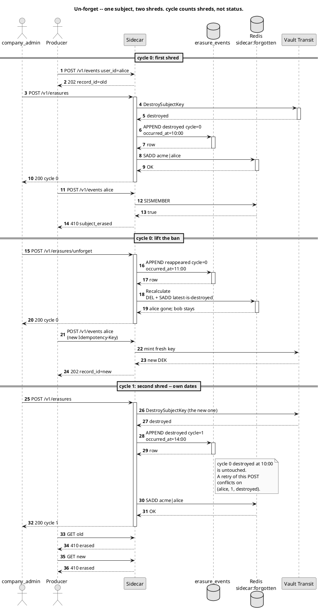
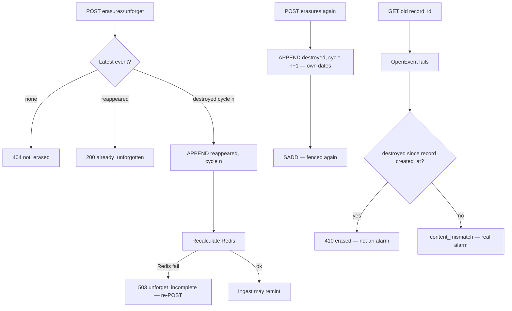

# Write the Un-forget

**Summary**: Tutorial + how-to for [JIRA Tasks](JIRA%20Tasks.md) Task 1 — restore lawful subject re-appearance after person erase, **and** remodel the erasure ledger as an append-only lifecycle event log so a second erase after un-forget has its own dates. One change, per [ADR-0004 Erasure Ledger as Lifecycle Event Log](../decisions/ADR-0004%20Erasure%20Ledger%20as%20Lifecycle%20Event%20Log.md). Same spirit as [Write the Person Graveyard](Write%20the%20Person%20Graveyard.md) and *Let's Go*: build steps that teach the syntax they use, then a complete edit, then a complete test. You write the code.

**Sources**: [ADR-0004](../decisions/ADR-0004%20Erasure%20Ledger%20as%20Lifecycle%20Event%20Log.md) (schema, queries, HTTP shape — all pinned there); [ADR-0003](../decisions/ADR-0003%20Shared%20Redis%20Forget%20Set.md) §4 (recalculate exception); shipped `forget` / `erasure_ledger` / sidecar doors; repo D3 note in `docs/plans/DECISION_SET_2026-08-10_VERIFY_ERASURE_RBAC.md`.

**Last updated**: 2026-09-09 (Step 6 `FILE:` now includes `unforgetResponse` + `unforgetMessage` next to `erasureAttestation` — not a “define these” sentence after the handler.)

---

**How to read this page.** You already shipped the forget set. This page assumes that code exists and that you can answer the [Check yourself](Write%20the%20Person%20Graveyard.md#check-yourself-before-the-pr) questions on the graveyard how-to. Each step teaches the **new** Go and SQL (idempotent append via `INSERT … SELECT … ON CONFLICT`, `DISTINCT ON`, nullable columns, the one allowed `DEL`), then a complete edit, then a complete test. Read once top to bottom without typing; stop at [Check yourself before Step 0](#check-yourself-before-step-0) and answer those from memory before you create a file. The [Check yourself before the PR](#check-yourself-before-the-pr) set is the same idea after the build.

Code snippets marked `FILE:` name the exact destination. Snippets marked *pattern only* are shapes, not paste-and-ship. When stuck on a Go idiom, ask — teach, do not paste the finished sidecar.

Start on `INV-42498-tenant-reappears`: the forget-set landing and the caller-visible leakage pass are already merged. Do **not** mix this into those PRs. The landing pins the set as append-only; this feature is the documented exception. HTTP `message`/`reason` still must not name Redis, Postgres, or Vault — logs may.

**Keep the four store verbs.** Do not delete `InsertErasureIfAbsent`, `GetErasure`, `ListErasures`, or `ListAllErasures`. Change their SQL, row type (`Erasure` → `ErasureEvent`), and meaning. Add only `AppendUnforgotten` (door write) and `KeyDestroyedSince` (read unwrap after `OpenEvent` failed). Preview still calls `GetErasure` and then checks `Kind == EventDestroyed`. Heal and recalculate still call `ListAllErasures` — the SQL behind that name narrows to “latest event is `destroyed`”. Read unwrap must **not** keep using `GetErasure` (that is the T3 lie: any row → erased).

## What you are building and why

After person erase, ingest answers `410 subject_erased` forever. That closed remint (hole 2) and the sibling warm-cache hole — and it also reversed a shipped policy: **erasure survives re-appearance**. Decision D3 (`docs/plans/DECISION_SET_2026-08-10_VERIFY_ERASURE_RBAC.md`): a later lawful event for the same subject mints a **fresh** key; old records stay unreadable; new records unwrap. GDPR erasure is not do-not-track. Until this feature, the forget set is a permanent processing ban for that identifier. That was an accepted interim. This is the exit.

The first design added a nullable `unforgotten_at` to the one-row-per-subject ledger. It was scoped, then **rejected** ([ADR-0004](../decisions/ADR-0004%20Erasure%20Ledger%20as%20Lifecycle%20Event%20Log.md)): with one row per subject, a second shred after un-forget can only flip a flag — its dates are undated, and the attestation table grows an `UPDATE`. So this change replaces the table instead. `erasure_ledger` (one row, compound PK) becomes `erasure_events` (append-only log):

- **`destroyed`** event — Vault destroyed this subject's key. Carries that shred's `occurred_at` and `completion_by`. Same word as `destroyed_at` / `key_destroyed`.
- **`reappeared`** event — an admin restored the right to process (D3 “re-appearance”). Carries `occurred_at` only. **Does not create a key.** The HTTP door stays `/unforget` (`AppendUnforgotten` writes this kind).
- **`cycle`** — which shred this is (0 = first, 1 = second after an un-forget, …). Not a status. Status is “what is the latest row.” Uniqueness is `(company_id, subject_pseudonym, cycle, kind)` — per **act**, not per subject.

Render the diagram with the Obsidian PlantUML plugin or https://www.plantuml.com/plantuml.



### What `cycle` is (and is not)

`cycle` is **which shred**. It is not a status you flip. Each shred can have two rows: the `destroyed` act, then later the `reappeared` act of **that same** shred. The next shred starts a new cycle so its dates never overwrite the first. The unique key `(pair, cycle, kind)` can then say “this *act* already happened” without saying “this *subject* can only happen once.”

How the next cycle is computed (Step 1 writes this inside the `INSERT`):

| Door | SQL | Result |
| --- | --- | --- |
| Erase | `COALESCE(MAX(cycle) + 1, 0)` over this subject's **`reappeared`** rows | no un-forget yet → **0**; after `reappeared` of cycle *n* → **n+1** |
| Un-forget | copy `cycle` from the latest **`destroyed`** row | never erased → no insert; already `reappeared` this cycle → conflict, incumbent comes back |

`cycle` never uses a clock. Time is only for one later question: **this ciphertext vs that shred**, after unwrap has already failed.

Two tables, two clocks — they are not interchangeable:

| Table | Row | Clock | Meaning |
| --- | --- | --- | --- |
| `content_records` | one sealed event | `created_at` | when that ciphertext was minted |
| `erasure_events` | one admin act | `occurred_at` | when we destroyed a key, or lifted the ban |

`GetErasure` (latest event) / `ListAllErasures` (heal feed) / next `cycle` order by `(cycle, kind)`. They do **not** look at `occurred_at`. `KeyDestroyedSince` is the only **new** read — it compares times, and only after `OpenEvent` failed: “did we shred the key that sealed **this** record?”

Walk `acme` / `alice` (and bystander `bob`) with the SQL each method runs.

#### T0 — empty. Ingest old alice at 09:50

```text
-- content_records
record_id | subject | created_at
----------+---------+-----------
old       | alice   | 09:50
```

`erasure_events` is empty.

```go
GetErasure(ctx, "acme", "alice")                                  // found=false
KeyDestroyedSince(ctx, "acme", "alice", record.CreatedAt)         // false
```

GET `old` unwraps. First erase will compute `MAX(reappeared)` empty → cycle **0**.

#### T1 — 10:00 erase alice (and bob). `InsertErasureIfAbsent`

No `reappeared` rows yet → cycle **0**.

```sql
INSERT INTO erasure_events
    (company_id, subject_pseudonym, cycle, kind, occurred_at, completion_by)
SELECT 'acme', 'alice', COALESCE(MAX(cycle) + 1, 0), 'destroyed', '10:00',
       '10:00'::timestamptz + interval '30 days'
  FROM erasure_events
 WHERE company_id = 'acme' AND subject_pseudonym = 'alice' AND kind = 'reappeared'
ON CONFLICT DO NOTHING
RETURNING *;
```

```go
row, inserted, err := s.InsertErasureIfAbsent(ctx, ErasureEvent{
	CompanyID: "acme", SubjectPseudonym: "alice",
	OccurredAt: t10, CompletionBy: &completion, // completion = t10+30d
})
// inserted=true, row.Cycle==0, row.Kind==destroyed
```

```text
company | subject | cycle | kind      | occurred_at | completion_by
--------+---------+-------+-----------+-------------+--------------
acme    | alice   |     0 | destroyed | 10:00       | 10:00+30d
acme    | bob     |     0 | destroyed | 10:05       | 10:05+30d
```

**Currently forgotten?** — no time. `GetErasure` is the latest event: `cycle DESC`, then `reappeared` above `destroyed` within a cycle:

```sql
SELECT kind FROM erasure_events
 WHERE company_id = 'acme' AND subject_pseudonym = 'alice'
 ORDER BY cycle DESC, (kind = 'reappeared') DESC
 LIMIT 1;
-- destroyed → fence Redis, ingest 410
```

```go
latest, found, _ := s.GetErasure(ctx, "acme", "alice")
// found && latest.Kind == EventDestroyed
```

`ListAllErasures` (heal feed) keeps subjects whose latest is `destroyed` → **alice and bob**. Retry of alice’s erase still computes cycle 0; insert of `(alice, 0, destroyed)` **conflicts**; `10:00` does not move.

**Was the old record’s key shredded?** — here time appears:

```sql
SELECT EXISTS (
  SELECT 1 FROM erasure_events
   WHERE company_id = 'acme' AND subject_pseudonym = 'alice'
     AND kind = 'destroyed'
     AND occurred_at >= '09:50'   -- record.CreatedAt
);
-- 10:00 >= 09:50 → true
```

```go
KeyDestroyedSince(ctx, "acme", "alice", old.CreatedAt) // 09:50 → true → GET old → 410 erased
```

The key that sealed `old` was killed **after** `old` was written. Lawful erasure, not an alarm.

#### T2 — 11:00 un-forget alice. `AppendUnforgotten`

Copies cycle from the latest `destroyed` (0). `NOW()` is only a human/regulator stamp. It does **not** pick the next cycle.

```sql
INSERT INTO erasure_events (company_id, subject_pseudonym, cycle, kind, occurred_at)
SELECT company_id, subject_pseudonym, cycle, 'reappeared', NOW()  -- 11:00
  FROM erasure_events
 WHERE company_id = 'acme' AND subject_pseudonym = 'alice' AND kind = 'destroyed'
 ORDER BY cycle DESC LIMIT 1
ON CONFLICT DO NOTHING
RETURNING *;
```

```go
ev, found, appended, err := s.AppendUnforgotten(ctx, "acme", "alice")
// found=true, appended=true, ev.Cycle==0, ev.Kind==reappeared, CompletionBy==nil
```

```text
… plus:
acme    | alice   |     0 | reappeared | 11:00       | NULL
```

Cycle 0 now has both acts. Uniqueness is per `(pair, cycle, kind)`: two *kinds* share a cycle; two of the *same* kind do not. `GetErasure(alice)` → **reappeared**. `ListAllErasures` and `ListErasures(acme)` drop alice, keep **bob**. Recalculate `DEL`s Redis and `SADD`s only bob. Retry of un-forget conflicts on `(alice, 0, reappeared)`; `11:00` stays; Redis rebuild still runs (crash recovery).

GET `old` still fails unwrap (Vault key is gone forever). Same `KeyDestroyedSince(09:50)` → still **true** → still **erased**. Un-forget does not resurrect old ciphertext.

#### T3 — 11:10 remint. New record

```text
record_id | subject | created_at
----------+---------+-----------
old       | alice   | 09:50      -- dead key
new       | alice   | 11:10      -- fresh key
```

The log is unchanged (un-forget does not create a key; ingest does). GET `new` unwraps.

If `new` failed to unwrap **now** (bug, wrong DEK, bit flip):

```sql
SELECT EXISTS (
  SELECT 1 FROM erasure_events
   WHERE company_id = 'acme' AND subject_pseudonym = 'alice'
     AND kind = 'destroyed' AND occurred_at >= '11:10'
);
-- only destroy is 10:00. 10:00 >= 11:10? NO → false
```

```go
KeyDestroyedSince(ctx, "acme", "alice", new.CreatedAt) // 11:10 → false → content_mismatch alarm
```

The subject **has** a shred in the log, but that shred is **older than this record**. This ciphertext was sealed under a live key. “Any destroyed row exists” would lie and call it `erased`. Time is here so **old** and **new** can disagree:

| Record | `created_at` | destroy `10:00 >= created_at`? | GET if unwrap fails |
| --- | --- | --- | --- |
| `old` | 09:50 | yes | `erased` |
| `new` | 11:10 | no | `content_mismatch` |

#### T4 — 14:00 erase alice again. `InsertErasureIfAbsent`

Now there **is** a `reappeared` row, `MAX(cycle)` over those is **0** → insert cycle **1**. Fresh dates. Cycle 0 is not touched. Same `INSERT` as T1.

```go
row, inserted, _ := s.InsertErasureIfAbsent(ctx, ErasureEvent{
	CompanyID: "acme", SubjectPseudonym: "alice",
	OccurredAt: t14, CompletionBy: &completion14,
})
// inserted=true, row.Cycle==1  — not an UPDATE of the 10:00 row
```

```text
acme | alice | 0 | destroyed  | 10:00 | 10:00+30d   -- untouched
acme | alice | 0 | reappeared | 11:00 | NULL
acme | alice | 1 | destroyed  | 14:00 | 14:00+30d   -- new shred
acme | bob   | 0 | destroyed  | 10:05 | 10:05+30d
```

`GetErasure` → cycle 1 `destroyed` → fenced again. `ListAllErasures` and `ListErasures(acme)` → **alice and bob** (latest destroy only). Retry conflicts on `(alice, 1, destroyed)`; **`14:00` stays**. `GET /v1/erasures` does **not** list the `11:00` un-forget or the `10:00` shred — history is later work.

`KeyDestroyedSince` for **both** records is now true: `14:00 >= 09:50` and `14:00 >= 11:10`. The remint key really was destroyed at 14:00. GET `new` is now `410 erased`.

A second un-forget copies cycle **1**. The next erase would be cycle **2**. Same pattern.

**What time is not.** Not how you compute `cycle` (`MAX` over `reappeared`, or copy latest `destroyed`). Not how you decide “currently forgotten” (`GetErasure` — latest kind). Not how heal/recalculate pick members (`ListAllErasures`). If you ordered “latest” by `occurred_at`, two replicas whose clocks disagree by more than the erase→un-forget gap could flip who is forgotten. `(cycle, kind)` cannot. If you dropped the time check and asked “any `destroyed` row?”, then after T2 every broken **new** record would be filed as lawful erasure forever. That is why `resolveUnopenable` passes `record.CreatedAt` into `KeyDestroyedSince`, and `GetErasure` must not be reused for that ask.

The four questions and who asks them:

| Question | Who asks | Answer |
| --- | --- | --- |
| Currently forgotten? | ingest / read fence (via Redis), preview | `GetErasure`: latest event is `destroyed` |
| All currently forgotten subjects? | heal **and** recalculate | `ListAllErasures`: `DISTINCT ON` latest per subject, keep `destroyed` |
| Forgotten in **this** tenant? | `GET /v1/erasures` | `ListErasures`: same query, `company_id = $1` |
| Was **this record's** key shredded? | `resolveUnopenable` on unwrap failure | any `destroyed` event with `occurred_at >=` the record's `created_at` |



**Five iron rules** (a reviewer will check all five):

1. **Never `UPDATE` or `DELETE` in `erasure_events`.** A second erase is a new `destroyed` event with its own dates, not a flag flip. A retry of the same act hits the `(pair, cycle, kind)` unique key and adopts the incumbent — dates never move. If you find yourself writing `UPDATE`, stop.
2. **Ledger append first, then Redis.** Erase: append `destroyed` → `SADD`. Un-forget: append `reappeared` → `Recalculate`. If Redis fails after the append, Postgres is already the truth; answer 503 and let re-POST retry the Redis half only. Never touch Redis before the row is in.
3. **Heal stays union-only.** `IsForgotten` / `MarkForgotten` must not grow `SRem` or `Del`. `Recalculate` is a new method, called only from the un-forget door, under the `SET NX` lock.
4. **Heal and recalculate read the same feed, ordered by `(cycle, kind)` — never wall clock.** `ListAllErasures` = subjects whose **latest** event is `destroyed` (same method name, narrower SQL). "Any destroyed row exists" is a different question (`KeyDestroyedSince`); mixing them re-fences a subject whose latest is `reappeared` after a flush.
5. **Redis / lock / Postgres error = 503.** Never treat "could not rebuild" or "could not read the log" as "the set is already right".

## Check yourself before Step 0

If you cannot answer these from memory, re-read [What `cycle` is](#what-cycle-is-and-is-not) — do not open an editor. Every answer is on this page. This is the model; the steps only type it.

1. Name the two *kinds* and the two *door* verbs. Why are they not the same words? What would a regulator think `kind = unforgotten` or `kind = key_created` meant, and why is that wrong?
2. Why is there no `forgotten` kind if “currently forgotten” is the main question the doors ask?
3. Alice is cycle 0 `destroyed` at 10:00, then `reappeared` at 11:00. What does `GetErasure` return? What is in `ListAllErasures`? What does `KeyDestroyedSince(09:50)` say about her old record? What does `KeyDestroyedSince(11:10)` say about a remint?
4. After a second erase at 14:00, why is that row cycle **1**, not an `UPDATE` of the 10:00 row? What does a retry of that second POST conflict on?
5. Erase computes `MAX(cycle)` over **`reappeared`** rows only. Walk the empty table, then one `reappeared` of cycle 0: which cycle does each erase insert?

## Already decided — do not re-litigate while coding

Everything here is pinned in [ADR-0004](../decisions/ADR-0004%20Erasure%20Ledger%20as%20Lifecycle%20Event%20Log.md); the "Proposed — confirm" block there lists what still needs the owner's yes.

| Question                         | Answer                                                                                                                                                                                              | Details                |
| -------------------------------- | --------------------------------------------------------------------------------------------------------------------------------------------------------------------------------------------------- | ---------------------- |
| Alter `erasure_ledger` in place? | **No.** New table `erasure_events` + backfill of existing rows as cycle-0 `destroyed`. Old table kept unwritten; dropped in a later migration | Step 0 |
| Event kinds | **`destroyed` / `reappeared`.** Door stays `/unforget` (`AppendUnforgotten` writes `reappeared`). No `forgotten` (same act as destroy), no `unforgotten` kind (door already owns that word), no `completed` | Step 0 |
| Retry idempotency                | `PRIMARY KEY (company_id, subject_pseudonym, cycle, kind)` + `INSERT … ON CONFLICT DO NOTHING`; on conflict, second SELECT returns the incumbent (same pattern as today's `InsertErasureIfAbsent`)  | Steps 1–2              |
| HTTP                             | `POST /v1/erasures/unforget`, body `{"user_id":"…"}` — same raw identifier as erase                                                                                                                 | Step 6                 |
| RBAC                             | `company_admin` + `requireTenant` only. Same group as erase. No `global_admin`                                                                                                                      | Step 6                 |
| Codes                            | `404 not_erased`; `200` with `already_unforgotten`; `503 unforget_incomplete` (row done, Redis not)                                                                                                 | Step 6                 |
| Forget-set shrink                | `Recalculate`: fill `sidecar:forgotten:next`, `RENAME` onto `sidecar:forgotten`. `DEL` the live key only when the new feed is empty. Not `SREM` of one member, not `DEL`+loop on the live key          | Step 3                 |
| Concurrent recalculates          | Redis `SET NX` lock `sidecar:forgotten:recalc`. Two rebuilds must not interleave snapshots                                                                                                          | Step 3                 |
| Second erase after un-forget | New `destroyed` event, cycle *n+1*, **own** `occurred_at` / `completion_by`. No `Reactivate`, no spec "known limit" sentence | Steps 1, 5 |
| Old-record GET/verify            | `resolveUnopenable` asks `KeyDestroyedSince(record.CreatedAt)`, not "any row". Un-forgotten subject + unwrap failure on a **new** record = real alarm                                               | Step 7                 |
| Vault                            | Untouched. Old keys stay destroyed; un-forget never resurrects old content                                                                                                                          | —                      |
| Out of this work                 | company door (#7), R2 lock (#6), dropping `erasure_ledger` (later migration), **GET history of shreds / un-forgets** (later)                                                                        | —                      |
| `cache_purged`                   | **Gone.** Not a column, not a JSON field. Keyvault still purges local RAM; the door does not attest it                                                                                              | Step 0, Step 5, Step 9 |
| Code names | **Keep** `InsertErasureIfAbsent`, `GetErasure`, `ListErasures`, `ListAllErasures`, `SummarizeSubject`. Row type becomes `ErasureEvent` (`EventDestroyed` / `EventReappeared`). **Add** `AppendUnforgotten` (writes `reappeared`) and `KeyDestroyedSince` (read unwrap only). `GetErasure` = latest event (preview / currently forgotten). `ListAllErasures` = latest-is-destroyed, all tenants (heal + recalculate). `ListErasures` = that same feed, one tenant (`GET /v1/erasures`). No history listing in this change. Do not delete the four methods. `Recalculate`, handler `UnforgetSubject`. Door ≠ kind. "Graveyard" is vault prose only | — |

## Go primer — what is new on top of the graveyard page

The four habits (context first, wrap with `%w`, interfaces at the consumer, pointer receivers) still apply. Five new ones:

**5. A sidecar schema change is a numbered `.up.sql`, not `cmd/migrate`.** The record store embeds `internal/sidecar/store/migrations/*.up.sql` (`//go:embed` in `migrate.go`) and applies them at boot (`RunMigrations`, tracking table `sidecar_schema_migrations`). Next file is `003_…up.sql`. Name it without `.up.sql` and golang-migrate silently ignores it. There is no `.down.sql` in this tree — do not add one.

**6. `INSERT … SELECT … ON CONFLICT DO NOTHING` is an idempotent append.** The `SELECT` computes the next `cycle` *inside* the statement, so two racing erases compute the same cycle and exactly one wins; the loser's `RETURNING` yields no rows (`pgx.ErrNoRows`) and a **second** SELECT (fresh snapshot) fetches the winner. This is the same two-round-trip pattern `InsertErasureIfAbsent` already documents — keep the method and the comment; change the table and the `INSERT`.

**7. SQL `NULL` is a pointer in Go.** `time.Time` has a zero value (`0001-01-01`) that is **not** SQL `NULL`. `completion_by` is set on `destroyed` events and `NULL` on `reappeared` ones, so on the struct it is `*time.Time`; pgx scans into `*time.Time` directly. JSON: `omitempty` drops the field when nil.

**8. `DISTINCT ON` picks one row per group.** Postgres-specific: `SELECT DISTINCT ON (a, b) … ORDER BY a, b, <tiebreak>` keeps the **first** row per `(a, b)` under that order. `ORDER BY … cycle DESC, (kind = 'reappeared') DESC` puts each subject's latest event first (booleans sort `false < true`, so `DESC` puts `reappeared` above `destroyed` within a cycle). That is `ListAllErasures`'s new engine — and why rule 4 says never order by wall clock: replica clocks skew; `(cycle, kind)` is total.

**9. `DEL` of the live `sidecar:forgotten` is legal only when Recalculate's new feed is empty.** `IsForgotten` / `MarkForgotten` must still have no `SRem` / `Del` on that key. Never `DEL` then loop-`SADD` the live key: after the first `SADD`, `SCARD > 0` so heal does not run, and a still-banned subject not yet copied would ingest. Recalculate fills `sidecar:forgotten:next` and `RENAME`s. Put `Del`, `SetNX`, and `Rename` on `redisSet` — call them only from `Recalculate`.

## The change at a glance

Application path: `/Users/valeriyilihmetov/work/inveniam/trace-chain/InveniamIndicia`. You are already on that branch.

```text
NEW  internal/sidecar/store/migrations/003_create_erasure_events.up.sql   Step 0

MOD  internal/sidecar/store/erasure.go           Step 1     Erasure → ErasureEvent + EventKind. Keep InsertErasureIfAbsent,
                                                            GetErasure, ListErasures, ListAllErasures (SQL changes).
                                                            ADD AppendUnforgotten, KeyDestroyedSince. SummarizeSubject stays.
MOD  internal/sidecar/store/erasure_test.go      Step 2     same test names + two cycles, KeyDestroyedSince, heal feed

MOD  internal/sidecar/forget/forget.go           Step 3     Hydrator still ListAllErasures ([]ErasureEvent); Recalculate;
                                                            redisSet + Del, SetNX
MOD  internal/sidecar/forget/forget_test.go      Step 4     fake grows Del/SetNX; rebuild + lock tests

MOD  internal/sidecar/http/handler.go            Step 5     ForgetSet.Recalculate
MOD  internal/sidecar/http/forget_stub_test.go   Step 5     stubs grow Recalculate
MOD  internal/sidecar/http/erasure.go            Steps 5–6  ErasureStore grows two methods; EraseSubject still
                                                            InsertErasureIfAbsent; Preview still GetErasure (check Kind);
                                                            ListErasures still current-forgotten, tenant; UnforgetSubject
MOD  internal/sidecar/http/erasure_test.go       Steps 5,7  erasureLedger fake over []ErasureEvent; unforget cases
MOD  internal/sidecar/http/read.go               Step 7     resolveUnopenable → KeyDestroyedSince(record.CreatedAt)
MOD  internal/sidecar/http/read_test.go          Step 7     un-forgotten subject + broken new record = alarm, not erased
MOD  internal/sidecar/router.go                  Step 6     POST /v1/erasures/unforget
MOD  internal/sidecar/router_test.go             Step 6     path on the company_admin table

MOD  tests/integration/sidecar_fulldata_test.go  Step 8     erase → unforget → remint → erase again; sibling fence.
                                                            Also retarget the existing `SELECT … FROM erasure_ledger`
                                                            in `TestSidecarErasureDoor` — that query still names the old table.

MOD  docs/api/API_SPECIFICATION.md               Step 9
MOD  docs/plans/DECISION_SET_2026-08-10_VERIFY_ERASURE_RBAC.md          Step 9  D3 note
MOD  docs/plans/SEPARATION_OF_CONCERNS_SLICE_2B_RECORD_STORE.md         Step 9  §8.2
MOD  docs/plans/CRYPTO_SHRED_COMPLIANCE_EXPLAINER.md                    Step 9  §8
MOD  docs/plans/SECURITY_ASSESSMENT_2026-08-17.md                       Step 9  DP-002 trail

DEL  (none — erasure_ledger stays on disk, unwritten, until a later migration)
```

You are **not** changing `internal/keyvault/` (local DEK purge stays; do not echo `CachePurged` onto the new table or the JSON) or the core API. `SummarizeSubject` (the preview count) reads `content_records` and does not change. If you find yourself writing `UPDATE erasure_events`, `SREM` of one member, or a `cache_purged` column, stop.

---

## Step 0 — the migration: the event table and the backfill

**Files**: `internal/sidecar/store/migrations/003_create_erasure_events.up.sql` (new).

**What**: create `erasure_events`, copy every existing `erasure_ledger` row in as cycle-0 `destroyed`. The old table stays — nothing writes it after this PR; a later migration drops it once a release has verified the copy.

**The SQL here.** `CHECK (kind IN …)` is a two-value enum without the `CREATE TYPE` ceremony. The shape constraint pins "destroyed carries `completion_by`, reappeared does not" in the schema, so a bug in Go cannot write a half-event. `ON CONFLICT DO NOTHING` on the backfill makes re-running the migration against a half-migrated database safe (golang-migrate should prevent that, but a cheap belt costs one line).

```sql
-- FILE: internal/sidecar/store/migrations/003_create_erasure_events.up.sql
-- The erasure lifecycle log: one row per ACT (shred or un-forget), append-only.
-- Replaces erasure_ledger's one-row-per-subject shape so a second erase after
-- an un-forget carries its own dates instead of flipping a flag. The old table
-- is backfilled below, kept unwritten, and dropped in a later migration.
--
-- subject_pseudonym is the tenant-scoped HMAC pseudonym, never a raw
-- identifier — same rule as 002.
CREATE TABLE IF NOT EXISTS erasure_events (
    company_id        TEXT        NOT NULL,
    subject_pseudonym TEXT        NOT NULL,
    -- 0 = first shred. An un-forget of cycle n is followed by a destroy of
    -- cycle n+1. Uniqueness is per act, which is what makes a retried POST
    -- conflict and adopt the incumbent instead of re-dating the erasure.
    cycle             INTEGER     NOT NULL,
    kind              TEXT        NOT NULL CHECK (kind IN ('destroyed', 'reappeared')),
    occurred_at       TIMESTAMPTZ NOT NULL,
    -- destroyed only: occurred_at + key-store snapshot retention — the point
    -- by which THIS shred is irreversible.
    completion_by     TIMESTAMPTZ,

    PRIMARY KEY (company_id, subject_pseudonym, cycle, kind),
    CONSTRAINT erasure_events_shape CHECK (
        (kind = 'destroyed'  AND completion_by IS NOT NULL) OR
        (kind = 'reappeared' AND completion_by IS NULL))
);

-- The tenant-facing listing, newest first.
CREATE INDEX IF NOT EXISTS idx_erasure_events_tenant_time
    ON erasure_events (company_id, occurred_at DESC);

-- Backfill: every erased subject becomes cycle 0 of its own log.
INSERT INTO erasure_events
    (company_id, subject_pseudonym, cycle, kind, occurred_at, completion_by)
SELECT company_id, subject_pseudonym, 0, 'destroyed', destroyed_at, completion_by
  FROM erasure_ledger
ON CONFLICT DO NOTHING;
```

`//go:embed migrations/*.up.sql` picks the file up with no Go edit; `RunMigrations` at boot (and `newTestStore` in store tests) applies it.

**Done when**: the file is on disk. Compile proof is Step 1 — every store method moves to the new table.

---

## Step 1 — store: the event type; keep four methods, add two

**Files**: `internal/sidecar/store/erasure.go`.

**Careful which `erasure.go`.** Same trap as the graveyard: `store/erasure.go` is SQL; `http/erasure.go` is the door (Steps 5–6).

**What.** Replace type `Erasure` with `ErasureEvent`. Keep `InsertErasureIfAbsent`, `GetErasure`, `ListErasures`, `ListAllErasures` — same names, same two-round-trip / all-tenants comments, new table and new meaning. Add `AppendUnforgotten` and `KeyDestroyedSince`. `SummarizeSubject` stays. Do not invent `AppendDestroyed` / `LatestEvent` / `ListForgotten`; those names in ADR-0004 are the jobs these four methods already do.

```go
// FILE: internal/sidecar/store/erasure.go — replaces type Erasure.
// Imports already in this file: context, errors, fmt, time, pgx.

// EventKind names one act in a subject's erasure lifecycle.
type EventKind string

const (
	// EventDestroyed — Vault destroyed this subject's key. Carries the shred's
	// completion deadline.
	EventDestroyed EventKind = "destroyed"
	// EventReappeared — an admin restored the right to process (D3).
	// The next erase, if any, opens the next cycle with its own dates.
	// AppendUnforgotten writes this kind; the HTTP door stays /unforget.
	EventReappeared EventKind = "reappeared"
)

// ErasureEvent is one row of the erasure lifecycle log: one act, append-only.
// A subject's history is its events ordered by (Cycle, Kind); the latest event
// answers "currently forgotten", and any destroyed event at or after a
// record's creation answers "was this record's key shredded".
//
// SubjectPseudonym is always the tenant-scoped HMAC pseudonym — the log is a
// regulator artifact and must not become a directory of erased identities.
type ErasureEvent struct {
	CompanyID        string
	SubjectPseudonym string
	Cycle            int
	Kind             EventKind
	OccurredAt       time.Time
	// CompletionBy is set on destroyed events only: OccurredAt + the key-store
	// snapshot-retention window, the point by which THIS shred is irreversible.
	CompletionBy *time.Time
}
```

**The Go here — computing `cycle` inside the `INSERT`.** The `SELECT` half of an `INSERT … SELECT` runs in the same statement snapshot, so "one past the last un-forget, or 0" and the insert are one atomic act. Two racing erases compute the same cycle; the unique key makes one lose; the loser resolves the incumbent with a second, fresh-snapshot SELECT — exactly the pattern the old `InsertErasureIfAbsent` used and documented (a CTE that SELECTs its own snapshot races itself; the second round trip always sees the winner).

```go
// FILE: internal/sidecar/store/erasure.go — same method, new table and INSERT.
// Keep the existing two-round-trip comment (CTE snapshot race / xmax). Change
// the input type to ErasureEvent (OccurredAt / CompletionBy *time.Time; drop
// CachePurged). Cycle and Kind are computed by SQL, not by the caller.
//
// InsertErasureIfAbsent records one shred as the next cycle's destroyed event
// and returns the event that is authoritative — the caller's if it won the
// insert, otherwise the incumbent destroyed event (a re-POST or a lost race).
// inserted distinguishes the two. The unique (pair, cycle, kind) key conflicts
// and the original occurred_at / completion_by come back unchanged.
//
//nolint:gocritic // hugeParam: ErasureEvent is taken by value deliberately.
func (s *Store) InsertErasureIfAbsent(ctx context.Context, e ErasureEvent) (row ErasureEvent, inserted bool, err error) {
	const q = `
		INSERT INTO erasure_events
			(company_id, subject_pseudonym, cycle, kind, occurred_at, completion_by)
		SELECT $1, $2, COALESCE(MAX(cycle) + 1, 0), 'destroyed', $3, $4
		  FROM erasure_events
		 WHERE company_id = $1 AND subject_pseudonym = $2 AND kind = 'reappeared'
		ON CONFLICT DO NOTHING
		RETURNING company_id, subject_pseudonym, cycle, kind, occurred_at, completion_by`
	var got ErasureEvent
	err = s.pool.QueryRow(
		ctx, q, e.CompanyID, e.SubjectPseudonym, e.OccurredAt, e.CompletionBy,
	).Scan(
		&got.CompanyID, &got.SubjectPseudonym, &got.Cycle, &got.Kind, &got.OccurredAt, &got.CompletionBy,
	)
	if err == nil {
		return got, true, nil
	}
	if !errors.Is(err, pgx.ErrNoRows) {
		return ErasureEvent{}, false, fmt.Errorf("insert erasure event: %w", err)
	}

	// Conflict: this cycle already has a destroyed event — the subject is
	// currently forgotten and this is a re-POST. Fresh snapshot sees it.
	incumbent, found, err := s.GetErasure(ctx, e.CompanyID, e.SubjectPseudonym)
	if err != nil {
		return ErasureEvent{}, false, fmt.Errorf("read incumbent erasure event: %w", err)
	}
	if !found || incumbent.Kind != EventDestroyed {
		// Nothing deletes events, so a conflict followed by "no destroyed
		// latest" means the log was edited out of band. Surface it.
		return ErasureEvent{}, false, fmt.Errorf(
			"erasure event for %s conflicted on insert but no destroyed event is current", e.CompanyID)
	}
	return incumbent, false, nil
}
```

Why `MAX(cycle)` over **`reappeared`** rows: before any un-forget the subquery is empty → `COALESCE` → cycle 0, and every retry recomputes 0 and conflicts. After a `reappeared` of cycle *n*, the max is *n* → cycle *n+1*, fresh row, fresh dates. The reappeared event is the only thing that advances the counter — which is the business rule ("a new shred needs a lifted ban first") expressed in one `WHERE`.

```go
// FILE: internal/sidecar/store/erasure.go — new, next to InsertErasureIfAbsent.
//
// AppendUnforgotten records the admin act that lifts the ingest ban for the
// current cycle. found=false: never erased. appended=false with found=true:
// the latest cycle was already un-forgotten (re-POST) — the incumbent
// reappeared event comes back with its ORIGINAL occurred_at.
func (s *Store) AppendUnforgotten(
	ctx context.Context, companyID, subjectPseudonym string,
) (ev ErasureEvent, found, appended bool, err error) {
	const q = `
		INSERT INTO erasure_events (company_id, subject_pseudonym, cycle, kind, occurred_at)
		SELECT company_id, subject_pseudonym, cycle, 'reappeared', NOW()
		  FROM erasure_events
		 WHERE company_id = $1 AND subject_pseudonym = $2 AND kind = 'destroyed'
		 ORDER BY cycle DESC
		 LIMIT 1
		ON CONFLICT DO NOTHING
		RETURNING company_id, subject_pseudonym, cycle, kind, occurred_at, completion_by`
	var got ErasureEvent
	err = s.pool.QueryRow(ctx, q, companyID, subjectPseudonym).Scan(
		&got.CompanyID, &got.SubjectPseudonym, &got.Cycle, &got.Kind, &got.OccurredAt, &got.CompletionBy,
	)
	if err == nil {
		return got, true, true, nil
	}
	if !errors.Is(err, pgx.ErrNoRows) {
		return ErasureEvent{}, false, false, fmt.Errorf("append reappeared event: %w", err)
	}

	// Zero rows: either no destroyed event exists (never erased), or the
	// latest cycle already has its reappeared event (re-POST). GetErasure
	// (latest event) tells them apart on a fresh snapshot.
	incumbent, found, err := s.GetErasure(ctx, companyID, subjectPseudonym)
	if err != nil {
		return ErasureEvent{}, false, false, err
	}
	if !found {
		return ErasureEvent{}, false, false, nil
	}
	if incumbent.Kind == EventReappeared {
		return incumbent, true, false, nil
	}
	// Destroyed is latest yet our insert appended nothing: a concurrent erase
	// slid in between the two statements. The caller retries; say why.
	return ErasureEvent{}, false, false, fmt.Errorf(
		"unforget for %s lost a race with a concurrent erase; retry", companyID)
}
```

`NOW()` here (not a Go-supplied `$3`) is intentional: un-forget has no Vault clock. A retry still returns the incumbent `occurred_at` via the conflict path.

```go
// FILE: internal/sidecar/store/erasure.go — same method, new meaning.
// The "latest is what counts" order: highest cycle first; within one cycle
// the reappeared event (if any) outranks the destroyed one. Booleans sort
// false < true, so DESC works. Never order by occurred_at — replica clocks
// skew; (cycle, kind) is total.
//
// GetErasure returns the newest lifecycle event for one subject. found is
// false (nil error) when the subject was never erased. Kind == EventDestroyed
// means currently forgotten (preview / ingest fence via Redis). This is NOT
// the read-unwrap question — that is KeyDestroyedSince(record.CreatedAt).
func (s *Store) GetErasure(ctx context.Context, companyID, subjectPseudonym string) (e ErasureEvent, found bool, err error) {
	const q = `
		SELECT company_id, subject_pseudonym, cycle, kind, occurred_at, completion_by
		  FROM erasure_events
		 WHERE company_id = $1 AND subject_pseudonym = $2
		 ORDER BY cycle DESC, (kind = 'reappeared') DESC
		 LIMIT 1`
	var got ErasureEvent
	err = s.pool.QueryRow(ctx, q, companyID, subjectPseudonym).Scan(
		&got.CompanyID, &got.SubjectPseudonym, &got.Cycle, &got.Kind, &got.OccurredAt, &got.CompletionBy,
	)
	if errors.Is(err, pgx.ErrNoRows) {
		return ErasureEvent{}, false, nil
	}
	if err != nil {
		return ErasureEvent{}, false, fmt.Errorf("get erasure event: %w", err)
	}
	return got, true, nil
}

// KeyDestroyedSince reports whether any shred happened at or after a moment —
// the read path's question: an unwrap failure on a record CREATED BEFORE a
// destroy is a lawful erasure; on a record created after the latest destroy it
// is an integrity alarm. "Any row exists" would call both erased and hide the
// alarm for every re-erased subject.
func (s *Store) KeyDestroyedSince(ctx context.Context, companyID, subjectPseudonym string, since time.Time) (bool, error) {
	const q = `
		SELECT EXISTS (
			SELECT 1 FROM erasure_events
			 WHERE company_id = $1 AND subject_pseudonym = $2
			   AND kind = 'destroyed' AND occurred_at >= $3)`
	var destroyed bool
	if err := s.pool.QueryRow(ctx, q, companyID, subjectPseudonym, since).Scan(&destroyed); err != nil {
		return false, fmt.Errorf("key destroyed since: %w", err)
	}
	return destroyed, nil
}
```

**`ListErasures`** is the same feed as **`ListAllErasures`**, plus `company_id = $1`. Both keep latest-per-subject, `kind = 'destroyed'` only. After un-forget, that subject is gone from both. Do **not** list `reappeared` rows or older shreds — history is later work. Keep the no-pagination comment on `ListErasures` and the all-tenants comment on `ListAllErasures`.

```go
// FILE: internal/sidecar/store/erasure.go — same method, narrower SQL.
//
// ListAllErasures returns every subject (all tenants) whose LATEST lifecycle
// event is destroyed — the heal and recalculate feed for the forget set. Keep
// the existing all-tenants comment: one global Redis key cannot be repaired
// from one company alone. It must NOT return ever-destroyed subjects: after a
// flush, an un-forgotten subject must stay off the set.
func (s *Store) ListAllErasures(ctx context.Context) ([]ErasureEvent, error) {
	const q = `
		SELECT company_id, subject_pseudonym, cycle, kind, occurred_at, completion_by
		  FROM (
			SELECT DISTINCT ON (company_id, subject_pseudonym)
			       company_id, subject_pseudonym, cycle, kind, occurred_at, completion_by
			  FROM erasure_events
			 ORDER BY company_id, subject_pseudonym, cycle DESC, (kind = 'reappeared') DESC
		  ) latest
		 WHERE kind = 'destroyed'
		 ORDER BY occurred_at DESC, subject_pseudonym`
	// … same rows/Scan/rows.Err() loop as today, into ErasureEvent
	// (CompanyID, SubjectPseudonym, Cycle, Kind, OccurredAt, CompletionBy).
	…
}
```

**Done when**: `go build ./internal/sidecar/store/` compiles (the `http` package will not until Step 5 — that is expected; build the one package). Old tests fail to compile: Step 2 rewrites them.

---

## Step 2 — store tests: two cycles, retry, the two feeds

**File**: `internal/sidecar/store/erasure_test.go` (package `store_test`, build tag `integration`).

Keep the existing test names (`TestInsertErasureIfAbsent_*`, `TestGetErasure_*`, `TestListErasures_*`, `TestListAllErasures_ReturnsEveryTenant`) and extend them. The methods are not gone. Keep the helpers' spirit: real Postgres via testcontainers, same Docker/Colima env as graveyard Step 0. Migration 003 runs automatically via `newTestStore`. Change `newErasure` to return `ErasureEvent` (`OccurredAt` / `CompletionBy`; drop `CachePurged`). Change the helper's `TRUNCATE erasure_ledger` to `TRUNCATE erasure_events` (the old table stays on disk, unwritten — do not keep truncating it as if it were the log).

Minimum cases (write them as full tests; the shapes below are the assertions that matter):

1. **First erase.** `InsertErasureIfAbsent` → `inserted=true`, `Cycle=0`, `Kind=destroyed`, `CompletionBy` non-nil. `GetErasure` → same event. `ListAllErasures` includes the subject.
2. **Retry.** Second `InsertErasureIfAbsent` with **different** dates → `inserted=false` and the **original** `OccurredAt` / `CompletionBy` come back. The log still has exactly one row (assert via `ListErasures` length).
3. **Un-forget.** `AppendUnforgotten` → `found=true, appended=true`, `Cycle=0`, `Kind=reappeared`, `CompletionBy` nil. `GetErasure.Kind == reappeared`. `ListAllErasures` no longer includes the subject; a **second** subject erased in the same test must remain.
4. **Un-forget re-POST.** Second call → `found=true, appended=false`, `OccurredAt` unchanged. Never erased subject → `found=false`.
5. **Second cycle.** `InsertErasureIfAbsent` after the un-forget → `inserted=true`, `Cycle=1`, **new** dates. `ListAllErasures` and `ListErasures` include the subject again (one row, cycle 1 — not the earlier shred or the un-forget).
6. **`KeyDestroyedSince`.** With a cycle-0 destroy at `t0` and an un-forget: `since=t0-1h` → true; `since=t0+1h` → false. After the cycle-1 destroy at `t1`: `since=t0+1h` → true.
7. **Backfill.** Insert a row into `erasure_ledger` by hand (plain `Exec` — the table still exists), re-run `RunMigrations`… — skip this one if `newTestStore` migrates once per container; the backfill is exercised implicitly by any pre-003 database. Optional.

```go
// Pattern only — the cycle-1 assertion, the heart of the change:
row2, inserted, err := s.InsertErasureIfAbsent(ctx, ErasureEvent{
	CompanyID: "acme", SubjectPseudonym: "alice",
	OccurredAt: t1, CompletionBy: &completion1,
})
if err != nil || !inserted {
	t.Fatalf("second erase: inserted=%v err=%v", inserted, err)
}
if row2.Cycle != 1 || !row2.OccurredAt.Equal(t1) {
	t.Fatalf("second shred is cycle %d at %s; want cycle 1 with its OWN date", row2.Cycle, row2.OccurredAt)
}
```

**Done when**:

```text
go test -tags=integration -count=1 -run 'TestInsertErasureIfAbsent|TestGetErasure|TestListErasures|TestListAllErasures|TestKeyDestroyed|TestAppendUnforgotten' ./internal/sidecar/store/
```

---

## Step 3 — forget: `ListAllErasures` feed and `Recalculate`, the one allowed `DEL`

**File**: `internal/sidecar/forget/forget.go`.

**What.** Keep the `Hydrator` method name. Change its element type to `[]store.ErasureEvent`. Widen `redisSet` with `Del` and `SetNX`, add `Recalculate`. `IsForgotten` and `MarkForgotten` do not change — the heal loop still calls `ListAllErasures`; the SQL behind that name now excludes un-forgotten subjects.

```go
// FILE: internal/sidecar/forget/forget.go — same Hydrator verb, new element type.
// Hydrator is the one ledger verb this package needs: every subject whose
// latest lifecycle event is destroyed, all tenants — so a heal after a flush
// cannot leave another company's members missing, and cannot re-fence an
// un-forgotten subject.
type Hydrator interface {
	ListAllErasures(ctx context.Context) ([]store.ErasureEvent, error)
}

var _ Hydrator = (*store.Store)(nil)

// redisSet is the Redis surface this package may touch. Del / SetNX exist so
// Recalculate can run; IsForgotten and MarkForgotten still must not call them.
type redisSet interface {
	SAdd(ctx context.Context, key string, members ...interface{}) *redis.IntCmd
	SIsMember(ctx context.Context, key string, member interface{}) *redis.BoolCmd
	SCard(ctx context.Context, key string) *redis.IntCmd
	Del(ctx context.Context, keys ...string) *redis.IntCmd
	SetNX(ctx context.Context, key string, value interface{}, expiration time.Duration) *redis.BoolCmd
	Rename(ctx context.Context, key, newkey string) *redis.StatusCmd
}

var _ redisSet = (*redis.Client)(nil)

// recalcLockKey serializes rebuilds. Two interleaved RENAMEs could publish
// a stale snapshot over a newer one.
const recalcLockKey = "sidecar:forgotten:recalc"
const forgottenNextKey = "sidecar:forgotten:next"
```

`*redis.Client` already has `Del`, `SetNX`, and `Rename` — `main.go` does not change. `time` is a new import.

```go
// FILE: internal/sidecar/forget/forget.go — new method.
// Recalculate replaces sidecar:forgotten with the latest-is-destroyed feed.
// Fill sidecar:forgotten:next, then RENAME. Do not DEL the live key and
// SADD in a loop — that half-built window can mint for a still-banned
// subject. DEL the live key only when the new feed is empty.
func (s *Subjects) Recalculate(ctx context.Context) error {
	ok, err := s.rdb.SetNX(ctx, recalcLockKey, "1", 10*time.Second).Result()
	if err != nil {
		return fmt.Errorf("forget set recalc lock: %w", err)
	}
	if !ok {
		return fmt.Errorf("forget set recalc lock held")
	}
	defer func() { _ = s.rdb.Del(ctx, recalcLockKey).Err() }()

	rows, err := s.ledger.ListAllErasures(ctx)
	if err != nil {
		return fmt.Errorf("forget set recalc list: %w", err)
	}

	if len(rows) == 0 {
		if err := s.rdb.Del(ctx, forgottenKey).Err(); err != nil {
			return fmt.Errorf("forget set recalc empty: %w", err)
		}
		return nil
	}

	if err := s.rdb.Del(ctx, forgottenNextKey).Err(); err != nil {
		return fmt.Errorf("forget set recalc next: %w", err)
	}
	members := make([]interface{}, 0, len(rows))
	for _, row := range rows {
		members = append(members, member(row.CompanyID, row.SubjectPseudonym))
	}
	if err := s.rdb.SAdd(ctx, forgottenNextKey, members...).Err(); err != nil {
		return fmt.Errorf("forget set recalc sadd: %w", err)
	}
	if err := s.rdb.Rename(ctx, forgottenNextKey, forgottenKey).Err(); err != nil {
		return fmt.Errorf("forget set recalc rename: %w", err)
	}
	return nil
}
```

Why not `SREM` the one subject: two concurrent un-forgets would each `SREM` their own member and neither would notice the other's snapshot. Rebuild-from-Postgres under a lock is the rule ADR-0003 §4 named; the lock makes the second rebuild's ledger read see the first append.

The heal loop already calls `s.ledger.ListAllErasures` — leave that call. Recalculate uses the same method. Heal and recalculate already share one feed; the SQL change is what stops an un-forgotten subject from coming back after a flush.

**Done when**: `go build ./internal/sidecar/forget/` fails only on the test fake missing `Del` / `SetNX` (or is clean if you do Step 4 in the same sitting).

---

## Step 4 — forget tests: drop alice, keep bob, lock fails closed

**File**: `internal/sidecar/forget/forget_test.go` (package `forget`).

`fakeLedger` keeps `ListAllErasures`; its rows become `[]store.ErasureEvent` (only `CompanyID` / `SubjectPseudonym` matter to this package). `fakeRedis` grows `Del`, `SetNX`, and a `locked bool` field:

```go
// FILE: internal/sidecar/forget/forget_test.go — methods on fakeRedis.
func (f *fakeRedis) Del(_ context.Context, keys ...string) *redis.IntCmd {
	cmd := redis.NewIntCmd(context.Background())
	if f.err != nil {
		cmd.SetErr(f.err)
		return cmd
	}
	var n int64
	for _, k := range keys {
		if k == forgottenKey {
			n = int64(len(f.members))
			f.members = map[string]bool{}
		}
		if k == recalcLockKey {
			f.locked = false
		}
	}
	cmd.SetVal(n)
	return cmd
}

func (f *fakeRedis) SetNX(_ context.Context, key string, _ interface{}, _ time.Duration) *redis.BoolCmd {
	cmd := redis.NewBoolCmd(context.Background())
	if f.err != nil {
		cmd.SetErr(f.err)
		return cmd
	}
	if key == recalcLockKey && f.locked {
		cmd.SetVal(false)
		return cmd
	}
	f.locked = true
	cmd.SetVal(true)
	return cmd
}
```

```go
func TestRecalculate_DropsUnforgottenKeepsTheOther(t *testing.T) {
	ctx := context.Background()
	rdb := newFakeRedis("acme|alice", "acme|bob")
	s := New(rdb, fakeLedger{rows: []store.ErasureEvent{
		{CompanyID: "acme", SubjectPseudonym: "bob"},
	}})

	if err := s.Recalculate(ctx); err != nil {
		t.Fatalf("Recalculate: %v", err)
	}
	got, err := s.IsForgotten(ctx, "acme", "alice")
	if err != nil || got {
		t.Fatalf("alice forgotten=%v err=%v, want false", got, err)
	}
	got, err = s.IsForgotten(ctx, "acme", "bob")
	if err != nil || !got {
		t.Fatalf("bob forgotten=%v err=%v, want true", got, err)
	}
}

func TestRecalculate_LockHeldIsError(t *testing.T) {
	rdb := newFakeRedis()
	rdb.locked = true
	s := New(rdb, fakeLedger{})
	if err := s.Recalculate(context.Background()); err == nil {
		t.Fatal("want error when recalc lock is held")
	}
}
```

Note the interplay: after `Recalculate`'s `Del`, `IsForgotten` sees `SCARD == 0` and heals from the ledger — which is why the fake ledger must contain **only bob**. If alice is still in it, heal puts her back and the first test fails for the right reason: the feed, not the `DEL`, decides membership.

**Done when**: `go test ./internal/sidecar/forget/`

---

## Step 5 — door interfaces, stubs, and the erase door on the new store

**Files**: `internal/sidecar/http/handler.go`, `forget_stub_test.go`, `erasure.go` (existing handlers), `erasure_test.go` (fakes).

```go
// FILE: internal/sidecar/http/handler.go — on ForgetSet.
type ForgetSet interface {
	MarkForgotten(ctx context.Context, companyID, subject string) error
	IsForgotten(ctx context.Context, companyID, subject string) (bool, error)
	Recalculate(ctx context.Context) error
}
```

Every stub in `forget_stub_test.go` and `recordingForget` in `erasure_test.go` grows `Recalculate`. `nopForget` / `forgottenForget` / `errorForget`: `return nil`. `recordingForget`: count the calls and add a `recalcErr error` field for Step 7's failure case.

```go
// FILE: internal/sidecar/http/erasure.go — grow ErasureStore; do not replace it.
// ErasureStore is the lifecycle-log persistence the doors need. Separate from
// RecordStore for the same reason as before: ingest must not touch the log.
// Keep InsertErasureIfAbsent, GetErasure, ListErasures, SummarizeSubject.
// Add AppendUnforgotten and KeyDestroyedSince. Element type becomes ErasureEvent.
type ErasureStore interface {
	InsertErasureIfAbsent(ctx context.Context, e store.ErasureEvent) (row store.ErasureEvent, inserted bool, err error)
	GetErasure(ctx context.Context, companyID, subjectPseudonym string) (store.ErasureEvent, bool, error)
	AppendUnforgotten(ctx context.Context, companyID, subjectPseudonym string) (ev store.ErasureEvent, found, appended bool, err error)
	KeyDestroyedSince(ctx context.Context, companyID, subjectPseudonym string, since time.Time) (bool, error)
	ListErasures(ctx context.Context, companyID string) ([]store.ErasureEvent, error)
	SummarizeSubject(ctx context.Context, companyID, subjectPseudonym string) (store.SubjectSummary, error)
}
```

`KeyDestroyedSince` is on this interface because `read.go`'s `resolveUnopenable` already calls `h.deps.ErasureStore` (today `GetErasure`). One store, two questions. After this change, `GetErasure` is latest-event (preview); `KeyDestroyedSince` is the unwrap question.

**`EraseSubject`** — the three-step flow and its long crash-window comment stay; the ledger call keeps `InsertErasureIfAbsent`. Map Vault dates onto `ErasureEvent` (`OccurredAt: att.DestroyedAt`, `CompletionBy: &att.CompletionBy`). Both post-destroy crash windows (append failed, `MarkForgotten` failed) keep **`msgAttestationIncomplete`** — one HTTP body, no Redis fingerprint. Logs may still name `SADD`. Do not pass `CachePurged` into the store. Delete the `row.CachePurged` assertion in `TestEraseSubject_*` when you drop the JSON field.

```go
// Pattern only — the middle of EraseSubject after the keyvault destroy:
row, inserted, err := h.deps.ErasureStore.InsertErasureIfAbsent(ctx, store.ErasureEvent{
	CompanyID: companyID, SubjectPseudonym: subject,
	OccurredAt: att.DestroyedAt, CompletionBy: &att.CompletionBy,
})
// error → 503 attestation_failed, exactly as today.
// then MarkForgotten (unchanged), then answer from row:
alreadyErased := !inserted
```

The response mapping: `DestroyedAt: row.OccurredAt`, `CompletionBy: *row.CompletionBy` (destroyed events always carry it — the schema `CHECK` guarantees the pointer is non-nil), and a new `Cycle: row.Cycle` field on `erasureAttestation` (`json:"cycle"`). **No `Reactivate` and no `UnforgottenAt` handling** — a re-erase after un-forget is just `inserted=true, Cycle=n+1`, and `MarkForgotten` re-fences as before.

**`PreviewErasure`** — keep the `GetErasure` call; stop treating `found` as “already erased”:

```go
latest, found, err := h.deps.ErasureStore.GetErasure(ctx, companyID, subject)
// error → 503 store_failed as today.
alreadyErased := found && latest.Kind == store.EventDestroyed
```

An un-forgotten subject previews as **not** erased — correct: an erase would cover their new records.

**`ListErasures`** — still one item per **currently forgotten** subject in this tenant (same meaning as today). After un-forget they disappear; after a second erase they come back with the **new** cycle's dates. Add `cycle` on `erasureAttestation`. **Drop `cache_purged`**. Do not emit `reappeared` items.

**Fakes** (`erasure_test.go`): rewrite `erasureLedger` over `events []store.ErasureEvent` with the same append/latest semantics — it is ~60 lines and doubles as your understanding check of Step 1's queries. Existing `TestEraseSubject_*` assertions update mechanically (`already_erased` still works; re-POST still returns original dates — now via the conflict path).

**Done when**: `go build ./...` compiles (Step 7 fixes `read.go` — do its one-line handler change now if the build demands it) and `go test ./internal/sidecar/http/` passes for the erase/preview/list suites.

---

## Step 6 — `UnforgetSubject` and the route

**Files**: `internal/sidecar/http/erasure.go`, `internal/sidecar/router.go`, `router_test.go`.

**The Go here — same door, new verb.** `resolveErasureSubject` already reads raw `user_id`, pseudonymizes, never logs the raw value. Reuse it. The `/erasures` group is already `RoleChecker("company_admin")` + `requireTenant`. Add one line:

```go
// FILE: internal/sidecar/router.go — next to erasure.POST("/preview", ...)
erasure.POST("/unforget", deps.Handler.UnforgetSubject)
```

Add `{http.MethodPost, "/v1/erasures/unforget"}` to the `company_admin` route table in `router_test.go` (the slice that already lists preview / erase / GET).

The shred's own dates stay on `GET /v1/erasures`. This body describes the un-forget. No raw `user_id` in the struct, the JSON, or the logs.

```go
// FILE: internal/sidecar/http/erasure.go — next to erasureAttestation.
// unforgetResponse is the tenant-readable answer of an un-forget. It describes
// the un-forget act, not the shred — those dates stay on GET /v1/erasures.
// Pseudonym only; no raw user_id.
type unforgetResponse struct {
	CompanyID          string    `json:"company_id"`
	SubjectPseudonym   string    `json:"subject_pseudonym"`
	Cycle              int       `json:"cycle"`
	UnforgottenAt      time.Time `json:"unforgotten_at"`
	AlreadyUnforgotten bool      `json:"already_unforgotten"`
	Message            string    `json:"message"`
}

func unforgetMessage(alreadyUnforgotten bool) string {
	if alreadyUnforgotten {
		return "This subject was already un-forgotten; the original un-forget is returned unchanged. " +
			"The ingest ban is lifted."
	}
	return "The ingest ban for this subject is lifted. Previously shredded ciphertext stays permanently unreadable; " +
		"new records may be ingested under a reminted key."
}
```

```go
// FILE: internal/sidecar/http/erasure.go — new handler.
// UnforgetSubject handles POST /v1/erasures/unforget: the deliberate admin act
// that lifts one subject's ingest ban. Ledger append first; Recalculate
// second. A Redis failure after a successful append is 503 unforget_incomplete
// — the log is already the truth; re-POST retries only the rebuild.
func (h *Handler) UnforgetSubject(c *gin.Context) {
	ctx := c.Request.Context()
	companyID, subject, ok := h.resolveErasureSubject(c)
	if !ok {
		return
	}

	ev, found, appended, err := h.deps.ErasureStore.AppendUnforgotten(ctx, companyID, subject)
	if err != nil {
		h.deps.Logger.Error().Err(err).Str("company_id", companyID).
			Str("subject_pseudonym", subject).Msg("unforget: lifecycle append failed")
		c.JSON(http.StatusServiceUnavailable, errorResponse{
			Error: codeStoreFailed, Message: msgLedgerUnreadable,
		})
		return
	}
	if !found {
		c.JSON(http.StatusNotFound, errorResponse{
			Error:   "not_erased",
			Message: "this subject has no erasure attestation; there is nothing to un-forget",
		})
		return
	}

	if err := h.deps.Forget.Recalculate(ctx); err != nil {
		h.deps.Logger.Error().Err(err).Str("company_id", companyID).
			Str("subject_pseudonym", subject).
			Msg("unforget: event appended but forget set recalculate failed; re-POST")
		c.JSON(http.StatusServiceUnavailable, errorResponse{
			Error:   "unforget_incomplete",
			Message: "the un-forget was recorded but attestation is incomplete; retry this request",
		})
		return
	}

	h.deps.Logger.Info().Str("company_id", companyID).
		Str("subject_pseudonym", subject).Int("cycle", ev.Cycle).
		Bool("already_unforgotten", !appended).
		Msg("unforget completed")

	c.JSON(http.StatusOK, unforgetResponse{
		CompanyID:          ev.CompanyID,
		SubjectPseudonym:   ev.SubjectPseudonym,
		Cycle:              ev.Cycle,
		UnforgottenAt:      ev.OccurredAt,
		AlreadyUnforgotten: !appended,
		Message:            unforgetMessage(!appended),
	})
}
```

Note the **re-POST runs `Recalculate` too** (`already_unforgotten` still reaches the recalc call) — that is the crash-window recovery: append committed, rebuild did not.

The structured log line **is** the audit log the ticket asks for: pseudonym only, no new table. The sidecar has no privileged-action ledger today; do not invent one.

**Done when**: `go build ./...` and the router test passes.

---

## Step 7 — read path and HTTP tests: erased vs alarm, honestly

**Files**: `internal/sidecar/http/read.go`, `read_test.go`, `erasure_test.go`.

**`resolveUnopenable`** — replace the `GetErasure` block:

```go
// Pattern only — in resolveUnopenable, replacing the GetErasure call:
destroyed, err := h.deps.ErasureStore.KeyDestroyedSince(
	ctx, record.CompanyID, record.SubjectPseudon oym, record.CreatedAt)
// err → 503 store_failed (unchanged); destroyed → VerifyErased branch;
// otherwise → integrity alarm (unchanged).
```

Why `Since(record.CreatedAt)` and not "any event": after un-forget + remint, the subject has a **live** key and new records. If one of those new records fails to unwrap, "any destroyed row exists" would answer `erased` — filing a real integrity alarm as a lawful erasure, forever, for every subject that ever went through a cycle. The record's `CreatedAt` (already on `store.Record`) splits the timeline: shredded at-or-after creation → `erased`; not → alarm. Clock skew between the two timestamps fails toward the **visible** error (alarm), never toward a hidden erasure.

Minimum HTTP test cases (fixtures exist: `readFixture`, `setForget`, `setOpener`, the erasure fixture's `do`, `recordingForget`):

1. **Unforget happy path.** Erase, then `POST /v1/erasures/unforget` → 200, `already_unforgotten` false, `cycle` 0, `Recalculate` called once, raw `user_id` absent from the body.
2. **Re-POST.** Second unforget → 200, `already_unforgotten` true, `unforgotten_at` unchanged, `Recalculate` called **again**.
3. **Never erased.** Unforget without erase → 404 `not_erased`, `Recalculate` not called.
4. **Recalculate fails.** `recalcErr` set → 503 `unforget_incomplete`.
5. **Second erase.** Erase → unforget → erase: 200, `already_erased` false, `cycle` 1, `MarkForgotten` called again.
6. **Old record vs new record** (`read_test.go`): unwrap failure + ledger says destroyed-since-creation → verify `result: erased` / GET 410. Unwrap failure + subject un-forgotten and no destroy since this record's creation → `content_mismatch` alarm. Drive both with `setOpener`'s broken opener and a fake whose `KeyDestroyedSince` answers by comparing the timestamps.
7. **Listing.** After un-forget, `GET /v1/erasures` does **not** include alice. After the second erase it includes alice once, `cycle` 1, fresh dates — not the first shred and not the un-forget.

**Done when**: `go test ./internal/sidecar/http/`

---

## Step 8 — integration: the full lifecycle on a real stack

**File**: `tests/integration/sidecar_fulldata_test.go`.

Same stack as `TestSidecarForgetSetHealsAfterFlush` (`startSidecarStack`). Pin two `user_id`s. This test also carries a burden the unit tests cannot: **nothing since the forget set landed has proven that Vault Transit mints a fresh key after a destroy of the same subject name** (D3 asserted it). Step 3 of this flow is that proof.

```text
1. Ingest + erase alice. Ingest + erase bob.
2. POST /v1/erasures/unforget {"user_id": alice} → 200.
3. Ingest alice (fresh Idempotency-Key) → 202, NEW record_id. ← remint proof
4. GET the NEW alice record → 200 + canary.
5. GET the OLD alice record → 410 erased (not 500 content_mismatch).
6. Ingest bob → 410 subject_erased (recalculate must not drop bob).
7. POST /v1/erasures {"user_id": alice} again → 200, cycle 1, fresh dates.
8. Ingest alice → 410 subject_erased (re-fenced).
9. redis FLUSHALL, then ingest alice → still 410 (heal reads ListAllErasures:
   latest is destroyed). Optional: unforget bob before the flush and assert
   bob ingests 202 after it — heal must not re-fence him.
```

Admin token: copy the erase call helper from `TestSidecarErasureDoor`. Writer token for ingest / GET. Pre-un-forget ingest replay inside 24h can return a cached 202 — use a **new** `Idempotency-Key` for every ingest here, same caveat as the graveyard page.

That same existing test still runs `SELECT subject_pseudonym FROM erasure_ledger`. After Step 0 nothing writes that table, so the query must move to `erasure_events` (same column, same assertion: pseudonym, never raw `user_id`). Leave it pointing at the old table and Step 8's suite fails before your new test runs.

**Done when**:

```text
go test -tags=integration -count=1 -timeout=10m -run 'TestSidecarUnforget' ./tests/integration/
```

---

## Step 9 — lint and the five repo docs

From the app repo:

```text
go test ./internal/sidecar/...
make lint
```

Then edit these **app-repo** files. Do not put vault ADR ids in them.

**1. `docs/api/API_SPECIFICATION.md`**

- New `#### POST /v1/erasures/unforget` next to erase: body `user_id`, `company_admin`, 200 / 404 `not_erased` / 503 `unforget_incomplete`. Ingest after un-forget is 202 again (fresh key). Old GET/verify stay `erased`.
- Erase attestation gains `cycle`; a re-erase after un-forget returns a **new** attestation with its own `destroyed_at` / `completion_by`. (The old draft's "known limit" sentence is dead — do not write it.)
- Ledger listing: still currently-forgotten subjects in that tenant; each item gains `cycle`. After un-forget the subject is absent; after re-erase they reappear with the new shred's dates. **Drop `cache_purged`** from the example bodies and the "do not read this as sibling RAM" paragraph (the field is gone). Do not document a history of un-forgets — that listing is later.
- Ingest table: `subject_erased` becomes "until an explicit un-forget (`POST /v1/erasures/unforget`)" — replacing "until an explicit un-forget ships".

**2. `docs/plans/DECISION_SET_2026-08-10_VERIFY_ERASURE_RBAC.md` D3 note** — re-appearance is restored, via explicit un-forget instead of silent remint. Old records stay `erased`.

**3. `docs/plans/SEPARATION_OF_CONCERNS_SLICE_2B_RECORD_STORE.md` §8.2** and **`docs/plans/CRYPTO_SHRED_COMPLIANCE_EXPLAINER.md` §8** — same policy sentence; the compliance explainer additionally gets the per-cycle attestation (each shred has its own dates and completion deadline).

**4. `docs/plans/SECURITY_ASSESSMENT_2026-08-17.md` DP-001 and DP-002** — DP-002: the finding offered "refuse OR re-consent/un-erase"; the forget set delivered refuse, this change delivers the re-consent path. DP-001: the field was **retired**, not made honest — the erasure guarantee is the door fence, not RAM eviction. Do not reopen either finding.

No ADR ids. No claim that sibling RAM is evicted.

**Done when**: `make lint` is clean, a reviewer can run the Step 7–8 cases from the spec alone, and you can answer the “Check yourself” questions below from memory.

---

## Blast radius — what this change touches, and what it cannot break

- **`erasure_ledger`'s four readers stay** (`InsertErasureIfAbsent`, `GetErasure`, `ListErasures`, `ListAllErasures`) behind `ErasureStore` + `Hydrator` — after Step 1 the compile errors are the type change (`Erasure` → `ErasureEvent`) plus the two new methods the doors need. One extra reader is not a method: `tests/integration/sidecar_fulldata_test.go` still `SELECT`s the old table by name (Step 8). Tenant offboard is keyvault-only and does **not** touch this table. Nothing in the core API names it.
- **`SummarizeSubject`** reads `content_records`, not the ledger — untouched. Preview still calls `GetErasure` and then checks `Kind`.
- **Heal** semantics narrow: `ListAllErasures` excludes un-forgotten subjects, which is the point (rule 4). The flush test in Step 8 pins both directions.
- **Idempotency replay**: unchanged; new keys per ingest in tests.
- **The old table** stays on disk with stale data. Nothing reads it after this PR — resist "just one fallback query"; the backfill made it redundant.

## Out of this work (do not sneak them in)

- `UPDATE` or `DELETE` on `erasure_events`; dropping `erasure_ledger` (later migration)
- `SREM` of a single member (recalculate the key, or do nothing)
- New Vault keys for old records; any "restore ciphertext"
- Company / tenant door ([Open Questions](Inveniam%20Indicia%20(INV-42236)/wiki/Open%20Questions.md) #7)
- In-flight GET vs erase lock ([Open Questions](Inveniam%20Indicia%20(INV-42236)/wiki/Open%20Questions.md) #6)
- A `completed` lifecycle event (needs a job first — [ADR-0004](../decisions/ADR-0004%20Erasure%20Ledger%20as%20Lifecycle%20Event%20Log.md) Alternatives)
- A new audit table or `global_admin` on this door
- `GET /v1/erasures` as a history of shreds and un-forgets (later; this change lists currently forgotten subjects only)

## Check yourself before the PR

If you can answer these from memory, you understood the design — every answer is on this page. The [before Step 0](#check-yourself-before-step-0) set was the model; this set is the code.

1. Two erase re-POSTs race for cycle 0. Walk both statements: why does exactly one row land, and why do both callers answer with the same `destroyed_at`?
2. Why does `InsertErasureIfAbsent` compute `MAX(cycle)` over **`reappeared`** events only? What business rule does that `WHERE kind = 'reappeared'` encode?
3. A flush hits after alice was un-forgotten. Why must heal read `ListAllErasures` (latest-is-destroyed) and not "any destroyed event"? What breaks with the wrong feed?
4. After a full cycle (erase → unforget → remint), a **new** alice record fails to unwrap. Why must that be `content_mismatch` and not `erased`, and which argument to `KeyDestroyedSince` makes it so?
5. Why is `Recalculate` a temp set + `RENAME` under a lock, not `SREM alice` and not `DEL`+loop on the live key? What do two concurrent un-forgets do under each design?
6. Ordering is `(cycle, kind)`, never `occurred_at`. What can two replicas' clocks do to a wall-clock "latest"?
7. `AppendUnforgotten` writes `kind = reappeared`. Why must the method keep the un-forget name, and why must the `CHECK` not say `unforgotten`?
8. Redis rebuild fails after the `reappeared` row committed. What does the handler return, what does a re-POST do, and which iron rule names the write order?
9. Why is `cache_purged` absent from `erasure_events` and from the attestation JSON? What claim would putting it back make, and which finding called that a lie?
10. `GetErasure` used to mean “any row → erased.” After this change it returns the **latest event** (preview). Which **new** store method answers the read-unwrap question, and which old-record / new-record pair would keeping the old `GetErasure` test get wrong?

## Toolbox

`go test -run TestRecalculate ./internal/sidecar/forget/` · `go test -tags=integration -run TestInsertErasureIfAbsent ./internal/sidecar/store/` · `make lint` · `gofmt -l .`

When stuck on a Go idiom: ask — teach, do not paste the finished sidecar.

## Related pages

- [ADR-0004 Erasure Ledger as Lifecycle Event Log](../decisions/ADR-0004%20Erasure%20Ledger%20as%20Lifecycle%20Event%20Log.md) — the decision this how-to implements; "Proposed — confirm" list lives there
- [JIRA Tasks](JIRA%20Tasks.md) — Task 1 (this how-to; former Tasks 2 and 4 folded in); Task 3 docs (done)
- [Write the Person Graveyard](Write%20the%20Person%20Graveyard.md) — the landing this follows
- [QA Person Graveyard](QA%20Person%20Graveyard.md) — add an un-forget step when you implement
- [Open Questions](Inveniam%20Indicia%20(INV-42236)/wiki/Open%20Questions.md) — #5 and #9 (decided here), #6, #7
- [Landing Review Findings](ADR-0003%20Landing%20Review%20Findings.md) — Finding 2 (the interim this exits)
- [ADR-0003 Shared Redis Forget Set](../decisions/ADR-0003%20Shared%20Redis%20Forget%20Set.md) — §4 recalculate exception
- [Wiki Index](Inveniam%20Indicia%20(INV-42236)/wiki/index.md)
