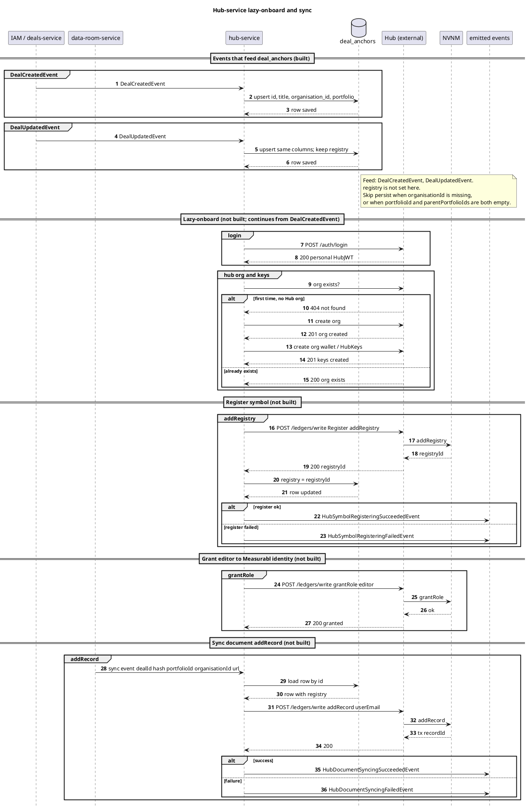

# Hub-service projector — onboard a client and sync a document

**Summary**: Local `deal_anchors` read model in hub-service. Hub-service upserts deal identity from `DealCreatedEvent` / `DealUpdatedEvent` so later Register and AddRecord can run without calling other IO microservices. Lazy-onboard, `addRegistry`, `grantRole`, and `addRecord` from this table are not wired yet.

**Sources**: hub-service `deal-anchoring/` on `INV-42559-measurabl-anchoring`; `DealCreatedEvent` / `DealUpdatedEvent` payloads in shared Events; prior working note moved into this wiki.

**Last updated**: 2026-09-15

---

Minimal hub-service design so **Register** and **AddRecord** do not call other IO microservices. Hub-service listens to IO events, keeps one local table, talks to **Hub (external)** only, then emits follow-up events (who consumes them is out of scope).

**Related idea (INV-42086-hub-keys-everywhere).** That work explored keeping enough deal and portfolio context *inside* hub-service so a Hub write does not have to ask other IO services. We take only that idea. This note does not follow that branch’s tables, APIs, or merge path. Scoped Hub keys (org → portfolio → deal) live on `INV-42559` for NVNM credential climb; they are not this projector.

**What is built today.** Hub-service upserts `deal_anchors` from `DealCreatedEvent` / `DealUpdatedEvent`. `hub-onboarding` can `POST /auth/login` and hold the admin HubJWT. Create org/keys, `addRegistry`, `grantRole`, and `addRecord` are **not wired yet**. Sequences A and B below are the intended Hub HTTP flow once that work lands. See [ADR-0001](../decisions/ADR-0001%20Hub%20Onboarding%20Module.md).

**Lazy-onboarding** (first call only, not built): hub-service calls Hub as a **known user** (`POST /auth/login` with login + password — personal HubJWT). Then a sequence of Hub HTTP APIs: create the Hub org if it is missing, then the org NVNM wallet if missing (generate → derive → set), then HubKeys. That pair is done **once** for the Hub org. Later deals do not repeat it: ask Hub whether the org already exists. Do **not** consume `OrganisationCreatedEvent`.

---

## What `deal_anchors` is

`deal_anchors` is a **local read model in hub-service**. It is not the source of deals or portfolios. Those stay in IAM / deals-service. Hub-service only **projects** what it heard on the bus so that later Hub work (create org/keys once, register a registry, add a document) can run from this database alone.

One row is one deal. When a deal is created or updated, hub-service writes `id`, `title`, `organisation_id`, `portfolio_id`, and `parent_portfolio_ids`. An existing `registry` is left untouched on that upsert. When Hub later returns a registry id, that same row will get `registry`. A later sync event can then be answered with `dealId` — no HTTP to deals-service or data-room.

It is **not** a copy of the full deal. Hash and URL never live here; they arrive on the sync event and go straight onto the chain. Hub org and HubKeys are not stored here either; they live on Hub and are created on the first lazy-onboard call.

Existing hub-service tables `organisations` (`id`, `name`) and `deals` (`id`, `title`) stay as they are. Portfolio and registry belong on this projection. `title` is stored so the projector can stand alone without joining `deals`.

**Events that feed the table** (bus → upsert). Nothing else writes the identity columns.

| Event | Writes |
| --- | --- |
| `DealCreatedEvent` | `id`, `title`, `organisation_id` (from event context), `portfolio_id`, `parent_portfolio_ids` |
| `DealUpdatedEvent` | same columns, same upsert (portfolio can change). `registry` is preserved |

The saga does not persist, and logs the reason, when `context.organisationId` is missing, or when both `portfolioId` and `parentPortfolioIds` are empty (payload, else context for `portfolioId`).

`registry` will be written later by hub-service itself, after Hub returns `registryId` from `addRegistry`. The sync event does **not** feed this table.

---

## Columns

Listener: `DealCreatedEvent` / `DealUpdatedEvent` → upsert (`SaveDealAnchorCommand`). Table: `deal_anchors`. Naming strategy is snake_case.

| Column                 | Type                           | Source                                                                | Why it is here                           |
| ---------------------- | ------------------------------ | --------------------------------------------------------------------- | ---------------------------------------- |
| `id`                   | uuid PK                        | `DealCreatedEvent.payload.id`                                         | Sync and Register key (`dealId`)         |
| `title`                | varchar                        | `DealCreatedEvent.payload.title`                                      | Standalone projector; no join to `deals` |
| `organisation_id`      | uuid not null                  | `DealCreatedEvent` **context** `organisationId` (payload has no org)  | IO org; used on Hub calls after login    |
| `portfolio_id`         | uuid null                      | `payload.portfolioId`, else `context.portfolioId`                     | Client / signer scope                    |
| `parent_portfolio_ids` | uuid[] null                    | `DealCreatedEvent.payload.parentPortfolioIds`                         | Root vs nested portfolio                 |
| `registry`             | varchar not null, default `''` | Hub `addRegistry` result (numeric `registryId`) — **not written yet** | Target registry for `addRecord`          |

Hash and URL are **not** stored. They arrive on the sync event and go onto the chain in that `addRecord` (`checksum` = hash, `uri` = URL).

`DealAnchorModel.rootPortfolioId()` is the signer-scope helper: `portfolio_id` when `parent_portfolio_ids` is empty (deal on the root portfolio); otherwise `parent_portfolio_ids[0]`.

---

## Events

### Consume (build / drive the table)

| Event | Today on `hub`? | Fields used | Action |
| --- | --- | --- | --- |
| `DealCreatedEvent` / `DealUpdatedEvent` | yes | `id`, `title`, `portfolioId`, `parentPortfolioIds`; `organisationId` from **event context** | upsert `deal_anchors` (skip and log if no `organisationId`, or if `portfolioId` and `parentPortfolioIds` are both empty). Does **not** run lazy-onboard or Register yet |
| Sync event (see below) | working name `MeasurablDLTTransaction` (slim of `HubDocumentSyncingRequestedEvent`) | `dealId`, `taxonomyId`, `organisationId`, `uri` / `checksum`. `symbol` from this table. Portfolio unused. | `addRecord` — **not wired from this table yet** |

`DealCreatedEvent` payload today (`DealCreatePayloadDTO`): `id`, `title`, `portfolioId?`, `parentPortfolioIds?`. Organisation is not on the payload. Use event `context.organisationId`.

### Sync event — expected payload

Working name `MeasurablDLTTransaction`. Full contract: [Measurabl DLT Transaction](Measurabl%20DLT%20Transaction.md).

```
dealId
taxonomyId
organisationId
uri
checksum
checksumAlgo
```

`symbol` / `registry` from `deal_anchors` by `dealId`. Portfolio is **not** used on this path. Hub sets ledger to NVNM (Measurabl is NVNM-only).

### Emit (after a consumed event — listeners are out of scope; not emitted from this projector yet)

| Event                                | When                                                   |
| ------------------------------------ | ------------------------------------------------------ |
| `HubSymbolRegisteringSucceededEvent` | After `addRegistry` — `symbol` = on-chain `registryId` |
| `HubSymbolRegisteringFailedEvent`    | Register failed                                        |
| `HubDocumentSyncingSucceededEvent`   | `addRecord` ok                                         |
| `HubDocumentSyncingFailedEvent`      | `addRecord` failed                                     |

---

## Sequence A — lazy-onboard a client (not built)

Triggered on the **first** deal that needs Hub (after the row is upserted). Hub-service is the caller; it logs in as the known Hub user.

1. Portfolio root created (IO).
2. Deal created (IO). Persist onto `deal_anchors` (`id`, `title`, `organisation_id`, `portfolio_id`, `parent_portfolio_ids`). **This step is built.**
3. Hub-service → Hub `POST /auth/login` (known user login + password) → personal HubJWT.
4. If Hub has no org for this IO organisation → create org (same JWT). Else skip.
5. Create org wallet / HubKeys on Hub (same JWT). Check `GET .../wallets/ledger-type/NVNM` first; if missing, generate → derive → set wallet.
6. Register a symbol = `addRegistry` (create the registry documents will sync into).
7. Save `registry` on the row. Emit `HubSymbolRegisteringSucceededEvent`.
8. Grant **editor** on that registry to the **Measurabl identity** (registry scope: empty checksum). Hub `POST /ledgers/write` → `grantRole(registryId, "", measurablIdentity, "editor")`. The registry creator is already admin; this is what lets the Measurabl identity call `addRecord` later.
9. Later: `addRecord` on that registry through Hub, signed as the **Measurabl identity**.

Steps 4–5 run only when Hub does not already have the org/keys. Later deals start at step 6 (register + grant editor).

---

## Sequence B — sync a document (not built)

Prerequisite: row exists, `registry` set, Measurabl identity has **editor** on that registry. Hub org + keys exist because lazy-onboard already ran once.

1. Consume sync event `{ dealId, hash, portfolioId, organisationId, url }`.
2. Load `deal_anchors` by `id` = `dealId` (no deals-service / data-room HTTP).
3. Hub `POST /ledgers/write` → `addRecord` into `registry` (`checksum` = hash, `uri` = url, **`userEmail`** = Measurabl identity). Hub signs with that identity wallet.
4. Emit succeeded / failed.

---

## PlantUML



## Related pages

- [Wiki Index](Measurabl%20provision%20(INV-42559)/wiki/index.md)
- [ADR-0001 Hub Onboarding Module](../decisions/ADR-0001%20Hub%20Onboarding%20Module.md)
- [Event Payloads](Event%20Payloads.md)
- [Measurabl DLT Transaction](Measurabl%20DLT%20Transaction.md)
- [Open Questions](Measurabl%20provision%20(INV-42559)/wiki/Open%20Questions.md)
- [Decision register](../decisions/INDEX.md)
