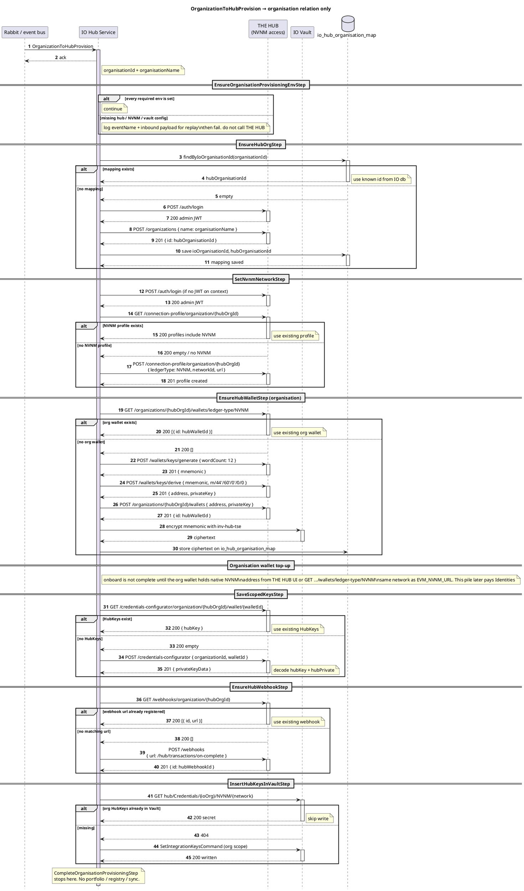

# Measurabl Provisioning

**Summary**: Measurabl organisation provisioning versus `develop`: inbound events, THE HUB org relation, Identity-signed register and `addRecord`, infrastructure, decisions, and remaining gaps. THE HUB is a third-party black box; this work does not change it. Self-contained. Sections follow execution order.

**Sources**: `inveniam.io` Measurabl anchoring branch versus `origin/develop` (211 files, ~12.5k insertions). `apps/hub-service/src/organisation-provisioning/`, `deal-anchoring/`, `secure-storage/`, `integration-keys/`, `transactions/`, `config/environment.ts`, `shared-modules/Events/Hub/Onboarding/`, deals-service integration settings.

**Last updated**: 2026-10-09

---

Application path: `~/work/inveniam/inveniam.io`.

THE HUB is not part of IO. It is a third-party integration: a black box (separate repository, published HTTP API and webhooks). This work does not change THE HUB — repository, APIs, estimate, write path, THE HUB Vault, or THE HUB key layout. IO calls the published API and consumes webhooks. Open items that require a change in THE HUB stay owned by THE HUB.

## Scope

Measurabl requires an NVNM registry for a deal and an `addRecord` for a data-room file. Available inputs: IO organisation, deal, file, checksum, URI. Measurabl has no IO user.

Existing IO Hub Service sync via THE HUB requires an IO user, a `data_room_file_taxonomies` row, and `HubDocumentSyncingRequestedEvent`. Measurabl does not create that user and does not call `create-request`.

IO Hub Service (`inv-hub-ms`) therefore, using THE HUB as a black box:

1. Establishes THE HUB organisation (org, NVNM profile, org wallet, HubKeys, webhook).
2. Creates THE HUB Identity for the Measurabl portfolio.
3. Registers an NVNM registry as that Identity when the deal has none.
4. Syncs the document onto that registry.

IO orchestrates. THE HUB holds keys and submits the ledger write. Nothing in THE HUB is modified for that.

## Terminology

| Term | Meaning |
| --- | --- |
| THE HUB | Third-party signer and ledger write API. Not part of IO. Black box. This work does not change it. |
| IO Hub Service | IO microservice (`inv-hub-ms`, `apps/hub-service`). Orchestrates against THE HUB. |
| Organisation | IO organisation = THE HUB organisation, 1:1. Mapping: `invhub.io_hub_organisation_map`. |
| Portfolio | IO portfolio = THE HUB Identity. Email `{portfolioId}@measurabl.com`. Not a person. |
| Org wallet | HD `m/44'/60'/0'/0/0`. THE HUB stores the derived key pair. IO stores the encrypted org mnemonic. |
| Identity wallet | Later leaf on the same mnemonic. Keys remain on THE HUB. |
| HubKeys | THE HUB `tokenization` credentials for `POST /auth/service-login`. IO Hub Service writes them to IO Vault at organisation scope. |
| Registry | NVNM container (`addRegistry`, then `addRecord`). Id stored on `deal_anchors.registry`. |
| Chain of Responsibility (CoR) | Ordered ensure-steps for one inbound event (`RunOrganisationProvisioningCommand`, `RunPortfolioProvisioningCommand`, then registry and document). Each step GET-or-create, then `setNext`. |

Code retains THE HUB resource names (`EnsureHubOrg`, `EnsureHubIdentity`, `EnsureHubWallet`).

## Inbound events

A single ingest (slim of `HubDocumentSyncingRequestedEvent`) mixed two lifetimes: organisation onboard is once; a document may arrive later on a deal that already has a registry.

The contract is two events, consumed by IO Hub Service only. `EventToMSMap` lists both as `hub`. There is no document-only queue and no second topic. Cluster: the env SNS topic (usually `*.fifo`) and the existing IO Hub Service SQS subscription (`msList=["hub"]`). Local: Rabbit `dev-exchange`. Types: `shared-modules/Events/Hub/Onboarding/`.

`OrganizationToHubProvision` creates or reuses THE HUB org relation and **stops**. It is not the document ingest. It does not create an Identity, registry, or document. The document event is `ClientDLTTransaction`.

```ts
export interface OrganizationToHubProvisionPayload {
  organisationId: string;
  organisationName: string;
}
```

`ClientDLTTransaction` requires `io_hub_organisation_map`. Creates the Identity if missing, registers if `deal_anchors.registry` is empty, then syncs. THE HUB sets ledger to NVNM. IO Hub Service binds only this payload. Extra keys on the envelope are ignored.

```ts
export interface ClientDLTTransactionPayload {
  dealId: string;
  taxonomyId: string; // required. IO correlation key. Must be data_room_file_taxonomies.id
  organisationId: string;
  uri: string;
  checksum: string;
  checksumAlgo: string;
}
```

`uri` is the document URL. `checksumAlgo` is copied onto NVNM `addRecord` as a string. IO Hub Service does not validate an enum. The only member of `ChecksumAlgorithms` (`shared-modules/SharedInterfaces/Domain/data-room.interfaces.ts`) is `SHA-256`. Emit scripts and this path’s tests send that value.

These names are not on the type and are not read:

| Name on some producer contracts | IO Hub Service |
| --- | --- |
| `documentUrl` | `uri` |
| `checksumAlgorithm` | `checksumAlgo` |
| `portfolioId` | From `deal_anchors` (`portfolio_id` or `parent_portfolio_ids[0]`). Builds `{portfolioId}@measurabl.com` |
| `documentName` | Sync sets `documentTaxonomy.document` to `''` |
| optional taxonomy | `taxonomyId` is required |

`fileId`, `userId`, `userEmail`, `ledgerType`, and `transactionType` are also absent on this inbound type.

`taxonomyId` is the required IO correlation key. THE HUB `addRegistry` / `addRecord` do not use it. IO does. The value must be the primary key of an existing `data_room_file_taxonomies` row. A missing, empty, or fabricated id means IO cannot attach the chain result to the file: no parked document after register, no taxonomy status update, no Synced badge. `fileId` is not a substitute on this contract.

Uses:

| Location | Role |
| --- | --- |
| `ClientDLTTransaction` | Inbound required field. Identifies which data-room taxonomy this write is for. |
| `deal_anchors.pending_document[taxonomyId]` | Park `{ uri, checksum, … }` when register is in flight. Resume document sync from that key after `HubSymbolRegisteringSucceededEvent`. |
| `transactions` (Register and Sync) | Stored at insert so async `onComplete` can emit the same id. |
| `HubDocumentSyncingSucceededEvent` / Failed / Pending | Data-room `updateStatusOnResponseFromLedger` loads the row by this primary key. Missing row: log and return. Status does not change. |
| File Synced UI | `getFileDLTStatuses` reads that taxonomy. The in-session spinner is keyed by the same id. |

Missing map row: ClientDLT fails. Missing `deal_anchors` row for `dealId`: ClientDLT fails. ClientDLT does not insert a deal stub.

Replay after configuration is corrected.

Local (Rabbit):

```bash
./apps/hub-service/scripts/emit-organization-to-hub-provision.sh <organisationId> "<organisationName>"
./apps/hub-service/scripts/emit-client-dlt-transaction.sh
```

SNS (env topic, usually `*.fifo`):

```bash
SNS_TOPIC_ARN="<...>" \
AWS_PROFILE=<...> \
./apps/hub-service/scripts/emit-organization-to-hub-provision-sns.sh <organisationId> "<organisationName>"

SNS_TOPIC_ARN="<...>" \
AWS_PROFILE=<...> \
./apps/hub-service/scripts/emit-client-dlt-transaction-sns.sh <organisationId> <dealId> <taxonomyId>
```

`taxonomyId` must be `data_room_file_taxonomies.id`. Omitting it generates a new UUID that IO cannot apply.

The first Chain of Responsibility (CoR) step of each chain validates required env. On miss it logs `eventName` and the inbound payload (not the CoR context), then throws without calling THE HUB. That payload is the replay body.

## Infrastructure prerequisites

Each environment that runs this image must be prepared independently. Local Vault does not replicate to cluster Vault.

Do not touch THE HUB Vault (`vault-hub-*`, `hub-tse/`, keyring `wallets`). That is hub-api only.

Order: enable transit on **that** env’s IO Vault, set env on IO Hub Service (`inv-hub-ms`), deploy, then prove tables and Vault paths.

The schema is the TypeORM migrations under `apps/hub-service/src/migrations/`. They execute automatically on IO Hub Service (`inv-hub-ms`) startup (`migrationsRun: true` in `apps/hub-service/src/config/database.ts`). There is no separate migrate job. Nothing else creates these tables.

| File | Establishes |
| --- | --- |
| `1789471435157-add-deal-anchors-table.ts` | `deal_anchors` (`id`, `title`, `organisation_id`, `registry`, `portfolio_id`, `parent_portfolio_ids`) |
| `1789600000000-add-deal-anchors-pending-document.ts` | `deal_anchors.pending_document` (jsonb, keyed by `taxonomyId`) |
| `1789548200000-add-io-hub-organisation-map-table.ts` | `io_hub_organisation_map` (`io_organisation_id`, `hub_organisation_id`, `mnemonic_ciphertext`) |
| `1789700000000-add-io-hub-organisation-map-identity-wallet-index.ts` | `io_hub_organisation_map.identity_wallet_index` (HD leaf counter) |

Confirm after deploy:

```sql
SELECT column_name
FROM information_schema.columns
WHERE table_name IN ('deal_anchors', 'io_hub_organisation_map')
ORDER BY table_name, ordinal_position;
```

Required columns: `deal_anchors.pending_document`, `io_hub_organisation_map.mnemonic_ciphertext`, `io_hub_organisation_map.identity_wallet_index`.

Cluster env for IO Hub Service (`inv-hub-ms`) is `~/work/inveniam/helm_env_configs`. That repository has no `develop` branch; the Measurabl anchoring branch is compared to `origin/master`. The inveniam.io chart (`helm/configs/hub.yaml`) does not add these variables.

New keys are in `apps/inveniam/values/hub.yaml.gotmpl`. Admin credentials stay in Vault KV (paths only; values are not in git). The other three are rendered from values:

```gotmpl
HUB_ADMIN_EMAIL: vault://{{ $vaultKv }}/service/hub/thehub/admin/email
HUB_ADMIN_PASSWORD: vault://{{ $vaultKv }}/service/hub/thehub/admin/password
HUB_ON_COMPLETE_WEBHOOK_URL: "https://{{ .Values | getOrNil "url_api" | default (printf "%s-api.%s" $env .Values.zone_name) }}/hub/transactions/on-complete"
EVM_NVNM_URL: {{ .Values.blockchain_nvnm_network_rpc }}
HUB_MS_VAULT_TSE_PATH: {{ .Values | getOrNil "hub_ms_vault_tse_path" | default (printf "inveniam-%s-hub-tse" $env) }}
```

| Variable | Source | Role |
| --- | --- | --- |
| `HUB_ADMIN_EMAIL` / `HUB_ADMIN_PASSWORD` | Vault `service/hub/thehub/admin/{email,password}` | `POST {HUB_URL}/auth/login` for onboard |
| `HUB_ON_COMPLETE_WEBHOOK_URL` | `https://{url_api or {env}-api.{zone}}/hub/transactions/on-complete` | THE HUB POSTs here. Cluster is `https://` hostname. Local compose may use `http://IPv4:port/...`. Not a Kubernetes service DNS name |
| `EVM_NVNM_URL` | `blockchain_nvnm_network_rpc` | NVNM JSON-RPC: THE HUB connection profile, identity `eth_estimateGas`, parent top-up |
| `HUB_MS_VAULT_TSE_PATH` | `hub_ms_vault_tse_path`, else `inveniam-{env}-hub-tse` | Transit mount. Local compose / app default is `inv-hub-tse`. No env overlay sets `hub_ms_vault_tse_path` today |

`blockchain_nvnm_network_rpc` (vs `master`):

| Class | Value |
| --- | --- |
| Non-live (`apps/inveniam/configs/defaults.yaml`) | `https://evm.testnet.nvnmchain.io` |
| Live overlays (`apps/inveniam/configs/environments/`) | `https://evm.nvnmchain.io` |

An overlay that sets `blockchain_nvnm_network_type: mainnet` without `blockchain_nvnm_network_rpc` inherits the non-live RPC.

Already present in the same gotmpl (`envVariables`). `HUB_MS_VAULT_ENDPOINT` must be IO Vault, not THE HUB Vault:

| Variable | Source | Must be |
| --- | --- | --- |
| `HUB_URL` | `https://{url_hub or hub-{env}-api.{zone}}` | That env’s THE HUB API, not IO |
| `HUB_MS_VAULT_ENDPOINT` | `.Values.vault_address` | That env’s **IO** Vault. Not `vault-hub-*` |
| `HUB_MS_VAULT_ROLE` | `vault_role`, else `{Environment.Name}-cluster-inv-hub-pod-role` (compose: `$USER`) | The IO Hub Service (`inv-hub-ms`) role on that cluster |
| `HUB_MS_VAULT_KV` | `hub-{env}-inveniam` | Existing IO KV for HubKeys |
| `NVNM_NETWORK_TYPE` | `blockchain_nvnm_network_type` (non-live default `testnet`; live overlays `mainnet`) | THE HUB profile `networkId` |
| `HUB_WRITE_API_VERSION` | `ms_hub_write_api_version` (`v3` in `defaults.yaml`) | `v3` on this path (job id, then poll). Writes are only v1 or v3; there is no write API v2. Wallet “v2” is only the `x-hub-access-key` header |

Optional quote knobs are not in `helm_env_configs`. Code defaults: `NVNM_GAS_PRICE_HEADROOM_PERCENT` (`120`), `NVNM_ADD_RECORD_EOA_GAS_STAND_IN` (`166014`).

On each IO Vault the transit mount path must equal `HUB_MS_VAULT_TSE_PATH` (`inv-hub-tse` locally; `inveniam-<env>-hub-tse` on cluster unless overridden):

```bash
export VAULT_ADDR=<this env IO Vault URL>
vault secrets enable -path="$HUB_MS_VAULT_TSE_PATH" transit
```

Do not reuse `hub-tse/` if it already exists. Cluster IO Hub Service (`inv-hub-ms`) role:

```hcl
path "inveniam-<env>-hub-tse/keys/+"    { capabilities = ["update"] }
path "inveniam-<env>-hub-tse/encrypt/+" { capabilities = ["update"] }
path "inveniam-<env>-hub-tse/decrypt/+" { capabilities = ["update"] }
```

`+` matches one path segment (the IO organisation UUID). Transit create-key is `update` on `keys/+`. There is no `read` or `list` on keys. `vault secrets list` and `vault token capabilities` on `keys/probe` may 403 even when encrypt / decrypt work.

Decrypt is required. Ciphertext lives on the map row, not in Vault KV. THE HUB is unchanged. IO continues to write organisation HubKeys to the existing IO Vault KV.

The app’s key name is the IO organisation UUID: `update` `inveniam-<env>-hub-tse/keys/{ioOrg}`, encrypt, store ciphertext, later decrypt with that ciphertext. Local compose mount is `inv-hub-tse`.

After deploy: tables exist, the five new env vars are set, Vault endpoint is IO Vault, the role can encrypt and decrypt on the TSE path THE HUB is configured to use, THE HUB can reach the webhook (THE HUB 1301 = unreachable, 1307 = bad URL shape). Logs use the marker `client-provisioning`. TSE failures look like Vault 403 or “Couldn’t create Vault transit secret”. Grep `required env is missing` when a chain fails before THE HUB login.

This work does not create FusionAuth users. Organisation wallet native funding is part of onboard (`OrganizationToHubProvision`), not a later step. THE HUB itself is unchanged.

## IO organisation

`create-org.sh` (local) or the IAM create-org path (cluster) creates the IO organisation. It assigns an existing user as Administrator. It does not FusionAuth-invite and does not call THE HUB.

```bash
./create-org.sh "<org name>" <existing_user_id>
```

Output `ORG_ID` is `organisationId` for `OrganizationToHubProvision`. Do not insert an organisation row in SQL.

## Deal projection

`deal_anchors` is an IO Hub Service read model. IAM and deals-service remain authoritative. The projector lets later IO Hub Service work run from `invhub` without HTTP to deals-service or data-room for portfolio or registry.

On `DealCreatedEvent` or `DealUpdatedEvent`, `SaveDealAnchorCommand` upserts `id`, `title`, `organisation_id`, `portfolio_id`, `parent_portfolio_ids`. Organisation is not on the payload; it comes from event **context**. Skip and log if `organisationId` is missing, or if both `portfolioId` and `parentPortfolioIds` are empty. An existing `registry` is left untouched on that upsert. Hash and URI never live here; they arrive on ClientDLT and go onto the chain.

`title` is stored so the projector does not join the old `deals` table. Those older `organisations` / `deals` tables stay as they are.

Portfolio for signing: `portfolio_id` when `parent_portfolio_ids` is empty (deal sits on the root portfolio), otherwise `parent_portfolio_ids[0]`. That is `DealAnchorModel.rootPortfolioId()`.

`registry` and `pending_document` are written later, by provisioning, not by the projector. ClientDLT must not create a stub row. If the deal was never projected, Register has nothing to join.

## OrganizationToHubProvision

Implementation is in IO Hub Service: `apps/hub-service/src/organisation-provisioning/`. The module was named `hub-onboarding`, then `client-provisioning`, then `organisation-provisioning` (IO organisation vocabulary).

It is not part of `tokenization`. That module uses `/auth/service-login` and org HubKeys. Onboard uses `/auth/login` (admin email and password) and create-if-missing. IO Hub Service uses two THE HUB HTTP clients. After keys exist, `addRegistry` and `addRecord` remain on the existing `transactions` / tokenization write path. There is no second job table.

`RunOrganisationProvisioningCommand` is a Chain of Responsibility (CoR) of ensure-steps. Each THE HUB resource is GET, reuse if present, otherwise POST.

First step: required env. Missing THE HUB URL, admin, webhook, NVNM network, NVNM URL, or Vault endpoint / role / KV: log `OrganizationToHubProvision` and `{ organisationId, organisationName }`, throw, stop.

`EnsureHubOrgStep` looks up the map by IO org. Hit: use `hubOrganisationId`. Miss: admin login, `POST /organizations` with `organisationName`, save both ids on `io_hub_organisation_map`.

`SetNvnmNetworkStep` GETs THE HUB connection profile. If NVNM is missing, POST `{ networkId, url }` from `NVNM_NETWORK_TYPE` and `EVM_NVNM_URL`.

`EnsureHubWalletStep` is org-only. GET wallets for NVNM. If none: THE HUB `generate` a 12-word mnemonic, `derive` `m/44'/60'/0'/0/0`, `POST` the address and private key onto the org. THE HUB keeps the key pair. THE HUB’s `generateWalletKeys` returns a bip39 phrase and persists nothing; `deriveKeysFromMnemonic` returns `{ privateKey, address }` in memory. Treating “the phrase reached THE HUB” as a security defect was rejected: THE HUB has no mnemonic storage by design. IO retains the phrase so later leaves can be derived from the same seed.

`InsertOrgMnemonicInTransitStep` runs only when a wallet was just created (mnemonic still on context). It creates `inv-hub-tse/keys/{ioOrg}`, encrypts, and stores ciphertext on `io_hub_organisation_map.mnemonic_ciphertext`. Replay against an existing wallet skips the step (no mnemonic on context). Decrypt ACL is IO Hub Service only. The phrase is not stored in THE HUB app storage, not mixed into HubKeys, and not written to `hub-tse/`.

`SaveScopedKeysStep` GET credentials-configurator for that org wallet, or POST and decode `privateKeyData` into `hubKey` / `hubPrivate`.

`EnsureHubWebhookStep` GET webhooks for the org. If the configured URL is absent, POST `{ name, url, isSignatureEnabled: true, organizationId }` to `hub/transactions/on-complete`. URL: `HUB_ON_COMPLETE_WEBHOOK_URL`. Local default: `http://host.docker.internal:8893/hub/transactions/on-complete`, resolved to IPv4 before POST. THE HUB accepts `http://IPv4:port/...` or `https://domain/...`.

`InsertHubKeysInVaultStep` skips if org-level NVNM keys already exist in Vault. Else `SetIntegrationKeysCommand` at organisation scope. Portfolio keys stay on THE HUB.

`CompleteOrganisationProvisioningStep` marks the context done and **does not** start portfolio, registry, or sync.

Prove a new wallet onboard with existence only — do not print ciphertext:

```sql
SELECT io_organisation_id,
       hub_organisation_id,
       mnemonic_ciphertext IS NOT NULL AS has_ciphertext
FROM io_hub_organisation_map;
```

THE HUB UI should show the organisation. Logs: `docker logs inv-hub-ms | rg client-provisioning`.

Sequence:



## ClientDLTTransaction

`ClientDLTTransaction` starts `RunPortfolioProvisioningCommand`. Env check first, same THE HUB / NVNM / Vault keys, replay body is the ClientDLT payload.

`ResolveHubOrganisationStep` reads the map only. Missing row: fail. `OrganizationToHubProvision` must have completed first.

`EnsureHubIdentityStep` loads `deal_anchors` by `dealId`, takes `portfolioId` or `parentPortfolioIds[0]`, and searches THE HUB users by `{portfolioId}@measurabl.com`. Miss: `POST /users` `{ firstName: Measurabl, lastName: Portfolio, email }`. `hubIdentityId` is context-only, for the subsequent wallet POST. IO does not persist it. Reconstruction: map → THE HUB org, anchors → portfolio, email → THE HUB `getIdentityByOrgIdAndEmail`.

`EnsureHubIdentityWalletStep` GET that identity’s NVNM wallets. Miss: decrypt the org mnemonic, derive `m/44'/60'/0'/0/{n}` where `n` is `DISTINCT` resolved parent portfolio ids for the org, plus one. Org remains on leaf 0. Leaves stay dense (1..N) so reconstruction does not require a scan length. Generate-per-identity was rejected. Reserve-index-first was rejected: a failed THE HUB create would skip a leaf.

Two concurrent ClientDLTs for the same org could read the same `n` and hand out one leaf twice. That whole check → derive → create → tick sits under `OrganisationProvisioningLock` with scope `IdentityHdLeaf`: session-scoped `pg_try_advisory_lock` on a dedicated QueryRunner, 150s wait. The parent top-up (coming next) uses a **different** scope, `ParentWalletNonce`. Sharing one lock key would deadlock when one section nests inside the other.

The portfolio chain uses its own `EnsureHubWalletStep` instance so org and portfolio `setNext` pointers do not collide.

`CompletePortfolioProvisioningStep` then starts `RunRegistryProvisioningCommand`.

### Organisation wallet funding

During onboard, after `EnsureHubWalletStep`. Send native NVNM to the organisation NVNM address: THE HUB UI, or `GET {HUB_URL}/organizations/{hubOrganisationId}/wallets/ledger-type/NVNM` (`hubOrganisationId` from `io_hub_organisation_map`). Same network as `EVM_NVNM_URL`. Onboard is not complete until that wallet holds funding. That pile is the parent for Identity top-ups. There is no environment variable for this send.

### Identity funding

NVNM: the registry creator is admin; other addresses are deny-by-default until `grantRole`. Product requires Identity-signed `addRegistry` and `addRecord` (`userEmail` = the Measurabl email). THE HUB `write()` uses `value = 0`. The Identity must hold native funding before the write. On `ClientDLTTransaction`, the parent org wallet (`/0`) sends native NVNM via ethers on `EVM_NVNM_URL` (`EnsureRegistryFundsStep` / `EnsureDocumentFundsStep`). Do not send native token to Identity wallets by hand. Do not put the top-up in THE HUB `write()` value.

THE HUB `/ledgers/estimate` always uses the org wallet as `from`, including when `userEmail` is set. THE HUB controller resolves the identity wallet and passes `userWallet`; `ProcessTransactionService.estimate` omits it and connects with `orgWallet`. A `userWallet` branch in that service is commented out. `write` in the same service uses `isIndividual ? userWallet : orgWallet`. An org-wallet estimate of `addRecord` on an identity-created registry returns `unauthorized`. Register and Sync do not call THE HUB estimate.

`EnsureRegistryFundsStep` and `EnsureDocumentFundsStep` quote with ethers `eth_estimateGas` from the Identity address (Vault InveniamToken ABI). THE HUB’s sign buffer is applied to `2×` that estimate (`max(hubGas * 3, hubGas + 30000) * gasPrice`); THE HUB’s smart-account estimate is approximately twice an EOA. The price is `max(gasPrice, maxFeePerGas)` × `nvnm.gasPriceHeadroomPercent` (default 1.2×). Amounts are `bigint` wei; THE HUB ETH numbers convert at the boundary; logs are strings. The buffer is applied per write, then summed. After the leftover poll the quote is repeated; if leftover no longer covers, the step fails.

If leftover covers the buffer, no transfer. Otherwise leftover is re-read immediately before the parent send, the transfer is `required - leftover`, and THE HUB is polled until leftover covers the buffer or the deadline expires. A failed `GET /ledgers/balance/{id}` is rethrown (a swallowed read previously funded a full buffer). Concurrent parent sends use `ParentWalletNonce`; leftover is re-read inside the lock so a concurrent run is a no-op.

`tx.wait` timeout is not a failed transfer. The hash is logged and returned; the poll confirms. Treating timeout as failure discarded a live send.

An `addRecord` estimate that reverts (`CALL_EXCEPTION` / `NvnmEstimateRevertError`) may use `nvnm.addRecordEoaGasStandIn` (logged `addRecordStandInUsed`, cached per org). Transport errors fail the quote. Register fee is not reused as the document quote. Explorer-displayed `0.01` is not treated as sufficient; fixed piles `0.008` and `0.01` still Failed with `insufficient funds`.

Previous budget: transfer 120s + poll 180s (300s) versus `handleMessageTimeout` 180s. Heartbeat extends SQS visibility; the abort is the handler timeout. Redelivery previously started a second top-up; the nonce lock makes a funded duplicate a no-op. Current budget: transfer 60s, poll 90s, worst case 150s, 30s margin. `IDENTITY_FUNDS_BUDGET_CEILING_MS` is 180s; a unit test fails if transfer + poll no longer fit with 30s remaining. `HANDLE_MESSAGE_TIMEOUT` was not increased. A resumable funding step was not implemented.

At most one funding step runs per message. If `deal_anchors.registry` already exists, registry funding is skipped and document funding runs. If register was just requested, document funding does not run in the same handler; the payload is parked for the webhook.

Identity `to` address: context or get-wallet-info, else THE HUB GET wallets by id or name `Measurabl Portfolio`, then `POST /wallets/keys/decode`. Do not log mnemonic, cipher, keys, or address.

`HubAdminClient.estimateTxCost` is unused except by its own test. The intended estimate API remains THE HUB `/ledgers/estimate` from the Identity wallet. That change is THE HUB-owned and is listed under Open items.

If the Identity is missing, not `Identity Active`, or has no NVNM wallet, THE HUB does **not** fail the write; it signs with the org wallet. On succeed, `IdentityWriteSigner` compares receipt `from` to the Identity and logs a warning on mismatch.

### Registry

`EnsureRegistryStep`: if `deal_anchors.registry` is set, place it on context and skip create. Otherwise `RegisterSymbolCommand` (`addRegistry`) as `{portfolioId}@measurabl.com`, authenticated with org Vault HubKeys. Persistence: existing `transactions` table, type Register. No `hash` column. Keys: `taxonomyId` at insert and unique `hubJobId`.

Register / Sync rows need `transactions.user_id` to be a valid UUID. Empty string blocked the insert and the on-complete webhook. There is no Measurabl IO user, so the row uses sentinel `MEASURABL_TRANSACTIONS_USER_ID` = `11111111-1111-4111-8111-111111111111`. That is a stand-in. Do not null the column; other ledgers need it. A real Measurabl IO user later replaces the constant.

v3 write returns `hubJobId` first. Job `completed` means submitted, not on-chain success. Success is chain applied plus `RegistryCreated`. `NvnmLedgerProvider.onComplete` decodes that log. Explorer and the receipt need the **chain hash**. `resolveRegisterChainTransactionId` returns `transaction.transactionId` when it is already a hash (v1 write, or v3 after the poll wrote the hash). If the row hash is empty, `"null"`, or equal to `hubJobId`, it asks `GET /ledgers/v3/jobs/:id`. There is no write API v2. Wallet version v2 only adds `x-hub-access-key`; it still writes v1 or v3.

On success the existing `HubSymbolRegisteringSucceededEvent` is published (`UserScope<T>` adds `userId`). It updates deal integration settings (`registerSymbolStatus = Active`, NVNM connected). It does not update file Synced status. NVNM requires `symbol` (registry id). deals-service throws if `symbol` is missing. If register is already Active and the registry id is stored, deals-service skips rewriting settings. `userId` / `userEmail` are required on the type; this path has no IO user (`userEmail` is `''`; `userId` is the sentinel). Shape from `BaseDealInterface` plus register fields:

```ts
export interface HubSymbolRegisteringSucceededEventPayload {
  ledgerType: HubLedgerTypeEnum; // NVNM
  transactionType: TransactionTypeEnum;
  dealId: string;
  userId: string;
  userEmail: string;
  organisationId: string;
  transactionId: string; // chain hash, not hubJobId
  hubJobId?: string;
  status: DLTOperationStatuses;
  symbol?: string; // NVNM registry id; required for deals-service
  taxonomyId?: string;
}
```

Webhook and status poll can both call `onComplete`. The second is skipped when the row is already terminal.

`CompleteRegistryProvisioningStep`: if context already has a registry, start `RunDocumentProvisioningCommand` immediately. If register was just requested, park `{ uri, checksum, … }` at `pending_document[taxonomyId]` and return. There is no registry poll.

`StoreDealAnchorRegistrySaga` listens for `HubSymbolRegisteringSucceededEvent`. It inner-joins `deal_anchors` to `io_hub_organisation_map` on `organisation_id = io_organisation_id` and `deal_anchors.id = dealId`, writes `symbol` into `registry`, then starts document sync from `pending_document[taxonomyId]` and clears that key. No join → throw, no sync.

### Document sync

Document env is checked again (webhook resume included). Same funding pattern for `addRecord`. `SyncDocumentStep` uses `deal_anchors.registry` as `symbol` and the same `userEmail`. Existing `transactions` Sync-Document path.

Outbound `HubDocumentSyncingSucceededEvent` / Failed / Pending is the existing pair. There is no Measurabl-only emit. Data-room uses `taxonomyId`, `transactionPointer`, `status`, `reason` and ignores `ledgerType`, `organisationId`, and `userId`. `LogDocumentSyncFinishedSaga` logs `document sync finished`. Shape from `BaseHubInterface` and `DLTResponseInterface`:

```ts
export interface HubDocumentSyncingSucceededEventPayload {
  ledgerType: HubLedgerTypeEnum;
  transactionType: TransactionTypeEnum;
  taxonomyId: string; // required IO key — data_room_file_taxonomies PK. Without it IO cannot update the file
  transactionPointer: string; // empty + Pending => NotSynced
  hubJobId?: string;
  status: string; // must be Succeed for Synced
  reason: string; // empty on success
  organisationId?: string;
  userId?: string;
}
```

IO Hub Service does not assemble an inbound idempotency key from `organisationId | portfolioId | dealId | uri | checksum`. The unique key on `transactions` is `hub_job_id` (THE HUB job id, unique when not null). A write that returns the same `hubJobId` hits that unique constraint and reuses the existing row. That is THE HUB job replay, not a content hash of the document.

A second `ClientDLTTransaction` re-runs the chain. If `deal_anchors.registry` is already set, register is skipped. `SyncDocumentStep` still executes `SyncDocumentCommand`. A new THE HUB job is a second `addRecord`. Same `uri` and a different `checksum` is a different record. If `taxonomyId` is reused, data-room compares `taxonomy.documentChecksum` to the file checksum: mismatch is Outdated. Parked `pending_document[taxonomyId]` is overwritten with the latest `{ uri, checksum, checksumAlgo }`.

A Failed `transactions` row stays Failed. Retry register or sync needs a new row and a new THE HUB `hubJobId`.

The write field is **`userEmail`**, not Vault `userName` (`client-onboarding@inveniam.io` is metadata on the org secret). Omit `userEmail` and THE HUB signs as the org. Set it to the Measurabl email and THE HUB looks up that Identity’s NVNM wallet.

Sequence:



```plantuml
@startuml
title ClientDLTTransaction → portfolio → registry → document

skinparam sequenceMessageAlign center
skinparam sequence {
  LifeLineBackgroundColor white
}
hide footbox
autonumber

participant "Rabbit / event bus" as Bus
participant "IO Hub Service" as IO
participant "THE HUB\n(NVNM access)" as Hub
participant "NVNM chain\n(JSON-RPC)" as Chain
participant "IO Vault" as Vault
database "io_hub_organisation_map" as Map
database "deal_anchors" as Anchors

Bus -> IO ++ #E8DEF8 : ClientDLTTransaction
IO --> Bus : ack

== EnsurePortfolioProvisioningEnvStep ==

alt every required env is set
  note right of IO : continue
else missing hub / NVNM / vault config
  note right of IO : log eventName + inbound payload for replay\\nthen fail. do not call THE HUB
end

== ResolveHubOrganisationStep ==

IO -> Map ++ #FFFFFF : findByIoOrganisationId(organisationId)
alt mapping exists
  Map --> IO -- : hubOrganisationId
  note right : use known id from IO db
else no mapping
  Map --> IO -- : empty
  note right of IO : fail. run OrganizationToHubProvision first
end

== EnsureHubIdentityStep ==

IO -> Anchors ++ #FFFFFF : findOne(dealId)
Anchors --> IO -- : portfolioId / parentPortfolioIds
note right
  use portfolioId if parentPortfolioIds empty
  else parentPortfolioIds[0]
  email = {portfolioId}@measurabl.com
end note
IO -> Hub ++ #FFFFFF : GET /organizations/{hubOrgId}/users?search=email
alt Identity exists
  Hub --> IO -- : 200 { id: hubIdentityId }
  note right : use existing identity
else no Identity
  Hub --> IO -- : 200 []
  IO -> Hub ++ #FFFFFF : POST /organizations/{hubOrgId}/users\n{ firstName, lastName, email }
  Hub --> IO -- : 201 { id: hubIdentityId }
end

== EnsureHubIdentityWalletStep ==

IO -> Hub ++ #FFFFFF : GET /organizations/{hubOrgId}/users/{identityId}/wallets
alt identity NVNM wallet exists
  Hub --> IO -- : 200 [{ id: hubWalletId }]
  note right : use existing identity wallet
else no identity wallet
  Hub --> IO -- : 200 []
  IO -> Vault ++ #FFFFFF : decrypt org mnemonic (inv-hub-tse)
  Vault --> IO -- : mnemonic
  IO -> Hub ++ #FFFFFF : POST /wallets/keys/derive { m/44'/60'/0'/0/n }
  Hub --> IO -- : 201 { address, privateKey }
  IO -> Hub ++ #FFFFFF : POST /organizations/{hubOrgId}/users/{identityId}/wallets
  Hub --> IO -- : 201 { id: hubWalletId }
end

== EnsureRegistryFundsStep ==

IO -> Hub ++ #FFFFFF : GET /ledgers/get-wallet-info?userEmail=
Hub --> IO -- : wallet
IO -> Hub ++ #FFFFFF : GET /ledgers/balance/{hubWalletId}
Hub --> IO -- : leftover
IO -> Vault ++ #FFFFFF : GET InveniamToken ABI
Vault --> IO -- : abi + contractAddress
IO -> Chain ++ #FFFFFF : eth_estimateGas(addRegistry) from identity
Chain --> IO -- : funding
note right of IO : THE HUB estimates only from the org wallet and ignores userEmail on the estimate payload,\\nso identity addRegistry is quoted on the chain
alt leftover covers sign buffer
  note right of IO : proceed
else leftover below sign buffer
  IO -> Hub ++ #FFFFFF : GET /ledgers/balance/{hubWalletId}
  Hub --> IO -- : leftover
  note right of IO : parent /0 sends required - leftover, poll balance
end

== EnsureRegistryStep ==

IO -> Anchors ++ #FFFFFF : findOne(dealId)
alt registry already on deal_anchors
  Anchors --> IO -- : registry
  note right : use known registry, skip register
else registry empty
  Anchors --> IO -- : registry = ""
  IO -> Vault ++ #FFFFFF : GET org HubKeys (scoped miss then org fallback)
  Vault --> IO -- : 200 HubKeys
  IO -> Hub ++ #FFFFFF : send register registry transaction
  Hub --> IO -- : accepted (jobId)
  IO -> Hub ++ #FFFFFF : GET /ledgers/v3/jobs/:jobId
  Hub --> IO -- : completed + hash
  IO -> Hub ++ #FFFFFF : GET /ledgers/status/:hash
  Hub --> IO -- : applied
  Hub -> IO ++ #FFFFFF : POST /hub/transactions/on-complete
  IO --> Hub -- : 200
  IO -> Bus ++ #FFFFFF : HubSymbolRegisteringSucceededEvent
  Bus -> IO --++ #FFFFFF : StoreDealAnchorRegistrySaga
  IO -> Anchors ++ #FFFFFF : UPDATE registry = symbol
  Anchors --> IO -- : row updated
  IO -> Anchors ++ #FFFFFF : take pending_document
  Anchors --> IO -- : ClientDLT uri / taxonomy
  note right of IO : start document sync
end

== CompleteRegistryProvisioningStep ==

alt registry already known
  note right of IO : start document sync now
else register just requested
  IO -> Anchors ++ #FFFFFF : park pending_document
  Anchors --> IO -- : stored
  note right of IO : wait for register webhook, no poll
end

== EnsureDocumentProvisioningEnvStep ==

alt every required env is set
  note right of IO : continue
else missing hub / NVNM / vault config
  note right of IO : log ClientDLTTransaction payload for replay\\nthen fail
end

== EnsureDocumentFundsStep ==

IO -> Hub ++ #FFFFFF : GET /ledgers/get-wallet-info?userEmail=
Hub --> IO -- : wallet
IO -> Hub ++ #FFFFFF : GET /ledgers/balance/{hubWalletId}
Hub --> IO -- : leftover
IO -> Vault ++ #FFFFFF : GET InveniamToken ABI
Vault --> IO -- : abi + contractAddress
IO -> Chain ++ #FFFFFF : eth_estimateGas(addRecord) from identity
Chain --> IO -- : funding
note right of IO : THE HUB estimates only from the org wallet and ignores userEmail on the estimate payload,\\nso identity addRecord is quoted on the chain
alt leftover covers sign buffer
  note right of IO : proceed
else leftover below sign buffer
  IO -> Hub ++ #FFFFFF : GET /ledgers/balance/{hubWalletId}
  Hub --> IO -- : leftover
  note right of IO : parent /0 sends required - leftover, poll balance
end

== SyncDocumentStep ==

IO -> Vault ++ #FFFFFF : GET org HubKeys (scoped miss then org fallback)
Vault --> IO -- : 200 HubKeys
IO -> Hub ++ #FFFFFF : send sync document transaction
Hub --> IO -- : accepted (jobId)
IO -> Hub ++ #FFFFFF : GET /ledgers/v3/jobs/:jobId
Hub --> IO -- : completed + hash
IO -> Hub ++ #FFFFFF : GET /ledgers/status/:hash
Hub --> IO -- : applied
Hub -> IO ++ #FFFFFF : POST /hub/transactions/on-complete
IO --> Hub -- : 200
IO -> Bus ++ #FFFFFF : HubDocumentSyncingSucceededEvent
Bus --> IO -- : delivered

== LogDocumentSyncFinishedSaga ==

Bus -> IO ++ #FFFFFF : HubDocumentSyncingSucceededEvent
IO --> Bus -- : log document sync finished

deactivate IO

@enduml
```

## File Synced status

The UI does not apply IO Hub Service success events directly. IO Hub Service emits → data-room updates the taxonomy → data-room emits `DataRoomFileTaxonomyUpdatedEvent` → the UI refetches.

`getFileDLTStatuses` looks up the file’s NVNM taxonomy. Synced only when `taxonomy.documentChecksum === file.checksum`, `verificationStatus` is null or Verified, and `taxonomy.status` is Succeed. Empty `transactionPointer` plus Pending is NotSynced. Failed is NotSynced. Checksum mismatch is Outdated.

Required on the success event: a real `taxonomyId` (`data_room_file_taxonomies.id`), non-empty `transactionPointer`, `status = Succeed`, empty `reason`. That id is the only key data-room uses to update the file. Data-room ignores `ledgerType` / `organisationId` / `userId` on that command. Prerequisites not on the event: taxonomy row, file row, `ledgerType = NVNM`, matching checksum. Missing taxonomy: handler logs and returns; status does not change. The chain write may succeed; IO still treats the file as not Synced.

The websocket `HubDocumentSyncingSucceededEvent` only clears an in-session spinner if that `taxonomyId` is already in the client progress store. A background Measurabl sync may miss the spinner; the badge still updates from the taxonomy event or the next load.

`HubSymbolRegisteringSucceededEvent` never touches the file badge. It only matters if the deal UI should show NVNM connected. That needs an NVNM integration setting on the deal (or the auto-create path).

Measurabl emit is blocked on `taxonomyId`. Upload creates the file only. View-file URL: `/view-file/{fileId}?id={dealId}` (`data_room_files.id` + deal). After upload, `GET /dataroom/taxonomies/{fileId}` is empty (`200 []`). Confirmed 2026-09-22, file `04221f59-ffc2-48a6-9dbf-3cf15a8b3ad9`.

The taxonomy row is inserted by IO Sync / `POST /dataroom/taxonomy/create-request/{fileId}` (`requestChecksumVerification`), which then emits `HubDocumentSyncingRequestedEvent`. ClientDLT does not call that API. A fabricated UUID does not create the row; data-room looks up by primary key. Until the contract changes, Measurabl cannot supply a usable `taxonomyId` and IO will not complete the document path.

Options not yet selected:

- Mint taxonomy in IO first, then emit ClientDLT. Today’s `create-request` also starts `HubDocumentSyncingRequestedEvent`.
- Key ClientDLT on `fileId` (identity Measurabl already has). Data-room creates or updates the NVNM taxonomy on THE HUB success.
- Hybrid: use `taxonomyId` when present; otherwise resolve or create by `fileId`.

Persisting `taxonomyId` on `transactions` so async `onComplete` can emit it is useful only after a real row exists.

## Decisions

| Decision                            | Selected                                                                         | Rejected                                                                                      |
| ----------------------------------- | -------------------------------------------------------------------------------- | --------------------------------------------------------------------------------------------- |
| Inbound                             | `OrganizationToHubProvision` + `ClientDLTTransaction`                            | Reuse `HubDocumentSyncingRequestedEvent`                                                      |
| Register + sync                     | One ClientDLT; existing registry → sync; else park and wait for register webhook | Two inbound events; registry poll                                                             |
| Feedback                            | Existing Succeeded / Failed pair                                                 | Measurabl-only emit                                                                           |
| Persistence                         | Existing `transactions`                                                          | Second provision job table; `hash` column                                                     |
| Missing `deal_anchors`              | Fail                                                                             | Stub row from ClientDLT                                                                       |
| `isSyncNeeded`                      | Omitted; ClientDLT means sync                                                    | Skip flag                                                                                     |
| Identity funding                   | Leftover-aware parent `/0` native send; THE HUB write `value = 0`                    | THE HUB `write()` value; manual ops top-up                                                        |
| Wallets                             | One org mnemonic; dense HD leaves                                                | Generate-per-identity                                                                         |
| Mnemonic                            | IO transit `inv-hub-tse/` + ciphertext on the map                                | THE HUB app storage; mix into HubKeys; reuse `hub-tse/`                                           |
| Phrase on THE HUB                       | Not a security defect; THE HUB does not persist the mnemonic                         | Treat generate/derive as leakage                                                              |
| Funding quote                       | Ethers `eth_estimateGas` from Identity + THE HUB sign buffer                         | THE HUB `/ledgers/estimate` until it uses `userEmail`; org-signed writes; `grantRole`; fixed pile |
| Failed then Succeed same `hubJobId` | Failed stays Failed; retry = new row + new THE HUB job                               | `Failed → Pending` on the same row (tried, reverted)                                          |
| Concurrency                         | `ParentWalletNonce` and `IdentityHdLeaf` lock scopes                             | Shared lock key; reserve-first HD index                                                       |
| Funding vs timeout                  | Transfer 60s + poll 90s under `handleMessageTimeout` 180s                        | Raise handler timeout; resumable funding step                                                 |
| Amounts                             | `bigint` wei                                                                     | JS `number`                                                                                   |
| Gas price                           | `max(gasPrice, maxFeePerGas)` × headroom; re-quote after poll                    | Legacy `gasPrice` only                                                                        |
| Sign buffer                         | Per write, then sum                                                              | Buffer the summed estimate                                                                    |
| `addRecord` probe                   | Typed revert swallow; configured stand-in                                        | Bare `catch`                                                                                  |
| Balance read failure                | Rethrow                                                                          | Treat as empty wallet                                                                         |
| `tx.wait` timeout                   | Keep hash; poll confirms                                                         | Treat as failed send                                                                          |
| Identity signer                     | Receipt `from` vs Identity; mismatch is a warning                                | No check                                                                                      |
| deals-service                       | Skip settings write when register already Active                                 | Rewrite on every Succeeded                                                                    |

Log redaction retains `walletId` / `from` / `walletAddress`. Path sanitizer does not mask `/wallet/{id}` (aligned with `/ledgers/balance/{id}`).

## Open items

Do not change THE HUB or `transactions` write idempotency from `organisation-provisioning` without an explicit request.

**Sentinel `transactions.user_id`.** Keep `MEASURABL_TRANSACTIONS_USER_ID` until a Measurabl IO user exists. Then replace the constant. Do not null the column.

**THE HUB estimate.** `/ledgers/estimate` still uses the org wallet. When THE HUB `estimate()` selects the wallet the same way as `write()`, retire the ethers quote path (including per-call `JsonRpcProvider`) and restore Register / Sync onto `/ledgers/estimate`. Product retained Identity-signed writes. Identity-created registries (including Gama `4533`) remain identity-owned.

**Failed job then Succeed.** Same `hubJobId` can fail (`sender balance < tx cost`) and later Succeed. `completeIfPending` updates Pending only. Retry write is idempotent on that job id and returns the Failed row. `deal_anchors.registry` stays empty; `pending_document` stays parked. Observed: deal `a44a3326-0e18-4f61-8636-2eb46525c762`, job `dca26992-dfdd-49d4-8fd1-1fae5dcadb0c`, hash `0xb20ef61c31ee13c4b6a5ae9c0fe3d081c304b8dbc1836df7022d04681ff256a0`. Required close: new `transactions` row and new THE HUB job.

**`taxonomyId` at emit.** Unsolved. This is the required IO correlation key (`data_room_file_taxonomies.id`). Without a real row, park, `onComplete` emit, data-room status update, and the Synced badge do not run. THE HUB may still write the chain. Options are listed under File Synced status.

**Deploy.** `helm_env_configs` on the Measurabl anchoring branch versus `origin/master` already wires the five new IO Hub Service keys in `apps/inveniam/values/hub.yaml.gotmpl`. Attach transit decrypt on each IO Vault at `HUB_MS_VAULT_TSE_PATH` (`inveniam-{env}-hub-tse` on cluster; `inv-hub-tse` locally). Confirm live overlays set `blockchain_nvnm_network_rpc` when `blockchain_nvnm_network_type` is `mainnet`; otherwise the non-live RPC is inherited. This chain writes organisation HubKeys and signs via `userEmail`; do not assume portfolio keys in Vault. Native funding on THE HUB org wallet is part of onboard, not an environment variable.
