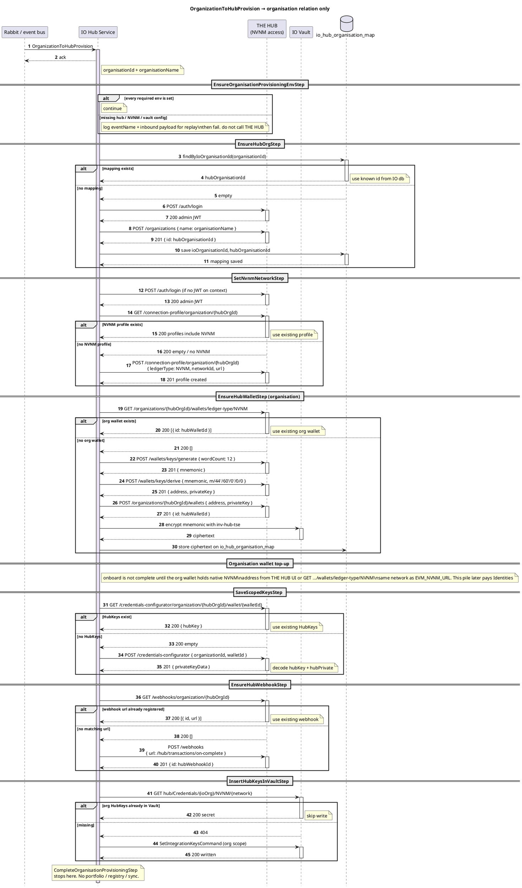

# Measurabl Provisioning Product

**Summary**: What IO Hub Service does when it receives the two implemented payloads. Organisation relation once; taxonomy sync onto the deal registry. THE HUB is a third-party signer and is not changed.

**Sources**: Implemented flow in IO Hub Service organisation-provisioning. Types: `shared-modules/Events/Hub/Onboarding/`. Sequences from the developer handoff.

**Last updated**: 2026-10-09

---

Audience: BA / PM / PO. This page is the product contract for the flow that shipped. It does not cover Vault, helm, or how a taxonomy row is created in Inveniam.

## Outcome

IO Hub Service consumes two events. That is the contract.

1. `OrganizationToHubProvision` — link the Inveniam organisation to THE HUB. Then stop.
2. `ClientDLTTransaction` — sync a **taxonomy** onto the deal’s NVNM registry (`addRecord`). Create the registry on first sync if the deal has none.

THE HUB is not Inveniam. It is a third-party signer. This work does not change THE HUB.

There is no Inveniam login user on this path. The portfolio Identity (`{portfolioId}@measurabl.com`) signs the ledger writes. Portfolio comes from the deal already stored in Inveniam, not from the document payload.

## Names

| Term | Meaning |
| --- | --- |
| THE HUB | Third-party signer. Not Inveniam. Black box. |
| IO Hub Service | Inveniam service that consumes the two events and calls THE HUB. |
| Organisation | One Inveniam organisation = one THE HUB organisation. |
| Portfolio | Inveniam portfolio = THE HUB Identity. Not a person. |
| Registry | NVNM container for a deal. Created on first taxonomy sync if missing; reused after that. |
| Taxonomy | Inveniam NVNM taxonomy identified by `taxonomyId`. That is what `ClientDLTTransaction` syncs. |

## Organisation payload

IO Hub Service must receive:

```ts
export interface OrganizationToHubProvisionPayload {
  organisationId: string;
  organisationName: string;
}
```

The Inveniam organisation must already exist. This payload does not create it. It does not sync a taxonomy.

```gherkin
Feature: Organisation payload

  Scenario: Organisation payload stops at THE HUB relation
    Given IO Hub Service receives OrganizationToHubProvision
    Then THE HUB organisation is created or reused
    And no taxonomy is synced
```

What is implemented: reuse THE HUB organisation if already linked; otherwise create it; ensure NVNM, organisation wallet, credentials, and webhook. Organisation wallet native funding is part of this onboard. Then stop.



## Taxonomy sync payload

To sync a taxonomy, IO Hub Service must receive `ClientDLTTransaction` with this payload and no other:

```ts
export interface ClientDLTTransactionPayload {
  dealId: string;
  taxonomyId: string;
  organisationId: string;
  uri: string;
  checksum: string;
  checksumAlgo: string;
}
```

`taxonomyId` is the Inveniam taxonomy this write belongs to. `uri` and `checksum` go onto the chain. `checksumAlgo` is `SHA-256`. Organisation setup must already have finished. The deal must already exist in Inveniam (`deal_anchors`). Missing organisation link or missing deal: the sync fails. The payload does not create a deal.

These names are not on the payload and are not read: `documentUrl`, `checksumAlgorithm`, `portfolioId`, `documentName`, optional taxonomy.

```gherkin
Feature: Taxonomy sync payload

  Scenario: Sync starts only from this payload
    Given organisation setup has finished
    And the deal exists in Inveniam
    When IO Hub Service receives ClientDLTTransaction with dealId, taxonomyId, organisationId, uri, checksum, checksumAlgo
    Then it syncs that taxonomy onto the deal registry

  Scenario: Organisation payload is not a sync
    When IO Hub Service receives OrganizationToHubProvision
    Then it does not sync a taxonomy

  Scenario: Missing organisation link
    Given OrganizationToHubProvision has not completed
    When IO Hub Service receives ClientDLTTransaction
    Then the sync fails

  Scenario: Missing deal
    Given the deal is not in Inveniam
    When IO Hub Service receives ClientDLTTransaction
    Then the sync fails
    And Inveniam does not create a deal
```

What is implemented after a valid payload:

1. Resolve THE HUB organisation from the stored link.
2. Ensure THE HUB Identity for the deal’s portfolio.
3. If the deal has no registry: create it as that Identity, park the taxonomy payload, wait for THE HUB, then `addRecord`.
4. If the deal already has a registry: `addRecord` now.

Register success may mark the deal NVNM connected. It does not update taxonomy status. Taxonomy status updates only from document success keyed by `taxonomyId`.

If that `taxonomyId` has no row, data-room does not change status. THE HUB may still write the chain.

```gherkin
Feature: Registry then taxonomy

  Scenario: First sync on a deal creates the registry
    Given the organisation is linked
    And the deal has no registry
    When IO Hub Service receives ClientDLTTransaction
    Then it creates the registry as the portfolio Identity
    And then syncs the taxonomy onto that registry

  Scenario: Later sync reuses the registry
    Given the deal already has a registry
    When IO Hub Service receives ClientDLTTransaction for another taxonomyId
    Then it does not create a second registry
    And it syncs that taxonomy onto the existing registry

  Scenario: taxonomyId with no row
    Given ClientDLTTransaction carries a taxonomyId that has no Inveniam taxonomy row
    When THE HUB completes addRecord
    Then taxonomy status in Inveniam does not change
```



```plantuml
@startuml
title ClientDLTTransaction → portfolio → registry → document

skinparam sequenceMessageAlign center
skinparam sequence {
  LifeLineBackgroundColor white
}
hide footbox
autonumber

participant "Rabbit / event bus" as Bus
participant "IO Hub Service" as IO
participant "THE HUB\n(NVNM access)" as Hub
participant "NVNM chain\n(JSON-RPC)" as Chain
participant "IO Vault" as Vault
database "io_hub_organisation_map" as Map
database "deal_anchors" as Anchors

Bus -> IO ++ #E8DEF8 : ClientDLTTransaction
IO --> Bus : ack

== EnsurePortfolioProvisioningEnvStep ==

alt every required env is set
  note right of IO : continue
else missing hub / NVNM / vault config
  note right of IO : log eventName + inbound payload for replay\\nthen fail. do not call THE HUB
end

== ResolveHubOrganisationStep ==

IO -> Map ++ #FFFFFF : findByIoOrganisationId(organisationId)
alt mapping exists
  Map --> IO -- : hubOrganisationId
  note right : use known id from IO db
else no mapping
  Map --> IO -- : empty
  note right of IO : fail. run OrganizationToHubProvision first
end

== EnsureHubIdentityStep ==

IO -> Anchors ++ #FFFFFF : findOne(dealId)
Anchors --> IO -- : portfolioId / parentPortfolioIds
note right
  use portfolioId if parentPortfolioIds empty
  else parentPortfolioIds[0]
  email = {portfolioId}@measurabl.com
end note
IO -> Hub ++ #FFFFFF : GET /organizations/{hubOrgId}/users?search=email
alt Identity exists
  Hub --> IO -- : 200 { id: hubIdentityId }
  note right : use existing identity
else no Identity
  Hub --> IO -- : 200 []
  IO -> Hub ++ #FFFFFF : POST /organizations/{hubOrgId}/users\n{ firstName, lastName, email }
  Hub --> IO -- : 201 { id: hubIdentityId }
end

== EnsureHubIdentityWalletStep ==

IO -> Hub ++ #FFFFFF : GET /organizations/{hubOrgId}/users/{identityId}/wallets
alt identity NVNM wallet exists
  Hub --> IO -- : 200 [{ id: hubWalletId }]
  note right : use existing identity wallet
else no identity wallet
  Hub --> IO -- : 200 []
  IO -> Vault ++ #FFFFFF : decrypt org mnemonic (inv-hub-tse)
  Vault --> IO -- : mnemonic
  IO -> Hub ++ #FFFFFF : POST /wallets/keys/derive { m/44'/60'/0'/0/n }
  Hub --> IO -- : 201 { address, privateKey }
  IO -> Hub ++ #FFFFFF : POST /organizations/{hubOrgId}/users/{identityId}/wallets
  Hub --> IO -- : 201 { id: hubWalletId }
end

== EnsureRegistryFundsStep ==

IO -> Hub ++ #FFFFFF : GET /ledgers/get-wallet-info?userEmail=
Hub --> IO -- : wallet
IO -> Hub ++ #FFFFFF : GET /ledgers/balance/{hubWalletId}
Hub --> IO -- : leftover
IO -> Vault ++ #FFFFFF : GET InveniamToken ABI
Vault --> IO -- : abi + contractAddress
IO -> Chain ++ #FFFFFF : eth_estimateGas(addRegistry) from identity
Chain --> IO -- : funding
note right of IO : THE HUB estimates only from the org wallet and ignores userEmail on the estimate payload,\\nso identity addRegistry is quoted on the chain
alt leftover covers sign buffer
  note right of IO : proceed
else leftover below sign buffer
  IO -> Hub ++ #FFFFFF : GET /ledgers/balance/{hubWalletId}
  Hub --> IO -- : leftover
  note right of IO : parent /0 sends required - leftover, poll balance
end

== EnsureRegistryStep ==

IO -> Anchors ++ #FFFFFF : findOne(dealId)
alt registry already on deal_anchors
  Anchors --> IO -- : registry
  note right : use known registry, skip register
else registry empty
  Anchors --> IO -- : registry = ""
  IO -> Vault ++ #FFFFFF : GET org HubKeys (scoped miss then org fallback)
  Vault --> IO -- : 200 HubKeys
  IO -> Hub ++ #FFFFFF : send register registry transaction
  Hub --> IO -- : accepted (jobId)
  IO -> Hub ++ #FFFFFF : GET /ledgers/v3/jobs/:jobId
  Hub --> IO -- : completed + hash
  IO -> Hub ++ #FFFFFF : GET /ledgers/status/:hash
  Hub --> IO -- : applied
  Hub -> IO ++ #FFFFFF : POST /hub/transactions/on-complete
  IO --> Hub -- : 200
  IO -> Bus ++ #FFFFFF : HubSymbolRegisteringSucceededEvent
  Bus -> IO --++ #FFFFFF : StoreDealAnchorRegistrySaga
  IO -> Anchors ++ #FFFFFF : UPDATE registry = symbol
  Anchors --> IO -- : row updated
  IO -> Anchors ++ #FFFFFF : take pending_document
  Anchors --> IO -- : ClientDLT uri / taxonomy
  note right of IO : start document sync
end

== CompleteRegistryProvisioningStep ==

alt registry already known
  note right of IO : start document sync now
else register just requested
  IO -> Anchors ++ #FFFFFF : park pending_document
  Anchors --> IO -- : stored
  note right of IO : wait for register webhook, no poll
end

== EnsureDocumentProvisioningEnvStep ==

alt every required env is set
  note right of IO : continue
else missing hub / NVNM / vault config
  note right of IO : log ClientDLTTransaction payload for replay\\nthen fail
end

== EnsureDocumentFundsStep ==

IO -> Hub ++ #FFFFFF : GET /ledgers/get-wallet-info?userEmail=
Hub --> IO -- : wallet
IO -> Hub ++ #FFFFFF : GET /ledgers/balance/{hubWalletId}
Hub --> IO -- : leftover
IO -> Vault ++ #FFFFFF : GET InveniamToken ABI
Vault --> IO -- : abi + contractAddress
IO -> Chain ++ #FFFFFF : eth_estimateGas(addRecord) from identity
Chain --> IO -- : funding
note right of IO : THE HUB estimates only from the org wallet and ignores userEmail on the estimate payload,\\nso identity addRecord is quoted on the chain
alt leftover covers sign buffer
  note right of IO : proceed
else leftover below sign buffer
  IO -> Hub ++ #FFFFFF : GET /ledgers/balance/{hubWalletId}
  Hub --> IO -- : leftover
  note right of IO : parent /0 sends required - leftover, poll balance
end

== SyncDocumentStep ==

IO -> Vault ++ #FFFFFF : GET org HubKeys (scoped miss then org fallback)
Vault --> IO -- : 200 HubKeys
IO -> Hub ++ #FFFFFF : send sync document transaction
Hub --> IO -- : accepted (jobId)
IO -> Hub ++ #FFFFFF : GET /ledgers/v3/jobs/:jobId
Hub --> IO -- : completed + hash
IO -> Hub ++ #FFFFFF : GET /ledgers/status/:hash
Hub --> IO -- : applied
Hub -> IO ++ #FFFFFF : POST /hub/transactions/on-complete
IO --> Hub -- : 200
IO -> Bus ++ #FFFFFF : HubDocumentSyncingSucceededEvent
Bus --> IO -- : delivered

== LogDocumentSyncFinishedSaga ==

Bus -> IO ++ #FFFFFF : HubDocumentSyncingSucceededEvent
IO --> Bus -- : log document sync finished

deactivate IO

@enduml
```

## Wallets and funding

THE HUB `write()` sends `value = 0`. Two different top-ups, on two different payloads.

**Organisation wallet** — during onboard (`OrganizationToHubProvision`). After the wallet exists, send native NVNM on that network to the organisation NVNM address (THE HUB UI, or `GET {HUB_URL}/organizations/{hubOrganisationId}/wallets/ledger-type/NVNM`). `hubOrganisationId` is on `io_hub_organisation_map`. Onboard is not complete until that wallet holds funding. Amount must cover later Identity top-ups (the parent pays the Identity). There is no environment variable for this send.

**Identity wallet** — on `ClientDLTTransaction`. `EnsureRegistryFundsStep` / `EnsureDocumentFundsStep` run before the write. IO Hub Service quotes from the Identity address, then the organisation wallet (`m/44'/60'/0'/0/0`) sends only `required − leftover` on `EVM_NVNM_URL`. If leftover already covers the buffer, there is no send. Do not send native token to Identity wallets by hand.

If onboard skipped the organisation top-up, Identity top-up fails and the taxonomy sync does not start.

```gherkin
Feature: Funding

  Scenario: Organisation wallet is funded during onboard
    Given IO Hub Service has created or reused the organisation wallet
    When OrganizationToHubProvision is completed
    Then that wallet holds native NVNM
    And that pile is enough for later Identity top-ups

  Scenario: Identity wallet is funded from the organisation wallet
    Given onboard already funded the organisation wallet
    When IO Hub Service receives ClientDLTTransaction
    Then it tops up the Identity only if leftover is below the quoted buffer
    And THE HUB write still sends value 0

  Scenario: Onboard without organisation funding
    Given the organisation wallet was created but not funded
    When IO Hub Service tries to fund the Identity
    Then the taxonomy sync fails
```

## Repeat and retry

IO Hub Service does not key a write as `organisationId | portfolioId | dealId | uri | checksum`. The unique key is THE HUB job id on `transactions`.

A second `ClientDLTTransaction` runs the implemented chain again. Existing registry is reused. Sync is requested again. A new THE HUB job is a second `addRecord`.

Same `uri` and a different `checksum` on the same `taxonomyId` is a different record. Taxonomy status is Outdated when the stored checksum no longer matches.

A Failed job stays Failed. Retry is a new job. A later success on the Failed job does not store the registry or sync the parked taxonomy.

```gherkin
Feature: Repeat and retry

  Scenario: Same taxonomyId with a new checksum
    Given a taxonomy was synced with checksum A
    When IO Hub Service receives ClientDLTTransaction with the same taxonomyId and checksum B
    Then it requests a new chain record
    And taxonomy status is Outdated if the stored checksum is still A

  Scenario: Failed job does not revive
    Given the ledger job failed
    When THE HUB later reports success for that same job
    Then the deal registry stays empty if it was never stored
    And the taxonomy stays parked
    And a retry must be a new job
```

## What this flow does not do

- Does not change THE HUB.
- Does not create the Inveniam organisation or the deal.
- Does not create a taxonomy row. It requires `taxonomyId` on the payload and looks that row up after success.
- Does not skip a sync. `ClientDLTTransaction` means sync that taxonomy.
- Does not fund Identity wallets by hand. Organisation funding is during onboard; Identity funding is the leftover-aware parent send on `ClientDLTTransaction`.

## Locked on this flow

| Choice | Meaning |
| --- | --- |
| Two payloads | Organisation relation; then taxonomy sync |
| One sync payload | Registry if needed, then `addRecord` |
| Existing success / fail events | No Measurabl-only callback |
| Missing deal or missing org link | Fail |
| Identity signs | Registry and taxonomy write use the portfolio Identity |
| Failed write | Stays failed. Retry is a new job |

## Still open

**`taxonomyId` must be a real taxonomy row** for Inveniam to update status after `addRecord`. The payload requires the id. This flow does not create the row.

**Failed job then later success on the same job.** Registry and parked taxonomy do not move. Retry is a new job.
