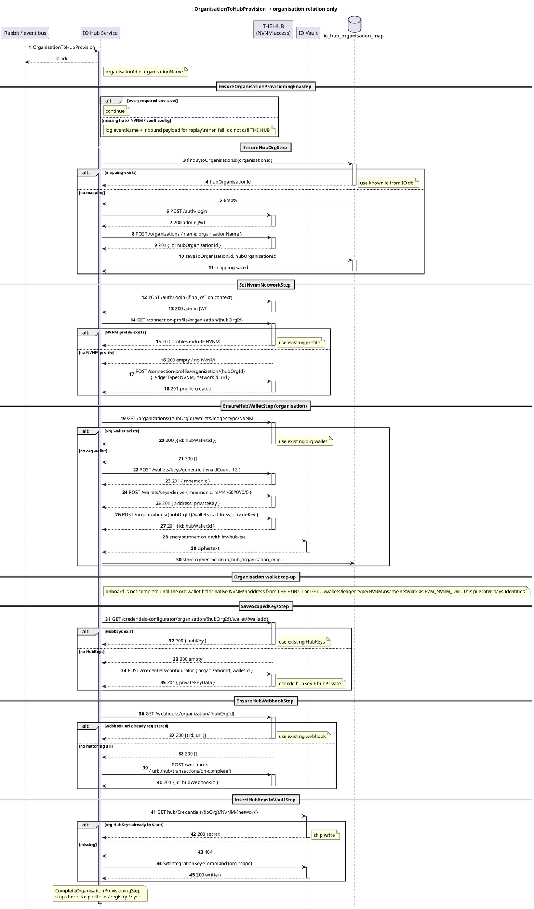

# Measurabl Provisioning QA

**Summary**: Self-contained black-box QA for organisation onboard and document sync. TC-01 through TC-05 are the happy path. TC-06 through TC-11 publish an incorrect id on purpose. The opening catalog lists Kibana lines if a run stops on its own. The appendix holds both sequence diagrams. No other page is required.

**Sources**: `apps/hub-service/scripts/emit-organisation-to-hub-provision-sns.sh`, `apps/hub-service/scripts/emit-client-dlt-transaction-sns.sh`, `apps/hub-service/src/config/client-provisioning.log.ts`, organisation-provisioning and deal-anchoring log messages.

**Last updated**: 2026-10-09

---

TC-01 through TC-05 onboard one organisation, then sync a document onto a deal that already exists in Inveniam. TC-06 through TC-11 publish an incorrect id. Any other stop is in this suite only when it appears on its own during a run. Record it. Do not construct it.

QA does not read or run the service code. Inveniam has no new screen or flag that starts this flow. Checks are THE HUB (the third-party signer) and Kibana logs for IO Hub Service (`inv-hub-ms`).

## When a run stops

The chain stops at the first error. Later happy-path `msg` lines for that publish are absent. THE HUB can already show a partial organisation (org created, webhook missing, Identity missing). Replay the same event after the cause is fixed. Use a new FIFO deduplication id.

In Kibana, same IO Hub Service view, same time range as the publish. Sort oldest first.

```
args.marker: "client-provisioning" and level: error and args.organisationId: "<organisationId>"
```

For a document publish, add `args.dealId: "<dealId>"`. Read `msg` and `args.reason`. A command line (`RunOrganisationProvisioningCommand failed`, `RunPortfolioProvisioningCommand failed`, `RunRegistryProvisioningCommand failed`, `RunDocumentProvisioningCommand failed`) is the wrapper. The step line just above it is the cause. On a THE HUB HTTP failure the same line also has `args.upstreamStatus`, `args.upstreamMessage`, and sometimes `args.upstreamConstraint`.

One stop does not set `args.marker`. Search it by message:

```
msg: "EnsureOrganisationProvisioningEnvStep failed" or msg: "EnsurePortfolioProvisioningEnvStep failed" or msg: "EnsureDocumentProvisioningEnvStep failed"
```

`args.reason` is `required env is missing`. `args.missing` lists the absent settings. `args.eventName` is `OrganisationToHubProvision` or `ClientDLTTransaction`. IO Hub Service does not call THE HUB.

| What you see in Kibana | What it means |
| --- | --- |
| `DealAnchorSagas skipped persist`, `args.reasons` contains `missing portfolioId and parentPortfolioIds` | The deal was saved in Inveniam without a portfolio. Document sync has no Identity email. Fix the deal, wait for `DealAnchorSagas finish`, then publish. |
| `DealAnchorSagas skipped persist`, `args.reasons` contains `missing context.organisationId` | The deal event had no organisation. The deal row used by sync was not stored. |
| `EnsureOrganisationProvisioningEnvStep failed` or `EnsurePortfolioProvisioningEnvStep failed` or `EnsureDocumentProvisioningEnvStep failed` | IO Hub Service is missing configuration. No call to THE HUB. |
| `HubAdminSession.login failed` | THE HUB admin login was rejected. Onboard does not create an organisation. |
| `HubAdminClient.request failed`, `args.reason` `Hub organisation name already exists` | That name is already an organisation on THE HUB. `EnsureHubOrgStep created a duplicate Hub org; keeping the existing mapping` (warning) can follow. THE HUB is left with the extra organisation; Inveniam keeps the first mapping. |
| `EnsureHubOrgStep failed`, `args.reason` `Hub organisation create returned no id` | THE HUB accepted the create call and returned no organisation id. |
| `EnsureHubWalletStep failed`, `args.reason` `Hub organisation wallet create returned no id` | Organisation exists. NVNM wallet was not stored. |
| `EnsureHubWalletStep failed` or `InsertOrgMnemonicInTransitStep failed` or `EnsureHubIdentityWalletStep failed`, `args.reason` `Vault transit is not available` | IO Vault transit encrypt or decrypt failed. Wallet material was not stored. |
| `EnsureHubWalletStep failed`, `args.reason` `Hub organisation wallet exists without mnemonic ciphertext` | THE HUB already has the organisation wallet. Inveniam has no ciphertext to derive later Identity wallets. |
| `SaveScopedKeysStep failed` or `InsertHubKeysInVaultStep skipped` | THE HUB credentials were missing or could not be decoded. Scoped keys were not written. |
| `EnsureHubWebhookStep failed`, `args.reason` `Hub webhook URL is not reachable` or `Hub webhook URL format is invalid` | THE HUB rejected the on-complete URL. Register and document completion cannot call back. |
| `EnsureHubWebhookStep failed`, `args.reason` `Hub on-complete webhook URL is missing` | IO Hub Service has no webhook URL configured. |
| `OrganisationProvisioningLock timed out`, `args.reason` `another provisioning run holds this organisation lock` | A second publish for the same organisation overlapped the first. Wait and publish again with a new deduplication id. |
| `RunOrganisationProvisioningCommand failed` | Onboard stopped. Use the step error above this line. `CompleteOrganisationProvisioningStep` is absent. |
| `ResolveHubOrganisationStep failed`, `args.reason` `Hub organisation mapping is missing` | Document sync ran before a successful onboard for this `organisationId`. THE HUB is not called for Identity or registry. |
| `EnsureHubIdentityStep failed`, `args.reason` `portfolioId is missing for identity email` | The stored deal has no portfolio. No `{portfolioId}@measurabl.com` Identity is created. |
| `EnsureHubIdentityStep failed`, `args.reason` `Hub identity create returned no id` | THE HUB did not return an Identity id. |
| `EnsureHubIdentityWalletStep failed`, `args.reason` `org mnemonic ciphertext is missing` | Onboard did not store the organisation mnemonic. The Identity wallet cannot be derived. |
| `IdentityWalletTopUp leftover read failed` or `NvnmNativeTransfer rejected` or `EnsureRegistryFundsStep failed` or `EnsureDocumentFundsStep failed` | The Identity wallet could not be funded from the organisation wallet. The ledger write does not start. |
| `NvnmAddRecordGas estimate failed` | Funding for `addRegistry` or `addRecord` could not be estimated. The write does not start. |
| `EnsureRegistryStep failed`, `args.reason` `portfolioId is missing for registry userEmail` | Registry was not requested. |
| `RunRegistryProvisioningCommand failed` or `RunPortfolioProvisioningCommand failed` | Portfolio or registry stopped. The step error above is the cause. |
| `StoreDealAnchorRegistrySaga skipped`, `args.reason` `dealId or symbol is missing` | THE HUB register completion did not carry a deal id and registry symbol. The deal registry is not stored. Document sync does not start. |
| `StoreDealAnchorRegistryCommand skipped`, `args.reason` `no deal_anchors row inner-joined to io_hub_organisation_map` | Register completed, and Inveniam has no deal row linked to this organisation. `deal_anchors.registry` stays empty. |
| `StoreDealAnchorRegistryCommand finish`, `args.reason` `pending document is missing` | The registry was stored. The parked document for this `taxonomyId` was not found, so `addRecord` does not start. This line is info, not error. |
| `SyncDocumentStep failed`, `args.reason` `registry is missing for addRecord` | Document sync started without a registry. No `addRecord`. |
| `RunDocumentProvisioningCommand failed` | Document sync stopped. `LogDocumentSyncFinishedSaga document sync finished` is absent, so there is no `args.transactionPointer`. |
| `IdentityWriteSigner Hub write signed as a different wallet` | Warning after a write. The chain may still finish. The signer was not the Identity wallet. |

`LogDocumentSyncFinishedSaga document sync finished` is success only. Its absence after the wait, together with one error line above, is the document failure. Attach `msg`, `args.reason`, `args.upstreamStatus`, `args.upstreamMessage`, the publish time, and the ids.

## Terminology

| Term | Meaning |
| --- | --- |
| THE HUB | Third-party signer. QA uses its UI. This work does not change it. |
| IO Hub Service | Inveniam service that consumes the two events. Logs carry marker `client-provisioning`. |
| Organisation | One Inveniam organisation becomes one THE HUB organisation. |
| Portfolio | Inveniam portfolio becomes THE HUB Identity. Email `{portfolioId}@measurabl.com`. |
| Registry | NVNM container for the deal. Created on the first document sync, reused after that. |
| Taxonomy | Inveniam correlation key `taxonomyId`. Upload of a file does not create it. |

## Kibana

Open Discover for the environment under test. Restrict the view to IO Hub Service (`inv-hub` / `inv-hub-ms`). Set the time range from one minute before the AWS publish to fifteen minutes after it. Register and document write wait on THE HUB, so a short window hides a pass.

Each log line is JSON. The sentence is `msg`. The fields QA filters on sit under `args`:

| Field | Use |
| --- | --- |
| `args.marker` | `client-provisioning` on this flow |
| `args.organisationId` | Inveniam organisation id |
| `args.organisationName` | Name sent on onboard |
| `args.dealId` | Inveniam deal id |
| `args.taxonomyId` | Id sent on the document event |
| `args.portfolioId` | Inveniam portfolio id |
| `args.hubOrganisationId` | THE HUB organisation id, once known |
| `args.transactionPointer` | Chain hash after document success |
| `args.reason` | Present when a step stops |
| `level` | Info on the happy path |

If Discover shows a prefix such as `json.args.marker`, use that same prefix on every query below.

Save this baseline and add the case query on top of it:

```
args.marker: "client-provisioning"
```

Columns: `@timestamp`, `level`, `msg`, `args.organisationId`, `args.dealId`, `args.taxonomyId`, `args.hubOrganisationId`, `args.reason`, `args.transactionPointer`.

Sort oldest first. Read the `msg` values in the order listed in the case. A missing line after the wait is a fail for that case.

## Inveniam preconditions

Do this in the Inveniam UI of the environment under test before any AWS publish. There is no control on that UI that onboards THE HUB or syncs the document.

1. Sign in.
2. Create an organisation whose name is unique. Copy `organisationId` from the address bar or from the organisation response in the browser network panel. A random UUID is not a substitute: the publish stores a mapping for whatever id you send.
3. Create a portfolio in that organisation. Copy `portfolioId` the same way.
4. Create a deal in that portfolio. Copy `dealId`.
5. In Kibana, confirm the deal was stored before you sync a document:

```
args.marker: "client-provisioning" and args.dealId: "<dealId>" and msg: "DealAnchorSagas finish"
```

`DealAnchorSagas finish` means IO Hub Service stored the deal, including its portfolio. If that line is absent, update the deal so it sits in the portfolio and wait for the same line. Do not publish the document event until it is there.

6. Upload a file to the deal data room when you want a real document URL. The view-file address is `/view-file/{fileId}?id={dealId}`. `fileId` is not `taxonomyId`. Upload does not create the NVNM taxonomy row. For this happy path, generate a new UUID and use it as `taxonomyId` on the document event. THE HUB and Kibana are the pass. The Inveniam file badge is not the pass for a generated id.

Keep a note of: `organisationId`, `organisationName`, `portfolioId`, `dealId`, `taxonomyId`, document `uri`, `checksum`, and the time you publish.

## Onboard the organisation (AWS)

Publish once, after the Inveniam organisation exists. The event name is `OrganisationToHubProvision`. That spelling is the one IO Hub Service consumes. `apps/hub-service/scripts/emit-organisation-to-hub-provision-sns.sh`, run from the inveniam.io repository root, publishes this event. The console steps and the AWS CLI publish the same body.

SNS topic: the environment notification topic, usually a FIFO topic whose name contains `notification-topic`. Region is the region of that topic. Ask the environment owner for the topic ARN and the AWS profile. Do not publish to a different environment's topic.

### Console

1. AWS Console → SNS → Topics → open that topic → Publish message.
2. Message body (replace the two values; `createdAt` is the current UTC time; `correlationId` is a new UUID):

```json
{
  "eventName": "OrganisationToHubProvision",
  "eventBody": {
    "meta": {
      "eventId": null,
      "aggregateId": "<organisationId>",
      "version": null,
      "aggregateType": null,
      "createdAt": "<YYYY-MM-DDTHH:MM:SSZ>",
      "createdBy": null,
      "isReadOnly": false,
      "shouldPublishEvent": true,
      "isDirect": false
    },
    "payload": {
      "organisationId": "<organisationId>",
      "organisationName": "<organisationName>"
    },
    "context": {
      "organisationId": "<organisationId>",
      "correlationId": "<new-uuid>"
    }
  }
}
```

3. Message attributes:

| Name | Type | Value |
| --- | --- | --- |
| `eventName` | String | `OrganisationToHubProvision` |
| `msList` | String.Array | `["hub"]` |

4. FIFO topic: Message group ID is `<organisationId>`. Message deduplication ID is the same new UUID as `correlationId`. A second publish of the same deduplication id is dropped by SNS.

### CLI

```bash
aws sns publish \
  --region <region> \
  --profile <aws-profile> \
  --topic-arn "<topic-arn>" \
  --message-group-id "<organisationId>" \
  --message-deduplication-id "<new-uuid>" \
  --message-attributes '{"eventName":{"DataType":"String","StringValue":"OrganisationToHubProvision"},"msList":{"DataType":"String.Array","StringValue":"[\"hub\"]"}}' \
  --message '<paste the JSON body>'
```

SNS returns a `MessageId`. That is the AWS accept. It is not the onboard result.

### Script

Run from the inveniam.io repository root. The script sets `createdAt`, a new `correlationId`, message attributes `eventName` and `msList`, and on a FIFO topic the message group id (`organisationId`) and deduplication id (`correlationId`). It prints `correlationId`. A later publish is a new run, which gets a new deduplication id.

```bash
SNS_TOPIC_ARN="<topic-arn>" \
AWS_PROFILE=<SSO AWS PROFILE> \
apps/hub-service/scripts/emit-organisation-to-hub-provision-sns.sh <organisationId> "<organisationName>"
```

`AWS_REGION` defaults to `us-east-1`. Pass `<organisationId>` and `<organisationName>` from the Inveniam UI. Absent arguments use the script's sample organisation.

## Sync a document (AWS)

Publish only after onboard has passed and Kibana shows `DealAnchorSagas finish` for this `dealId`. The event name is `ClientDLTTransaction`. `apps/hub-service/scripts/emit-client-dlt-transaction-sns.sh`, run from the inveniam.io repository root, publishes this event. The console steps and the AWS CLI publish the same body.

Generate a new `taxonomyId` and a new `correlationId`. `checksumAlgo` is `SHA-256`. `checksum` is the hex SHA-256 of the file, or any 64-character hex string when the file is only a stand-in. `uri` is the document URL you want stored on the chain.

Message group ID for a FIFO topic is `<taxonomyId>`. Message deduplication ID is the new `correlationId`.

### Console

Message body:

```json
{
  "eventName": "ClientDLTTransaction",
  "eventBody": {
    "meta": {
      "eventId": null,
      "aggregateId": "<taxonomyId>",
      "version": null,
      "aggregateType": null,
      "createdAt": "<YYYY-MM-DDTHH:MM:SSZ>",
      "createdBy": null,
      "isReadOnly": false,
      "shouldPublishEvent": true,
      "isDirect": false
    },
    "payload": {
      "dealId": "<dealId>",
      "taxonomyId": "<taxonomyId>",
      "organisationId": "<organisationId>",
      "uri": "<document-url>",
      "checksum": "<sha256-hex>",
      "checksumAlgo": "SHA-256"
    },
    "context": {
      "organisationId": "<organisationId>",
      "correlationId": "<new-uuid>"
    }
  }
}
```

Message attributes:

| Name | Type | Value |
| --- | --- | --- |
| `eventName` | String | `ClientDLTTransaction` |
| `msList` | String.Array | `["hub"]` |

### CLI

```bash
aws sns publish \
  --region <region> \
  --profile <aws-profile> \
  --topic-arn "<topic-arn>" \
  --message-group-id "<taxonomyId>" \
  --message-deduplication-id "<new-uuid>" \
  --message-attributes '{"eventName":{"DataType":"String","StringValue":"ClientDLTTransaction"},"msList":{"DataType":"String.Array","StringValue":"[\"hub\"]"}}' \
  --message '<paste the JSON body>'
```

### Script

Run from the inveniam.io repository root. The script sets `createdAt`, a new `correlationId`, message attributes `eventName` and `msList`, and on a FIFO topic the message group id (`taxonomyId`) and deduplication id (`correlationId`). It prints `taxonomyId`, `uri`, `checksum`, and `correlationId`. Copy those lines before you open Kibana.

Minimum. The script generates `taxonomyId`, `uri`, `checksum`, and uses `checksumAlgo` `SHA-256`.

```bash
SNS_TOPIC_ARN="<topic-arn>" \
AWS_PROFILE=<SSO AWS PROFILE> \
apps/hub-service/scripts/emit-client-dlt-transaction-sns.sh <organisationId> <dealId>
```

`AWS_REGION` defaults to `us-east-1`. Pass `<organisationId>` and `<dealId>` from the Inveniam UI. Absent arguments use the script's sample ids.

Full. Same publish with every optional field set. Omit a field and the script uses the default in the table.

```bash
URI="<document-url>" \
CHECKSUM="<sha256-hex>" \
CHECKSUM_ALGO="SHA-256" \
SNS_TOPIC_ARN="<topic-arn>" \
AWS_PROFILE=<SSO AWS PROFILE> \
apps/hub-service/scripts/emit-client-dlt-transaction-sns.sh <organisationId> <dealId> <taxonomyId>
```

| Field | Where | Default when omitted |
| --- | --- | --- |
| `taxonomyId` | third argument | new UUID |
| `URI` | environment variable | generated example URL |
| `CHECKSUM` | environment variable | SHA-256 hex of the generated file name |
| `CHECKSUM_ALGO` | environment variable | `SHA-256` |

The first sync for a deal creates the registry, waits for THE HUB, then writes the document. A later sync of another `taxonomyId` on the same deal reuses that registry. Allow several minutes before you call the document case a fail.

## TC-01 Deal is stored

**Purpose.** The document event reads a deal Inveniam already has.

**Preconditions.** Organisation, portfolio, and deal exist in Inveniam. No AWS publish yet.

**Kibana.**

```
args.marker: "client-provisioning" and args.dealId: "<dealId>" and msg: "DealAnchorSagas finish"
```

**Pass.** One info line `DealAnchorSagas finish` with that `dealId`, `organisationId`, and `portfolioId`.

**THE HUB.** No new organisation yet.

## TC-02 Onboard the organisation

**Purpose.** `OrganisationToHubProvision` creates the THE HUB organisation and stops. It does not sync a document.

**Preconditions.** TC-01 passed. Name is unique on THE HUB.

**Steps.** Publish `OrganisationToHubProvision` as in Onboard the organisation (AWS).

**Kibana.** Baseline plus the organisation id. Read top to bottom:

```
args.marker: "client-provisioning" and args.organisationId: "<organisationId>"
```

| Order | `msg` |
| --- | --- |
| 1 | `OrganisationToHubProvisionEventHandler` |
| 2 | `RunOrganisationProvisioningCommand start` |
| 3 | `HubAdminSession.login finish` |
| 4 | `EnsureHubOrgStep created hub org and saved mapping` |
| 5 | `SetNvnmNetworkStep created NVNM profile` or `SetNvnmNetworkStep using existing NVNM profile` |
| 6 | `EnsureHubWalletStep created organisation NVNM wallet` or `EnsureHubWalletStep using existing organisation NVNM wallet` |
| 7 | `SaveScopedKeysStep created Hub keys` or `SaveScopedKeysStep using existing Hub keys` |
| 8 | `EnsureHubWebhookStep created webhook` or `EnsureHubWebhookStep using existing webhook` |
| 9 | `InsertHubKeysInVaultStep wrote organisation keys to vault` or `InsertHubKeysInVaultStep organisation keys already in vault` |
| 10 | `CompleteOrganisationProvisioningStep` |
| 11 | `RunOrganisationProvisioningCommand finish` |

Copy `args.hubOrganisationId` from the `EnsureHubOrgStep` line.

**THE HUB.** Open the organisation with that name. It has an NVNM connection, an organisation NVNM wallet address, and a webhook whose URL contains `/hub/transactions/on-complete`. No Identity for `{portfolioId}@measurabl.com` yet. No document transaction.

**Pass.** Kibana reaches `CompleteOrganisationProvisioningStep` with `args.completed: true`, and THE HUB shows that organisation. No `ClientDLTTransactionEventHandler` line for this publish.

## TC-03 Onboard the same organisation again

**Purpose.** A second happy-path publish reuses the organisation from TC-02.

**Preconditions.** TC-02 passed.

**Steps.** Publish `OrganisationToHubProvision` again for the same `organisationId` and `organisationName`. Use a new `correlationId` and a new FIFO deduplication id.

**Kibana.**

```
args.marker: "client-provisioning" and args.organisationId: "<organisationId>" and msg: "EnsureHubOrgStep using mapped hub org"
```

**Pass.** `EnsureHubOrgStep using mapped hub org` with the same `hubOrganisationId` as TC-02, then `CompleteOrganisationProvisioningStep` again. THE HUB still has one organisation with that name.

## TC-04 First document sync

**Purpose.** `ClientDLTTransaction` creates the portfolio Identity, the deal registry, then the document record.

**Preconditions.** TC-02 passed. TC-01 still shows `DealAnchorSagas finish`. New `taxonomyId`, `uri`, `checksum`.

**Steps.** Publish `ClientDLTTransaction` as in Sync a document (AWS).

**Kibana.**

```
args.marker: "client-provisioning" and args.dealId: "<dealId>" and args.taxonomyId: "<taxonomyId>"
```

| Order | `msg` |
| --- | --- |
| 1 | `ClientDLTTransactionEventHandler` |
| 2 | `ResolveHubOrganisationStep using mapped hub org` |
| 3 | `EnsureHubIdentityStep created identity` or `EnsureHubIdentityStep using existing identity` |
| 4 | `EnsureHubIdentityWalletStep created identity NVNM wallet` or `EnsureHubIdentityWalletStep using existing identity NVNM wallet` |
| 5 | `EnsureRegistryStep requested addRegistry` |
| 6 | `CompleteRegistryProvisioningStep waiting for HubSymbolRegisteringSucceededEvent` |
| 7 | `StoreDealAnchorRegistrySaga finish` |
| 8 | `SyncDocumentStep requested addRecord` |
| 9 | `CompleteDocumentProvisioningStep` |
| 10 | `LogDocumentSyncFinishedSaga document sync finished` |

Identity funding may log `IdentityWalletFunds funded` or `IdentityWalletTopUp sent parent transfer` between the wallet line and `addRegistry`. Either info line is part of the pass. Wait for line 10 before failing the case. `args.transactionPointer` on line 10 is the document hash.

**THE HUB.** The organisation has an Identity whose email is `{portfolioId}@measurabl.com` and an NVNM wallet for that Identity. A completed ledger transaction carries the `uri` you published.

**Pass.** Kibana shows `LogDocumentSyncFinishedSaga document sync finished` for this `taxonomyId` with a non-empty `transactionPointer`, and THE HUB shows that transaction.

## TC-05 Second document on the same deal

**Purpose.** The next document reuses the registry from TC-04.

**Preconditions.** TC-04 passed.

**Steps.** Publish `ClientDLTTransaction` again with the same `organisationId` and `dealId`, a new `taxonomyId`, a new `uri` or `checksum`, and a new deduplication id.

**Kibana.**

```
args.marker: "client-provisioning" and args.dealId: "<dealId>" and args.taxonomyId: "<second-taxonomyId>" and msg: "EnsureRegistryStep using existing registry"
```

Then the same taxonomy id through to:

```
args.marker: "client-provisioning" and args.taxonomyId: "<second-taxonomyId>" and msg: "LogDocumentSyncFinishedSaga document sync finished"
```

**Pass.** `EnsureRegistryStep using existing registry` (no second `requested addRegistry` for this taxonomy), then `SyncDocumentStep requested addRecord`, then `LogDocumentSyncFinishedSaga document sync finished` with its own `transactionPointer`. THE HUB shows the second document on the same organisation. The Identity email is unchanged.

## Incorrect ids

These publishes use one wrong id. The other ids stay the ones from TC-01 and TC-02. Each publish needs a new `correlationId` and a new FIFO deduplication id. The script does that on each run.

A new UUID in `taxonomyId` is the value TC-04 and TC-05 already send. IO Hub Service stores that id. It does not check it against an Inveniam file.

A well-formed `organisationId` that is not an Inveniam organisation, sent as `OrganisationToHubProvision`, is not rejected. `EnsureHubOrgStep` creates a THE HUB organisation for it. Do not publish one.

`ClientDLTTransaction` does not compare `organisationId` to `deal_anchors.organisation_id` before it creates an Identity. The deal row is loaded by `dealId` alone.

## TC-06 Onboard an organisationId that is not a UUID

**Purpose.** `io_hub_organisation_map.io_organisation_id` is a UUID column. A non-UUID id fails the lookup. THE HUB is not called.

**Preconditions.** No onboard has been published for `not-a-uuid`. The name may be any string.

**Steps.** Publish `OrganisationToHubProvision` with organisation id `not-a-uuid`.

```bash
SNS_TOPIC_ARN="<topic-arn>" \
AWS_PROFILE=<SSO AWS PROFILE> \
apps/hub-service/scripts/emit-organisation-to-hub-provision-sns.sh not-a-uuid "not-a-uuid"
```

**Kibana.**

```
args.marker: "client-provisioning" and msg: "EnsureHubOrgStep failed"
```

**Pass.** `EnsureHubOrgStep failed`. `args.reason` contains `invalid input syntax for type uuid`. `HubAdminSession.login finish` is absent. `CompleteOrganisationProvisioningStep` is absent. THE HUB has no organisation named `not-a-uuid`.

## TC-07 Document sync with an organisationId that was never onboarded

**Purpose.** A well-formed organisation id with no row in `io_hub_organisation_map` stops before Identity.

**Preconditions.** TC-02 passed for the real organisation. This publish uses a different UUID. Generate one. It must not be the Inveniam `organisationId`.

**Steps.** Publish `ClientDLTTransaction` with that UUID, the real `dealId`, and a new `taxonomyId`.

```bash
SNS_TOPIC_ARN="<topic-arn>" \
AWS_PROFILE=<SSO AWS PROFILE> \
apps/hub-service/scripts/emit-client-dlt-transaction-sns.sh <unknown-uuid> <dealId>
```

**Kibana.**

```
args.marker: "client-provisioning" and args.organisationId: "<unknown-uuid>" and msg: "ResolveHubOrganisationStep failed" and args.reason: "Hub organisation mapping is missing"
```

**Pass.** `ResolveHubOrganisationStep failed` with `args.reason` `Hub organisation mapping is missing`. `EnsureHubIdentityStep created identity` is absent. THE HUB organisation from TC-02 has no new Identity.

## TC-08 Document sync with an organisationId that is not a UUID

**Purpose.** The same UUID lookup as TC-06, on the document event.

**Preconditions.** TC-01 passed. The `dealId` is the real deal.

**Steps.** Publish `ClientDLTTransaction` with organisation id `not-a-uuid` and the real `dealId`.

```bash
SNS_TOPIC_ARN="<topic-arn>" \
AWS_PROFILE=<SSO AWS PROFILE> \
apps/hub-service/scripts/emit-client-dlt-transaction-sns.sh not-a-uuid <dealId>
```

**Kibana.**

```
args.marker: "client-provisioning" and msg: "ResolveHubOrganisationStep failed"
```

**Pass.** `ResolveHubOrganisationStep failed`. `args.reason` contains `invalid input syntax for type uuid`. `EnsureHubIdentityStep created identity` is absent. THE HUB organisation from TC-02 is unchanged.

## TC-09 Document sync with a dealId that is not a stored deal

**Purpose.** A well-formed deal id with no `deal_anchors` row has no portfolio. Identity is not created.

**Preconditions.** TC-02 passed. Generate a UUID that is not the Inveniam `dealId`. Kibana has no `DealAnchorSagas finish` for it.

**Steps.** Publish `ClientDLTTransaction` with the real `organisationId` and that UUID as `dealId`.

```bash
SNS_TOPIC_ARN="<topic-arn>" \
AWS_PROFILE=<SSO AWS PROFILE> \
apps/hub-service/scripts/emit-client-dlt-transaction-sns.sh <organisationId> <unknown-uuid>
```

**Kibana.**

```
args.marker: "client-provisioning" and args.dealId: "<unknown-uuid>" and msg: "EnsureHubIdentityStep failed" and args.reason: "portfolioId is missing for identity email"
```

**Pass.** `ResolveHubOrganisationStep using mapped hub org` is present. `EnsureHubIdentityStep failed` with `args.reason` `portfolioId is missing for identity email`. `EnsureHubIdentityStep created identity` is absent. THE HUB has no new Identity.

## TC-10 Document sync with a dealId that is not a UUID

**Purpose.** `deal_anchors.id` is a UUID column. The organisation lookup still succeeds. The deal lookup fails.

**Preconditions.** TC-02 passed.

**Steps.** Publish `ClientDLTTransaction` with the real `organisationId` and deal id `not-a-uuid`.

```bash
SNS_TOPIC_ARN="<topic-arn>" \
AWS_PROFILE=<SSO AWS PROFILE> \
apps/hub-service/scripts/emit-client-dlt-transaction-sns.sh <organisationId> not-a-uuid
```

**Kibana.**

```
args.marker: "client-provisioning" and msg: "EnsureHubIdentityStep failed"
```

**Pass.** `ResolveHubOrganisationStep using mapped hub org` is present. `EnsureHubIdentityStep failed`. `args.reason` contains `invalid input syntax for type uuid`. `EnsureHubIdentityStep created identity` is absent. THE HUB organisation from TC-02 is unchanged.

## TC-11 Document sync with an empty taxonomyId before a registry exists

**Purpose.** `taxonomyId` is required only when this deal has no registry yet. The check runs after the Identity wallet exists.

**Preconditions.** TC-02 passed. Use a deal that has `DealAnchorSagas finish` and has never had a document sync. Do not use the deal from TC-04. That deal already has a registry, and an empty `taxonomyId` is not rejected there.

**Steps.** Publish `ClientDLTTransaction` from the AWS CLI. Same body as Sync a document (AWS), with `"taxonomyId": ""`. Use the real `organisationId` and this deal's `dealId`. The emit script fills an empty `taxonomyId` with a new UUID, so this case is the CLI.

**Kibana.**

```
args.marker: "client-provisioning" and args.dealId: "<dealId>" and msg: "EnsureRegistryStep failed" and args.reason: "taxonomyId is missing to park pending document"
```

**Pass.** `EnsureHubIdentityStep created identity` or `EnsureHubIdentityStep using existing identity` is present. `EnsureRegistryStep failed` with `args.reason` `taxonomyId is missing to park pending document`. `EnsureRegistryStep requested addRegistry` is absent. `LogDocumentSyncFinishedSaga document sync finished` is absent. THE HUB has the Identity for this portfolio. It has no registry transaction for this deal.

## Appendix. Sequences

Two sequences. The first is organisation onboard and stops there. The second is document sync: portfolio Identity, registry, then the document. The bus message for onboard is `OrganisationToHubProvision`.

```plantuml
@startuml
title ClientDLTTransaction → portfolio → registry → document

skinparam sequenceMessageAlign center
skinparam sequence {
  LifeLineBackgroundColor white
}
hide footbox
autonumber

participant "Rabbit / event bus" as Bus
participant "IO Hub Service" as IO
participant "THE HUB\n(NVNM access)" as Hub
participant "NVNM chain\n(JSON-RPC)" as Chain
participant "IO Vault" as Vault
database "io_hub_organisation_map" as Map
database "deal_anchors" as Anchors

Bus -> IO ++ #E8DEF8 : ClientDLTTransaction
IO --> Bus : ack

== EnsurePortfolioProvisioningEnvStep ==

alt every required env is set
  note right of IO : continue
else missing hub / NVNM / vault config
  note right of IO : log eventName + inbound payload for replay\\nthen fail. do not call THE HUB
end

== ResolveHubOrganisationStep ==

IO -> Map ++ #FFFFFF : findByIoOrganisationId(organisationId)
alt mapping exists
  Map --> IO -- : hubOrganisationId
  note right : use known id from IO db
else no mapping
  Map --> IO -- : empty
  note right of IO : fail. run OrganisationToHubProvision first
end

== EnsureHubIdentityStep ==

IO -> Anchors ++ #FFFFFF : findOne(dealId)
Anchors --> IO -- : portfolioId / parentPortfolioIds
note right
  use portfolioId if parentPortfolioIds empty
  else parentPortfolioIds[0]
  email = {portfolioId}@measurabl.com
end note
IO -> Hub ++ #FFFFFF : GET /organizations/{hubOrgId}/users?search=email
alt Identity exists
  Hub --> IO -- : 200 { id: hubIdentityId }
  note right : use existing identity
else no Identity
  Hub --> IO -- : 200 []
  IO -> Hub ++ #FFFFFF : POST /organizations/{hubOrgId}/users\n{ firstName, lastName, email }
  Hub --> IO -- : 201 { id: hubIdentityId }
end

== EnsureHubIdentityWalletStep ==

IO -> Hub ++ #FFFFFF : GET /organizations/{hubOrgId}/users/{identityId}/wallets
alt identity NVNM wallet exists
  Hub --> IO -- : 200 [{ id: hubWalletId }]
  note right : use existing identity wallet
else no identity wallet
  Hub --> IO -- : 200 []
  IO -> Vault ++ #FFFFFF : decrypt org mnemonic (inv-hub-tse)
  Vault --> IO -- : mnemonic
  IO -> Hub ++ #FFFFFF : POST /wallets/keys/derive { m/44'/60'/0'/0/n }
  Hub --> IO -- : 201 { address, privateKey }
  IO -> Hub ++ #FFFFFF : POST /organizations/{hubOrgId}/users/{identityId}/wallets
  Hub --> IO -- : 201 { id: hubWalletId }
end

== EnsureRegistryFundsStep ==

IO -> Hub ++ #FFFFFF : GET /ledgers/get-wallet-info?userEmail=
Hub --> IO -- : wallet
IO -> Hub ++ #FFFFFF : GET /ledgers/balance/{hubWalletId}
Hub --> IO -- : leftover
IO -> Vault ++ #FFFFFF : GET InveniamToken ABI
Vault --> IO -- : abi + contractAddress
IO -> Chain ++ #FFFFFF : eth_estimateGas(addRegistry) from identity
Chain --> IO -- : funding
note right of IO : THE HUB estimates only from the org wallet and ignores userEmail on the estimate payload,\\nso identity addRegistry is quoted on the chain
alt leftover covers sign buffer
  note right of IO : proceed
else leftover below sign buffer
  IO -> Hub ++ #FFFFFF : GET /ledgers/balance/{hubWalletId}
  Hub --> IO -- : leftover
  note right of IO : parent /0 sends required - leftover, poll balance
end

== EnsureRegistryStep ==

IO -> Anchors ++ #FFFFFF : findOne(dealId)
alt registry already on deal_anchors
  Anchors --> IO -- : registry
  note right : use known registry, skip register
else registry empty
  Anchors --> IO -- : registry = ""
  IO -> Vault ++ #FFFFFF : GET org HubKeys (scoped miss then org fallback)
  Vault --> IO -- : 200 HubKeys
  IO -> Hub ++ #FFFFFF : send register registry transaction
  Hub --> IO -- : accepted (jobId)
  IO -> Hub ++ #FFFFFF : GET /ledgers/v3/jobs/:jobId
  Hub --> IO -- : completed + hash
  IO -> Hub ++ #FFFFFF : GET /ledgers/status/:hash
  Hub --> IO -- : applied
  Hub -> IO ++ #FFFFFF : POST /hub/transactions/on-complete
  IO --> Hub -- : 200
  IO -> Bus ++ #FFFFFF : HubSymbolRegisteringSucceededEvent
  Bus -> IO --++ #FFFFFF : StoreDealAnchorRegistrySaga
  IO -> Anchors ++ #FFFFFF : UPDATE registry = symbol
  Anchors --> IO -- : row updated
  IO -> Anchors ++ #FFFFFF : take pending_document
  Anchors --> IO -- : ClientDLT uri / taxonomy
  note right of IO : start document sync
end

== CompleteRegistryProvisioningStep ==

alt registry already known
  note right of IO : start document sync now
else register just requested
  IO -> Anchors ++ #FFFFFF : park pending_document
  Anchors --> IO -- : stored
  note right of IO : wait for register webhook, no poll
end

== EnsureDocumentProvisioningEnvStep ==

alt every required env is set
  note right of IO : continue
else missing hub / NVNM / vault config
  note right of IO : log ClientDLTTransaction payload for replay\\nthen fail
end

== EnsureDocumentFundsStep ==

IO -> Hub ++ #FFFFFF : GET /ledgers/get-wallet-info?userEmail=
Hub --> IO -- : wallet
IO -> Hub ++ #FFFFFF : GET /ledgers/balance/{hubWalletId}
Hub --> IO -- : leftover
IO -> Vault ++ #FFFFFF : GET InveniamToken ABI
Vault --> IO -- : abi + contractAddress
IO -> Chain ++ #FFFFFF : eth_estimateGas(addRecord) from identity
Chain --> IO -- : funding
note right of IO : THE HUB estimates only from the org wallet and ignores userEmail on the estimate payload,\\nso identity addRecord is quoted on the chain
alt leftover covers sign buffer
  note right of IO : proceed
else leftover below sign buffer
  IO -> Hub ++ #FFFFFF : GET /ledgers/balance/{hubWalletId}
  Hub --> IO -- : leftover
  note right of IO : parent /0 sends required - leftover, poll balance
end

== SyncDocumentStep ==

IO -> Vault ++ #FFFFFF : GET org HubKeys (scoped miss then org fallback)
Vault --> IO -- : 200 HubKeys
IO -> Hub ++ #FFFFFF : send sync document transaction
Hub --> IO -- : accepted (jobId)
IO -> Hub ++ #FFFFFF : GET /ledgers/v3/jobs/:jobId
Hub --> IO -- : completed + hash
IO -> Hub ++ #FFFFFF : GET /ledgers/status/:hash
Hub --> IO -- : applied
Hub -> IO ++ #FFFFFF : POST /hub/transactions/on-complete
IO --> Hub -- : 200
IO -> Bus ++ #FFFFFF : HubDocumentSyncingSucceededEvent
Bus --> IO -- : delivered

== LogDocumentSyncFinishedSaga ==

Bus -> IO ++ #FFFFFF : HubDocumentSyncingSucceededEvent
IO --> Bus -- : log document sync finished

deactivate IO

@enduml
```




