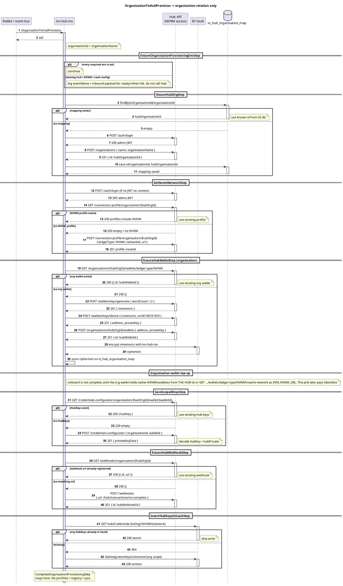

# Organisation Provisioning Sequence

**Summary**: Two inbound events. `OrganizationToHubProvision` sets up the Hub org relation and stops. `ClientDLTTransaction` (was `MeasurablDLTTransaction`) uses that mapping, then portfolio → registry → document.

**Sources**: `apps/hub-service/src/organisation-provisioning/`; [Organisation Provisioning Chain](Hub%20Onboarding%20Chain.md); [Identity Wallet Signing](Identity%20Wallet%20Signing.md).

**Last updated**: 2026-09-22

---

`OrganizationToHubProvision`: `organisationId`, `organisationName`. Creates or reuses Hub org, NVNM profile, org wallet, HubKeys, webhook, Vault keys. Does **not** start portfolio, registry, or sync.

`ClientDLTTransaction`: `dealId`, `taxonomyId`, `organisationId`, `uri`, `checksum`, `checksumAlgo`. Requires a row in `io_hub_organisation_map`. Portfolio for Identity email comes from `deal_anchors`: `portfolioId` when `parentPortfolioIds` is empty, else `parentPortfolioIds[0]`. Hub provides access to NVNM; we send a register-registry or sync-document transaction.

## OrganizationToHubProvision

## ClientDLTTransaction

```plantuml
@startuml
title ClientDLTTransaction → portfolio → registry → document

skinparam sequenceMessageAlign center
skinparam sequence {
  LifeLineBackgroundColor white
}
hide footbox
autonumber

participant "Rabbit / event bus" as Bus
participant "inv-hub-ms" as IO
participant "Hub API\n(NVNM access)" as Hub
participant "IO Vault" as Vault
database "io_hub_organisation_map" as Map
database "deal_anchors" as Anchors

Bus -> IO ++ #E8DEF8 : ClientDLTTransaction
IO --> Bus : ack

== EnsurePortfolioProvisioningEnvStep ==

alt every required env is set
  note right of IO : continue
else missing hub / NVNM / vault config
  note right of IO : log eventName + inbound payload for replay\\nthen fail. do not call Hub
end

== ResolveHubOrganisationStep ==

IO -> Map ++ #FFFFFF : findByIoOrganisationId(organisationId)
alt mapping exists
  Map --> IO -- : hubOrganisationId
  note right : use known id from IO db
else no mapping
  Map --> IO -- : empty
  note right of IO : fail. run OrganizationToHubProvision first
end

== EnsureHubIdentityStep ==

IO -> Anchors ++ #FFFFFF : findOne(dealId)
Anchors --> IO -- : portfolioId / parentPortfolioIds
note right
  use portfolioId if parentPortfolioIds empty
  else parentPortfolioIds[0]
  email = {portfolioId}@measurabl.com
end note
IO -> Hub ++ #FFFFFF : GET /organizations/{hubOrgId}/users?search=email
alt Identity exists
  Hub --> IO -- : 200 { id: hubIdentityId }
  note right : use existing identity
else no Identity
  Hub --> IO -- : 200 []
  IO -> Hub ++ #FFFFFF : POST /organizations/{hubOrgId}/users\n{ firstName, lastName, email }
  Hub --> IO -- : 201 { id: hubIdentityId }
end

== EnsureHubIdentityWalletStep ==

IO -> Hub ++ #FFFFFF : GET /organizations/{hubOrgId}/users/{identityId}/wallets
alt identity NVNM wallet exists
  Hub --> IO -- : 200 [{ id: hubWalletId }]
  note right : use existing identity wallet
else no identity wallet
  Hub --> IO -- : 200 []
  IO -> Vault ++ #FFFFFF : decrypt org mnemonic (inv-hub-tse)
  Vault --> IO -- : mnemonic
  IO -> Hub ++ #FFFFFF : POST /wallets/keys/derive { m/44'/60'/0'/0/n }
  Hub --> IO -- : 201 { address, privateKey }
  IO -> Hub ++ #FFFFFF : POST /organizations/{hubOrgId}/users/{identityId}/wallets
  Hub --> IO -- : 201 { id: hubWalletId }
end

== EnsureRegistryFundsStep ==

IO -> Hub ++ #FFFFFF : GET /ledgers/get-wallet-info?userEmail=
Hub --> IO -- : wallet
IO -> Hub ++ #FFFFFF : GET /ledgers/balance/{hubWalletId}
Hub --> IO -- : balance
IO -> Vault ++ #FFFFFF : GET InveniamToken ABI
Vault --> IO -- : abi + contractAddress
note right of IO : eth_estimateGas(addRegistry) from identity
alt leftover covers sign buffer
  note right of IO : proceed
else leftover below sign buffer
  IO -> Hub ++ #FFFFFF : GET /ledgers/balance/{hubWalletId}
  Hub --> IO -- : leftover
  note right of IO : parent /0 sends required - leftover, poll balance
end

== EnsureRegistryStep ==

IO -> Anchors ++ #FFFFFF : findOne(dealId)
alt registry already on deal_anchors
  Anchors --> IO -- : registry
  note right : use known registry, skip register
else registry empty
  Anchors --> IO -- : registry = ""
  IO -> Vault ++ #FFFFFF : GET org HubKeys (scoped miss then org fallback)
  Vault --> IO -- : 200 HubKeys
  IO -> Hub ++ #FFFFFF : send register registry transaction
  Hub --> IO -- : accepted (jobId)
  IO -> Hub ++ #FFFFFF : GET /ledgers/v3/jobs/:jobId
  Hub --> IO -- : completed + hash
  IO -> Hub ++ #FFFFFF : GET /ledgers/status/:hash
  Hub --> IO -- : applied
  Hub -> IO ++ #FFFFFF : POST /hub/transactions/on-complete
  IO --> Hub -- : 200
  IO -> Bus ++ #FFFFFF : HubSymbolRegisteringSucceededEvent
  Bus -> IO --++ #FFFFFF : StoreDealAnchorRegistrySaga
  IO -> Anchors ++ #FFFFFF : UPDATE registry = symbol
  Anchors --> IO -- : row updated
  IO -> Anchors ++ #FFFFFF : take pending_document
  Anchors --> IO -- : ClientDLT uri / taxonomy
  note right of IO : start document sync
end

== CompleteRegistryProvisioningStep ==

alt registry already known
  note right of IO : start document sync now
else register just requested
  IO -> Anchors ++ #FFFFFF : park pending_document
  Anchors --> IO -- : stored
  note right of IO : wait for register webhook, no poll
end

== EnsureDocumentProvisioningEnvStep ==

alt every required env is set
  note right of IO : continue
else missing hub / NVNM / vault config
  note right of IO : log ClientDLTTransaction payload for replay\\nthen fail
end

== EnsureDocumentFundsStep ==

IO -> Hub ++ #FFFFFF : GET /ledgers/get-wallet-info?userEmail=
Hub --> IO -- : wallet
IO -> Hub ++ #FFFFFF : GET /ledgers/balance/{hubWalletId}
Hub --> IO -- : balance
IO -> Vault ++ #FFFFFF : GET InveniamToken ABI
Vault --> IO -- : abi + contractAddress
note right of IO : eth_estimateGas(addRecord) from identity
alt leftover covers sign buffer
  note right of IO : proceed
else leftover below sign buffer
  IO -> Hub ++ #FFFFFF : GET /ledgers/balance/{hubWalletId}
  Hub --> IO -- : leftover
  note right of IO : parent /0 sends required - leftover, poll balance
end

== SyncDocumentStep ==

IO -> Vault ++ #FFFFFF : GET org HubKeys (scoped miss then org fallback)
Vault --> IO -- : 200 HubKeys
  IO -> Hub ++ #FFFFFF : send sync document transaction
  Hub --> IO -- : accepted (jobId)
  IO -> Hub ++ #FFFFFF : GET /ledgers/v3/jobs/:jobId
  Hub --> IO -- : completed + hash
  IO -> Hub ++ #FFFFFF : GET /ledgers/status/:hash
  Hub --> IO -- : applied
  Hub -> IO ++ #FFFFFF : POST /hub/transactions/on-complete
IO --> Hub -- : 200
IO -> Bus ++ #FFFFFF : HubDocumentSyncingSucceededEvent
Bus --> IO -- : delivered

== LogDocumentSyncFinishedSaga ==

Bus -> IO ++ #FFFFFF : HubDocumentSyncingSucceededEvent
IO --> Bus -- : log document sync finished

deactivate IO

@enduml
```

## Command hand-off

| Event | Completes | Starts |
| --- | --- | --- |
| `OrganizationToHubProvision` | `CompleteOrganisationProvisioningStep` | — |
| `ClientDLTTransaction` | `CompletePortfolioProvisioningStep` | `RunRegistryProvisioningCommand` |
| `ClientDLTTransaction` | `CompleteRegistryProvisioningStep` | `RunDocumentProvisioningCommand` when registry already exists |
| `ClientDLTTransaction` | `CompleteDocumentProvisioningStep` | — |
| `HubSymbolRegisteringSucceededEvent` | `StoreDealAnchorRegistryCommand` | `RunDocumentProvisioningCommand` from `pending_document` |

`CompleteRegistryProvisioningStep` starts document sync immediately when registry is already on context. Otherwise it parks the ClientDLT payload and the register webhook starts sync.

## Async bus (not in the CoR call stack)

| Event | Listener | Effect |
| --- | --- | --- |
| `HubSymbolRegisteringSucceededEvent` | `StoreDealAnchorRegistrySaga` | write `deal_anchors.registry`, then start document sync |
| `HubDocumentSyncingSucceededEvent` | `LogDocumentSyncFinishedSaga` | log `document sync finished` (no command) |
| `HubDocumentSyncingSucceededEvent` | `HubDocumentSyncingSucceededEventHandler` (transactions) | existing handler log |

Webhook and status poll can both call `onComplete`. The second is skipped when the row is already terminal.

## Related pages

- [Measurabl Provisioning Handoff](Measurabl%20Provisioning%20Handoff.md)

- [Wiki Index](Measurabl%20provision%20(INV-42559)/wiki/index.md)
- [Organisation Provisioning Chain](Hub%20Onboarding%20Chain.md)
- [Identity Wallet Signing](Identity%20Wallet%20Signing.md)
- [Hub User JWT Endpoints](Hub%20User%20JWT%20Endpoints.md)
- [Event Payloads](Event%20Payloads.md)
- [ADR-0001 Hub Onboarding Module](../decisions/ADR-0001%20Hub%20Onboarding%20Module.md)
