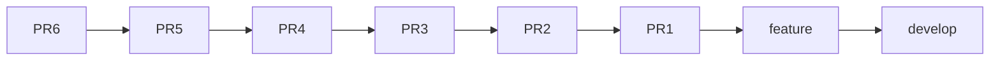

# Sequential PR Stack

**Summary**: Proposal for discussion. Open the six slice PRs as one line under a feature branch so the GitHub list is easy to follow. Some slices are independent; the sequence is for tracking, not because every slice needs the previous code.

**Sources**: [Split Branch Into PRs Agent Playbook](Split%20Branch%20Into%20PRs%20Agent%20Playbook.md); GitHub stacked-PR retarget after merge.

**Last updated**: 2026-10-01

---

Status: **open for discussion**. Not locked.

The playbook still defines the six slices and what each contains. This page is only how those slices are opened and merged on GitHub.

## Proposal

```
develop ← feature ← pr1 ← pr2 ← pr3 ← pr4 ← pr5 ← pr6
```

`←` means “merges into” / “base is to the left”.

| Open | Base (target) |
| --- | --- |
| Feature branch | `develop` |
| PR1 | `feature` |
| PR2 | `pr1` |
| PR3 | `pr2` |
| PR4 | `pr3` |
| PR5 | `pr4` |
| PR6 | `pr5` |

Write “depends on PRn−1” on each body. Reviewers follow one chain.



Excalidraw (open in Obsidian Excalidraw view, or import the JSON block on excalidraw.com): [Sequential PR Stack.excalidraw](Sequential%20PR%20Stack.excalidraw.md).

## After merge PR1, then PR2

GitHub merges a PR into its **current base**. After a head is merged, the next PR’s base becomes that merged PR’s old base. It does not jump to `develop`.

1. Merge PR1 → lands on **`feature`**. PR2 retargets from `pr1` to **`feature`**.
2. Merge PR2 → lands on **`feature`**. PR3 retargets to **`feature`**.
3. Same for PR3–PR6.

`develop` does not move until `feature` is merged into `develop`.

```
After PR1 and PR2 are merged:

develop ← feature ← pr3 ← pr4 ← pr5 ← pr6
              ↑
         PR1 + PR2 already here
```

## What this gives up

PR2, PR3, and PR6 can be built without waiting for every earlier slice. In this stack they still wait in the GitHub queue. That is the cost of one sequence.

Independence stays true in the playbook (what a slice contains, what it can compile against). The GitHub order is linear on purpose.

## Alternative (playbook GitHub bases)

PR1 and PR6 against `develop`. PR2 and PR3 against PR1. After PR1 merges, GitHub retargets PR2 to **`develop`**. Slice PRs land on `develop` as they merge. No holding feature branch. Harder to see one ordered list.

## To decide

1. Accept the linear stack under `feature`, or open against `develop` as in the playbook.
2. If linear: feature branch name, and whether an umbrella PR `feature` → `develop` is opened on day one.

## Related pages

- [Wiki Index](INV-42559%20-%20Measurabl%20provision/wiki/index.md)
- [Split Branch Into PRs Agent Playbook](Split%20Branch%20Into%20PRs%20Agent%20Playbook.md)
- [Sequential PR Descriptions](Sequential%20PR%20Descriptions.md) — Paste-ready bodies for the opened slice PRs.
- [Sequential PR Stack.excalidraw](Sequential%20PR%20Stack.excalidraw.md)
- [Sequential PR Stack.excalidraw](Sequential%20PR%20Stack.excalidraw) (JSON for excalidraw.com)
