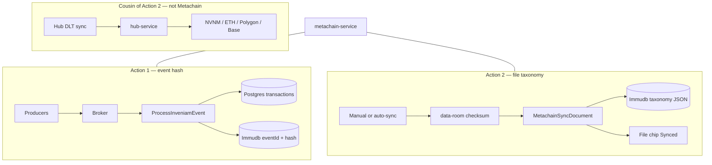

# Metachain And NVNM Flow

**Summary**: `metachain-service` does two actions. Action 1 hashes platform events into Immudb. Action 2 writes a file taxonomy (DLT-style fingerprint) and is what shows a file as Synced. NVNM via Hub is a cousin of Action 2 only.

**Sources**: [Event Hash vs File Taxonomy](Event%20Hash%20vs%20File%20Taxonomy.md); Excalidraw [Metachain And NVNM Flow.excalidraw](Metachain%20And%20NVNM%20Flow.excalidraw)

**Last updated**: 2026-10-02

---

Open [Metachain And NVNM Flow.excalidraw](Metachain%20And%20NVNM%20Flow.excalidraw) in Obsidian Excalidraw or [excalidraw.com](https://excalidraw.com) (File → Open). Plugin note: [Metachain And NVNM Flow.excalidraw.md](Metachain%20And%20NVNM%20Flow.excalidraw.md).

**Drawing structure (follow this if you edit):** title + `metachain-service` header; two side-by-side columns (Action 1 left, Action 2 right); each column top → bottom. Agents may update labels/boxes when facts change. Do not regenerate the file from scratch or flatten it back to a single stacked column.

## Split

| | Action 1 — event hash | Action 2 — file taxonomy | Cousin — NVNM / EVM |
| - | --------------------- | ------------------------ | ------------------- |
| Owner | `metachain-service` | `metachain-service` | `hub-service` + Hub app |
| Trigger | Any routed `BaseEvent` with `meta.eventId` | Manual DLT sync or auto-sync after link | User DLT sync, `isHubConnected = true` |
| Written | `{eventId, hash}` | Full `documentTaxonomy` | `addRecord` / `setDocument` |
| File Synced chip | No | Yes | Yes, on that ledger |

Deal-create “Connect Inv Metachain” starts neither action. It is deals-service integration settings.

INV-42833 is Action 1 unless we say otherwise.

## Mermaid (same story as the drawing)

## Related pages

- [Event Hash vs File Taxonomy](Event%20Hash%20vs%20File%20Taxonomy.md)
- [Metachain Ownership And Infrastructure](Metachain%20Ownership%20And%20Infrastructure.md)
- [Metachain Write Path](Metachain%20Write%20Path.md)
- [How File Shows As Synced](How%20File%20Shows%20As%20Synced.md)
- [Payload Comparison Metachain vs NVNM](Payload%20Comparison%20Metachain%20vs%20NVNM.md)
- [Wiki Index](INV-42833%20-%20Metachain/wiki/index.md)
