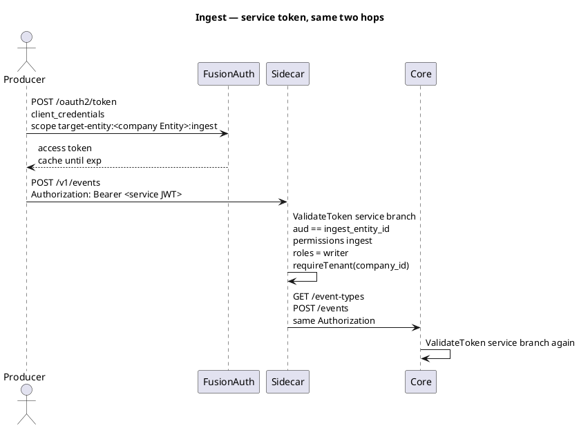

# ADR-0001 Service Tokens for Ingest

- **Status**: Postponed
- **Date**: 2026-10-13
- **Area**: Producer authentication on the sidecar and the core
- **Deciders**: Postponed. Not accepted.
- **Related**: [Service Token Explanation](Service%20Token%20Explanation.md), [Current Auth Flow](Current%20Auth%20Flow.md), [Open Questions](INV-43085%20-%20Indicia%20Auth%20Investigation/wiki/Open%20Questions.md)

Postponed 2026-10-13. The design below stays as the record of what was specified. It is not scheduled. The reason is [Service Token Explanation](Service%20Token%20Explanation.md).

## Context

A producer that calls the sidecar must present a FusionAuth access token. The sidecar validates it and forwards the same `Authorization` header on `GET /event-types` and `POST /events`. The core validates that header again. The sidecar does not mint a token (source: `internal/sidecar/coreclient/client.go`; Slice 2b §4.5).

The token in that path is a user token. Local kickstart enables `authorization_code`, `refresh_token`, and `password`, with `requireClientAuthentication: false` (source: `docker/fusionauth-kickstart/kickstart.json`). The documented token request sends `client_id`, username, and password (source: `docs/guides/GETTING_STARTED.md`). The user JWT populate lambda copies `company_id` and `roles` only when a registration is present:

```javascript
function populate(jwt, user, registration) {
  if (registration && registration.data && registration.data.company_id) {
    jwt.company_id = registration.data.company_id;
  }
  if (registration && registration.roles) {
    jwt.roles = registration.roles;
  }
}
```

`FusionAuthJWTValidator.ValidateToken` then requires `aud` to contain `INDICIA_FUSIONAUTH_APPLICATION_ID` (`b21c6087-f7d6-4cdd-9ae4-79778ee8ee17` in kickstart) and reads `company_id` and `roles` into `Claims` (source: `internal/auth/fusionauth_jwt.go`). Empty `company_id` is `403` on the sidecar for every role (`requireTenant` in `internal/sidecar/router.go`).

Ingest admits `writer`, `company_admin`, and `global_admin` (`RequireWriter` in `internal/api/middleware/auth.go`). A `writer` token can append and cannot read plaintext (D5b). D5d records that writer-class core credentials are machine identities. The shipped path still uses the producer's user JWT.

FusionAuth's open question 2 already recommends service accounts for backend integrations and leaves them unimplemented (source: `docs/feature_summaries/FUSIONAUTH_INTEGRATION.md`, Open Questions). Client-credentials tokens have no user registration, so the lambda above copies neither `company_id` nor `roles`, and `aud` is an Entity id, so `validateAudience` rejects them.

Machine producers need a client id and a client secret, a cached access token, and no user password on the sidecar call. Humans who read, erase, and administer stay on user tokens. The forwarded-bearer hop stays.

Role assignment for those humans lives in FusionAuth, on the user's registration for the Indicia application. Indicia stores no role table. The user lambda copies `registration.roles` onto the token. The door is `/admin/users`, behind `RequireAdmin` (source: `internal/api/router.go`). A `company_admin` creates and updates users only in their own `company_id`, and may assign only `reader`, `writer`, and `company_admin` (`companyAdminGrantableRoles` in `internal/api/handlers/users.go`). `global_admin` and `operator` are refused for that caller. A `global_admin` may manage any company and may assign those two roles. That API writes a user registration. It does not create an Entity, rotate a client secret, or write an `ingest` grant.

## Decision

Issue ingest credentials as FusionAuth client-credentials tokens (Entities). Keep user tokens for humans. One switcher in `ValidateToken` accepts both shapes and always yields `company_id` plus a D5 role set. Sidecar and core keep sharing that validator and keep forwarding the caller's bearer.

### Entities

FusionAuth client credentials are Entity grants, documented at [Machine-to-machine](https://fusionauth.io/docs/get-started/use-cases/machine-to-machine). Entity ids are UUIDs. The feature is documented as FusionAuth Starter or higher.

| FusionAuth object           | Role in this proposal                                            | Lands in the token as                                      |
| --------------------------- | ---------------------------------------------------------------- | ---------------------------------------------------------- |
| Producer Entity             | Recipient. Holds `client_id` (its own UUID) and `client_secret`. | `sub`                                                      |
| Company Entity              | Target. One per Indicia company.                                 | `aud` (array)                                              |
| Grant on the company Entity | Recipient = that producer. Permission name `ingest`.             | `permissions["<company Entity UUID>"]` includes `"ingest"` |

Indicia `company_id` stays the string already stored on `companies.company_id` (kickstart uses values such as `dev-company`). It is not the Entity UUID. The company row gains the target Entity UUID. Proposed column: `companies.ingest_entity_id`. That column does not exist in `internal/storage/postgres/migrations/005_create_companies.sql`.

Token request, once per access-token lifetime. The producer caches the access token and refreshes it when `exp` passes. Indicia does not refresh tokens (same recommendation as FusionAuth integration open question 3).

```http
POST /oauth2/token
Content-Type: application/x-www-form-urlencoded

grant_type=client_credentials
&client_id=<producer Entity UUID>
&client_secret=<producer Entity secret>
&scope=target-entity:<company Entity UUID>:ingest
```

### Where `company_id` is written

Two lambdas, one claim name. `requireTenant` keeps reading `company_id`.

User tokens: the existing JWT populate lambda, from `registration.data.company_id`.

Service tokens: a Client Credentials JWT Populate lambda. Signature and reserved claims are documented at [Client credentials JWT populate](https://fusionauth.io/docs/extend/code/lambdas/client-credentials-jwt-populate):

```javascript
function populate(jwt, recipientEntity, targetEntities, permissions, context) {
  // jwt.company_id may be set here.
  // Reserved, and left unchanged: amr, aud, cnf, exp, gty, iat, permissions, sub, tid, tty, use.
}
```

The lambda sets `jwt.company_id` from the target Entity that holds `ingest` (the company Entity's data), so the claim matches the grant FusionAuth put in `aud` and `permissions`.

### Switcher

`ValidateToken` branches on `gty`. FusionAuth sets `gty` to the grant list (documented on [access tokens](https://fusionauth.io/docs/lifecycle/authenticate-users/oauth/tokens) from 1.60.0). The client-credentials lambda cannot change it.

**User branch** (`gty` does not contain `client_credentials`). Unchanged. `iss` matches the configured issuer. `aud` contains `INDICIA_FUSIONAUTH_APPLICATION_ID`. `company_id` and `roles` come from the user lambda. Unknown role strings are dropped (`filterRoles` in `internal/auth/fusionauth_jwt.go`).

**Service branch** (`gty` contains `client_credentials`).

1. `iss` matches the same issuer. Signature still uses the tenant JWKS.
2. Read `company_id`. Load `companies.ingest_entity_id` for that id.
3. `aud` must contain that Entity UUID.
4. `permissions[that UUID]` must contain `ingest`.
5. Set `Claims.Roles` to `writer` only.

Step 5 is fixed. Permission strings are not copied into `roles`. `filterRoles` would drop an unknown name such as `ingest`, and would keep a permission that someone named `global_admin` or `company_admin`. The service branch never hands those names to `RequireWriter`.

`company_id` alone is not the audience check. A second Entity in the same tenant is signed by the same keys and the same `iss`. If its data also says `dev-company`, a switcher that trusts the claim and skips steps 3 and 4 admits it with no `ingest` grant. `aud` equal to `ingest_entity_id`, plus `ingest` on that id, is the check that stops it.

### What `aud` is for

On a user token, `aud` is the Indicia application id. That check answers: this token was minted for this application. Kickstart application id: `b21c6087-f7d6-4cdd-9ae4-79778ee8ee17`. A user token from another application in the same tenant carries that other id and fails `validateAudience`.

On a service token there is no `applicationId`, and `aud` is not that application id. The same question is answered by steps 3 and 4 above. Copying another application's OAuth settings does not create the Producer Entity, does not reveal its secret, and does not add `ingest`. FusionAuth sets `sub`, `aud`, and `permissions`; the caller cannot stamp them.

Absence of `applicationId` is the normal client-credentials shape. It does not admit another application.

### Claim comparison

Shapes below follow FusionAuth's token documentation. Entity UUIDs are placeholders. The application id and the issuer `acme.com` are the kickstart values. `company_id` stays an Indicia string.

User token (password, authorization code, or refresh):

```json
{
  "iss": "acme.com",
  "sub": "<FusionAuth user UUID>",
  "aud": "b21c6087-f7d6-4cdd-9ae4-79778ee8ee17",
  "gty": ["password"],
  "applicationId": "b21c6087-f7d6-4cdd-9ae4-79778ee8ee17",
  "roles": ["reader"],
  "company_id": "dev-company",
  "tty": "at"
}
```

Service token (client credentials):

```json
{
  "iss": "acme.com",
  "sub": "<producer Entity UUID>",
  "aud": ["<company Entity UUID>"],
  "gty": ["client_credentials"],
  "permissions": {
    "<company Entity UUID>": ["ingest"]
  },
  "company_id": "dev-company",
  "tty": "at"
}
```

| Claim                   | User token                                                                                          | Service token                                                                                          |
| ----------------------- | --------------------------------------------------------------------------------------------------- | ------------------------------------------------------------------------------------------------------ |
| `iss`                   | Tenant issuer (`acme.com` in kickstart). Same JWKS.                                                 | Same tenant issuer and same JWKS.                                                                      |
| `sub`                   | FusionAuth user id.                                                                                 | Producer Entity id. Also that Entity's `client_id`.                                                    |
| `aud`                   | Indicia application id, string or array. Must contain `INDICIA_FUSIONAUTH_APPLICATION_ID`.          | Company Entity id, always an array since FusionAuth 1.60.0. Must contain `companies.ingest_entity_id`. |
| `applicationId`         | Present when the user is registered for the application.                                            | Absent.                                                                                                |
| `roles`                 | Copied from `registration.roles`.                                                                   | Absent. Switcher sets `writer` only.                                                                   |
| `permissions`           | Not used.                                                                                           | Object keyed by target Entity UUID. `ingest` required on the company Entity.                           |
| `company_id`            | User lambda, from `registration.data.company_id`.                                                   | Client-credentials lambda, from the granted company Entity.                                            |
| `gty`                   | Grant list, for example `password`, `authorization_code`, `refresh_token`.                          | Grant list containing `client_credentials`. Branch key.                                                |
| `tty`                   | `at` for an access token.                                                                           | `at`. Does not distinguish the two.                                                                    |
| Who it admits on ingest | `writer`, and also `company_admin` or `global_admin` while those names stay inside `RequireWriter`. | `writer` only, after the switcher.                                                                     |
| Read / erasure doors    | A human `reader` or `company_admin` token, unchanged.                                               | No. `writer` is refused by those doors (D5b, D3a).                                                     |

### Who provisions the Producer Entity

A `company_admin` provisions Producer Entities for their own company. Indicia calls the FusionAuth Entity API with the server API key. The admin's token supplies `company_id`. A caller-supplied company id is ignored. Every grant's target is `companies.ingest_entity_id` for that company, and the only permission written is `ingest`. The response returns that Entity's `client_id` and `client_secret`. The producer exchanges those at `/oauth2/token`. The admin does not mint the JWT.

`global_admin` creates the company Entity and sets `ingest_entity_id` when the company is created. A `company_admin` cannot change that id, grant `ingest` on another company's Entity, or assign `global_admin` or `operator`.

### Producer ingest uses the service token

A machine that posts events is not a user. The password grant means every producer process holds a username and password, and adding a producer means creating a FusionAuth user and a registration in the FusionAuth the core trusts. A client-run sidecar has the same dependency.

Producer ingestion uses the service token only. The producer caches the access token until `exp` and sends it to the sidecar. Humans lose `writer`. They keep `reader` and `company_admin` for read, verify, and erasure. Many processes can share one Producer Entity.

`RequireWriter` still admits `company_admin` and `global_admin`, so those user tokens can still call `POST /v1/events` until that gate is narrowed to the service-token `writer` role. That narrowing is [Open Questions](INV-43085%20-%20Indicia%20Auth%20Investigation/wiki/Open%20Questions.md) item 1. This proposal does not decide it. Until then, producer user-token ingest is replaced, and those two admin roles remain a second way onto the same door.

The hop does not change. After the switcher accepts the service token, the sidecar still forwards that bearer. The core runs the same switcher. A `writer` service token can call `POST /events` and `GET /event-types`. It cannot call core verify (`RequireVerifyReader` admits `reader`, `company_admin`, `global_admin`).



## Alternatives considered

- **Keep the password grant for machines.** Works with today's validator and lambda. Every producer holds a user password. A new machine is a new FusionAuth user. That is the dependency this proposal removes.

- **Give the producer a signing key and let it mint JWTs.** The sidecar and core would verify with the public key. The producer would choose `company_id` and `roles` unless each key is pinned to one tenant and one role. That pin list is a credential store. FusionAuth integration non-goals already refuse a custom credential store in the Indicia database (source: `docs/feature_summaries/FUSIONAUTH_INTEGRATION.md`).

- **`INDICIA_AUTH_PROVIDER=static`.** The core mints HS256 tokens from secrets it holds. `validateAuthProvider` rejects `static` outside development (source: `internal/config/config.go`). The sidecar has no `POST /auth/token`.

- **A sidecar process credential on the core hop.** Slice 2b §4.5 rejected a standing multi-tenant credential. A compromised sidecar would then act for every tenant, not only the callers in flight. This proposal still forwards the producer bearer.

- **Accept any well-signed service token and trust `company_id` alone.** `iss` and the JWKS are the tenant's. Every Entity in the tenant verifies. A second Entity whose lambda input also yields `company_id` `dev-company` would pass with no `ingest` grant. The service branch requires `aud` and `permissions`.

## Consequences

- **Positive**: Producers authenticate with an Entity id and secret. Humans and machines use different FusionAuth objects. `company_id` remains the tenant claim on both doors. The sidecar still invents no credential. A service token cannot grow `company_admin` or `global_admin` by naming a permission that way. A `company_admin` can provision those producers for their own company and cannot provision them for another.

- **Negative / trade-offs**: Requires FusionAuth Entities (Starter or higher) and version 1.60.0 or later so `gty` is present to branch on. Local kickstart has no Entity types, grants, or client-credentials lambda. `ValidateToken`'s single application-id audience check must become the two branches, or every service token fails `invalid audience`. `companies.ingest_entity_id` must be populated before a service token for that company will pass. User tokens and service tokens must be deployed to sidecar and core together, because both validate the same bearer. `company_admin` and `global_admin` can still ingest until `RequireWriter` is narrowed.

- **Follow-ups**: Add the client-credentials lambda, Entity type, company Entity, producer Entity, and `ingest` grant to kickstart. Migration for `companies.ingest_entity_id`. Add the company-scoped provisioning door next to `/admin/users`. Remove `writer` from human registrations that should only read. Decide open question 1 (`global_admin` on sidecar ingest) separately. Confirm the Entity JWT signing key is published on the JWKS URL `LoadFusionAuthConfig` already fetches.

## Affected code

Nothing in this proposal is implemented. Paths that would change:

| Path | What would change |
| ---- | ----------------- |
| `internal/auth/fusionauth_jwt.go` | Branch `ValidateToken` on `gty`. Service branch checks `aud` and `permissions["ingest"]`, then sets `roles` to `writer`. |
| `internal/storage/postgres/migrations/005_create_companies.sql` | New migration adding `ingest_entity_id`. The existing table has no Entity id. |
| `docker/fusionauth-kickstart/kickstart.json` | Entity type, company and producer Entities, `ingest` grant, client-credentials populate lambda. User lambda stays. |
| `internal/api/handlers/users.go` | Unchanged for human roles. A new handler beside it creates Producer Entities and `ingest` grants, scoped to the caller's `company_id`. |  
| `internal/api/middleware/auth.go` | Unchanged until open question 1 narrows `RequireWriter`. |
| `internal/sidecar/coreclient/client.go` | Unchanged. Still forwards the caller bearer. |
| `cmd/sidecar/main.go`, `cmd/api/main.go` | Unchanged wiring. Both already construct `NewFusionAuthJWTValidator` from `LoadFusionAuthConfig`. |

## Related

- [Decision register](INV-43085%20-%20Indicia%20Auth%20Investigation/decisions/INDEX.md)
- [Service Token Explanation](Service%20Token%20Explanation.md)
- [Current Auth Flow](Current%20Auth%20Flow.md)
- [Open Questions](INV-43085%20-%20Indicia%20Auth%20Investigation/wiki/Open%20Questions.md)
- [Wiki](INV-43085%20-%20Indicia%20Auth%20Investigation/wiki/index.md)
