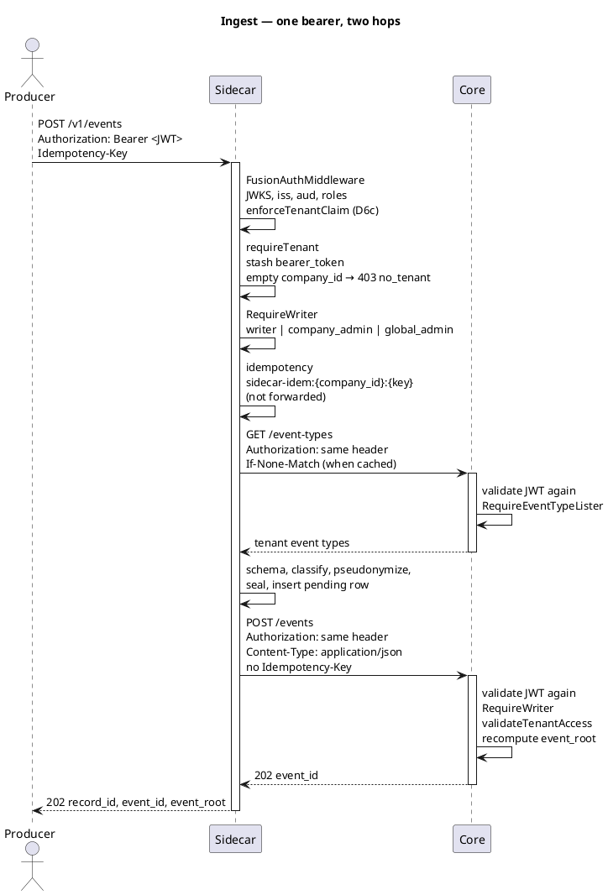
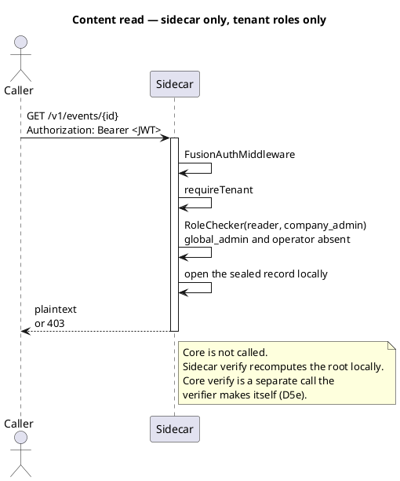
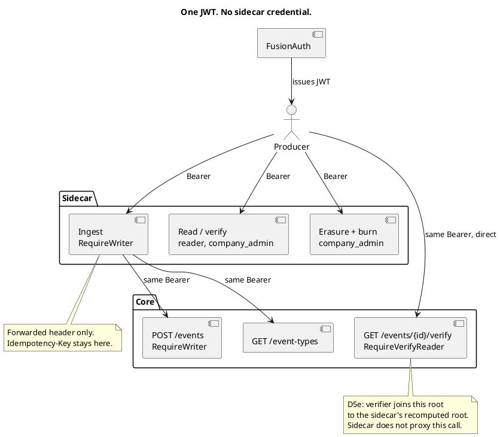

# Current Auth Flow

**Summary**: Producer, content sidecar, and anchoring core share one FusionAuth JWT. The sidecar validates it, then forwards the same `Authorization` header on the only two calls it makes to the core. There is no sidecar service account, mTLS, or shared secret on that hop.

**Sources**: `internal/sidecar/router.go`, `internal/sidecar/coreclient/client.go`, `internal/sidecar/http/handler.go`, `internal/registrysync/ingest.go`, `cmd/sidecar/main.go`, `internal/api/middleware/auth.go`, `internal/api/router.go`, `internal/api/handlers/users.go`, `docs/plans/SEPARATION_OF_CONCERNS_SLICE_2B_RECORD_STORE.md` §4.5, `docs/plans/DECISION_SET_2026-08-10_VERIFY_ERASURE_RBAC.md` (D3a, D5, D6), `docs/plans/SECURITY_ASSESSMENT_2026-08-14_BACKLOG.md` (`internal-api-3`). Application repo: `~/work/inveniam/trace-chain/InveniamIndicia`.

**Last updated**: 2026-10-13

---

One bearer travels both hops. The sidecar does not mint a token. A compromised sidecar can only act as the callers it is already handling (source: Slice 2b §4.5; package comment on `internal/sidecar/coreclient/client.go`).

Door-by-role picture: [Auth Doors](Auth%20Doors.excalidraw.md).

## Who validates what

| Hop | Who presents the token | Who checks it | Credential invented on this hop |
| --- | --- | --- | --- |
| Producer → sidecar | Producer | Sidecar, with the core's FusionAuth loader | None |
| Sidecar → core | Sidecar, forwarding the producer's header | Core, again, as if the caller were any other client | None |

The sidecar binary builds `auth.NewFusionAuthJWTValidator` from `config.LoadFusionAuthConfig()` so issuer, audience, and claim names cannot drift from the core (source: `cmd/sidecar/main.go`, comment above the validator). Production mounts `NewFusionAuthAuth`, which is `middleware.FusionAuthMiddleware`. The sidecar has no static-auth `POST /auth/token`. A JWT minted only by the core's `INDICIA_AUTH_PROVIDER=static` path does not validate here. Integration tests substitute `stubAuth` and skip signature checks; that stub is not the shipped door (source: `internal/sidecar/router.go` `RouterDeps.Auth`).

`/health` and `/ready` take no JWT.

## Producer → sidecar

Every `/v1` route runs the same two middleware steps, then a **per-door** role gate. A single checker on `/v1` would be the union of ingest and erasure, which the RBAC notes refuse (source: `NewRouter` comments in `internal/sidecar/router.go`).

1. **`FusionAuthMiddleware`**. Extract `Authorization: Bearer`. Validate signature (JWKS), issuer, audience, expiry. Map `sub`, `company_id`, and `roles` (filtered to the D5 vocabulary). Then `enforceTenantClaim` (D6c): an empty `company_id` is allowed only when the token holds `global_admin` or `operator`. Any other tenantless token is **403** `Token is missing the company_id claim` (source: `internal/api/middleware/auth.go`).
2. **`requireTenant`**. Stricter than the core. An empty `company_id` is **403** `no_tenant` even for `global_admin` and `operator`. On success it stores `company_id` and the raw `Authorization` header as `bearer_token` (source: `requireTenant` in `internal/sidecar/router.go`). The comment states why: every record is sealed under one tenant, and every pseudonym — including the one an erasure resolves — is derived from that tenant's secret. The core's "empty `company_id` means cross-tenant admin" signal does not exist on this door.
3. **Role gate**, different per door. `requireTenant` runs before idempotency so keys are `sidecar-idem:{company_id}:{clientKey}` and the shared `_anonymous` bucket is unreachable.

| Door | Method and path | Admitted roles | Refused |
| --- | --- | --- | --- |
| Ingest | `POST /v1/events` | `writer`, `company_admin`, `global_admin` (`RequireWriter`) | `reader`, `operator` |
| Read | `GET /v1/events/:id`, `GET /v1/events/:id/verify`, `GET /v1/quarantine`, `GET /v1/quarantine/:id` | `reader`, `company_admin` | `writer`, `global_admin`, `operator` |
| Burn | `DELETE /v1/quarantine/:id` | `company_admin` | everyone else |
| Erasure | `POST/GET /v1/erasures…` | `company_admin` | everyone else, including `global_admin` (`RequireAdmin` is deliberately not used) |

Ingest also requires `Idempotency-Key`. That header is a sidecar concern. It is not an auth credential and it is not forwarded (see below).

On ingest the handler overwrites body `company_id` from the token and rejects a caller-supplied value that disagrees (source: `decodeRequest` in `internal/sidecar/http/handler.go`).

### Ingest sequence

`GET /event-types` runs when the sidecar needs a fresh tenant registry (`ensureRegistryFresh` / `IngestSync`). `IngestSync` never mints a process credential; it sends the producer `Authorization`, adding a `Bearer ` prefix only if the stored value lacks one (source: `internal/registrysync/ingest.go`). The list is then filtered to the token's `company_id`.

`POST /events` happens after the content row is inserted. `PostEnvelope` sets `Authorization` to the stashed header and does not copy `Idempotency-Key` (source: `internal/sidecar/coreclient/client.go`).

### Content read never calls the core

Erasure and quarantine burn stay on the sidecar as well. They use `RoleChecker("company_admin")` only.

## Sidecar → core

The sidecar calls exactly two core routes, both with the producer's bearer:

| Call | When | Core gate |
| --- | --- | --- |
| `GET {INDICIA_SIDECAR_CORE_URL}/event-types` | Registry probe before ingest, and again on registry skew | `RequireEventTypeLister`: `reader`, `writer`, `company_admin`, `operator`, `global_admin` |
| `POST {INDICIA_SIDECAR_CORE_URL}/events` | After seal and insert | `RequireWriter`: `writer`, `company_admin`, `global_admin` |

Base URL is `INDICIA_SIDECAR_CORE_URL` (source: `internal/sidecar/config.go`). A trailing slash is trimmed so the client does not post to `//events`.

The core has no sidecar identity. It re-checks, independently:

1. JWT signature, issuer, audience, expiry.
2. `enforceTenantClaim` (empty `company_id` allowed only for `global_admin` / `operator` — wider than the sidecar).
3. The route's role gate.
4. On `POST /events`, `validateTenantAccess`: `global_admin` may name another tenant in the envelope; everyone else must match the token's `company_id`.
5. Envelope checks the sidecar cannot assert for it: recomputed `event_root`, schema digest, known event type, tier placement, reserved system tenant.

Optional `RequireRegisteredCompany` applies when `cfg.Companies.RequireRegistered` is on. That is a core config flag, not a sidecar credential.

A producer token that is only `reader` can pass the sidecar read door and the core's event-type list and verify surface. It cannot pass sidecar ingest or core `POST /events`. A token that is only `writer` can pass both ingest doors and `GET /event-types`, and cannot read plaintext.

### Trust boundaries

## Who assigns roles

FusionAuth holds the assignment on the user's registration for the Indicia application (`registration.roles` and `registration.data.company_id`). The user populate lambda copies both onto the JWT. Indicia stores no role table.

`/admin/users` is the door, behind `RequireAdmin` (source: `internal/api/router.go`). A `company_admin` lists, creates, and updates users whose `company_id` matches the token, and may assign only `reader`, `writer`, and `company_admin` (`companyAdminGrantableRoles` in `internal/api/handlers/users.go`). `global_admin` and `operator` are refused for that caller. A `global_admin` may manage any company and may assign those two roles. The handler writes a FusionAuth user registration. It does not create an Entity, rotate a client secret, or write an `ingest` grant.

## Why it is this shape

Each line below is a recorded decision or a comment that repeats one. This page does not choose among them.

- **Forward the caller's bearer; do not invent a service credential.** Slice 2b §4.5: the core validates the token itself and applies its existing tenant checks, so the full-data path adds no privilege. The stated alternative was an outbox worker, which would need a standing multi-tenant credential. A compromised sidecar would then be able to act for every tenant, not only the callers in flight (source: `docs/plans/SEPARATION_OF_CONCERNS_SLICE_2B_RECORD_STORE.md` §4.5). `coreclient` repeats the same sentence.
- **Do not forward `Idempotency-Key` (amendment F3, same section).** The core keys idempotency on prefix, tenant, and client key, and does not hash the body. A forwarded key would replay the first envelope's `event_id` onto a later row whose `event_root` was never that event. That is a plumbing mismatch reported as a verification failure.
- **Writer is not a reader (D5b).** A compromised producer token must be able to append, never exfiltrate (source: `RequireReader` comment in `internal/api/middleware/auth.go`; decision set D5b).
- **On the plaintext door, Inveniam holds no read (D5c).** `global_admin` and `operator` are absent from the read group. The router comment: access to this deployable is setup and teardown, not content. This is the service that holds readable content, so the distinction is enforceable here (source: read-group comment in `internal/sidecar/router.go`).
- **Erasure is the tenant's, not Inveniam's (D3a).** The gate is `company_admin` only. Admitting `global_admin` would recreate the cross-tenant operator erasure path that was declined (source: erasure-group comment in `internal/sidecar/router.go`).
- **Core verify stays a direct call (D5e).** A tenant `reader` may call the core verify surface, which returns status and hashes, never content. Sidecar-proxying that call was rejected: it would re-launder the join through operator plumbing and remove the verifier's ability to contradict the operator (source: `RequireVerifyReader` comment; decision set D5e).
- **Empty `company_id` is malformed for everyone except two Inveniam roles (D6c), and the sidecar does not grant even those two an exception.** Core perimeter: `enforceTenantClaim`. Sidecar: `requireTenant` refuses every tenantless token, because a tenantless seal or erasure is undefined.

## Tensions (recorded, not resolved)

**D5d's "sidecar service account" is not what the code does.** D5d says writer-class core credentials are machine identities, "the sidecar's service account today; BYO producers tomorrow" (source: `docs/plans/DECISION_SET_2026-08-10_VERIFY_ERASURE_RBAC.md` D5d). The shipped managed path forwards the producer's `writer` JWT. No sidecar process credential is minted. Read D5d as "a human is not the writer on the core." The mechanism is the forwarded producer token.

**`global_admin` can still ingest plaintext.** `RequireWriter` admits `global_admin`. If that token also carries a non-empty `company_id`, `requireTenant` lets it through `POST /v1/events`. D5c already keeps `global_admin` off the read door. Backlog item `internal-api-3` calls an admin identity on the plaintext ingest door a design violation and proposes narrowing the ingest gate, conditional on FusionAuth being able to issue `global_admin` with a `company_id` (source: `docs/plans/SECURITY_ASSESSMENT_2026-08-14_BACKLOG.md`). Tracked in [Open Questions](Indicia%20Auth%20Investigation%20(INV-43085)/wiki/Open%20Questions.md). Not decided here.

## Related pages

- [Auth Doors](Auth%20Doors.excalidraw.md)
- [Open Questions](Indicia%20Auth%20Investigation%20(INV-43085)/wiki/Open%20Questions.md)
- [Wiki Index](Indicia%20Auth%20Investigation%20(INV-43085)/wiki/index.md)
- [Decision register](Indicia%20Auth%20Investigation%20(INV-43085)/decisions/INDEX.md)
- [ADR-0001 Service Tokens for Ingest](ADR-0001%20Service%20Tokens%20for%20Ingest.md) — postponed. This page stays the shipped user-token path.
- [Service Token Explanation](Service%20Token%20Explanation.md)
