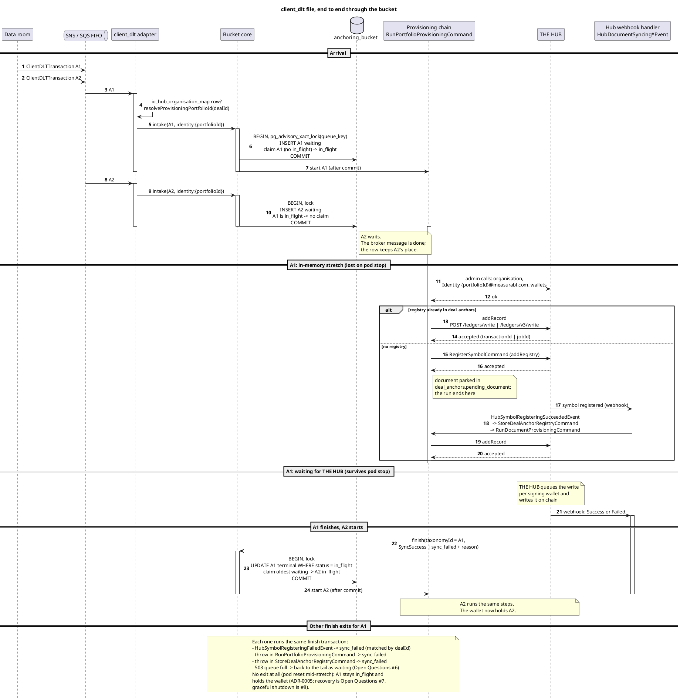
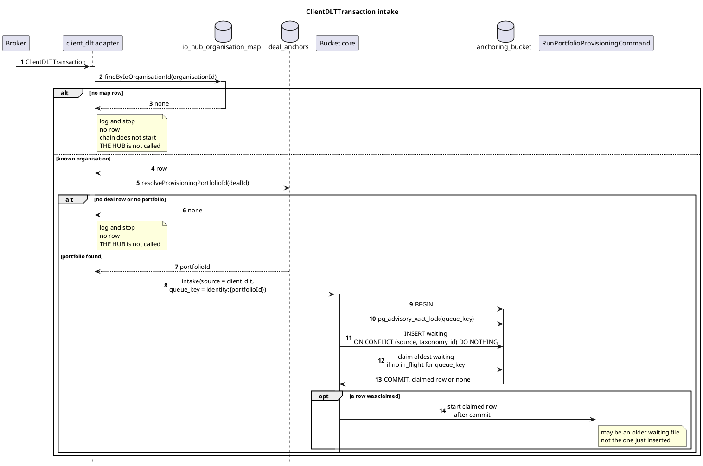
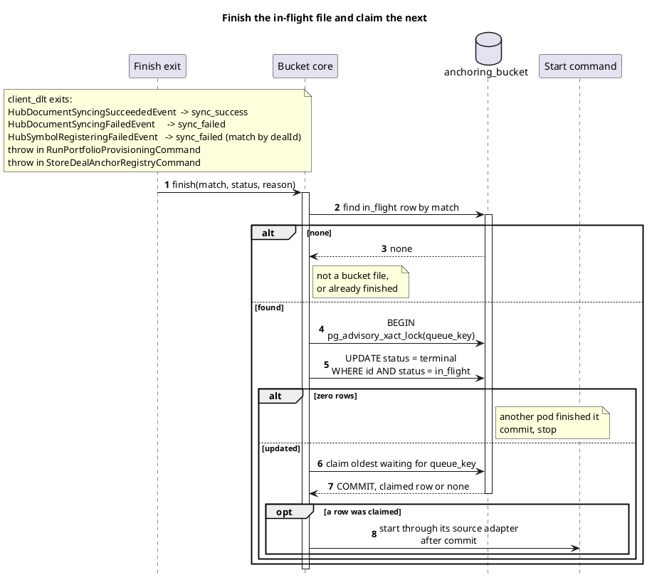
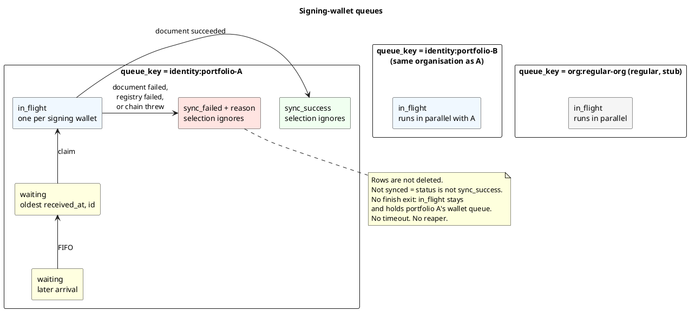
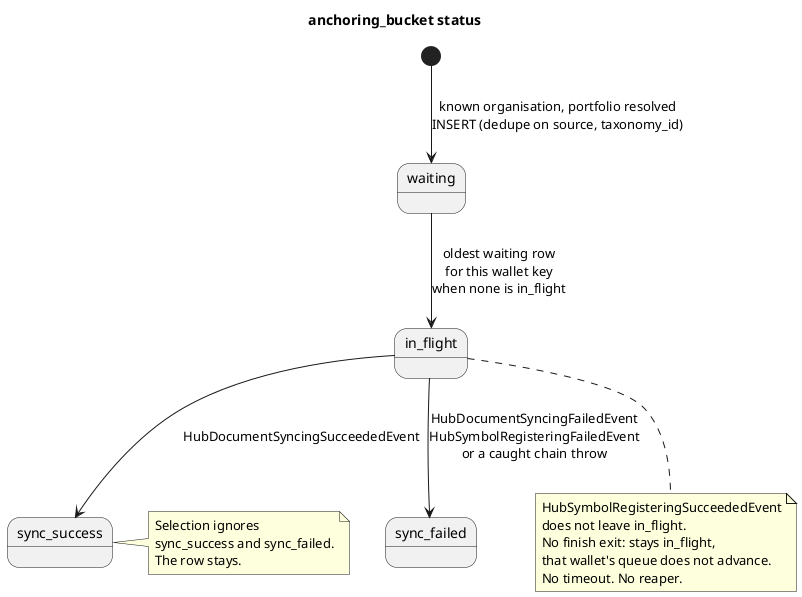

# Bulk Anchoring (INV-43987) — one reading

One file for context. The pages under the vault stay the source. This copy is the reading order.

Read the active approach straight through. After the on-hold marker, the earlier Postgres bucket investigation is reference only. Excalidraw drawings are left out.

Active:

1. [SQS FIFO Approach](SQS%20FIFO%20Approach.md)
2. [Holding The Start Message](Holding%20The%20Start%20Message.md)

On hold, after that:

3. [File Start Today](File%20Start%20Today.md)
4. [Anchoring Bucket](Anchoring%20Bucket.md)
5. [Anchoring Bucket Diagrams](Anchoring%20Bucket%20Diagrams.md)
6. [Bucket Pattern And Alternatives](Bucket%20Pattern%20And%20Alternatives.md)
7. [Open Questions](INV-43987%20-%20Bulk%20Anchoring/wiki/Open%20Questions.md)


---

# Active


---

# SQS FIFO Approach

> [!info] Active
> This page is the current approach. The rest of this folder is on hold and is reference only.

**Summary**: Chosen direction: the existing hub queue, with the start handler throwing until the file's finish is recorded. IO Hub Service republishes each file start into the existing hub SQS FIFO queue with `MessageGroupId` set to the signing wallet: `portfolioId` for `ClientDLTTransaction`, `organisationId` for regular organisations. SQS then gives FIFO per wallet and parallel wallets. Start and finish are existing event pairs. A FIFO group is released when its message is deleted, not when the business process ends, so the design depends on holding the message until the finish event. The provisioning chain already runs inside the message handler, and the heartbeat holds the message while it runs. Only the webhook wait needs the throw. Turning on `ENABLE_QUEUE_GLOBAL_ERROR_HANDLER` as it stands would retry every chain failure, top-ups included, so the start handler must catch chain errors and emit `HubDocumentSyncingFailedEvent`. Locally hub runs on Floci SNS and SQS FIFO. A receive of one message holds the group. A receive of more than one does not.

**Sources**: `shared-modules/Events/Hub/Onboarding/client-dlt-transaction.event.ts`, `shared-modules/Events/Hub/Common/hub-document-syncing-*.event.ts`, `shared-modules/Events/Hub/Common/hub-symbol-registering-*.event.ts`, `shared-modules/Events/Hub/interfaces.ts`, `shared-modules/Events/DataRoom/Interfaces/data-room.interfaces.ts`, `shared-modules/Events/EventsConstants.ts`, `shared-modules/NestAwsCqrs/src/broker/aws/SnsProducer.ts`, `apps/data-room-service/src/data-room/taxonomy/domain/entity.ts`, `apps/hub-service/src/transactions/domain/models/transactions.model.ts`, `apps/hub-service/src/organisation-provisioning/domain/commands/run-portfolio-provisioning.command.ts`, `apps/hub-service/src/organisation-provisioning/application/sagas/client-dlt-provisioning.saga.ts`, `shared-modules/NestAwsCqrs/src/NestAwsService.ts`, `shared-modules/NestAwsCqrs/src/NestAwsCqrs.ts`, `shared-modules/NestAwsCqrs/src/NestAwsPubSub.ts`, `shared-modules/NestAwsCqrs/src/broker/rabbitmq/RabbitMqConsumer.ts`, `node_modules/sqs-consumer/dist/consumer.js`, `apps/hub-service/src/transactions/application/providers/ledger-io.provider.ts`, `apps/data-room-service/src/data-room/taxonomy/application/sagas/taxonomy.saga.ts`, `apps/data-room-service/src/data-room/file/application/sagas/file.saga.ts`, `docker-compose.yml`, `docker-compose.override.yml`, `helm/dev-tools/charts/inv-aws`, `dev-tools/local-aws`.

**Last updated**: 2026-11-16

---

## Idea

- A producer in IO Hub Service takes the start event and publishes a start message to the existing hub SQS FIFO queue.
- `MessageGroupId` is the signing wallet: `portfolioId` (resolved with `resolveProvisioningPortfolioId(dealId)`) for `ClientDLTTransaction`, `organisationId` for a regular organisation.
- The consumer of that message starts the process. The finish event releases the group.
- Local runs use Floci. Hub is on the SNS and SQS broker against `inv-floci`, and the FIFO topic and queues are already there (see Local stack).

## Start and finish pairs

Hub is a listed consumer of every event below (source: `EventsConstants.ts`, `EventToMSMap`), so each one reaches hub through the broker.

| Flow | Start | Terminal success | Terminal failure | Not terminal |
| --- | --- | --- | --- | --- |
| Known organisation | `ClientDLTTransaction` | `HubDocumentSyncingSucceededEvent` | `HubDocumentSyncingFailedEvent`, `HubSymbolRegisteringFailedEvent`, **none for a chain throw** | `HubSymbolRegisteringSucceededEvent`, `HubDocumentSyncingPendingEvent` |
| Regular organisation | `HubDocumentSyncingRequestedEvent` | `HubDocumentSyncingSucceededEvent` | `HubDocumentSyncingFailedEvent` | `HubDocumentSyncingPendingEvent` |

### Start payloads

`ClientDLTTransaction` is published by data room with `aggregateId = taxonomyId`, `meta.isDirect = true`, and `context.organisationId` set. It sets no `messageGroupId`, so its FIFO group today is the taxonomy id (source: `entity.ts`, `SnsProducer.ts`).

```ts
export interface ClientDLTTransactionPayload {
  dealId: string;
  taxonomyId: string;
  organisationId: string;
  uri: string;
  checksum: string;
  checksumAlgo: string;
}
```

`HubDocumentSyncingRequestedEvent` carries `UserScope<HubDocumentSyncingRequestedEventPayload>`:

```ts
interface HubDocumentSyncingRequestedEventPayload {
  ledgerType: HubLedgerTypeEnum;
  transactionType: TransactionTypeEnum;
  estimation?: TxCostEstimationType;
  dealId: string;
  fileId: string;
  taxonomyId: string;
  taxonomyType?: TaxonomyTypeEnum;
  documentTaxonomy: TaxonomyInterface;
  isSyncNeeded?: boolean;
  symbol: string;
  organisationId: string;
  userId: string;
}
```

### Finish payloads

`HubDocumentSyncingSucceededEvent`, `HubDocumentSyncingFailedEvent`, and `HubDocumentSyncingPendingEvent` carry the same shape. `aggregateId` is the hub transaction id, or a fresh uuid on the HTTP-error path (source: `transactions.model.ts`, `documentSyncingEventPublisher`, `syncDocument`).

```ts
interface HubDocumentSyncingResultPayload {
  ledgerType: HubLedgerTypeEnum;
  transactionType: TransactionTypeEnum;
  estimation?: TxCostEstimationType;
  taxonomyId: string;          // finish correlation key
  transactionPointer: string;
  hubJobId?: string;
  status: string;
  reason: string;
  organisationId?: string;
  userId?: string;
  taxonomyType?: TaxonomyTypeEnum;
}
```

No `dealId` and no `portfolioId`. Matching a document result to its start message goes through `taxonomyId`.

`HubSymbolRegisteringFailedEvent` carries no `taxonomyId`. The HTTP-error path fills `dealId`, `organisationId`, `userId` (source: `transactions.model.ts`, `registerSymbol`). The webhook path fills the same fields from the `transactions` row (source: `base-ledger.provider.ts`, `onComplete`).

```ts
interface HubSymbolRegisteringFailedEventPayload {
  ledgerType: HubLedgerTypeEnum;
  transactionType: TransactionTypeEnum;
  dealId: string;              // finish correlation key, via deal_anchors to portfolioId
  userId: string;
  userEmail: string;
  organisationId: string;
  transactionId: string;
  status: DLTOperationStatuses;
  reason: string;
}
```

### Chain throw has no finish event

`ClientDltProvisioningSaga` maps `ClientDLTTransaction` straight to `RunPortfolioProvisioningCommand`. Its handler logs `RunPortfolioProvisioningCommand failed` and rethrows. No event is emitted (source: `run-portfolio-provisioning.command.ts`). A missing organisation mapping, a lock timeout, or a failed THE HUB admin call therefore ends the process with no event. With event-driven finish, that group never releases. A failure event for the provisioning chain is needed; see Failure event for a chain throw.

## Holding the group until finish

SQS FIFO does not deliver the next message of a group while one is in flight, and releases the group when that message is deleted. To serialise the whole business process, the start message must stay undeleted until the finish event.

### What the existing consumer does

Every hub queue is read by `SqsConsumer`, built on `sqs-consumer` (source: `shared-modules/NestAwsCqrs/src/broker/aws/SqsConsumer.ts`):

- Hub reads two queues: one for event handlers, one for command handlers.
- The handler resolving deletes the message. A message whose event name is not in the allowed list is skipped by returning, so it is also deleted.
- A thrown error keeps the message only when `ENABLE_QUEUE_GLOBAL_ERROR_HANDLER=true` and the error is not an `ApplicationError` or `DomainError`. Otherwise it is logged as fatal and deleted (`isRetryable`).
- `heartbeatInterval` extends visibility while the handler runs.
- `SqsConsumer` always passes `handleMessageBatch`, so `sqs-consumer` takes its batch path even with a batch size of 1. The batch path has no `handleMessageTimeout` race; only the single-message path has one (source: `node_modules/sqs-consumer/dist/consumer.js`, `executeHandler` and `executeBatchHandler`). Hub's `HANDLE_MESSAGE_TIMEOUT` is therefore not enforced, and the heartbeat keeps a message invisible for as long as its handler runs.
- With `batchSize > 1`, the messages of one batch run in parallel (`Promise.allSettled`). SQS FIFO can put several messages of one group into one batch, so they would run at once.
- The body is read as an SNS envelope: `JSON.parse(Body).Message`.

Hub's values:

| Setting | Hub value | Source |
| --- | --- | --- |
| `HANDLE_MESSAGE_TIMEOUT` | 900000 ms (15 min) in helm; code default 180000; not enforced on the batch path | `helm_env_configs/apps/inveniam/values/hub.yaml.gotmpl`, `apps/hub-service/src/config/environment.ts` |
| `VISIBILITY_TIMEOUT` / `HEARTBEAT_INTERVAL` | 10 s / 9 s (code defaults; not set in helm) | `environment.ts` |
| `queue.batchSize` | not configured, so 1 | `NestAwsCqrsModule.ts` |
| `ENABLE_QUEUE_GLOBAL_ERROR_HANDLER` | not set, so every handler error deletes the message | `SqsConsumer.ts` `isRetryable`; not in hub helm values |

With a batch size of 1, one receive returns one message, so messages of one group never run in parallel. `sqs-consumer` handles a pod's messages one after another, so a handler that waits for THE HUB's answer stalls that pod's whole queue.

### Saga commands run inside the message handler

The queue handler runs the event handlers, then the sagas, and awaits every command the sagas return (source: `NestAwsService.ts` `processMessage`, `NestAwsCqrs.ts` `executeCommandHandlers`, `await Promise.all(... internalCommandBus.execute(command))`). For `ClientDLTTransaction`, `ClientDltProvisioningSaga` returns `RunPortfolioProvisioningCommand`, so the whole provisioning chain runs while the `ClientDLTTransaction` message is in flight, and an error rethrown by the command reaches the consumer.

- The synchronous part of a file's process (resolve, identity, wallet, top-ups, registry, `addRecord`) already holds the message: the heartbeat keeps it invisible and no timeout applies.
- Only the wait for THE HUB's webhooks happens after the handler returns. That is the part the throw-until-finished mechanics have to cover.
- Hub's event handlers only log. Every effect of a hub message comes from saga commands.

### Consequence for the existing queue

The generic consumer takes every message on the queue, and it either handles it or deletes it when its handler returns. A second receiver cannot hold a start message on the same queue: whichever consumer receives it, the generic one deletes it on return. So on the existing queue, with the existing consumer, a group cannot stay blocked until the webhook.

Ways to keep the group blocked:

| Option | How | Limits |
| --- | --- | --- |
| Dedicated FIFO queue | Own receive loop for start messages only. Receipt handle stored for any pod; visibility extended until the finish event deletes the message. | New queue and SNS subscription. 12 h visibility cap. Local stack needs the same queue. |
| Existing queue, throw until finished | The start handler starts the process on first receipt, then throws a retryable error on every redelivery until the finish is recorded, then returns and the message is deleted. | Needs `ENABLE_QUEUE_GLOBAL_ERROR_HANDLER=true`, which hub does not set; turning it on changes retry behaviour for every hub handler. Every redelivery counts toward `maxReceiveCount`; past it the message goes to the dead-letter queue and the group is released. Needs a record of "finished" that the handler can read. |
| Existing queue, wait inside the handler | The handler does not return until the finish is recorded; the heartbeat holds the message. See [Holding The Start Message](Holding%20The%20Start%20Message.md). | The pod's consumer is busy for the whole wait. |
| Postgres gate | The bucket design, kept in this folder on hold. | Not an SQS solution. |

## Chosen direction: existing queue, throw until finished

The start message goes to the existing hub queue. Its handler keeps the message, and so the wallet's group, in the queue by throwing a retryable error until the file's finish is recorded. Then it returns and the message is deleted, which releases the next message of the group.

### Mechanics

1. The start message arrives. The handler reads the file record by `taxonomyId`.
2. No record: write `started` (with an owner and a lease), then run the chain inside the handler; the heartbeat holds the message meanwhile. On a chain error: record `sync_failed`, emit `HubDocumentSyncingFailedEvent`, return. On success: throw, to wait for the webhook.
3. Record `started`, lease alive: throw. The group stays blocked.
4. Record finished (`sync_success` or `sync_failed`): return. The message is deleted and the next file of the wallet is delivered.
5. Record `started`, lease expired, no record that THE HUB accepted the write: mark `sync_failed` with an unknown-outcome reason and return. No automatic rerun.
6. Record `started` with THE HUB's acceptance recorded: throw, and wait for the webhook.

The finish event handlers write the terminal status into the record. They do not touch the queue.

### Requirements

- `ENABLE_QUEUE_GLOBAL_ERROR_HANDLER=true` for hub. Without it every handler error deletes the message (`SqsConsumer.isRetryable`).
- The thrown error must not be an `ApplicationError` or `DomainError`, or it is not retried.
- The start handler catches every chain error, records `sync_failed`, emits `HubDocumentSyncingFailedEvent`, and returns. Only its own "still running" error leaves the handler.
- A file record shared by all pods: `taxonomyId`, status, owner, lease. THE HUB acceptance marker is the existing `transactions` row.
- `ClientDltProvisioningSaga` stops running the chain on the original `ClientDLTTransaction`.
- Group ids with their own prefix (`anchoring:identity:{portfolioId}`, `anchoring:org:{organisationId}`).

### Redelivery cadence

`sqs-consumer` 8.1.0 is in use. Hub's `SqsConsumer` passes no `terminateVisibilityTimeout`, so after a throw the message stays invisible for the rest of its visibility timeout and is then delivered again (source: `node_modules/sqs-consumer/dist/consumer.js`). With hub's `VISIBILITY_TIMEOUT` of 10 s, a held file is redelivered about every 10 s. Every receive counts toward `maxReceiveCount`. Locally that is 100, so about 17 minutes of holding before the message moves to `SQSDeadLetters` and the group is released with the file unfinished. The production value was not read. A process with a registry registration and a document write, each waiting on THE HUB, can take longer.

Ways to stretch it, both outside the hub module: a longer visibility timeout for these messages before the throw (the handler receives the broker message, not the receipt handle, so `SqsConsumer` would have to pass it), or a higher `maxReceiveCount` on the hub queue. `attributeNames` is not passed either, so `ApproximateReceiveCount` is not visible to the handler.

### Risks of the flag

- The flag applies to every hub handler. Any handler that now throws a plain error is retried up to `maxReceiveCount` instead of being dropped. A handler that spends funds or calls THE HUB before it throws repeats that call on every retry. See the audit below.
- Each throw is logged as `Retry the message` at error level, about every 10 s per held file.
- A pod handles its messages one after another, so every redelivery takes one handler slot on that pod. The check is a single record read.

### Handler audit for the flag

Hub has 72 command and event handlers. Event handlers only log. Command handlers fall into three groups (source: `apps/hub-service/src/**/commands/*.command.ts`):

| Group | Commands | Reached from the queue | Effect of the flag |
| --- | --- | --- | --- |
| Catch and swallow | `SyncDocument`, `RegisterSymbol`, `DeployToken`, `DistributeTokens`, `ChangeTotalSupply`, `SetTokensRelation`, `AskTokenHolders`, `ConnectHub`, `ConnectOrgHub`, `OnTransactionComplete`, `UpdateTxStatus`, `SaveDeal`, `SaveOrganisation` | Yes | None. Errors never reach the consumer. |
| Rethrow, HTTP only | `CancelTransaction`, `ResendTransaction`, `UpdateAggregateStatus` | No, called from `requests-processing.service.ts` | None. |
| No catch, not from a saga | `SetIntegrationKeys`, `SetScopedIntegrationKeys`, `SetAccessKeys`, `DeleteIntegrationKeys`, `DeleteAccessKeys` | No, called from `integration-keys-command-factory.service.ts` and the organisation chain | None on their own. Inside the chain they fall under the row below. |
| Rethrow, from a saga | `RunPortfolioProvisioning` (`ClientDLTTransaction`), `RunOrganisationProvisioning` (`OrganisationToHubProvision`), `StoreDealAnchorRegistry` and the `RunDocumentProvisioning` it runs (`HubSymbolRegisteringSucceededEvent`), `SaveDealAnchor` (`DealCreatedEvent`, `DealUpdatedEvent`) | Yes | **Retried.** |

Every error the chain raises is a Nest `UnprocessableEntityException`, an HTTP client error, or `NvnmEstimateRevertError`, none of them an `ApplicationError` or `DomainError`. With the flag on, every chain failure is retryable, and every retry reruns the chain from the start:

- `RunPortfolioProvisioning` and `RunDocumentProvisioning` include `ensureRegistryFunds`, `ensureDocumentFunds`, and the parent top-up. A retry can top up again before failing at the same step.
- `RunOrganisationProvisioning` creates THE HUB organisation, wallets, and webhooks. The steps are written as "ensure", but each retry repeats the THE HUB calls.
- A retry of `HubSymbolRegisteringSucceededEvent` reruns the parked document write.

So the flag cannot be turned on as it stands. The start handler must catch every chain error itself, record the file as `sync_failed`, emit the failure event, and return. The only error it lets out is its own "still running" error. The other three saga entries need the same treatment, or must keep dropping on error.

## Points that follow from the existing queue

- **Group id collisions.** The hub queue carries other events grouped by `aggregateId` or `context.messageGroupId`. A bare `portfolioId` or `organisationId` group would also block any other hub event that uses the same id as its group. Group ids for start messages need their own prefix, for example `anchoring:identity:{portfolioId}` and `anchoring:org:{organisationId}`.
- **Publish path.** An event with `meta.isDirect = true` goes from `NestAwsPubSub.publish` to `DirectEventProducerService`, which calls the broker producer (SNS) directly and skips the event store and the relay. `ClientDLTTransaction` already uses it. Any other event goes through the event store; the relay deletes outbox rows and calls SNS in one transaction. On both paths `SnsProducer` logs and swallows publish errors, so a failed publish is lost (source: `NestAwsPubSub.ts`, `direct-event-producer.service.ts`, `apps/relay-service/src/tasks.service.ts`, `SnsProducer.ts`). A direct `SendMessage` to the queue avoids `SnsProducer` but needs the SNS envelope. Not decided.
- **Double start.** `ClientDLTTransaction` already reaches hub and runs the chain through `ClientDltProvisioningSaga`. If hub republishes it as a start message, the saga on the original event must stop running the chain, or every file runs twice.
- **Deduplication.** `MessageDeduplicationId = taxonomyId` drops a duplicate within the 5-minute SQS window only.
- **Envelope.** A start message sent directly with `SendMessage` must be wrapped as an SNS envelope (`{ Message: "<json>" }`), because `SqsConsumer` reads `Body.Message`.
- **Retention.** Messages waiting behind a held one age toward the queue's retention period. Locally that is 3 days (`MessageRetentionPeriod` 259200); production value not read.

## Restart and reruns

- A pod reset while a message is held makes the message visible again after its visibility timeout, and SQS redelivers it. That is an automatic rerun.
- An interrupted file with no record that THE HUB received the write is not rerun automatically. It becomes failed with an unknown-outcome reason, and a rerun is a manual resync in the data room. The chain spends from wallets; automatic reruns could drain a wallet if THE HUB spends without returning feedback.
- So a redelivered start message needs a record of whether that file already started. Started with unknown outcome: report failed and delete. Not started: start.

## Local stack

### Hub runs on Floci

Checked live on 2026-11-16. `inv-floci` was healthy and `inv-hub-ms` was up on the SNS and SQS broker. `inv-rabbitmq` was still running. Hub does not use it: `BROKER_TYPE=snssqs`, and the hub command waits on Postgres only (source: `docker-compose.override.yml`). `inv-data-room-ms` was not running. The override wires it, and the other broker services, the same way when they start.

| Setting | Running hub |
| --- | --- |
| `BROKER_TYPE` | `snssqs` |
| `QUEUE_ENDPOINT` | `http://inv-floci:4566` |
| `SNS_TOPIC_ARN` | `arn:aws:sns:us-east-1:000000000000:inveniam-events.fifo` |
| Event queue | `http://inv-floci:4566/000000000000/hub-event-queue.fifo` |
| Command queue | `http://inv-floci:4566/000000000000/hub-command-queue.fifo` |

`RabbitMqConsumer` is unchanged and still has no message groups (source: `RabbitMqConsumer.ts`). It is not the broker hub is on.

### What Floci is running

`inv-floci` is `floci/floci:latest-compat`, published on `127.0.0.1:4566` only, with `FLOCI_STORAGE_MODE=hybrid`, `FLOCI_HOSTNAME=inv-floci`, and `./data` mounted at `/app/data` (source: `docker-compose.override.yml`). The image includes `aws` and `awslocal`. The container is healthy when `/tmp/inveniam-queues.done` exists.

The ready hook `/etc/floci/init/ready.d/01-inveniam-queues.py` creates the topology. It is the compose config `floci-inveniam-queues`.

- Topic `inveniam-events.fifo`: `FifoTopic`, `ContentBasedDeduplication`, `FifoThroughputScope=MessageGroup`.
- One event queue and one command queue per service, all FIFO, plus `inveniam-dead-letters.fifo`. Template has queues and no subscription. The other fifteen services subscribe both queues with `FilterPolicy` `{"msList":["<service>"]}`. Live: 33 queues, 30 confirmed subscriptions, none pending.
- Hub's event subscription: filter `{"msList":["hub"]}`, `RawMessageDelivery` false, so the body is an SNS notification. `SqsConsumer` reads `Body.Message`.
- Queue attributes on `hub-event-queue.fifo`: `FifoQueue`, `DeduplicationScope=messageGroup`, `FifoThroughputLimit=perMessageGroupId`, `ContentBasedDeduplication` false, `VisibilityTimeout` 30, `DelaySeconds` 0, `MessageRetentionPeriod` 259200, redrive to `inveniam-dead-letters.fifo` after `maxReceiveCount` 100.
- Returned queue URLs use `http://inv-floci:4566/...`. Other containers resolve that name. From the host the same path works on `127.0.0.1`.

The queue's visibility timeout is 30 seconds. Hub's consumer still passes its own timeout on receive (code default 10 seconds), so the redelivery cadence above is unchanged.

`dev-tools/local-aws` and `helm/dev-tools/charts/inv-aws` still describe LocalStack standard queues. They are not the broker hub uses.

### FIFO behaviour, checked live

Throwaway queue `bulk-anchoring-probe.fifo`, then deleted. Fake credentials, endpoint `http://127.0.0.1:4566`.

- A second `SendMessage` with the same `MessageDeduplicationId` returned the same message id.
- `MaxNumberOfMessages` 1: the first receive took `wallet-a`. The next receive took `wallet-b`. A further receive returned nothing while `wallet-a` was in flight. After that message was deleted, the second `wallet-a` message was delivered.
- `MaxNumberOfMessages` 10: one receive returned both `wallet-a` messages and the `wallet-b` message. A batch receive does not hold the group, and it mixes groups. Hub's `queue.batchSize` is 1, so the path hub uses does hold the group.

A throwaway publish with message attribute `msList` `["hub"]` was delivered to both hub queues as an SNS notification. Hub logged the event name as ignored and deleted both messages. The queues were empty again afterwards. A publish that did not carry `msList` `hub` did not appear in the hub log.

## Failure event for a chain throw

A provisioning chain throw emits nothing today, so data room receives neither `HubDocumentSyncingSucceededEvent` nor `HubDocumentSyncingFailedEvent` for that file.

`HubDocumentSyncingFailedEvent` fits as the chain-throw failure event:

- Hub already emits it without a THE HUB transaction. `TransactionsModel.syncDocument` applies it on an HTTP error with `transactionPointer: ''` and a fresh `aggregateId` (source: `transactions.model.ts`).
- Data room already consumes it. `TaxonomySaga` maps it to `UpdateDataRoomFileTaxonomyCommand`, which reads `taxonomyId`, `transactionPointer`, `status`, `reason`, `taxonomyType`. `FileSaga` maps it to `FDRFileSyncActivityFailedCommand`, which reads `taxonomyId`, `status`, `organisationId` (source: `apps/data-room-service/src/data-room/taxonomy/application/sagas/taxonomy.saga.ts`, `file/application/sagas/file.saga.ts`).
- The start payload holds `taxonomyId` and `organisationId`; `reason` carries the chain error. `ledgerType` and `transactionType` are fixed for this flow.

Data room does not consume `HubSymbolRegisteringFailedEvent`. Unverified: how data room shows a file with an empty `transactionPointer`.

## File record

- The `transactions` row for a file is written only after THE HUB `write` returns: `LedgerIOProvider.write` calls THE HUB, sets `hubJobId`, `transactionId`, and status `Pending`, then inserts the row with `taxonomyId` and `organisationId`. A unique violation on `hubJobId` is treated as an idempotent replay (source: `apps/hub-service/src/transactions/application/providers/ledger-io.provider.ts`).
- So a `transactions` row for the `taxonomyId` is the THE HUB acceptance marker the mechanics need (step 6). The gap is a crash between THE HUB's answer and the insert: THE HUB has the job, hub has no row. That is the unknown-outcome case, and it is not rerun.
- Nothing in hub records a file before acceptance. `started`, owner, and lease need a new record. Hub's tables are `transactions`, `deal_anchors`, `deals`, `organisations`, `io_hub_organisation_map`.
- `transactions.status` uses `DLTOperationStatuses` (`Pending`, `Succeed`, `Failed`, `Canceled`). A new record uses snake_case statuses.

## Production queue settings

The hub queue's `maxReceiveCount`, visibility timeout, retention, and FIFO attributes are not in this workspace: no Terraform for SQS or SNS was found, and the helm values reference the queue and topic through vault. They can be read with a read-only call, with credentials from the environment:

```bash
aws sqs get-queue-attributes --queue-url "<hub queue url>" \
  --attribute-names FifoQueue ContentBasedDeduplication DeduplicationScope FifoThroughputLimit \
  VisibilityTimeout MessageRetentionPeriod RedrivePolicy
aws sns get-topic-attributes --topic-arn "<topic arn>"
```

## Open

1. Production `maxReceiveCount`, visibility timeout, and retention for the hub queue, against the longest file process; and whether a held message gets a longer visibility timeout.
2. Publish path for the start message: SNS direct, or `SendMessage` with an SNS envelope.
3. The record for `started`, owner, and lease: a new table, and its name.
4. What data room shows for `HubDocumentSyncingFailedEvent` with an empty `transactionPointer`.
5. How the other saga entries that rethrow (`OrganisationToHubProvision`, `HubSymbolRegisteringSucceededEvent`, `DealCreatedEvent`, `DealUpdatedEvent`) behave once the flag is on: catch, or keep dropping.

## Answered

- `HubSymbolRegisteringFailedEvent` from the webhook path carries `dealId`, `organisationId`, `userId`, `status`, and `reason`, copied from the `transactions` row (source: `base-ledger.provider.ts`, `onComplete`). Matching it by `dealId` works on both paths.
- The flag's effect on hub handlers: see the handler audit. Only saga commands that rethrow are affected, and the provisioning ones spend funds.
- Failure event for a chain throw: `HubDocumentSyncingFailedEvent`, already consumed by data room.
- THE HUB acceptance marker: the `transactions` row for the `taxonomyId`.
- Local broker is Floci. Hub is on `inveniam-events.fifo` and `hub-event-queue.fifo`. Dedup works. A receive of one message holds the group; a receive of ten does not. Data room was not running at the check.

## Related pages

- [Wiki Index](index.md)
- [Holding The Start Message](Holding%20The%20Start%20Message.md)
- [File Start Today](File%20Start%20Today.md) (reference, on hold)
- [Bucket Pattern And Alternatives](Bucket%20Pattern%20And%20Alternatives.md) (reference, on hold)
- [Open Questions](Open%20Questions.md) (reference, on hold)


---

# Holding The Start Message

> [!info] Active
> Part of the current approach, [SQS FIFO Approach](SQS%20FIFO%20Approach.md). No option is chosen yet.

**Summary**: Ways to keep a file's start message, and so its wallet's FIFO group, in the queue until the file's finish. Throwing a retryable error with `ENABLE_QUEUE_GLOBAL_ERROR_HANDLER=true` is needed only on the shared hub queue read by the generic `SqsConsumer`, when the pod's consumer must not stay busy. Waiting inside the handler holds the message without the flag. A dedicated queue with hub's own consumer holds it with no throw at all. A second consumer on the shared hub queue does not work. Direct `SendMessage` to SQS fixes delivery, not holding. Local hub is on Floci, so any of these can be tried there. A receive of one message holds the group.

**Sources**: `shared-modules/NestAwsCqrs/src/broker/aws/SqsConsumer.ts`, `shared-modules/NestAwsCqrs/src/broker/aws/SnsProducer.ts`, `shared-modules/NestAwsCqrs/src/broker/rabbitmq/RabbitMqConsumer.ts`, `shared-modules/NestAwsCqrs/src/NestAwsCqrs.ts`, `node_modules/sqs-consumer/dist/consumer.js`, [SQS FIFO Approach](SQS%20FIFO%20Approach.md).

**Last updated**: 2026-11-16

---

## Constraints

- Goal: as few infrastructure changes as possible.
- The production hub queue is FIFO (stated by the team; attributes not read).
- Local hub runs on Floci SNS and SQS FIFO (see [SQS FIFO Approach](SQS%20FIFO%20Approach.md), Local stack). A receive of one message holds the group. Hub's batch size is 1.

## Why a message needs holding

SQS FIFO does not deliver the next message of a group while one is in flight, and releases the group when that message is deleted. The generic `SqsConsumer` deletes a message when its handler returns. When the handler throws, it also deletes the message unless `ENABLE_QUEUE_GLOBAL_ERROR_HANDLER=true` and the error is not an `ApplicationError` or `DomainError` (source: `SqsConsumer.ts`, `isRetryable`). Holding only blocks the wallet's group. Other groups keep flowing.

The provisioning chain runs inside the handler, and the heartbeat keeps the message invisible while it runs, with no timeout on hub's batch path (source: `NestAwsCqrs.ts`, `consumer.js`). Holding is needed only for the wait between THE HUB accepting the write and the webhook.

## A second consumer on the shared queue does not work

SQS has no per-consumer routing on one queue. Every `ReceiveMessage` takes the next available message, whoever calls it.

- The generic consumer still reads the queue. It receives some start messages, finds the event name outside its allowed list, returns, and the message is deleted. The group is released at once.
- The hub-only consumer receives ordinary service messages and has to give them back.

Making it work means changing the shared `SqsConsumer` so it returns foreign messages with `ChangeMessageVisibility(0)`, and the hub consumer doing the same. Messages bounce between the consumers, each receive raises `ApproximateReceiveCount`, and ordinary messages can reach the dead-letter queue. Every service uses that module. Per-consumer filtering exists only on SNS subscriptions, and a subscription always targets its own queue.

## Options

| Option | Infrastructure | Code | Main risk |
| --- | --- | --- | --- |
| Shared queue, throw with `ENABLE_QUEUE_GLOBAL_ERROR_HANDLER=true` | Nothing new; possibly a higher `maxReceiveCount` | Start handler in hub; the flag in helm | The flag is global. Saga commands that rethrow get retried, provisioning top-ups included. All of them need wrapping. |
| Shared queue, wait inside the handler | Nothing new | Start handler in hub only | The pod's consumer is busy for the whole wait. Files in progress are capped by the number of pods. |
| Shared queue, shared `SqsConsumer` releases foreign messages | Nothing new | Change in shared NestAwsCqrs | Bouncing messages, growing receive counts, ordinary messages can reach the dead-letter queue. |
| Dedicated FIFO queue, direct `SendMessage` | One FIFO queue; a FIFO dead-letter queue (the existing one if it is FIFO); IAM send and receive for hub; the URL in helm. No SNS subscription. | Hub's own consumer; the shared module stays untouched | A small Terraform and helm change. |

### Shared queue, throw

The start handler throws a retryable error on every delivery until the finish is recorded. The message comes back about every 10 s (hub's `VISIBILITY_TIMEOUT`). Every delivery counts toward `maxReceiveCount`; locally that is 100, about 17 minutes. Each throw is logged at error level. Detail: [SQS FIFO Approach](SQS%20FIFO%20Approach.md), Chosen direction and Handler audit.

### Shared queue, wait inside the handler

The handler does not return until the file record shows `sync_success` or `sync_failed`. The heartbeat extends visibility, no timeout applies, no receive is spent, and the flag is not needed. `sqs-consumer` handles a pod's messages one at a time, so the pod handles nothing else from the hub queue meanwhile. THE HUB's webhook arrives over HTTP, not through the queue (unverified: no finish path depends on the queue). Visibility extension is capped at 12 h from receipt.

### Dedicated queue, own consumer

No throw. Hub's code controls the message's lifetime:

1. The consumer receives the start message, starts the process, and keeps the receipt handle instead of deleting the message.
2. While the process runs, it extends visibility with `ChangeMessageVisibility`.
3. On the finish (`sync_success` or `sync_failed` from the webhook), it calls `DeleteMessage` with the stored handle. The group is released.

No retries, no `maxReceiveCount` spending, no global flag, no log noise. Limits: the 12 h visibility cap, and a pod restart loses the handle. The message then becomes visible again on its own. On redelivery the file record decides: started with an unknown outcome → `sync_failed`, delete; not started → start.

## Direct `SendMessage` instead of SNS

Hub can send the start message straight to SQS when it receives the source event (`ClientDLTTransaction` or `HubDocumentSyncingRequestedEvent`). This fixes delivery. It does not hold the message: on the shared queue the generic consumer reads it like any other.

What it gives:

- Hub sets `MessageGroupId` (`anchoring:identity:{portfolioId}`, `anchoring:org:{organisationId}`) and `MessageDeduplicationId` (`taxonomyId`) itself. Through SNS the group comes from `aggregateId` or `context.messageGroupId` (source: `SnsProducer.ts`).
- The message reaches only the target queue, not every topic subscriber.
- It bypasses `SnsProducer`, which logs and swallows publish errors. A `SendMessage` failure is visible.
- A dedicated queue needs no SNS subscription.

What to handle:

- **Body.** `SqsConsumer` parses `JSON.parse(Body).Message`, so on the shared queue the body is an SNS envelope `{ "Message": "<json>" }` holding `{ eventName, eventBody }`.
- **Allowed list.** On the shared queue the event name must be in hub's allowed list, or the consumer deletes the message without handling it.
- **IAM.** Hub needs `sqs:SendMessage` on the target queue (unverified: hub's current permissions).
- **Lost start.** The source event's handler sends, returns, and the source message is deleted. With the flag off, a failed `SendMessage` loses the start. The send needs its own retry or an explicit failure event.
- **Double start.** `ClientDltProvisioningSaga` must stop running the chain on the source event, or every file runs twice.
- **Local.** Hub is on Floci. From another container the hub event queue is `http://inv-floci:4566/000000000000/hub-event-queue.fifo`.

## Floci for local runs

Floci is the local broker, and hub is already on it. FIFO groups, dedup, and the `msList` subscription filter were checked live. The hub queues redrive to `inveniam-dead-letters.fifo` after 100 receives; that move was not exercised (see [SQS FIFO Approach](SQS%20FIFO%20Approach.md), Local stack). A receive of one message holds the group and lets other groups through. A receive of ten returned every waiting message of two groups in one call, so a batch larger than 1 does not hold the group on this emulator. `RabbitMqConsumer` still has no groups (source: `RabbitMqConsumer.ts`). Hub is not using it. Data room was not running at the check, so a file start has not been exercised end to end.

## Related pages

- [Wiki Index](index.md)
- [SQS FIFO Approach](SQS%20FIFO%20Approach.md)


---

# On hold — reference only

The Postgres bucket, its diagrams, and the open questions below are not the current approach.


---

# File Start Today

> [!warning] On hold
> This investigation is on hold. Nothing here is a candidate for implementation. Use it as reference only.

**Summary**: Hub starts a known-organisation file as soon as `ClientDLTTransaction` arrives, and a regular file as soon as `HubDocumentSyncingRequestedEvent` arrives. Nothing waits for the previous file to finish. The only overlap guard is an organisation advisory lock around two spots, whose waiters give up after 150 s.

**Sources**: `apps/hub-service/src/organisation-provisioning/application/sagas/client-dlt-provisioning.saga.ts`, `apps/hub-service/src/transactions/domain/sagas/transactions.sagas.ts`, `apps/hub-service/src/organisation-provisioning/infrastructure/organisation-provisioning.lock.ts`, `shared-modules/Events/Hub/Onboarding/client-dlt-transaction.event.ts`, `apps/data-room-service/src/data-room/taxonomy/application/sagas/taxonomy.saga.ts`, `apps/data-room-service/src/data-room/taxonomy/domain/entity.ts`, `apps/data-room-service/src/data-room/taxonomy/domain/services/taxonomy-functional.service.ts`.

**Last updated**: 2026-11-11

---

## Who sends what

| Trigger in data room | Event to hub | Hub path |
| --- | --- | --- |
| Auto-sync (`FDRAutoSyncInitEvent` → `RequestClientDltTransactionCommand`) | `ClientDLTTransaction` | `ClientDltProvisioningSaga` → `RunPortfolioProvisioningCommand` |
| Manual sync from the UI on a hub-connected room (`Taxonomy.requestLedgerSync`) | `HubDocumentSyncingRequestedEvent` | `TransactionsSagas.syncDocument` → `SyncDocumentCommand` |

(source: `taxonomy.saga.ts`, `entity.ts`, `transactions.sagas.ts`)

Data room skips `ClientDLTTransaction` when the room has no `organisationId` or no portfolio. It also skips it when an NVNM taxonomy already exists for the same file and checksum, even if that attempt failed. Otherwise it creates a new taxonomy and sends its id as `taxonomyId` (source: `taxonomy-functional.service.ts`). `uri` is the taxonomy's `documentShortLink` (source: `entity.ts`).

## Known-organisation file

`ClientDltProvisioningSaga` maps the payload straight onto `RunPortfolioProvisioningCommand`. Payload: `dealId`, `taxonomyId`, `organisationId`, `uri`, `checksum`, `checksumAlgo` (source: `client-dlt-transaction.event.ts`).

The chain:

1. Portfolio chain. `ResolveHubOrganisationStep` needs a row in `io_hub_organisation_map`, else throws `Hub organisation mapping is missing`. `EnsureHubIdentityStep` resolves the portfolio Identity `{portfolioId}@measurabl.com` (source: `resolve-hub-organisation.step.ts`, `ensure-hub-identity.step.ts`, `measurabl-identity.ts`).
2. `CompletePortfolioProvisioningStep` awaits `RunRegistryProvisioningCommand`.
3. Registry exists in `deal_anchors.registry`: `CompleteRegistryProvisioningStep` awaits `RunDocumentProvisioningCommand`. No registry: `EnsureRegistryStep` parks the document in `pending_document` and sends `RegisterSymbolCommand`. The run then ends. `HubSymbolRegisteringSucceededEvent` → `StoreDealAnchorRegistryCommand` takes the pending document and runs `RunDocumentProvisioningCommand` later (source: `ensure-registry.step.ts`, `complete-registry-provisioning.step.ts`, `store-deal-anchor-registry.command.ts`).
4. `SyncDocumentStep` sends `addRecord` via `SyncDocumentCommand`. The result is `HubDocumentSyncingSucceededEvent` or `HubDocumentSyncingFailedEvent` (source: `sync-document.step.ts`, `transactions.model.ts`).

A registry failure emits `HubSymbolRegisteringFailedEvent`, which carries no `taxonomyId`. In hub only a log-only handler listens, and the parked document stays parked (source: `transactions.model.ts`, `hub-symbol-registering-failed.event.handler.ts`).

## Regular file

`TransactionsSagas.syncDocument` maps `HubDocumentSyncingRequestedEvent` onto `SyncDocumentCommand`. It also starts on arrival.

## Writes to THE HUB

Ledger writes (`addRegistry`, `addRecord`) go through `HubTokenizationProvider.write`: `POST /ledgers/write` (v1, returns a transaction id) or `POST /ledgers/v3/write` (v3, returns a `jobId`, polled at `GET /ledgers/v3/jobs/:id`), picked by `HUB_WRITE_API_VERSION` (source: `hub-tokenization.provider.ts`, `config/environment.ts`). A new provider is created and logged in per call (source: `tokenization.service.ts`). A 503 becomes `Hub wallet transaction queue is full`, a 422 with no retry; for `addRecord` that ends as `HubDocumentSyncingFailedEvent` (source: `hub-tokenization.provider.ts`, `transactions.model.ts`).

THE HUB queues writes per signing wallet. Regular organisations sign with organisation-level HubKeys. Known organisations sign with an Identity wallet per portfolio, user `{portfolioId}@measurabl.com` (source: `measurabl-tx-payload.ts`). For NVNM, credentials are looked up deal → portfolio → organisation with `dealAnchor.rootPortfolioId()`, which is `resolveProvisioningPortfolioId` (source: `ledger-factory.provider.ts`, `nvnm-scoped-candidates.ts`, `deal-anchor.model.ts`).

Provisioning admin calls (organisation, webhook, scoped keys, identity, wallets, network profile) go through `HubAdminClient` with one admin account for every organisation (`hub.adminEmail`). No retry, no 429 handling (source: `hub-admin.client.ts`, `hub-admin.session.ts`).

## Overlap today

`OrganisationProvisioningLock` takes `pg_try_advisory_lock(scope, hashtext(organisationId))` around the parent wallet nonce (`42559`) and the identity HD counter (`42560`). A waiter retries every 500 ms and throws `Timed out waiting for the organisation provisioning lock` after 150 s (source: `organisation-provisioning.lock.ts`). Several files of one organisation therefore queue on that lock, and the late ones fail. The rest of the chain is not guarded. A hub-wide scope registry that renumbers these to `1001` and `1002` is proposed in [ADR-0010](../decisions/ADR-0010%20Hub%20Advisory%20Lock%20Scope%20Registry.md). A hub-wide scope registry that renumbers these to `1001` and `1002` is proposed in [ADR-0010](../decisions/ADR-0010%20Hub%20Advisory%20Lock%20Scope%20Registry.md). A hub-wide scope registry that renumbers these to `1001` and `1002` is proposed in [ADR-0010](../decisions/ADR-0010%20Hub%20Advisory%20Lock%20Scope%20Registry.md).

## Where this slice stops

The chains, THE HUB write, and the data room publisher stay as they are. The gap is the missing gate in hub in front of the start. See [Anchoring Bucket](Anchoring%20Bucket.md).

## Related pages

- [Anchoring Bucket](Anchoring%20Bucket.md)
- [ADR-0001 Hub Postgres Bucket](../decisions/ADR-0001%20Hub%20Postgres%20Bucket.md)
- [ADR-0007 Pluggable Bucket Sources](../decisions/ADR-0007%20Pluggable%20Bucket%20Sources.md)
- [ADR-0009 One In Flight Per Signing Wallet](../decisions/ADR-0009%20One%20In%20Flight%20Per%20Signing%20Wallet.md)
- [Open Questions](Open%20Questions.md)
- [Wiki Index](index.md)


---

# Anchoring Bucket

> [!warning] On hold
> This investigation is on hold. Nothing here is a candidate for implementation. Use it as reference only.

**Summary**: Proposed standalone hub module. A Postgres table holds file starts and runs one file at a time per THE HUB signing wallet, because THE HUB queues writes per wallet and handles them one by one. A source-agnostic core plus one adapter per source: `client_dlt` (known organisations, `ClientDLTTransaction`) is wired, `regular` (`HubDocumentSyncingRequestedEvent`) is a stub. Finished rows stay. No code has been added.

**Sources**: [ADR-0001](../decisions/ADR-0001%20Hub%20Postgres%20Bucket.md), [ADR-0003](../decisions/ADR-0003%20Keep%20Terminal%20Rows.md), [ADR-0004](../decisions/ADR-0004%20Atomic%20Finish%20and%20Claim.md), [ADR-0005](../decisions/ADR-0005%20Unmarked%20In%20Flight%20Holds.md), [ADR-0006](../decisions/ADR-0006%20Read%20Failures%20In%20Postgres.md), [ADR-0007](../decisions/ADR-0007%20Pluggable%20Bucket%20Sources.md), [ADR-0009](../decisions/ADR-0009%20One%20In%20Flight%20Per%20Signing%20Wallet.md). Current start path: [File Start Today](File%20Start%20Today.md). Diagrams: [Anchoring Bucket Diagrams](Anchoring%20Bucket%20Diagrams.md), [Anchoring Bucket Board](Anchoring%20Bucket%20Board.excalidraw.md).

**Last updated**: 2026-11-11

---

The module lives in hub (`inv-hub-ms`), proposed at `apps/hub-service/src/anchoring-bucket/`. Data room, THE HUB, the broker, and the provisioning chains are unchanged. The bucket only decides when a file's start command may run, and records how the file ended.

Hub already uses Postgres, TypeORM `SnakeNamingStrategy`, and `migrationsRun: true` (source: `apps/hub-service/src/config/database.ts`). Column names below are what that strategy would store.

## Why

THE HUB is a one-by-one consumer: request/response plus webhook, with a write queue per signing wallet. A 503 on write is surfaced as `Hub wallet transaction queue is full` (source: `hub-tokenization.provider.ts`). Regular organisations sign with organisation-level HubKeys; known organisations sign with an Identity wallet per portfolio. Each file needs preparation and blockchain calls before `addRecord`. Today every `ClientDLTTransaction` starts its chain at once, and the only guard is `OrganisationProvisioningLock` around the wallet nonce and the HD counter, whose waiters throw after 150 s (source: `organisation-provisioning.lock.ts`). See [File Start Today](File%20Start%20Today.md).

## Module shape

| Part | Knows | This slice |
| --- | --- | --- |
| Core | Table, per-key lock, intake transaction, finish transaction | Built |
| `client_dlt` adapter | `ClientDLTTransaction`, `io_hub_organisation_map` check, `RunPortfolioProvisioningCommand`, its finish exits | Wired |
| `regular` adapter | `HubDocumentSyncingRequestedEvent`, `SyncDocumentCommand`, document events | Stub, not registered |

The source is chosen by the **entry event**. An organisation is either known or regular, never both. A manual sync from the data room UI arrives as `HubDocumentSyncingRequestedEvent` (source: `apps/data-room-service/src/data-room/taxonomy/domain/entity.ts`), so it is `regular` even for a known organisation. The `client_dlt` chain sends `addRecord` through `SyncDocumentStep` → `SyncDocumentCommand` and never emits that event (source: `sync-document.step.ts`). Until the `regular` adapter is registered, `TransactionsSagas.syncDocument` runs as today. [ADR-0007](../decisions/ADR-0007%20Pluggable%20Bucket%20Sources.md).

## Row

| Column | Role |
| --- | --- |
| `id` | Row id. FIFO tiebreak |
| `source` | `client_dlt` now. `regular` when that adapter is wired |
| `queue_key` | Signing wallet: `identity:{portfolioId}` or `org:{organisationId}` |
| `taxonomy_id` | From the entry payload. Document events match this |
| `payload` | Entry payload, enough for the adapter to build the start command |
| `status` | `waiting`, `in_flight`, `sync_success`, `sync_failed` |
| `reason` | Set on `sync_failed` |
| `received_at` | Database `now()` at insert. FIFO inside one `queue_key` |

## Queue key

The THE HUB wallet the file is signed with. [ADR-0009](../decisions/ADR-0009%20One%20In%20Flight%20Per%20Signing%20Wallet.md).

| Source | Signing wallet | `queue_key` |
| --- | --- | --- |
| `client_dlt` | Portfolio Identity `{portfolioId}@measurabl.com` | `identity:{portfolioId}` |
| `regular` (stub) | Organisation HubKeys | `org:{organisationId}` |

`portfolioId` is `resolveProvisioningPortfolioId` over the `deal_anchors` row for `dealId`. The NVNM credentials lookup uses the same function through `dealAnchor.rootPortfolioId()` (source: `deal-anchor.model.ts`, `ledger-factory.provider.ts`), so the key is the signer.

One `in_flight` row per key. Portfolios and organisations run in parallel. Organisation-wide spots inside the chain (parent wallet nonce, HD counter) stay under `OrganisationProvisioningLock`.

## Who may enter (`client_dlt`)

`ClientDltProvisioningSaga` hands `ClientDLTTransaction` to intake instead of running the command.

Known organisation = a row in `io_hub_organisation_map` for `organisationId` (lookup: `IoHubOrganisationMapRepository.findByIoOrganisationId`, already used by `resolve-hub-organisation.step.ts`). No row: log and stop. Then the deal must resolve a portfolio; no `deal_anchors` row or no portfolio: log and stop. In both cases no bucket row, no chain, THE HUB is not called.

A redelivered event hits the unique `(source, taxonomy_id)` and inserts nothing. Data room never reuses a `client_dlt` `taxonomyId`: it skips the event when a taxonomy for the same file and checksum exists (source: `taxonomy-functional.service.ts`).

## Statuses

| Status | Meaning | Selected as the next file |
| --- | --- | --- |
| `waiting` | Stored, not started | Yes, oldest `received_at`, then `id` |
| `in_flight` | Start command issued, result not stored yet | No. The one running file of that wallet |
| `sync_success` | Document succeeded | No |
| `sync_failed` | Document failed, registry failed, or the chain threw | No |

Status values are snake_case, like the column names. PascalCase is not used in the table.

## Finish exits (`client_dlt`)

| Exit | Status | Match |
| --- | --- | --- |
| `HubDocumentSyncingSucceededEvent` | `sync_success` | `taxonomy_id` |
| `HubDocumentSyncingFailedEvent` (HTTP error, webhook failed or cancelled) | `sync_failed` | `taxonomy_id` |
| Throw in `RunPortfolioProvisioningCommand` (covers the synchronous portfolio → registry → document run) | `sync_failed` | `taxonomy_id` |
| `HubSymbolRegisteringFailedEvent` (no `taxonomyId` on it) | `sync_failed` | `in_flight` row of `identity:{portfolioId of dealId}` with that `dealId`, when `userId = MEASURABL_TRANSACTIONS_USER_ID` |
| Throw in `StoreDealAnchorRegistryCommand` or the `RunDocumentProvisioningCommand` it awaits | `sync_failed` | `taxonomy_id`, else as the registry row |

A 503 queue-full arrives as `HubDocumentSyncingFailedEvent` and becomes `sync_failed`, although it is a busy signal ([Open Questions](Open%20Questions.md) #6).

`HubSymbolRegisteringSucceededEvent` does not finish the row. A webhook dropped by `StoreDealAnchorRegistrySaga` (no `dealId` or `symbol`) finishes nothing. Detail and sources: [ADR-0003](../decisions/ADR-0003%20Keep%20Terminal%20Rows.md).

Rows are not deleted. Not synced = `status <> 'sync_success'`.

## Indexes

| Index | Serves |
| --- | --- |
| unique `(source, taxonomy_id)` | Redelivery is a no-op |
| `(queue_key, received_at, id)` where `status = 'waiting'` | Oldest waiting row for a wallet |
| unique `(queue_key)` where `status = 'in_flight'` | Backstop: one running file per wallet |
| `(taxonomy_id)` where `status = 'in_flight'` | Document-event match |
| `(received_at)` where `status = 'sync_failed'` | Reading failed files |

## Atomic handoff

Intake and finish each run in one transaction under `pg_advisory_xact_lock(AdvisoryLockScope.AnchoringBucketQueue, hashtext(queue_key))`. Scope `2001` comes from one hub-wide registry: `1xxx` organisation provisioning (`ParentWalletNonce = 1001`, `IdentityHdLeaf = 1002`), `2xxx` anchoring bucket ([ADR-0010](../decisions/ADR-0010%20Hub%20Advisory%20Lock%20Scope%20Registry.md)). No `SKIP LOCKED`.

- **Intake**: lock, insert `waiting` (`ON CONFLICT DO NOTHING`), claim the oldest `waiting` row if the key has no `in_flight` row, commit, start the claimed row.
- **Finish**: find the `in_flight` row, lock its key, set the terminal status guarded by `status = 'in_flight'`, claim the oldest `waiting` row, commit, start it.

Because both take the same lock, a file inserted while another finishes is never left waiting with nothing in flight. The transaction is not held across THE HUB. [ADR-0004](../decisions/ADR-0004%20Atomic%20Finish%20and%20Claim.md).

## Unmarked in_flight

A row with no finish exit stays `in_flight` and holds that wallet's queue. No timeout and no reaper. [ADR-0005](../decisions/ADR-0005%20Unmarked%20In%20Flight%20Holds.md).

## Finding sync_failed

No list event and no screen. Connect to hub Postgres and read `anchoring_bucket`. [ADR-0006](../decisions/ADR-0006%20Read%20Failures%20In%20Postgres.md).

## Related pages

- [Anchoring Bucket Diagrams](Anchoring%20Bucket%20Diagrams.md)
- [Anchoring Bucket Board](Anchoring%20Bucket%20Board.excalidraw.md)
- [File Start Today](File%20Start%20Today.md)
- [Bucket Pattern And Alternatives](Bucket%20Pattern%20And%20Alternatives.md)
- [Open Questions](Open%20Questions.md)
- [ADR-0001 Hub Postgres Bucket](../decisions/ADR-0001%20Hub%20Postgres%20Bucket.md)
- [ADR-0003 Keep Terminal Rows](../decisions/ADR-0003%20Keep%20Terminal%20Rows.md)
- [ADR-0004 Atomic Finish and Claim](../decisions/ADR-0004%20Atomic%20Finish%20and%20Claim.md)
- [ADR-0005 Unmarked In Flight Holds](../decisions/ADR-0005%20Unmarked%20In%20Flight%20Holds.md)
- [ADR-0006 Read Failures In Postgres](../decisions/ADR-0006%20Read%20Failures%20In%20Postgres.md)
- [ADR-0007 Pluggable Bucket Sources](../decisions/ADR-0007%20Pluggable%20Bucket%20Sources.md)
- [ADR-0009 One In Flight Per Signing Wallet](../decisions/ADR-0009%20One%20In%20Flight%20Per%20Signing%20Wallet.md)
- [Wiki Index](index.md)


---

# Anchoring Bucket Diagrams

> [!warning] On hold
> This investigation is on hold. Nothing here is a candidate for implementation. Use it as reference only.

**Summary**: Diagrams for the proposed hub bucket: module shape with pluggable sources (Excalidraw), an end-to-end `client_dlt` sequence from arrival to THE HUB's answer, `client_dlt` intake, finish-and-claim, per-wallet queues, and row status. The board drawing is [Anchoring Bucket Board](Anchoring%20Bucket%20Board.excalidraw.md).

**Sources**: [Anchoring Bucket](Anchoring%20Bucket.md), [ADR-0003 Keep Terminal Rows](../decisions/ADR-0003%20Keep%20Terminal%20Rows.md), [ADR-0004 Atomic Finish and Claim](../decisions/ADR-0004%20Atomic%20Finish%20and%20Claim.md), [ADR-0007 Pluggable Bucket Sources](../decisions/ADR-0007%20Pluggable%20Bucket%20Sources.md), [ADR-0009 One In Flight Per Signing Wallet](../decisions/ADR-0009%20One%20In%20Flight%20Per%20Signing%20Wallet.md).

**Last updated**: 2026-11-12

---

These diagrams describe the proposed module. They are not a picture of shipped code. Current behaviour is [File Start Today](File%20Start%20Today.md).

## Module and sources

The core does not know events or commands. Each source plugs in an adapter. The entry event picks the source.


Drawing: [Anchoring Bucket Module](Anchoring%20Bucket%20Module.excalidraw.md). Standalone JSON for excalidraw.com: [Anchoring Bucket Module.excalidraw](Anchoring%20Bucket%20Module.excalidraw).

## End to end (`client_dlt`)

Two files, A1 and A2, for the same portfolio wallet arrive together. A2 waits until A1's whole business process ends with THE HUB's answer, then starts. Files for other wallets run the same flow in parallel. The in-memory stretch is lost if the pod stops; the wait for THE HUB's answer survives it.



## Intake (`client_dlt`)

Unknown organisation or unresolved portfolio: refused before a row exists. Insert and claim share one transaction under the wallet key's lock. The command runs after commit.



## Finish and claim

Every finish exit runs the same transaction. The terminal update is guarded by `status = 'in_flight'`, so a duplicate exit does nothing.



## Per-wallet queues



## State



## Related pages

- [Anchoring Bucket](Anchoring%20Bucket.md)
- [Anchoring Bucket Board](Anchoring%20Bucket%20Board.excalidraw.md)
- [Anchoring Bucket Module](Anchoring%20Bucket%20Module.excalidraw.md)
- [File Start Today](File%20Start%20Today.md)
- [ADR-0003 Keep Terminal Rows](../decisions/ADR-0003%20Keep%20Terminal%20Rows.md)
- [ADR-0004 Atomic Finish and Claim](../decisions/ADR-0004%20Atomic%20Finish%20and%20Claim.md)
- [ADR-0005 Unmarked In Flight Holds](../decisions/ADR-0005%20Unmarked%20In%20Flight%20Holds.md)
- [ADR-0007 Pluggable Bucket Sources](../decisions/ADR-0007%20Pluggable%20Bucket%20Sources.md)
- [ADR-0009 One In Flight Per Signing Wallet](../decisions/ADR-0009%20One%20In%20Flight%20Per%20Signing%20Wallet.md)
- [Wiki Index](index.md)


---

# Bucket Pattern And Alternatives

> [!warning] On hold
> This investigation is on hold. Nothing here is a candidate for implementation. Use it as reference only.

**Summary**: The anchoring bucket is a **per-key admission gate in front of the process**: a keyed semaphore acquired before the start command is sent and released by the terminal event. It does not wrap the saga or change its steps. In messaging terms it is a Sequential Convoy. It is not fan-in. It holds a THE HUB signing wallet for the whole business process, from `ClientDLTTransaction` to the Success/Failed webhook, not only while one message is handled. Job queues and brokers limit concurrency per handler run, so they do not replace it. The native cloud workflow services that can hold a key for a whole process would need the provisioning chain rewritten as a state machine.

**Sources**: [Anchoring Bucket](Anchoring%20Bucket.md), [ADR-0004](../decisions/ADR-0004%20Atomic%20Finish%20and%20Claim.md), [ADR-0005](../decisions/ADR-0005%20Unmarked%20In%20Flight%20Holds.md), [ADR-0009](../decisions/ADR-0009%20One%20In%20Flight%20Per%20Signing%20Wallet.md). Product behaviour below comes from vendor documentation as known at the time of writing; it was not re-verified against current docs.

**Last updated**: 2026-11-11

---

## Pattern name

| Name                               | Source                                | What it covers                                                                                                                               |
| ---------------------------------- | ------------------------------------- | -------------------------------------------------------------------------------------------------------------------------------------------- |
| Admission gate (admission control) | General                               | Holds incoming work and admits it only when capacity is free                                                                                 |
| Keyed semaphore / keyed mutex      | General                               | At most N (here 1) units of work active per key                                                                                              |
| Sequential Convoy                  | Azure Architecture Center             | Messages partitioned by key, FIFO within a key, keys in parallel                                                                             |
| Process Manager                    | Enterprise Integration Patterns (EIP) | Partial match only. A Process Manager decides each next step; the bucket tracks only start and end and leaves the steps to the existing saga |

The gate sits between the entry event and the saga's first command. Today `ClientDltProvisioningSaga` maps `ClientDLTTransaction` straight to `RunPortfolioProvisioningCommand`. With the bucket, the event becomes a `waiting` row, and the command is sent only when the wallet has no `in_flight` row. The steps in between are untouched. The bucket listens only for the terminal events that release the wallet.

Fan-in, as EIP uses the term, gathers the results of parallel work into one place (Aggregator, Scatter-Gather). The bucket does the opposite: it spreads incoming files into one serial lane per signing wallet.

## Unit being serialized

The lock covers the whole business process, not one handler call:

1. `ClientDLTTransaction` arrives and is claimed for its `queue_key` (`identity:{portfolioId}` or `org:{organisationId}`).
2. IO Hub Service runs the provisioning chain, with several HTTP calls to THE HUB.
3. THE HUB answers through the Success/Failed webhook.
4. The finish transaction marks the row terminal and claims the next waiting row for that key.

The process takes minutes, not milliseconds. Any alternative must keep the wallet held for that whole span.

## Job queues and brokers

These tools limit concurrency **while a handler runs**. The next item for a key starts when the handler returns or acks, even though the business process is still waiting on THE HUB.

| Tool | Per-key serial | Gap for this process |
| --- | --- | --- |
| pg-boss (Postgres, Node) | `singletonKey` plus queue policies (unverified: exact per-key semantics in current versions) | A job ends when the handler completes. Holding it open until the webhook means fetching manually and completing by id. |
| graphile-worker (Postgres, Node) | Jobs sharing a `queueName` run one after another | A job ends when the task function resolves. |
| BullMQ Pro groups (Redis) | Per-group concurrency | Same handler-level limit. Needs Redis and a paid licence. |
| AWS SQS FIFO | `MessageGroupId`; a group is blocked while one of its messages is in flight | Holding a message un-deleted until the webhook relies on extending visibility, which is capped at 12 h. Local RabbitMQ has no equivalent. |
| Azure Service Bus sessions | Session id per key, one receiver per session | Same as SQS FIFO: the lock lasts while the message is held, not while the process runs. |
| Kafka keyed partitions | Order per partition | Unrelated keys sharing a partition block each other. Commits are per offset, not per process. |

Any of these can act as the waiting list. A separate lock that spans the whole process is still needed, and that lock is what the bucket is.

## Native cloud workflow services

These treat a long, multi-step process as one unit and can wait for an external callback.

| Service | How it would hold the key | Fit with IO Hub Service |
| --- | --- | --- |
| AWS Step Functions | Semaphore in DynamoDB taken at the start and released at the end, with a cleanup path on failure. Webhook via a callback task (`.waitForTaskToken`). | IO Hub Service on EKS can run steps as an Activity worker (`GetActivityTask`) or be called over HTTP. The provisioning chain moves from NestJS CQRS sagas into a state machine. |
| Azure Durable Functions / Durable Task | Durable Entities run operations one at a time per key. Orchestrations wait for the webhook with `WaitForExternalEvent`. | Code runs in Azure Functions or on the Durable Task SDKs. It does not fit the NestJS service as deployed today. |

Both are a rewrite of the provisioning chain, not a gate placed in front of the existing saga.

## Why the bucket stays custom

The existing saga is NestJS CQRS events and commands. Gating it without rewriting it needs a semaphore that starts on the entry event and releases on the terminal event. No off-the-shelf tool provides that gate in front of an in-process saga. The Postgres table with per-key `pg_advisory_xact_lock` is the usual answer for this shape ([ADR-0004](../decisions/ADR-0004%20Atomic%20Finish%20and%20Claim.md)).

## What mature tools have that the bucket lacks

| Capability | Bucket today |
| --- | --- |
| Outbox or lease between claim and dispatch | The claim commits `in_flight`, then the start command is sent. A crash in between leaves the row holding the wallet. |
| Delayed retry (`run_at` / `available_at`) | Claims run only on intake and finish. A requeued row alone in its queue has nothing to wake it. See [Open Questions](Open%20Questions.md) #6. |
| Global concurrency cap | Only the per-key limit. A 503 from THE HUB points at a limit wider than one wallet. |
| Process deadline | None. Accepted in [ADR-0005](../decisions/ADR-0005%20Unmarked%20In%20Flight%20Holds.md). Recovery after a pod reset: [Open Questions](Open%20Questions.md) #7. |

## When a row holds without a terminal event

Steps that catch an error and emit a Failed event close the process normally. A row holds only when no `catch` runs or when the terminal event cannot be matched:

- The pod stops mid-step (deploy, OOM kill, eviction) during a THE HUB call or between a command and its in-process CQRS event.
- THE HUB accepts the request but never calls the webhook.
- The Failed event cannot be matched to a row. `HubSymbolRegisteringFailedEvent` has no `taxonomyId`; the match resolves the wallet from `dealId` ([ADR-0003](../decisions/ADR-0003%20Keep%20Terminal%20Rows.md)).
- A `catch` logs and swallows the error without emitting a terminal event (unverified: the `ClientDLTTransaction` chain has not been traced for this).

## Related pages

- [Anchoring Bucket](Anchoring%20Bucket.md)
- [File Start Today](File%20Start%20Today.md)
- [Open Questions](Open%20Questions.md)
- [ADR-0004 Atomic Finish and Claim](../decisions/ADR-0004%20Atomic%20Finish%20and%20Claim.md)
- [ADR-0005 Unmarked In Flight Holds](../decisions/ADR-0005%20Unmarked%20In%20Flight%20Holds.md)
- [ADR-0009 One In Flight Per Signing Wallet](../decisions/ADR-0009%20One%20In%20Flight%20Per%20Signing%20Wallet.md)


---

# Open Questions

> [!warning] On hold
> This investigation is on hold. Nothing here is a candidate for implementation. Use it as reference only.

**Summary**: Parking lot for things we do not know yet. Promote a question to an ADR in `decisions/` when a design choice is required.

**Sources**: [ADR-0005 Unmarked In Flight Holds](../decisions/ADR-0005%20Unmarked%20In%20Flight%20Holds.md), [ADR-0009 One In Flight Per Signing Wallet](../decisions/ADR-0009%20One%20In%20Flight%20Per%20Signing%20Wallet.md), [ADR-0006 Read Failures In Postgres](../decisions/ADR-0006%20Read%20Failures%20In%20Postgres.md), [ADR-0007 Pluggable Bucket Sources](../decisions/ADR-0007%20Pluggable%20Bucket%20Sources.md), [ADR-0003 Keep Terminal Rows](../decisions/ADR-0003%20Keep%20Terminal%20Rows.md).

**Last updated**: 2026-11-11

---

| # | Question | Notes | Status |
| - | -------- | ----- | ------ |
| 1 | What happens to an `in_flight` row that never receives a finish exit? | It stays `in_flight` and holds that wallet's queue. No timeout and no reaper. [ADR-0005 Unmarked In Flight Holds](../decisions/ADR-0005%20Unmarked%20In%20Flight%20Holds.md). | decided |
| 2 | Should hub emit a later event that lists `sync_failed` rows so someone can resync those files by hand in the data room? | Out of scope for this feature. Connect to hub Postgres and read `anchoring_bucket`. [ADR-0006 Read Failures In Postgres](../decisions/ADR-0006%20Read%20Failures%20In%20Postgres.md). | decided |
| 3 | Which wallet signs a manual UI sync on a known organisation, and so which queue would it join once `regular` is wired? | If it signs with the organisation HubKeys, it is `org:{organisationId}` and never waits behind `identity:*` rows. If it signs with a portfolio Identity, the `regular` adapter must key it `identity:{portfolioId}` to share that wallet's queue. Not checked. Not relevant until a slice registers `regular`. [ADR-0007](../decisions/ADR-0007%20Pluggable%20Bucket%20Sources.md), [ADR-0009](../decisions/ADR-0009%20One%20In%20Flight%20Per%20Signing%20Wallet.md). | open |
| 4 | Can a manual UI sync reuse the `taxonomyId` of a `client_dlt` row that is still `in_flight`? | Unverified. If data room returns the previous taxonomy for the same checksum and still sends `HubDocumentSyncingRequestedEvent`, that sync's document event would finish the `client_dlt` row. Check `requestChecksumVerification` / `canReturnPreviousTaxonomyPayload` in `taxonomy-functional.service.ts`. | open |
| 5 | Does `HubSymbolRegisteringFailedEvent` from the webhook path (`symbolRegisterEventPublisher`) carry `organisationId`, `dealId`, and `userId`? | The HTTP-error path carries all three (`transactions.model.ts`, `registerSymbol`). The webhook path spreads `payloadToPublish`, not checked. The registry finish match in [ADR-0003](../decisions/ADR-0003%20Keep%20Terminal%20Rows.md) needs them. | open |
| 6 | Should a 503 `Hub wallet transaction queue is full` stay `sync_failed`? | **Direction agreed**: no. The file goes back to the **end** of its wallet queue (`in_flight` → `waiting`, new position at the tail). A 503 means THE HUB refused the write before queueing it, so a resend cannot duplicate it on chain; a timeout is not the same and is not requeued. Hub sends at most one write per wallet and waits for the webhook, so a 503 points at a THE HUB limit beyond one wallet (capacity unknown).<br><br>**Prerequisite**: carry a queue-full marker from `HubTokenizationProvider.write` to `HubDocumentSyncingFailedEvent` and `HubSymbolRegisteringFailedEvent`. Today the 503 is rethrown as 422 with THE HUB's message when present, so `reason` alone cannot identify it (`hub-tokenization.provider.ts`).<br><br>**Postponed until real behaviour is observed**: (a) what delays and wakes a requeued row that is alone in its queue, since claims run only on intake and finish; (b) whether requeues are capped; (c) whether data room still receives `HubDocumentSyncingFailedEvent` for a requeued file. Also unverified: that rerunning the chain from `RunPortfolioProvisioningCommand` is idempotent for every step. No ADR until (a)–(c) are decided. | direction agreed |
| 7 | What drains the bucket after a hub restart, and what restarts a file whose pod was reset in the middle of processing? | The bucket moves only on events: an intake claims when a file arrives, a finish claims when a result arrives. After a restart, if neither happens, nothing claims or restarts anything. The broker cannot help: hub reads one shared queue, `ReceiveMessage` cannot select a FIFO group, and data room sets the group id.<br><br>**Stuck state after a restart.** A finish commits the terminal status and the next claim together, so a queue with `waiting` rows and no `in_flight` row occurs only after a 503 requeue (#6). The usual case is an `in_flight` row whose in-memory run died with the pod, with `waiting` rows behind it. No webhook arrives for it, so the queue never advances. A full deploy restarts every pod, so every wallet in its in-memory stretch is stuck at once.<br><br>**What is lost.** The run is in memory only during provisioning steps and THE HUB calls before the write is accepted. After that it waits on THE HUB's webhook, which any pod can receive.<br><br>**Candidate: lease plus drain.**<br>- Lease: while a pod runs the in-memory stretch, it sets `owner` and `lease_until` on the `in_flight` row and renews them every N seconds.<br>- Accepted marker: when THE HUB accepts the write, the row records `hub_accepted_at` or the job id (`hub_job_id` on `transactions`, source: `1775900000000-add-hub-job-id-to-transactions.ts`). From then on no lease is needed.<br>- Drain: runs at startup and periodically (`@nestjs/schedule`), one pod at a time under an advisory lock from the registry in [ADR-0010](../decisions/ADR-0010%20Hub%20Advisory%20Lock%20Scope%20Registry.md). It handles three cases:<br>&nbsp;&nbsp;(a) `in_flight`, lease expired, no `hub_accepted_at`: the run died, and hub has no record that the write reached THE HUB. **Decided: no automatic rerun.** The row becomes `sync_failed` with a reason that says the outcome is unknown, and the next row is claimed. Rerunning is a human decision, through a manual resync in the data room. Reason: the chain spends from wallets (parent top-ups, THE HUB writes). If THE HUB keeps spending without returning feedback, automatic reruns could drain a wallet over many transactions.<br>&nbsp;&nbsp;(b) `in_flight` with `hub_accepted_at`: do not resend. Wait for the webhook, or poll `GET /ledgers/v3/jobs/:id` when it is overdue.<br>&nbsp;&nbsp;(c) `waiting` rows in a queue with no `in_flight` row: claim the oldest. This also wakes the 503 requeue (#6).<br><br>A startup-only drain without a lease is unsafe: other pods may still be mid-file. The lease makes the startup run safe, because a live pod keeps renewing it and a dead pod's lease expires.<br><br>**Open**: lease length and renewal interval, the drain period, the columns (`owner`, `lease_until`, `hub_accepted_at`). Deciding this supersedes [ADR-0005](../decisions/ADR-0005%20Unmarked%20In%20Flight%20Holds.md). | open |
| 8 | How does graceful shutdown let the file currently being processed on a pod finish first? | Hub already has graceful shutdown (unverified here: which hooks it uses and what it waits for). The bucket adds a requirement: a pod that is stopping must not drop a file in its in-memory stretch.<br><br>Only the in-memory stretch has to finish: provisioning steps and THE HUB calls up to the point where THE HUB accepts the write. Waiting for the webhook is not held in memory, so shutdown does not wait for it; any pod can receive the webhook.<br><br>While stopping, the pod must not start new work. A finish on a stopping pod still commits the terminal status, but a claim it makes there would be dispatched in process and lost on exit. Options: the stopping pod marks terminal without claiming and leaves the next row to another pod or the sweep (#7), or the claim is dispatched through the broker so another pod runs it.<br><br>Time limit: the Kubernetes termination grace period must cover the longest in-memory stretch. A waiter on `OrganisationProvisioningLock` can block for up to 150 s (`ORGANISATION_LOCK_WAIT_DEADLINE_MS`, source: `organisation-provisioning.lock.ts`). Anything still running when the grace period ends falls back to #7.<br><br>Open: what hub's shutdown waits for today, how the bucket reports "in-memory stretch running", the grace period value. | open |

When a row becomes a decision, add the ADR and link it here. Leave the question in place with status `decided` and a link, so the wiki still explains *what we asked*.

## Related pages

- [Wiki Index](index.md)
- [Anchoring Bucket](Anchoring%20Bucket.md)
- [ADR-0003 Keep Terminal Rows](../decisions/ADR-0003%20Keep%20Terminal%20Rows.md)
- [ADR-0005 Unmarked In Flight Holds](../decisions/ADR-0005%20Unmarked%20In%20Flight%20Holds.md)
- [ADR-0006 Read Failures In Postgres](../decisions/ADR-0006%20Read%20Failures%20In%20Postgres.md)
- [ADR-0007 Pluggable Bucket Sources](../decisions/ADR-0007%20Pluggable%20Bucket%20Sources.md)
- [ADR-0009 One In Flight Per Signing Wallet](../decisions/ADR-0009%20One%20In%20Flight%20Per%20Signing%20Wallet.md)
- [Decision register](../decisions/INDEX.md)
