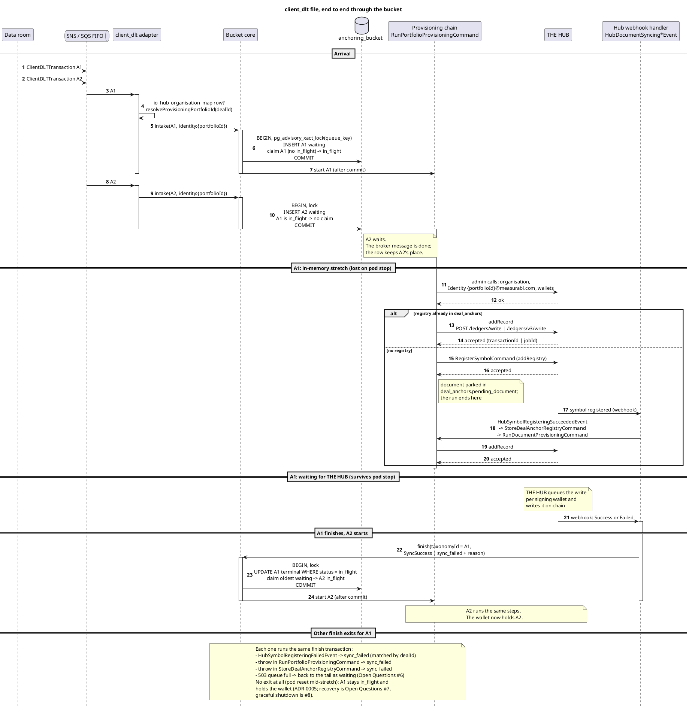
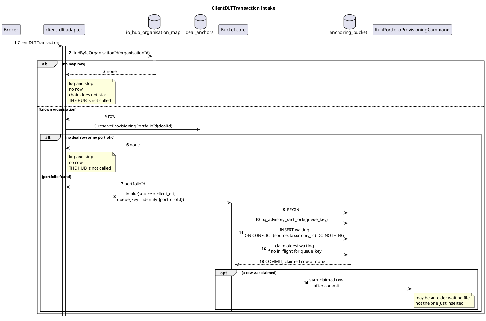
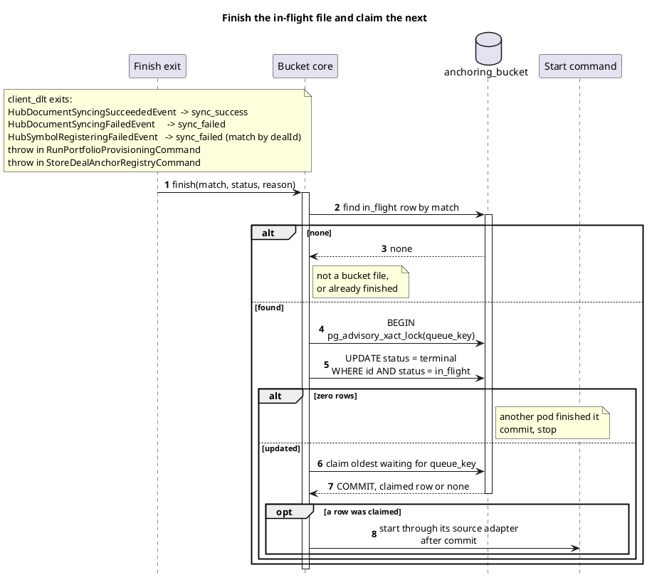
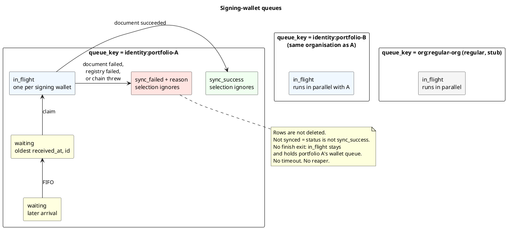
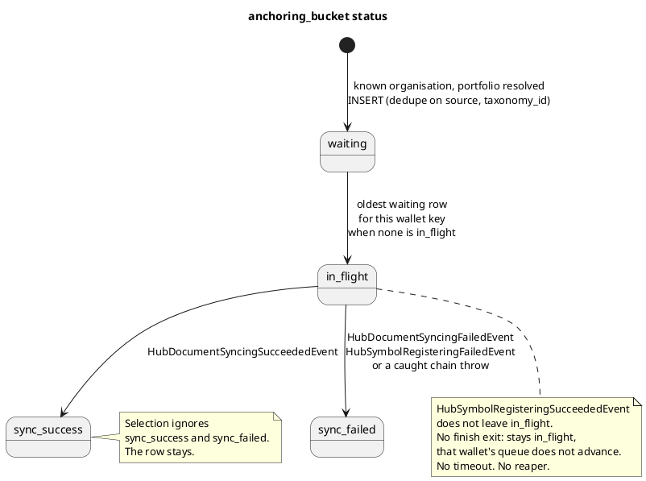

# Anchoring Bucket Diagrams

> [!warning] On hold
> This investigation is on hold. Nothing here is a candidate for implementation. Use it as reference only.

**Summary**: Diagrams for the proposed hub bucket: module shape with pluggable sources (Excalidraw), an end-to-end `client_dlt` sequence from arrival to THE HUB's answer, `client_dlt` intake, finish-and-claim, per-wallet queues, and row status. The board drawing is [Anchoring Bucket Board](Anchoring%20Bucket%20Board.excalidraw.md).

**Sources**: [Anchoring Bucket](Anchoring%20Bucket.md), [ADR-0003 Keep Terminal Rows](../decisions/ADR-0003%20Keep%20Terminal%20Rows.md), [ADR-0004 Atomic Finish and Claim](../decisions/ADR-0004%20Atomic%20Finish%20and%20Claim.md), [ADR-0007 Pluggable Bucket Sources](../decisions/ADR-0007%20Pluggable%20Bucket%20Sources.md), [ADR-0009 One In Flight Per Signing Wallet](../decisions/ADR-0009%20One%20In%20Flight%20Per%20Signing%20Wallet.md).

**Last updated**: 2026-11-12

---

These diagrams describe the proposed module. They are not a picture of shipped code. Current behaviour is [File Start Today](File%20Start%20Today.md).

## Module and sources

The core does not know events or commands. Each source plugs in an adapter. The entry event picks the source.

Drawing: [Anchoring Bucket Module](Anchoring%20Bucket%20Module.excalidraw.md). Standalone JSON for excalidraw.com: [Anchoring Bucket Module.excalidraw](Anchoring%20Bucket%20Module.excalidraw).

## End to end (`client_dlt`)

Two files, A1 and A2, for the same portfolio wallet arrive together. A2 waits until A1's whole business process ends with THE HUB's answer, then starts. Files for other wallets run the same flow in parallel. The in-memory stretch is lost if the pod stops; the wait for THE HUB's answer survives it.

## Intake (`client_dlt`)

Unknown organisation or unresolved portfolio: refused before a row exists. Insert and claim share one transaction under the wallet key's lock. The command runs after commit.

## Finish and claim

Every finish exit runs the same transaction. The terminal update is guarded by `status = 'in_flight'`, so a duplicate exit does nothing.

## Per-wallet queues

## State

## Related pages

- [Anchoring Bucket](Anchoring%20Bucket.md)
- [Anchoring Bucket Board](Anchoring%20Bucket%20Board.excalidraw.md)
- [Anchoring Bucket Module](Anchoring%20Bucket%20Module.excalidraw.md)
- [File Start Today](File%20Start%20Today.md)
- [ADR-0003 Keep Terminal Rows](../decisions/ADR-0003%20Keep%20Terminal%20Rows.md)
- [ADR-0004 Atomic Finish and Claim](../decisions/ADR-0004%20Atomic%20Finish%20and%20Claim.md)
- [ADR-0005 Unmarked In Flight Holds](../decisions/ADR-0005%20Unmarked%20In%20Flight%20Holds.md)
- [ADR-0007 Pluggable Bucket Sources](../decisions/ADR-0007%20Pluggable%20Bucket%20Sources.md)
- [ADR-0009 One In Flight Per Signing Wallet](../decisions/ADR-0009%20One%20In%20Flight%20Per%20Signing%20Wallet.md)
- [Wiki Index](index.md)
