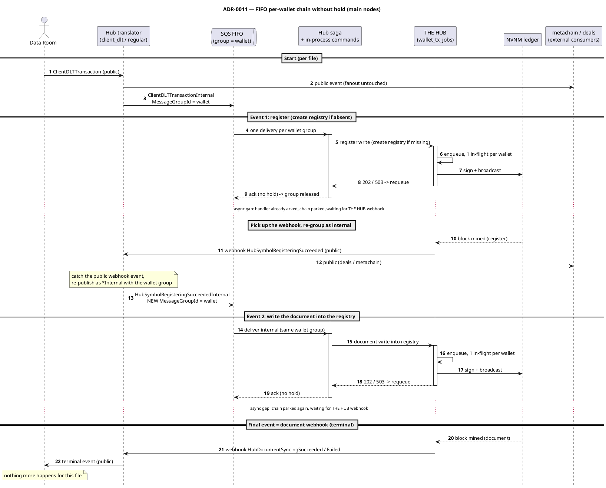

# SQS FIFO Approach

> [!info] Active
> This page is the current approach. The rest of this folder is on hold and is reference only.

**Summary**: Chosen direction: the existing hub queue, with the start handler throwing until the file's finish is recorded. IO Hub Service republishes each file start into the existing hub SQS FIFO queue with `MessageGroupId` set to the signing wallet: `portfolioId` for `ClientDLTTransaction`, `organisationId` for regular organisations. SQS then gives FIFO per wallet and parallel wallets. Start and finish are existing event pairs. A FIFO group is released when its message is deleted, not when the business process ends, so the design depends on holding the message until the finish event. The provisioning chain already runs inside the message handler, and the heartbeat holds the message while it runs. Only the webhook wait needs the throw. Turning on `ENABLE_QUEUE_GLOBAL_ERROR_HANDLER` as it stands would retry every chain failure, top-ups included, so the start handler must catch chain errors and emit `HubDocumentSyncingFailedEvent`. Locally hub runs on Floci SNS and SQS FIFO. A receive of one message holds the group. A receive of more than one does not.

**Sources**: `shared-modules/Events/Hub/Onboarding/client-dlt-transaction.event.ts`, `shared-modules/Events/Hub/Common/hub-document-syncing-*.event.ts`, `shared-modules/Events/Hub/Common/hub-symbol-registering-*.event.ts`, `shared-modules/Events/Hub/interfaces.ts`, `shared-modules/Events/DataRoom/Interfaces/data-room.interfaces.ts`, `shared-modules/Events/EventsConstants.ts`, `shared-modules/NestAwsCqrs/src/broker/aws/SnsProducer.ts`, `apps/data-room-service/src/data-room/taxonomy/domain/entity.ts`, `apps/hub-service/src/transactions/domain/models/transactions.model.ts`, `apps/hub-service/src/organisation-provisioning/domain/commands/run-portfolio-provisioning.command.ts`, `apps/hub-service/src/organisation-provisioning/application/sagas/client-dlt-provisioning.saga.ts`, `shared-modules/NestAwsCqrs/src/NestAwsService.ts`, `shared-modules/NestAwsCqrs/src/NestAwsCqrs.ts`, `shared-modules/NestAwsCqrs/src/NestAwsPubSub.ts`, `shared-modules/NestAwsCqrs/src/broker/rabbitmq/RabbitMqConsumer.ts`, `node_modules/sqs-consumer/dist/consumer.js`, `apps/hub-service/src/transactions/application/providers/ledger-io.provider.ts`, `apps/data-room-service/src/data-room/taxonomy/application/sagas/taxonomy.saga.ts`, `apps/data-room-service/src/data-room/file/application/sagas/file.saga.ts`, `docker-compose.yml`, `docker-compose.override.yml`, `helm/dev-tools/charts/inv-aws`, `dev-tools/local-aws`.

**Last updated**: 2026-11-17

---

## Idea

- A producer in IO Hub Service takes the start event and publishes a start message to the existing hub SQS FIFO queue.
- `MessageGroupId` is the signing wallet: `portfolioId` (resolved with `resolveProvisioningPortfolioId(dealId)`) for `ClientDLTTransaction`, `organisationId` for a regular organisation.
- The consumer of that message starts the process. The finish event releases the group.
- Local runs use Floci. Hub is on the SNS and SQS broker against `inv-floci`, and the FIFO topic and queues are already there (see Local stack).

## Start and finish pairs

Hub is a listed consumer of every event below (source: `EventsConstants.ts`, `EventToMSMap`), so each one reaches hub through the broker.

| Flow | Start | Terminal success | Terminal failure | Not terminal |
| --- | --- | --- | --- | --- |
| Known organisation | `ClientDLTTransaction` | `HubDocumentSyncingSucceededEvent` | `HubDocumentSyncingFailedEvent`, `HubSymbolRegisteringFailedEvent`, **none for a chain throw** | `HubSymbolRegisteringSucceededEvent`, `HubDocumentSyncingPendingEvent` |
| Regular organisation | `HubDocumentSyncingRequestedEvent` | `HubDocumentSyncingSucceededEvent` | `HubDocumentSyncingFailedEvent` | `HubDocumentSyncingPendingEvent` |

### Start payloads

`ClientDLTTransaction` is published by data room with `aggregateId = taxonomyId`, `meta.isDirect = true`, and `context.organisationId` set. It sets no `messageGroupId`, so its FIFO group today is the taxonomy id (source: `entity.ts`, `SnsProducer.ts`).

```ts
export interface ClientDLTTransactionPayload {
  dealId: string;
  taxonomyId: string;
  organisationId: string;
  uri: string;
  checksum: string;
  checksumAlgo: string;
}
```

`HubDocumentSyncingRequestedEvent` carries `UserScope<HubDocumentSyncingRequestedEventPayload>`:

```ts
interface HubDocumentSyncingRequestedEventPayload {
  ledgerType: HubLedgerTypeEnum;
  transactionType: TransactionTypeEnum;
  estimation?: TxCostEstimationType;
  dealId: string;
  fileId: string;
  taxonomyId: string;
  taxonomyType?: TaxonomyTypeEnum;
  documentTaxonomy: TaxonomyInterface;
  isSyncNeeded?: boolean;
  symbol: string;
  organisationId: string;
  userId: string;
}
```

### Finish payloads

`HubDocumentSyncingSucceededEvent`, `HubDocumentSyncingFailedEvent`, and `HubDocumentSyncingPendingEvent` carry the same shape. `aggregateId` is the hub transaction id, or a fresh uuid on the HTTP-error path (source: `transactions.model.ts`, `documentSyncingEventPublisher`, `syncDocument`).

```ts
interface HubDocumentSyncingResultPayload {
  ledgerType: HubLedgerTypeEnum;
  transactionType: TransactionTypeEnum;
  estimation?: TxCostEstimationType;
  taxonomyId: string;          // finish correlation key
  transactionPointer: string;
  hubJobId?: string;
  status: string;
  reason: string;
  organisationId?: string;
  userId?: string;
  taxonomyType?: TaxonomyTypeEnum;
}
```

No `dealId` and no `portfolioId`. Matching a document result to its start message goes through `taxonomyId`.

`HubSymbolRegisteringFailedEvent` carries no `taxonomyId`. The HTTP-error path fills `dealId`, `organisationId`, `userId` (source: `transactions.model.ts`, `registerSymbol`). The webhook path fills the same fields from the `transactions` row (source: `base-ledger.provider.ts`, `onComplete`).

```ts
interface HubSymbolRegisteringFailedEventPayload {
  ledgerType: HubLedgerTypeEnum;
  transactionType: TransactionTypeEnum;
  dealId: string;              // finish correlation key, via deal_anchors to portfolioId
  userId: string;
  userEmail: string;
  organisationId: string;
  transactionId: string;
  status: DLTOperationStatuses;
  reason: string;
}
```

### Chain throw has no finish event

`ClientDltProvisioningSaga` maps `ClientDLTTransaction` straight to `RunPortfolioProvisioningCommand`. Its handler logs `RunPortfolioProvisioningCommand failed` and rethrows. No event is emitted (source: `run-portfolio-provisioning.command.ts`). A missing organisation mapping, a lock timeout, or a failed THE HUB admin call therefore ends the process with no event. With event-driven finish, that group never releases. A failure event for the provisioning chain is needed; see Failure event for a chain throw.

## Holding the group until finish

SQS FIFO does not deliver the next message of a group while one is in flight, and releases the group when that message is deleted. To serialise the whole business process, the start message must stay undeleted until the finish event.

### What the existing consumer does

Every hub queue is read by `SqsConsumer`, built on `sqs-consumer` (source: `shared-modules/NestAwsCqrs/src/broker/aws/SqsConsumer.ts`):

- Hub reads two queues: one for event handlers, one for command handlers.
- The handler resolving deletes the message. A message whose event name is not in the allowed list is skipped by returning, so it is also deleted.
- A thrown error keeps the message only when `ENABLE_QUEUE_GLOBAL_ERROR_HANDLER=true` and the error is not an `ApplicationError` or `DomainError`. Otherwise it is logged as fatal and deleted (`isRetryable`).
- `heartbeatInterval` extends visibility while the handler runs.
- `SqsConsumer` always passes `handleMessageBatch`, so `sqs-consumer` takes its batch path even with a batch size of 1. The batch path has no `handleMessageTimeout` race; only the single-message path has one (source: `node_modules/sqs-consumer/dist/consumer.js`, `executeHandler` and `executeBatchHandler`). Hub's `HANDLE_MESSAGE_TIMEOUT` is therefore not enforced, and the heartbeat keeps a message invisible for as long as its handler runs.
- With `batchSize > 1`, the messages of one batch run in parallel (`Promise.allSettled`). SQS FIFO can put several messages of one group into one batch, so they would run at once.
- The body is read as an SNS envelope: `JSON.parse(Body).Message`.

Hub's values:

| Setting | Hub value | Source |
| --- | --- | --- |
| `HANDLE_MESSAGE_TIMEOUT` | 900000 ms (15 min) in helm; code default 180000; not enforced on the batch path | `helm_env_configs/apps/inveniam/values/hub.yaml.gotmpl`, `apps/hub-service/src/config/environment.ts` |
| `VISIBILITY_TIMEOUT` / `HEARTBEAT_INTERVAL` | 10 s / 9 s (code defaults; not set in helm) | `environment.ts` |
| `queue.batchSize` | not configured, so 1 | `NestAwsCqrsModule.ts` |
| `ENABLE_QUEUE_GLOBAL_ERROR_HANDLER` | not set, so every handler error deletes the message | `SqsConsumer.ts` `isRetryable`; not in hub helm values |

With a batch size of 1, one receive returns one message, so messages of one group never run in parallel. `sqs-consumer` handles a pod's messages one after another, so a handler that waits for THE HUB's answer stalls that pod's whole queue.

### Saga commands run inside the message handler

The queue handler runs the event handlers, then the sagas, and awaits every command the sagas return (source: `NestAwsService.ts` `processMessage`, `NestAwsCqrs.ts` `executeCommandHandlers`, `await Promise.all(... internalCommandBus.execute(command))`). For `ClientDLTTransaction`, `ClientDltProvisioningSaga` returns `RunPortfolioProvisioningCommand`, so the whole provisioning chain runs while the `ClientDLTTransaction` message is in flight, and an error rethrown by the command reaches the consumer.

- The synchronous part of a file's process (resolve, identity, wallet, top-ups, registry, `addRecord`) already holds the message: the heartbeat keeps it invisible and no timeout applies.
- Only the wait for THE HUB's webhooks happens after the handler returns. That is the part the throw-until-finished mechanics have to cover.
- Hub's event handlers only log. Every effect of a hub message comes from saga commands.

### Consequence for the existing queue

The generic consumer takes every message on the queue, and it either handles it or deletes it when its handler returns. A second receiver cannot hold a start message on the same queue: whichever consumer receives it, the generic one deletes it on return. So on the existing queue, with the existing consumer, a group cannot stay blocked until the webhook.

Ways to keep the group blocked:

| Option | How | Limits |
| --- | --- | --- |
| Dedicated FIFO queue | Own receive loop for start messages only. Receipt handle stored for any pod; visibility extended until the finish event deletes the message. | New queue and SNS subscription. 12 h visibility cap. Local stack needs the same queue. |
| Existing queue, throw until finished | The start handler starts the process on first receipt, then throws a retryable error on every redelivery until the finish is recorded, then returns and the message is deleted. | Needs `ENABLE_QUEUE_GLOBAL_ERROR_HANDLER=true`, which hub does not set; turning it on changes retry behaviour for every hub handler. Every redelivery counts toward `maxReceiveCount`; past it the message goes to the dead-letter queue and the group is released. Needs a record of "finished" that the handler can read. |
| Existing queue, wait inside the handler | The handler does not return until the finish is recorded; the heartbeat holds the message. See [Holding The Start Message](Holding%20The%20Start%20Message.md). | The pod's consumer is busy for the whole wait. |
| Postgres gate | The bucket design, kept in this folder on hold. | Not an SQS solution. |

## Chosen direction: existing queue, throw until finished (TO AGENT: it's not chosen yet it's like the option among others)

The start message goes to the existing hub queue. Its handler keeps the message, and so the wallet's group, in the queue by throwing a retryable error until the file's finish is recorded. Then it returns and the message is deleted, which releases the next message of the group.

### Mechanics

1. The start message arrives. The handler reads the file record by `taxonomyId`.
2. No record: write `started` (with an owner and a lease), then run the chain inside the handler; the heartbeat holds the message meanwhile. On a chain error: record `sync_failed`, emit `HubDocumentSyncingFailedEvent`, return. On success: throw, to wait for the webhook.
3. Record `started`, lease alive: throw. The group stays blocked.
4. Record finished (`sync_success` or `sync_failed`): return. The message is deleted and the next file of the wallet is delivered.
5. Record `started`, lease expired, no record that THE HUB accepted the write: mark `sync_failed` with an unknown-outcome reason and return. No automatic rerun.
6. Record `started` with THE HUB's acceptance recorded: throw, and wait for the webhook.

The finish event handlers write the terminal status into the record. They do not touch the queue.

### Requirements

- `ENABLE_QUEUE_GLOBAL_ERROR_HANDLER=true` for hub. Without it every handler error deletes the message (`SqsConsumer.isRetryable`).
- The thrown error must not be an `ApplicationError` or `DomainError`, or it is not retried.
- The start handler catches every chain error, records `sync_failed`, emits `HubDocumentSyncingFailedEvent`, and returns. Only its own "still running" error leaves the handler.
- A file record shared by all pods: `taxonomyId`, status, owner, lease. THE HUB acceptance marker is the existing `transactions` row.
- `ClientDltProvisioningSaga` stops running the chain on the original `ClientDLTTransaction`.
- Group ids with their own prefix (`anchoring:identity:{portfolioId}`, `anchoring:org:{organisationId}`).

### Redelivery cadence

`sqs-consumer` 8.1.0 is in use. Hub's `SqsConsumer` passes no `terminateVisibilityTimeout`, so after a throw the message stays invisible for the rest of its visibility timeout and is then delivered again (source: `node_modules/sqs-consumer/dist/consumer.js`). With hub's `VISIBILITY_TIMEOUT` of 10 s, a held file is redelivered about every 10 s. Every receive counts toward `maxReceiveCount`. Locally that is 100, so about 17 minutes of holding before the message moves to `SQSDeadLetters` and the group is released with the file unfinished. The production value was not read. A process with a registry registration and a document write, each waiting on THE HUB, can take longer.

Ways to stretch it, both outside the hub module: a longer visibility timeout for these messages before the throw (the handler receives the broker message, not the receipt handle, so `SqsConsumer` would have to pass it), or a higher `maxReceiveCount` on the hub queue. `attributeNames` is not passed either, so `ApproximateReceiveCount` is not visible to the handler.

### Risks of the flag

- The flag applies to every hub handler. Any handler that now throws a plain error is retried up to `maxReceiveCount` instead of being dropped. A handler that spends funds or calls THE HUB before it throws repeats that call on every retry. See the audit below.
- Each throw is logged as `Retry the message` at error level, about every 10 s per held file.
- A pod handles its messages one after another, so every redelivery takes one handler slot on that pod. The check is a single record read.

### Handler audit for the flag

Hub has 72 command and event handlers. Event handlers only log. Command handlers fall into three groups (source: `apps/hub-service/src/**/commands/*.command.ts`):

| Group | Commands | Reached from the queue | Effect of the flag |
| --- | --- | --- | --- |
| Catch and swallow | `SyncDocument`, `RegisterSymbol`, `DeployToken`, `DistributeTokens`, `ChangeTotalSupply`, `SetTokensRelation`, `AskTokenHolders`, `ConnectHub`, `ConnectOrgHub`, `OnTransactionComplete`, `UpdateTxStatus`, `SaveDeal`, `SaveOrganisation` | Yes | None. Errors never reach the consumer. |
| Rethrow, HTTP only | `CancelTransaction`, `ResendTransaction`, `UpdateAggregateStatus` | No, called from `requests-processing.service.ts` | None. |
| No catch, not from a saga | `SetIntegrationKeys`, `SetScopedIntegrationKeys`, `SetAccessKeys`, `DeleteIntegrationKeys`, `DeleteAccessKeys` | No, called from `integration-keys-command-factory.service.ts` and the organisation chain | None on their own. Inside the chain they fall under the row below. |
| Rethrow, from a saga | `RunPortfolioProvisioning` (`ClientDLTTransaction`), `RunOrganisationProvisioning` (`OrganisationToHubProvision`), `StoreDealAnchorRegistry` and the `RunDocumentProvisioning` it runs (`HubSymbolRegisteringSucceededEvent`), `SaveDealAnchor` (`DealCreatedEvent`, `DealUpdatedEvent`) | Yes | **Retried.** |

Every error the chain raises is a Nest `UnprocessableEntityException`, an HTTP client error, or `NvnmEstimateRevertError`, none of them an `ApplicationError` or `DomainError`. With the flag on, every chain failure is retryable, and every retry reruns the chain from the start:

- `RunPortfolioProvisioning` and `RunDocumentProvisioning` include `ensureRegistryFunds`, `ensureDocumentFunds`, and the parent top-up. A retry can top up again before failing at the same step.
- `RunOrganisationProvisioning` creates THE HUB organisation, wallets, and webhooks. The steps are written as "ensure", but each retry repeats the THE HUB calls.
- A retry of `HubSymbolRegisteringSucceededEvent` reruns the parked document write.

So the flag cannot be turned on as it stands. The start handler must catch every chain error itself, record the file as `sync_failed`, emit the failure event, and return. The only error it lets out is its own "still running" error. The other three saga entries need the same treatment, or must keep dropping on error.

## Points that follow from the existing queue

- **Group id collisions.** The hub queue carries other events grouped by `aggregateId` or `context.messageGroupId`. A bare `portfolioId` or `organisationId` group would also block any other hub event that uses the same id as its group. Group ids for start messages need their own prefix, for example `anchoring:identity:{portfolioId}` and `anchoring:org:{organisationId}`.
- **Publish path.** An event with `meta.isDirect = true` goes from `NestAwsPubSub.publish` to `DirectEventProducerService`, which calls the broker producer (SNS) directly and skips the event store and the relay. `ClientDLTTransaction` already uses it. Any other event goes through the event store; the relay deletes outbox rows and calls SNS in one transaction. On both paths `SnsProducer` logs and swallows publish errors, so a failed publish is lost (source: `NestAwsPubSub.ts`, `direct-event-producer.service.ts`, `apps/relay-service/src/tasks.service.ts`, `SnsProducer.ts`). A direct `SendMessage` to the queue avoids `SnsProducer` but needs the SNS envelope. Not decided.
- **Double start.** `ClientDLTTransaction` already reaches hub and runs the chain through `ClientDltProvisioningSaga`. If hub republishes it as a start message, the saga on the original event must stop running the chain, or every file runs twice.
- **Deduplication.** `MessageDeduplicationId = taxonomyId` drops a duplicate within the 5-minute SQS window only.
- **Envelope.** A start message sent directly with `SendMessage` must be wrapped as an SNS envelope (`{ Message: "<json>" }`), because `SqsConsumer` reads `Body.Message`.
- **Retention.** Messages waiting behind a held one age toward the queue's retention period. Locally that is 3 days (`MessageRetentionPeriod` 259200); production value not read.

## Restart and reruns

- A pod reset while a message is held makes the message visible again after its visibility timeout, and SQS redelivers it. That is an automatic rerun.
- An interrupted file with no record that THE HUB received the write is not rerun automatically. It becomes failed with an unknown-outcome reason, and a rerun is a manual resync in the data room. The chain spends from wallets; automatic reruns could drain a wallet if THE HUB spends without returning feedback.
- So a redelivered start message needs a record of whether that file already started. Started with unknown outcome: report failed and delete. Not started: start.

## Local stack

### Hub runs on Floci

Checked live on 2026-11-16. `inv-floci` was healthy and `inv-hub-ms` was up on the SNS and SQS broker. `inv-rabbitmq` was still running. Hub does not use it: `BROKER_TYPE=snssqs`, and the hub command waits on Postgres only (source: `docker-compose.override.yml`). `inv-data-room-ms` was not running. The override wires it, and the other broker services, the same way when they start.

| Setting | Running hub |
| --- | --- |
| `BROKER_TYPE` | `snssqs` |
| `QUEUE_ENDPOINT` | `http://inv-floci:4566` |
| `SNS_TOPIC_ARN` | `arn:aws:sns:us-east-1:000000000000:inveniam-events.fifo` |
| Event queue | `http://inv-floci:4566/000000000000/hub-event-queue.fifo` |
| Command queue | `http://inv-floci:4566/000000000000/hub-command-queue.fifo` |

`RabbitMqConsumer` is unchanged and still has no message groups (source: `RabbitMqConsumer.ts`). It is not the broker hub is on.

### What Floci is running

`inv-floci` is `floci/floci:latest-compat`, published on `127.0.0.1:4566` only, with `FLOCI_STORAGE_MODE=hybrid`, `FLOCI_HOSTNAME=inv-floci`, and `./data` mounted at `/app/data` (source: `docker-compose.override.yml`). The image includes `aws` and `awslocal`. The container is healthy when `/tmp/inveniam-queues.done` exists.

The ready hook `/etc/floci/init/ready.d/01-inveniam-queues.py` creates the topology. It is the compose config `floci-inveniam-queues`.

- Topic `inveniam-events.fifo`: `FifoTopic`, `ContentBasedDeduplication`, `FifoThroughputScope=MessageGroup`.
- One event queue and one command queue per service, all FIFO, plus `inveniam-dead-letters.fifo`. Template has queues and no subscription. The other fifteen services subscribe both queues with `FilterPolicy` `{"msList":["<service>"]}`. Live: 33 queues, 30 confirmed subscriptions, none pending.
- Hub's event subscription: filter `{"msList":["hub"]}`, `RawMessageDelivery` false, so the body is an SNS notification. `SqsConsumer` reads `Body.Message`.
- Queue attributes on `hub-event-queue.fifo`: `FifoQueue`, `DeduplicationScope=messageGroup`, `FifoThroughputLimit=perMessageGroupId`, `ContentBasedDeduplication` false, `VisibilityTimeout` 30, `DelaySeconds` 0, `MessageRetentionPeriod` 259200, redrive to `inveniam-dead-letters.fifo` after `maxReceiveCount` 100.
- Returned queue URLs use `http://inv-floci:4566/...`. Other containers resolve that name. From the host the same path works on `127.0.0.1`.

The queue's visibility timeout is 30 seconds. Hub's consumer still passes its own timeout on receive (code default 10 seconds), so the redelivery cadence above is unchanged.

`dev-tools/local-aws` and `helm/dev-tools/charts/inv-aws` still describe LocalStack standard queues. They are not the broker hub uses.

### FIFO behaviour, checked live

Throwaway queue `bulk-anchoring-probe.fifo`, then deleted. Fake credentials, endpoint `http://127.0.0.1:4566`.

- A second `SendMessage` with the same `MessageDeduplicationId` returned the same message id.
- `MaxNumberOfMessages` 1: the first receive took `wallet-a`. The next receive took `wallet-b`. A further receive returned nothing while `wallet-a` was in flight. After that message was deleted, the second `wallet-a` message was delivered.
- `MaxNumberOfMessages` 10: one receive returned both `wallet-a` messages and the `wallet-b` message. A batch receive does not hold the group, and it mixes groups. Hub's `queue.batchSize` is 1, so the path hub uses does hold the group.

A throwaway publish with message attribute `msList` `["hub"]` was delivered to both hub queues as an SNS notification. Hub logged the event name as ignored and deleted both messages. The queues were empty again afterwards. A publish that did not carry `msList` `hub` did not appear in the hub log.

## Failure event for a chain throw

A provisioning chain throw emits nothing today, so data room receives neither `HubDocumentSyncingSucceededEvent` nor `HubDocumentSyncingFailedEvent` for that file.

`HubDocumentSyncingFailedEvent` fits as the chain-throw failure event:

- Hub already emits it without a THE HUB transaction. `TransactionsModel.syncDocument` applies it on an HTTP error with `transactionPointer: ''` and a fresh `aggregateId` (source: `transactions.model.ts`).
- Data room already consumes it. `TaxonomySaga` maps it to `UpdateDataRoomFileTaxonomyCommand`, which reads `taxonomyId`, `transactionPointer`, `status`, `reason`, `taxonomyType`. `FileSaga` maps it to `FDRFileSyncActivityFailedCommand`, which reads `taxonomyId`, `status`, `organisationId` (source: `apps/data-room-service/src/data-room/taxonomy/application/sagas/taxonomy.saga.ts`, `file/application/sagas/file.saga.ts`).
- The start payload holds `taxonomyId` and `organisationId`; `reason` carries the chain error. `ledgerType` and `transactionType` are fixed for this flow.

Data room does not consume `HubSymbolRegisteringFailedEvent`. Unverified: how data room shows a file with an empty `transactionPointer`.

## File record

- The `transactions` row for a file is written only after THE HUB `write` returns: `LedgerIOProvider.write` calls THE HUB, sets `hubJobId`, `transactionId`, and status `Pending`, then inserts the row with `taxonomyId` and `organisationId`. A unique violation on `hubJobId` is treated as an idempotent replay (source: `apps/hub-service/src/transactions/application/providers/ledger-io.provider.ts`).
- So a `transactions` row for the `taxonomyId` is the THE HUB acceptance marker the mechanics need (step 6). The gap is a crash between THE HUB's answer and the insert: THE HUB has the job, hub has no row. That is the unknown-outcome case, and it is not rerun.
- Nothing in hub records a file before acceptance. `started`, owner, and lease need a new record. Hub's tables are `transactions`, `deal_anchors`, `deals`, `organisations`, `io_hub_organisation_map`.
- `transactions.status` uses `DLTOperationStatuses` (`Pending`, `Succeed`, `Failed`, `Canceled`). A new record uses snake_case statuses.

## Production queue settings

The hub queue's `maxReceiveCount`, visibility timeout, retention, and FIFO attributes are not in this workspace: no Terraform for SQS or SNS was found, and the helm values reference the queue and topic through vault. They can be read with a read-only call, with credentials from the environment:

```bash
aws sqs get-queue-attributes --queue-url "<hub queue url>" \
  --attribute-names FifoQueue ContentBasedDeduplication DeduplicationScope FifoThroughputLimit \
  VisibilityTimeout MessageRetentionPeriod RedrivePolicy
aws sns get-topic-attributes --topic-arn "<topic arn>"
```

## Open

1. Production `maxReceiveCount`, visibility timeout, and retention for the hub queue, against the longest file process; and whether a held message gets a longer visibility timeout.
2. Publish path for the start message: SNS direct, or `SendMessage` with an SNS envelope.
3. The record for `started`, owner, and lease: a new table, and its name.
4. What data room shows for `HubDocumentSyncingFailedEvent` with an empty `transactionPointer`.
5. How the other saga entries that rethrow (`OrganisationToHubProvision`, `HubSymbolRegisteringSucceededEvent`, `DealCreatedEvent`, `DealUpdatedEvent`) behave once the flag is on: catch, or keep dropping.

## Answered

- `HubSymbolRegisteringFailedEvent` from the webhook path carries `dealId`, `organisationId`, `userId`, `status`, and `reason`, copied from the `transactions` row (source: `base-ledger.provider.ts`, `onComplete`). Matching it by `dealId` works on both paths.
- The flag's effect on hub handlers: see the handler audit. Only saga commands that rethrow are affected, and the provisioning ones spend funds.
- Failure event for a chain throw: `HubDocumentSyncingFailedEvent`, already consumed by data room.
- THE HUB acceptance marker: the `transactions` row for the `taxonomyId`.
- Local broker is Floci. Hub is on `inveniam-events.fifo` and `hub-event-queue.fifo`. Dedup works. A receive of one message holds the group; a receive of ten does not. Data room was not running at the check.

## ADR-0011 sequence (no-hold)

High-level interaction of the main nodes for the no-hold direction ([ADR-0011](../decisions/ADR-0011%20FIFO%20Per-Wallet%20Chain%20Without%20Hold.md)). The chain is two sequential events with an async gap between them: **event 1** registers the symbol (creating the registry if absent), **event 2** writes the document into that registry. Each is a write that is enqueued on THE HUB, then parks: the handler acks (no hold) and the chain waits for THE HUB's webhook. When the register webhook (`HubSymbolRegisteringSucceeded`) arrives, the hub translator **catches it and re-publishes it as an `*Internal` event with a new `MessageGroupId` = wallet**, which drives event 2. Public events keep their fanout; the terminal event is THE HUB's document webhook, not something the saga emits on its own; nonce-safety stays in THE HUB's `wallet_tx_jobs` queue.



## Related pages

- [Wiki Index](index.md)
- [Holding The Start Message](Holding%20The%20Start%20Message.md)
- [ADR-0011 FIFO Per-Wallet Chain Without Hold](../decisions/ADR-0011%20FIFO%20Per-Wallet%20Chain%20Without%20Hold.md) (no-hold alternative)
- [File Start Today](File%20Start%20Today.md) (reference, on hold)
- [Bucket Pattern And Alternatives](Bucket%20Pattern%20And%20Alternatives.md) (reference, on hold)
- [Open Questions](Open%20Questions.md) (reference, on hold)
