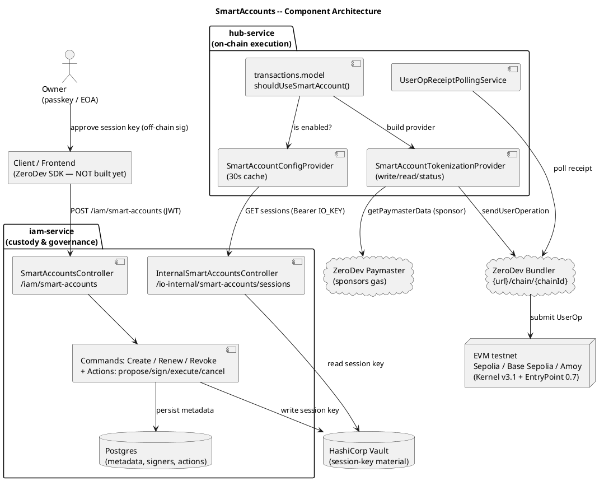
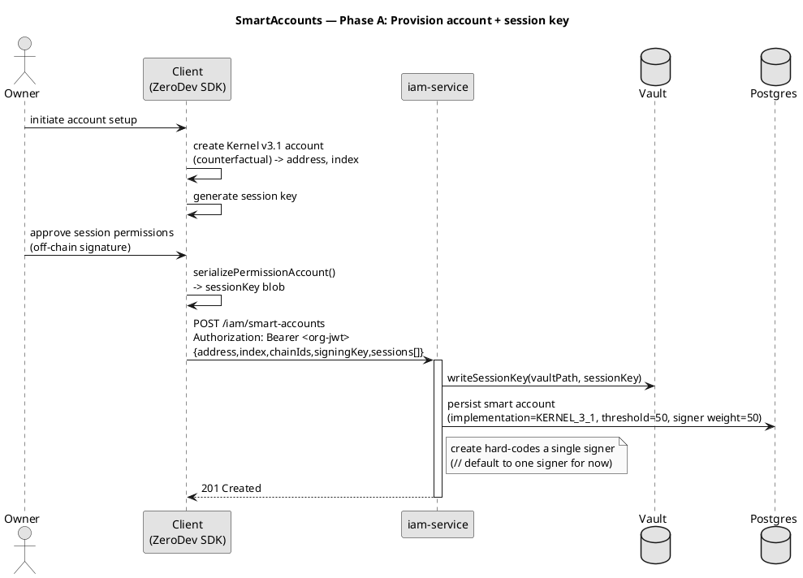
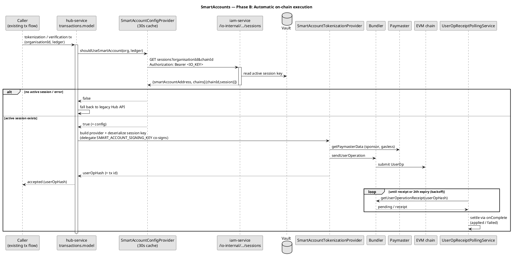
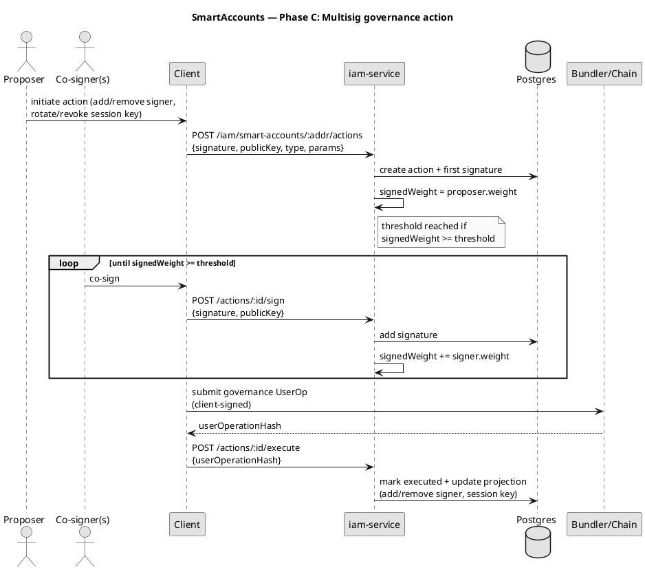

# SmartAccounts — PlantUML Diagrams

Companion to [Smart Accounts Implementation State](Smart%20Accounts%20Implementation%20State.md) and [Smart Accounts Happy Flow](Smart%20Accounts%20Happy%20Flow.md).
Render with any PlantUML tool (e.g. the Obsidian PlantUML plugin, or https://www.plantuml.com/plantuml).

---

## 1. Component / architecture view

---

## 2. Sequence — Phase A: provision account + session key (client-driven, one-time per org/chain)

---

## 3. Sequence — Phase B: automatic on-chain execution (per tokenization / verification tx)

---

## 4. Sequence — Phase C: multisig governance action (client-signed, iam coordinates)

