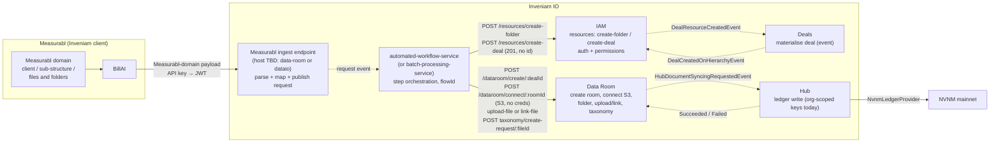
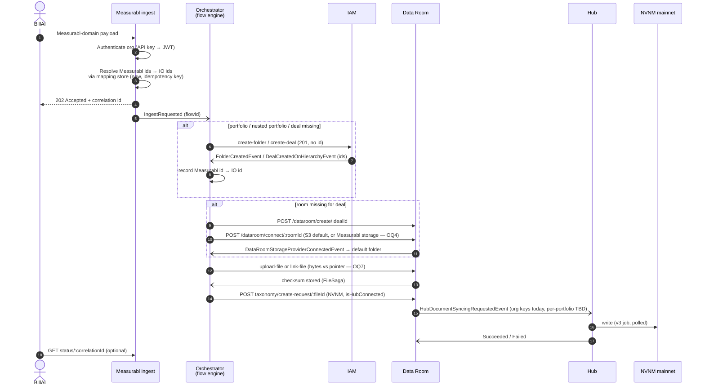

# Evaluation: `measurabl-anchoring-embedded-in-existing-services.md` — source fidelity and architectural feasibility

**Date:** 2026-09-06  
**Document under review:** [`../measurabl-anchoring-embedded-in-existing-services.md`](../measurabl-anchoring-embedded-in-existing-services.md) (reviewed as `billai-inveniam-communication.md`; Last updated 2026-09-04)  
**Prompt:** [`../prompts/evaluate-measurabl-anchoring-embedded-in-existing-services.md`](../prompts/evaluate-measurabl-anchoring-embedded-in-existing-services.md)  
**Resolution status:** [`measurabl-ingest-architecture-evaluation-2026-09-06-resolution.md`](measurabl-ingest-architecture-evaluation-2026-09-06-resolution.md) — this evaluation is frozen as the audit record; fixes are tracked there.

Sources used for decisions (in precedence order): [D1, D2](../reference-docs/architectural-decisions.md) (Accepted, 2026-09-06); [2026-09-04 meeting notes](../reference-docs/measurabl-integration-next-steps-2026-09-04.md); [Aug 17 markdown](../reference-docs/msr-io-integration-high-level-architecture-aug-17.md) + PNG (discussion artifact; step 17 superseded by D2). Sources for mechanism: code (`file:line`), then the [interim research docs](../interim-research-docs/). Graphify (`../../../graphify-out`) was used to locate files; every claim below was then read in source.

---

## Verdict

**Not yet safe to send to Measurabl as a confirmation request, and not buildable substantially as drawn.** On fidelity, the doc matches D1 on the dedicated-endpoint contract and its three restrictions, and it correctly lists the two "Needs Further Discussion" items as open questions — but the domain-mapping table and the sequence diagram state as settled two things the notes leave open (one data room per file/folder-set deal; a per-portfolio wallet), it silently drops the rest of the Aug 17 vision (DGML extraction with results back to BillAI, and the "no bytes leave Measurabl" residency rule) without saying it is a narrower slice — the one Aug 17 drop that **is** now a recorded decision is structured/Merkle-root anchoring (D2: only the Data Room feeds anchoring; Aug 17 step 17 is gone), and the doc's `DR → Hub → NVM` is consistent with it — and its one placement hint ("likely dataio") contradicts the only hint in the notes (an endpoint on "the one used for document uploads", i.e. data-room). On feasibility, the flowchart has three edges that do not exist in code (`iam → orgs`, `deals → dr`, `dr → meta → nvm`), and the sequence diagram assumes a synchronous chain of creates that the code cannot deliver: IAM's create-portfolio and create-deal return `201` with **no id** and generate ids server-side, deal materialisation and anchoring are event-driven and asynchronous, and the anchor is caller-initiated after a background checksum — so "one request → four creates → files → mainnet tx → ack with ids" is not a shape this codebase supports. **The single most consequential problem is the synchronous-fan-out assumption**: there is no way for the ingest handler to obtain the ids of the portfolio/deal it just asked IAM to create, so lazy creation, idempotency, and the "ack + IO ids" response all need an asynchronous, event-driven design (the repo already has one: `automated-workflow-service`'s flow engine, which is what the doc's own cited precedent `POST /input/create-client` actually uses).

---

## Fidelity findings

Severity: **Critical** = would mislead Measurabl or invents a decision; **Major** = states an open item as settled or drops a recorded position; **Minor** = attribution/wording.

### F1 — Critical — "Store files / JSON from payload" into the IO data room contradicts the Aug 17 residency rule, and no later source resolves it

- **Doc text:** sequence diagram step `Ingest->>DR: Store files / JSON from payload`; mapping row `Files / JSON in the payload | Data-room documents`.
- **Classification:** Contradicted (by Aug 17, prior vision) / Unsupported (by D1 and notes).
- **Source:** Aug 17 PNG, step 2: *"Bill AI sends the document straight to the Extraction API. No bytes leave Measurabl's infrastructure."*; step 3: *"The document is registered in the Data Room: checksum and metadata, not bytes."*; Data Room box: *"IO keeps the checksum and the metadata, not the bytes."*; annotation *"Nothing moves anywhere. The Data Room registers a checksum and metadata; the file stays where it was."* D1 says only *"maps it to IO entities (portfolios, deals, data-room files)"* — it does not say bytes are uploaded. Notes say Measurabl wants *"structured data (JSON/files) provided by Invenium"* (data flowing **out** of IO), not that files flow in.
- **Why it matters:** this is the kind of thing Measurabl will read as a commitment about where their customers' bills live. Either residency changed after Aug 17 (unrecorded decision) or the doc invented the upload.
- **Rewording:** `Ingest->>DR: Register file (checksum + metadata; bytes stay at Measurabl) — OR — upload bytes: NOT DECIDED, see OQ7` and add OQ7 "Data residency: does BillAI send bytes, or checksum + pointer (Aug 17 said no bytes leave Measurabl)?"

### F2 — Critical — Aug 17 scope (DGML extraction, results back to BillAI) dropped without saying so; structured anchoring dropped correctly but uncited

- **Doc text:** the whole document; the intro says only *"Working diagram for the Measurabl integration."*
- **Classification:** Omission of prior vision. For **extraction**, no source narrows the scope. For **structured anchoring**, D2 does — the doc is right to omit it but does not say why.
- **Source:** Aug 17 markdown: *"It answers two questions: how data gets anchored (structured and unstructured — both), and how data gets extracted with DGML."* PNG: Inveniam swimlane has **Extraction/Data Room API** (*"The only door between Bill AI and the engine: the document goes in here, results and proof come back out"*), **Extraction pipeline / DGML extraction**, **Anchoring API** (*"Accepts the root and returns a receipt"*), steps 8–10 (results and review outcome flow back to Bill AI). Notes and D1 mention none of this — D1 is ingest-only.
  Structured side: Aug 17 steps 14–17 (Measurabl Anchoring service builds a Merkle tree; step 17 *"Only the root leaves. This is the only crossing of the boundary"*) are **superseded by D2**: *"Step 17 … There will be no such flow. The only path into Inveniam anchoring is the Data Room."* Step 7 (*"The document's provenance goes to the same POST /events as the root from the Measurabl side"*) stands, minus the "same as the root" part.
- **Why it matters:** the Aug 17 door is **bidirectional** and the BillAI doc's is one-way. If the team decided the slice is ingest-only, that is fine — but for extraction it is an unrecorded decision and must be stated, otherwise Measurabl will assume extraction results are coming back. For anchoring, cite D2 so a reader of Aug 17 does not expect a root-anchoring endpoint.
- **Rewording:** add after the intro: *"Scope: this doc covers the **ingest slice** only (create IO entities, register files, anchor files via the Data Room). Per D2, anchoring enters IO only through the Data Room — the Aug 17 structured/Merkle-root flow (step 17) is dropped. DGML extraction and returning extraction results to BillAI (Aug 17 steps 4–10) are not covered here and are undecided."*

### F3 — Major — "Deal (+ data room 1:1)" per file/folder set is stated as settled; the notes mark the trigger as Needs Further Discussion

- **Doc text:** mapping row `Measurabl client files and folders | Deal (+ data room 1:1) | Deal is the IO home for that file/folder set`; sequence `alt Deal missing for this file/folder set … Ingest->>DR: Create data room 1:1 with deal`.
- **Classification:** Overstated (also internally inconsistent — the doc's own OQ3 and the diagram note say the trigger is open).
- **Source:** Notes, *Needs Further Discussion*: *"**Data room creation trigger undefined** The trigger event for creating data rooms (e.g., per client, per portfolio, or per request) remains an open question requiring further definition."* The 1:1 deal↔room relationship itself is supported (Valeriy, 00:35:33: *"data rooms … maintain a one-to-one relationship with deals"*). The mapping *files-and-folders → deal* appears in no source; the notes' only hierarchy mention is *"mapping the hierarchy from measurable (client/portfolio/deal) to Invenium"*, which does not define what a Measurabl "files and folders" set is.
- **Rewording:** row → `Measurabl client files and folders | Deal (proposed) | Candidate mapping — the unit that becomes a deal, and therefore the data-room trigger, is open (OQ3)`; sequence `alt` label → `alt Deal missing (trigger rule TBD — OQ3)`.

### F4 — Major — Sequence diagram provisions a wallet per portfolio while master-wallet vs per-client wallet is Needs Further Discussion

- **Doc text:** `alt Wallet / hub keys missing → Ingest->>Hub: Ensure ledger + wallet, portfolio first, else organisation`; mapping row `Wallet / hub keys | Hub ledger at portfolio, else organisation`.
- **Classification:** Overstated. The *key/ledger placement* (portfolio-else-org) is Bogdan's PRD position (00:04:18, *"based on current input"*), not in the Aligned list. The *wallet* question is explicitly open: *"**Wallet top-up strategy pending** … evaluating the use of a master wallet versus individual client wallets"*; Valeriy *"suggested using a single master wallet … though this remains a topic for future discussion"* (00:54:44). Lazy creation of wallets **is** Aligned (*"clients, portfolios, and wallets are created on-demand"*), which is in tension with a single master wallet — the doc should surface that tension rather than pick one in the diagram.
- **Also:** Valeriy's Hub statement (00:51:59) describes *"a 'flat' structure of organizations that map to individual client portfolios"* — i.e. one **Hub organisation per client portfolio**. The doc's *"Hub stays a flat org→portfolio map"* is a compressed paraphrase that hides this, and it is a materially different Hub model from "one Hub org, keys per portfolio" (see feasibility F-B7).
- **Rewording:** `alt Wallet / hub keys missing → Ingest->>Hub: Ensure ledger/keys for portfolio (fallback org) — wallet model TBD (OQ5)`; row notes → `PRD position (B. Golod), not yet Aligned. Hub-side model (one Hub org per client portfolio vs one org + identities) open.`

### F5 — Major — "likely dataio" diverges from the notes' only placement hint and is presented as "the intended shape"

- **Doc text:** *"A new Measurabl-specific route on an existing service (likely dataio, which already hosts the public API and external ingest) is the intended shape."*
- **Classification:** Unsupported but plausible; conflicts with the one hint in the notes.
- **Source:** D1 names no service. Notes (01:03:33): Yurii *"suggesting the use of an alternative endpoint on an existing service—such as the one used for document uploads"*. Document uploads live on **data-room-service** (`apps/data-room-service/src/data-room/data-room.controller.ts:642-712`), not dataio. Also recorded and dropped: *"Valeriy Ilihmetov expressed a personal preference for a new microservice"* (01:04:58).
- **Rewording:** *"Host service is open (OQ1). The notes' example was 'the service used for document uploads' (data-room); dataio is the alternative because it already fronts external API keys. Neither is decided."*

### F6 — Minor — Source attribution omits D1 and misdates the dedicated-endpoint decision

- **Doc text:** *"Last updated: 2026-09-04 … Source: meeting notes (2026-09-04), plus 2026-09-04 clarification on the dedicated endpoint."*
- **Classification:** Attribution error. The dedicated endpoint is **D1, Accepted 2026-09-06**. The notes themselves record only *"measurable would trigger calls to specific IO API endpoints"* (Yurii/Bogdan, 00:15:12) — plural, generic — not a single dedicated endpoint.
- **Rewording:** *"Sources: D1 (dedicated ingest endpoint) and D2 (anchoring only via Data Room), both accepted 2026-09-06, and the 2026-09-04 meeting notes."* Bump Last updated.

### F7 — Minor — Wording stronger than D1

- **Doc text:** *"Inveniam exposes **one** client-specific endpoint"*; *"BillAI has a **single write contract** … the behaviour is **fixed**."*
- **Source:** D1: *"IO **can** implement a dedicated endpoint"* — permissive, and D1 says nothing about behaviour being fixed. The four numbered behaviours (accept Measurabl terms; map; lazy-create; fan out to IAM/Data Room/Hub) are each individually supported (D1 body; notes Aligned "Lazy provisioning adopted"; D1 restriction 3), but "fixed" overstates.
- **Rewording:** *"Inveniam will expose one dedicated endpoint (D1). Path and payload are open; the intended behaviour is:"*

### F8 — Minor — "BillAI must not call" table adds a restriction D1 does not contain, and "Read-only" is loose

- **Doc text:** row `Public API v1 /v1/deals… | Read-only.`
- **Source:** D1 lists three restrictions (v2 writes, `/input/create-client`, internal routes). v1 is not in D1. Code: v1 is a query surface but has two `POST` routes that are reads (`apps/dataio-service/src/public-api/version-1/application/controllers/version-1.controller.ts:254`, `:304`).
- **Rewording:** keep the row but mark it *"(not in D1; v1 is a query-only surface — nothing there creates entities)"*, or drop it.

### F9 — Minor — "client portfolio → nested portfolio" uses a Measurabl entity name no source defines

- **Doc text:** row `Measurabl client portfolio | Nested portfolio`.
- **Source:** Notes: *"Any complex structures within a client will be handled via sub-portfolios"* (Bogdan, 00:01:27). IO side supported; the Measurabl-side term "client portfolio" is author inference. Aug 17 uses a different model entirely — **Core (Navigate)** *"system of record for portfolio, buildings, meters and readings"* — so "portfolio" on the Measurabl side may mean a Core portfolio, not a folder of files.
- **Rewording:** `Measurabl sub-structure under a client (term TBC with Measurabl) | Nested portfolio`.

### F10 — Minor — Chain name inconsistent with sources and code

- **Doc text:** `NVM mainnet`. Aug 17 PNG: **NVNM chain**. Code: `HubLedgerTypeEnum.NVNM`, `LedgerTypes.NVNM`. Use one name.

---

## D1 coverage check

| D1 element | In doc? | Notes |
| --- | --- | --- |
| Dedicated endpoint, Measurabl-domain payload | Yes | Wording stronger than D1 (F7) |
| Maps to IO entities (portfolios, deals, data-room files) | Yes | Doc adds *nested portfolio* (from notes) — fine |
| Route on existing service, not new microservice | Yes | Also Aligned in notes |
| R1: no generic v2 writes | Yes (row 1, intro) | |
| R2: no reuse of `/input/create-client` | Yes (row 3, prose) | Prose mischaracterises the mechanism (see F-B5) |
| R3: no internal IAM/Data Room/Hub routes | Yes (row 4) | |
| Extra restriction not in D1 | Public API v1 row | F8 |
| D1 cited as source | **No** | F6 |
| D1 in Mermaid | Implicitly (BillAI has one edge) | Acceptable |
| **D2** only Data Room feeds anchoring | Consistent — sequence `DR → Hub → NVM`; no Measurabl-side anchoring caller | Not cited; flowchart's `dr → meta → nvm` is a separate code error (F-B2) |

---

## Feasibility findings

Each is marked **wrong** (depicts something that does not exist), **incomplete** (omits a required step), or **optimistic** (buildable, materially more work than implied).

### F-B1 — Wrong — IAM does not return ids; the synchronous create-then-create-under-it chain cannot be built as drawn

- IAM's portfolio and deal creates return `Promise<void>` with `201`: `apps/iam-service/src/core/resources/application/controllers/resource.controller.ts:66-73` (create-deal), `:80-87` (create-folder). Ids are minted server-side: `apps/iam-service/src/core/resources/domain/commands/create-folder-resource.command.ts:32` (`uuidv4()`), `create-deal-resource.command.ts:61`. The DTOs expose no id field (`create-folder-resource.dto.ts:4-16`; `create-deal-resource.dto.ts:7-51`), so the caller cannot pre-assign one either.
- The UI learns ids from websocket events (research doc; `../../../apps/websockets-service/src/nsl-event-messages.config.ts`). An ingest handler would have to (a) look the resource up by name under the parent, (b) subscribe to `FolderCreatedEvent`/`DealCreatedOnHierarchyEvent`, or (c) add an id-returning or client-supplied-id path to IAM.
- **Consequence:** sequence steps 79→82→85→86 (create portfolio, then nested portfolio *under it*, then deal *under that*, then room *for that deal*) cannot run inside one request without new IAM API work. The `Ack + IO ids` response is likewise not available synchronously.

### F-B2 — Wrong — three flowchart edges have no mechanism

- `iam --> orgs`: organisations-service exposes org details, calendars and branding only (`apps/organisations-service/src/organisation/application/controllers/organisation.controller.ts:41-159`); it plays no part in portfolio/deal creation. IAM is the sole owner of the `resources` table (`apps/iam-service/src/core/resources/domain/entities/resource.entity.ts:5-49`).
- `deals --> dr`: deals-service does not create data rooms. Data-room reacts to deals only for renames (`apps/data-room-service/src/data-room/room/application/sagas/room.saga.ts:146-156`, `DealUpdatedEvent`). Rooms are created by `POST /dataroom/create/:dealId` (`data-room.controller.ts:392-403`) or by the `DataRoomInitializeRequestedEvent` saga (`room.saga.ts:88-98`).
- `dr --> meta --> nvm`: metachain-service is the **non-Hub** private-ledger path (QLDB / immudb: `apps/metachain-service/src/sync-document/domain/models/metachain-sync-document-transactions.model.ts:19-21`, `:165-184`). Data-room routes to it only when `isHubConnected` is false (`apps/data-room-service/src/data-room/taxonomy/domain/entity.ts:217-244`). NVNM maps to Hub (`shared-modules/Events/DataRoom/Interfaces/data-room.utils.ts:34-35`) and Hub has an `NvnmLedgerProvider` (`apps/hub-service/src/transactions/application/providers/ledger-factory.provider.ts:154-155`). Metachain never reaches NVNM. **The sequence diagram's `DR → Hub → NVM` is the right depiction; the flowchart's `dr → meta → nvm` is wrong.** Aug 17 agrees: *"Hub … the only component holding keys"*, *"Everything goes into the Inveniam chain"* (steps 18–19), no Metachain box. D2 confirms the Data Room is the only anchoring entry point, so the code path `taxonomy/create-request → HubDocumentSyncingRequestedEvent → Hub → NVNM` is the whole anchoring story for this integration.

### F-B3 — Wrong (as drawn) — IAM → Deals is an asynchronous event, not a call, and deal creation is two-phase

- IAM persists a deal *resource* and publishes `DealResourceCreatedEvent` (`apps/iam-service/src/core/resources/domain/models/resource.model.ts:197-216`). deals-service materialises the deal from that event via saga (`apps/deals-service/src/core/deals/application/sagas/deals.sagas.ts:25-36` → `CreateFromHierarchyDealCommand`), then IAM updates on `DealCreatedOnHierarchyEvent` / handles `CreateDealOnHierarchyFailedEvent` (`../../../apps/iam-service/src/core/resources/domain/events/deal-created-on-hierarchy-event.handler.ts`). The flowchart's solid `iam --> deals` should be dashed/event, and the sequence must show the deal as *eventually* created.

### F-B4 — Optimistic — lazy creation has no idempotency key, no unique constraints, and no compensation

- **Stable external id:** `resources` has `resource_id, type, resource_path, organisation_id, parent_id, version, created_by, updated_by` (`resource.entity.ts:5-49`) — no external/source-id column. `data_rooms` likewise (`apps/data-room-service/src/data-room/room/domain/entities/room.entity.ts:7-13`). Persisting a Measurabl client id needs a new column + migration in IAM, or a new mapping table (the research doc's *"Mapping store … doubling as the lazy-provisioning idempotency record"* is the right call, and it is **new**).
- **Concurrency:** folders (portfolios) have **no** name-uniqueness check at all (`create-folder-resource.command.ts:24-57`) — two concurrent first requests for one client create two top-level portfolios. Deals have a read-then-write title check that is **global across all organisations** and not a DB constraint (`create-deal-resource.command.ts:79-80`; `resource-view.repository.ts:231-237` — `WHERE name = $1 AND type = 'DEAL'`, no org filter), so (a) it races, and (b) a Measurabl deal title colliding with any other tenant's deal title is rejected. `data_rooms.deal_id` is not unique (`room.entity.ts:11-13`) — two concurrent room creates for one deal both succeed.
- **Partial failure:** there is no distributed transaction. Existing patterns: (1) the `automated-workflow-service` flow engine — step/`completeOn`/`failOn` state machine with `flowId` threaded through commands (`apps/automated-workflow-service/src/flow-control/flows/domain/flow.constants.ts:102-155`; `flowId` in `fdr-construct-room.command.ts:11-16`, `fdr-connect-esp.command.ts:18-39`); (2) `batch-processing-service` (`../../../apps/batch-processing-service/src/core/batch/domain/command-handlers` — dequeue / child-item processed / errored); (3) per-aggregate `*FailedEvent`s (e.g. `requestedFolderCreationFailed`, `create-folder-resource.command.ts:44-49`). There is no compensating-delete saga; `delete-folder`/`delete-deal` exist as user routes (`resource.controller.ts:93-103`, `:164-173`) but nothing calls them automatically.

### F-B5 — Optimistic — data room creation *can* run unattended on default S3, but it is two calls plus context resolution, not one

- Room creation needs no storage credentials: `POST /dataroom/create/:dealId` (`data-room.controller.ts:392-403`) → `FDRConstructRoomCommand` (`fdr-construct-room.command.ts:31-74`) → `Room.constructRoom` (`room.model.ts:114-131`). Storage is a **second** call, `POST /dataroom/connect/:roomId` (`data-room.controller.ts:413-441`), where `credentials = null` is accepted; `StorageProviderTypes.S3` is the Inveniam-default provider (`shared-modules/SharedInterfaces/DataRoom/storage-providers.interfaces.ts:1-10`) and the JSA flow connects it with no credentials (`flow.constants.ts:240-259`). Per-room end-user AWS/Google keys are only required for **customer-owned** providers (`S3Custom`, `Box`, `GoogleDrive`, …). So Valeriy's *"require end-user involvement for the necessary AWS or Google keys"* is over-general; OQ4 should become *"default Inveniam S3 or Measurabl-owned storage?"*
- Both calls need `req.user.userId` (`data-room.controller.ts:394-399`, `:428`) and the `FDRCreateFileFolder` permission on the **deal**; middleware resolves the deal's portfolio chain from IAM before the handler runs (`shared-modules/request-context/src/nest.get-portfolio-ids.middleware.ts:25-52` → `GET iam/resources/parent-portfolios/:resourceId`; `apps/data-room-service/src/data-room/shared/application/middleware/get-resource-details.middleware.ts:21-41` with the M2M key). So the deal resource must already exist in IAM (it does, synchronously — F-B1 problem is only the id).
- Uploading files then needs a **folder** in a connected provider (default folder is created by saga after connect: `room.saga.ts:23-86`), and `upload-file`/`link-file` hash asynchronously after `201` (research doc; `FileSaga`). So "Create data room 1:1 with deal" is really *create room → connect provider → wait for default folder → upload/link → wait for checksum*.

### F-B6 — Incomplete — anchoring is caller-initiated and asynchronous; the sequence shows it as an automatic synchronous tail

- The only trigger for anchoring is `POST /dataroom/taxonomy/create-request/:fileId` (`data-room.controller.ts:1293-1299`); nothing anchors on upload (no saga dispatches `RequestDataRoomFileTaxonomyDLTCommand` outside the controller). It requires the stored SHA-256, re-hashes, then publishes `HubDocumentSyncingRequestedEvent` (`taxonomy/domain/entity.ts:217-230`) → Hub saga (`apps/hub-service/src/transactions/domain/sagas/transactions.sagas.ts:88-96`) → ledger write → `Pending/Succeeded/Failed` events back. With `HUB_WRITE_API_VERSION=v3` Hub itself polls a job (`apps/hub-service/src/config/environment.ts:95-102`). None of this completes inside the ingest request. The ingest endpoint must **also** call the taxonomy route (or a new saga must), after the checksum exists.
- The anchor event carries `organisationId` and no portfolio or signer selector (`taxonomy/domain/entity.ts:222-230`); Hub `extraData` is `deal_id, deal_name, organization_id, organization_name` (`apps/hub-service/src/transactions/application/providers/ledger-io.provider.ts:127-132`). Per-client attribution on chain is therefore **not** produced by today's path (research doc's "silent wrong-signer" — the current default).

### F-B7 — Optimistic — "Ensure ledger + wallet, portfolio first" has no mechanism in IO; it is a redesign of Hub credential handling, not an addition

- IO's whole Hub surface is service-login + `/ledgers/*` (`apps/hub-service/src/tokenization/hub-tokenization.provider.ts:23-35`). There is no `/organizations`, `/connection-profile`, `/credentials-configurator`, or wallet-creation client anywhere in `../../../apps/hub-service/src` (grep: no matches). Credentials are pasted by an admin via `integration-keys` (`apps/hub-service/src/integration-keys/integration-keys.controller.ts:13`, `:63-79`, `@OrgId()` only) and stored per `(organisation, ledgerType, networkType)` (`apps/hub-service/src/secure-storage/providers/vault.provider.ts:308-327`); `LedgerFactoryProvider` resolves by `organisationId` alone (`ledger-factory.provider.ts:35-56`). `portfolioId` appears nowhere in hub-service (grep: 0 matches).
- Portfolio-first-with-org-fallback therefore requires: a Hub **admin** client and admin credential storage (new; needs a personal HubJWT, which nothing in IO holds), a portfolio segment in the Vault path + `getHubCredentials`, threading `portfolioId` through the anchor event (`../../../shared-modules/Events/Hub/interfaces.ts`) and ledger resolution, and a portfolio-aware keys API — **or** the identity-per-client variant (one credential set; `userEmail` forwarded by the NVNM codec, `apps/hub-service/src/transactions/application/services/codec/nvnm/nvnm-payload-codec.service.ts:61`, `:112-115`; new mapping store; fail-closed guard). Either way it is a new provisioning subsystem, and it is the piece Valeriy's "flat Hub orgs per client portfolio" and the master-wallet suggestion pull in opposite directions.
- **Mainnet:** NVNM network is env config (`environment.ts:93`; `docker-compose.yml:687` sets `testnet`). Code supports one wallet per Hub credential set; a "master wallet" is just the org credential set — supported today, but it defeats per-client attribution (F-B6).

### F-B8 — Optimistic — dataio is a weaker host than the doc implies; the cited precedent dispatches by **event**, not by internal API calls

- `POST /input/create-client` (`apps/dataio-service/src/data-inputs/create-client-requests/application/controllers/create-client-requests.controller.ts:11-30`) is guarded by `ExternalAuthGuard`, a hard-coded single-client (JSA) token list (`apps/dataio-service/src/auth/external-auth.guard.ts:13-21`, `:31-38`) — D1 R2 is correct, and the code agrees it is JSA-only (`create-client-request.model.ts:45`: *"CreateClientRequestedEvent would be only JSA related"*).
- Its "internal dispatch" is publishing `CreateClientRequestedEvent` (`create-client-request.model.ts:49-50`); the actual orchestration lives in `automated-workflow-service` `JSA_FLOW` (`flow.constants.ts:102-155` deal → workflow → task → `DataRoomInitializeRequestedEvent` → `DataRoomProviderSetRequestedEvent`(S3, no credentials) → folders → files). That is the opposite of the doc's *"Fan out to existing internal APIs"*.
- dataio has **no** HTTP clients to IAM, deals or Hub. Its only outbound client is a GET-only data-room client (`apps/dataio-service/src/public-api/version-1/infrastructure/services/api-client.service.ts:13-31`); it reads IAM and deals **databases directly** (`apps/dataio-service/src/config/environment.ts:63-90`). IAM, Deals, Data-Room-write and Hub clients would all be new dependencies.
- Public API v2 portfolio/deal writes are gateway aliases for **IAM** resource routes (the v2 spec ships inside IAM: `apps/iam-service/src/v2-api-docs/api-spec.yaml:25`, `:42`; there is no `@Post('v2/deals')` controller anywhere — the research doc's finding holds), not dataio. "dataio already hosts the public API" is only true for v1 and the dataio-flavoured v2 API-key auth.

### F-B9 — Optimistic — auth flow exists, but the API-key JWT identity is a token id, and permissions are resource-scoped

- Both token routes exist: IAM `GET /api-keys/auth/token` (`apps/iam-service/src/core/api-key/application/controllers/api-key.controller.ts:70`, `:80`) and dataio `GET /api-key/token` (`apps/dataio-service/src/public-api/api-keys/api-key.controller.ts:15`, `:40-44`), both published as `/v2/...` in the API specs.
- The resulting JWT's `id` is the **api-key-token entity id**, not a user (`apps/iam-service/src/core/api-key/domain/services/api-key-token-validation.service.ts:52-56`; dataio `auth.middleware.ts:51-54`). Passport maps it to `req.user.userId` (`shared-modules/JWTVerification/src/auth-jwt/auth.jwt.strategy.ts:28-33`), so `createdBy` on portfolios/deals/rooms becomes a token id. `OrgTokenGuard` only checks the org claim (`org-token.guard.ts:29-38`).
- Every create is permission-checked **per resource** via IAM (`shared-modules/PermissionsVerification/src/permissions-verification-v2.guard.ts:19-46`; `permissions-verification-v2.service.ts:204-210` → `GET iam/permissions-check/resource/:resourceId`, `apps/iam-service/src/core/permissionsAndActions/application/controllers/permissions.controller.ts:105-116`). Whether the Measurabl token's roles (`generate-api-key-token.command.ts:54`, `roleIds`) inherit to lazily created children has to be verified; nothing assigns roles on folder creation (`folder-resource-created.event.handler.ts` only projects the view). If the ingest handler instead uses an M2M key (`M2MApiKeyGuard`, `resource.controller.ts:299-344`), note that only **read** internal routes accept it today.

### F-B10 — Incomplete — creation side effects that assume a human

- `CreateFavouriteCommand` for the creator on every deal (`apps/iam-service/src/core/favourite/application/sagas/favourite.saga.ts:11-23`) → favourites rows keyed by an API token id.
- Deal create with `USE_MONGO_DB_FOR_DEAL_DATA=true` (`helm/configs/iam.yaml:81`) requires the org to have Mongo credentials in Vault or fails with *"Connect to MongoDB first"* (`create-deal-resource.command.ts:36-54`) — a one-time org setup step the doc does not mention.
- Deal create requires a `dealTypeId` (`create-deal-resource.dto.ts:15-18`) and defaults weekdays/calendar (`apps/deals-service/src/core/deals/domain/services/deal-factory.service.ts:31-47`) — the payload mapping needs a deal type for Measurabl.
- Websocket notifications fire on every step (harmless). No workflow, task or notification is auto-instantiated on plain deal creation (consumers of `DealCreatedOnHierarchyEvent` are deals, IAM, websockets only) — good; the JSA flow's workflow/task steps are flow-specific.
- **DGML / extraction:** no `DGML`/`Docugami` reference exists in `../../../apps`, `shared-modules/`, `shared-packages/` (grep: 0). IO has its own datalab extraction (`apps/data-room-service/src/data-room/datalab-providers/…/extraction-builder.controller.ts:52`, `:111`, `:250`) and `shared-packages/document-extraction`, unrelated to DGML. So the Aug 17 extraction story is **not** supported by today's code; the ingest slice does not connect to it because there is nothing to connect to.
- **Structured anchoring:** no Merkle/root "Anchoring API" exists in code either — and per D2 none is needed: the only anchoring entry is the Data Room's `taxonomy/create-request` (`data-room.controller.ts:1293`), which is exactly the Aug 17 step 7 flow. This is the one Aug 17 gap that is closed by decision rather than by code.

### F-B11 — Wrong — runtime shape: one synchronous request cannot span creates, upload, checksum and a mainnet write

- Public traffic is fronted by AWS API Gateway (`shared-modules/APIGateway/src/aws.api-gateway.service.ts:5-21`; ingress timeouts live in the external `helm_env_configs` repo, `helm/README.md:10`, not here). Whatever the limit, the chain includes at least: IAM create (sync) → deals materialisation (event) → room create (sync) → connect provider (sync, calls S3) → default folder (saga) → upload (sync to ISP) → ESP copy + SHA-256 (saga) → taxonomy request (sync) → re-hash (saga) → Hub write (event) → chain confirmation (Hub v3 job polling). Several links are queue hops with no request-scoped completion signal.
- The repo's answer to this is already in use: publish a request event and drive steps with `automated-workflow-service` (`flow.constants.ts` `FlowConfig` with `when/runNext/completeOn/failOn`, `flowId` correlation) or `batch-processing-service`. The ingest endpoint should return `202` with a correlation/flow id and expose a status query; "Ack + IO ids" becomes a later lookup.

### F-B12 — Where it breaks first

**Most underestimated:** F-B1 — the assumption that the ingest handler can create a portfolio and immediately create children under it. Everything else in the diagram (idempotency, room-per-deal, response ids) sits on top of that.

Ranked remaining risk:

1. Hub per-portfolio credentials/wallet provisioning (F-B7) — new subsystem, admin credential, and an unresolved model choice.
2. Idempotency/race design and the mapping store (F-B4) — schema + migration + concurrency strategy across three services.
3. Asynchronous orchestration + status API (F-B11) — pick flow engine vs batch service; define failure states.
4. Anchoring trigger and per-client attribution (F-B6) — who calls the taxonomy route, when, and with which signer.
5. Data residency decision (F1) — determines whether files are uploaded or only registered; changes the data-room step entirely.
6. Permissions model for a non-human token (F-B9) — likely solvable with org-level roles; must be tested.
7. Host service and new outbound clients (F-B8) — mechanical once decided.

---

## Corrected architecture (affected portions only)

### System context — corrected edges

Justification per changed edge: `ingest -.-> flow` and the orchestrator box — `flow.constants.ts:102-155`, `create-client-request.model.ts:49-50` (the cited precedent is event-dispatched). `flow --> iam` with "201, no id" — `resource.controller.ts:66-87`. `iam -.-> deals` / back — `deals.sagas.ts:25-36`, `deal-created-on-hierarchy-event.handler.ts`. `flow --> dr` four calls — `data-room.controller.ts:392-403`, `:413-441`, `:642-712`, `:1293`. `dr -.-> hub` — `taxonomy/domain/entity.ts:217-230`, `transactions.sagas.ts:88-96`. `hub --> nvm` — `ledger-factory.provider.ts:154-155`. Removed: `iam --> orgs` (`organisation.controller.ts:41-159` has no portfolio role), `deals --> dr` (`room.saga.ts:146-156` is rename-only), `dr --> meta --> nvm` (`entity.ts:231-244` non-Hub branch; `metachain-sync-document-transactions.model.ts:19-21` QLDB/immudb).

### Request handling — corrected shape

---

## Missing from the document

1. **Scope statement vs Aug 17** — that this is the ingest slice; DGML extraction, results-back-to-BillAI and the review-outcome loop are out of scope / undecided; structured (Merkle-root) anchoring is out by decision (D2) (F2).
2. **Data residency** — Aug 17's "no bytes leave Measurabl" vs the doc's file upload (F1).
3. **D1 and D2 as the cited decisions** and their dates (F6). D2 in particular justifies why the doc has no Measurabl-side anchoring caller.
4. **Aligned item wording** — *"prioritize the simplest technical implementation … until formal requirements are established"* (conditional) and Valeriy's recorded preference for a microservice (F5).
5. **Hub model tension** — Valeriy's "flat Hub orgs mapped to client portfolios" vs single master wallet vs PRD "keys at portfolio level" (F4).
6. **Batch/backfill** — notes' next step *"Document the vision for batch and lazy onboarding processes"*; the doc covers lazy only. Existing Measurabl clients on day one are not addressed.
7. **Open next steps that shape the design** — Yurii to *"Verify Data Room Requirements … with Rick Banker or Daria"*; team assignment for Hub/Keystone work.
8. **Metadata on chain** — Oleksii: metadata presentation was clarified by Daria's presentation (01:06:33); the doc says nothing about what is written (today: `deal_id, deal_name, organization_id, organization_name`, `ledger-io.provider.ts:127-132`).
9. **Code-evident prerequisites** — org Mongo credentials for deal creation (`helm/configs/iam.yaml:81`), a deal type for Measurabl deals, roles on the API-key token, and the mapping store.
10. **Asynchronous nature** — 202 + status rather than sync ack (F-B11).

## Unsourced claims

- "Files / JSON in the payload → Data-room documents" (direction and bytes) — F1.
- "Measurabl client files and folders → Deal" as the deal-forming unit — F3.
- "likely dataio … is the intended shape" — F5.
- "Hub stays a flat org→portfolio map" as a paraphrase that drops the Hub-org-per-portfolio implication — F4.
- Auth via API-key → JWT routes — code-supported, not decided by any source (plausible; keep, mark as proposal).
- "Public API v1 … Read-only" as a D1 restriction — F8.
- All `iam → orgs`, `deals → dr`, `dr → meta → nvm` edges — F-B2.
- `POST /input/create-client` as "one external body, internal dispatch" implying synchronous fan-out — F-B8.

## Suggested edits

| # | Before | After |
| --- | --- | --- |
| 1 | `Last updated: 2026-09-04` … `Source: meeting notes (2026-09-04), plus 2026-09-04 clarification on the dedicated endpoint.` | `Last updated: 2026-09-06` … `Sources: D1 — dedicated ingest endpoint; D2 — anchoring enters IO only through the Data Room (both Accepted 2026-09-06); the 2026-09-04 meeting notes. Aug 17 high-level architecture is the prior vision; this doc covers only its ingest slice (see Scope).` |
| 2 | *(none)* | Add after intro: **Scope.** *Ingest only: create IO entities, register/upload files, anchor files via Data Room → Hub. Per D2 there is no Measurabl-side anchoring flow into IO (Aug 17 step 17 dropped; step 7 stands). Not covered and not decided: DGML extraction, returning results to BillAI, data residency.* |
| 3 | `Inveniam exposes **one client-specific endpoint**.` | `Inveniam will expose one dedicated ingest endpoint (D1).` |
| 4 | `Measurabl client portfolio \| Nested portfolio \| Under the client portfolio` | `Measurabl sub-structure under a client (term TBC) \| Nested portfolio \| Notes: "complex structures within a client … via sub-portfolios"` |
| 5 | `Measurabl client files and folders \| Deal (+ data room 1:1) \| Deal is the IO home for that file/folder set` | `Measurabl client files and folders \| Deal (proposed) + one data room per deal \| Unit that becomes a deal is open (OQ3). Deal↔room is 1:1 in IO.` |
| 6 | `Files / JSON in the payload \| Data-room documents \| Measurabl consumes structured data, not the IO UI` | `Files referenced/sent by BillAI \| Data-room file records \| Bytes vs checksum+pointer undecided (OQ7; Aug 17 said no bytes leave Measurabl). Measurabl does not use the IO UI.` |
| 7 | `Wallet / hub keys \| Hub ledger at portfolio, else organisation \| Hub stays a flat org→portfolio map` | `Hub keys / ledger \| Portfolio first, else organisation (PRD position, B. Golod) \| Hub-side model open: one Hub org per client portfolio (V. Ilihmetov) vs one org + identities; wallet funding open (OQ5)` |
| 8 | flowchart edges `iam --> orgs`, `deals --> dr`, `dr --> meta`, `meta --> nvm` | remove; add orchestrator box and event edges per *Corrected architecture* |
| 9 | flowchart node `meta["Metachain"]` | remove (QLDB/immudb path, not on the NVNM route) |
| 10 | sequence `Ingest->>IAM: Create portfolio … Ingest->>IAM: Create nested portfolio … Ingest->>IAM: Create deal` | replace with the asynchronous shape above; note *"IAM returns 201 without an id; ids arrive by event"* |
| 11 | sequence `Ingest->>DR: Create data room 1:1 with deal` | `Flow->>DR: create room; connect provider (S3 default or Measurabl storage — OQ4); default folder by saga` |
| 12 | sequence `Ingest->>DR: Store files / JSON from payload` → `DR->>Hub: Anchor / publish` → `Hub->>NVM` → `Ingest-->>BillAI: Ack + IO ids if needed` | `upload-file/link-file → wait for checksum → POST taxonomy/create-request → Hub event → NVNM (async)`; ack becomes `202 + correlation id` up front, ids via status query |
| 13 | `4. Fan out to existing internal APIs — IAM, Data Room, Hub — the caller never sees those routes.` | `4. Dispatch to existing internal services (IAM, Data Room, Hub) via the platform's event/flow mechanism; BillAI never sees those routes (D1 R3).` |
| 14 | `Closest existing pattern in this repo is dataio POST /input/create-client (Musoni/JSA): one external body, internal dispatch.` | `Closest precedent: dataio POST /input/create-client (JSA) publishes CreateClientRequestedEvent and automated-workflow-service drives deal → data room → S3 → folders → files as an asynchronous flow. Same shape, different domain — D1 forbids reusing the route.` |
| 15 | `A new Measurabl-specific route on an existing service (likely dataio, which already hosts the public API and external ingest) is the intended shape.` | `Host is open (OQ1): the notes' example was the service that handles document uploads (data-room); dataio is the alternative because it already fronts external API keys.` |
| 16 | `Public API v1 /v1/deals… \| Read-only.` | `Public API v1 /v1/… \| Query-only surface; not a write path (not listed in D1).` |
| 17 | `Hub ledgers are organisation-scoped in the current Hub API. Portfolio-first with organisation fallback is still implementation work behind the ingest endpoint.` | `Hub credentials are stored and resolved per organisation today; IO has no Hub admin client. Portfolio-scoped keys or per-client identities are a new provisioning subsystem, not a tweak.` |
| 18 | Open questions 1–6 | Keep 1–6; reword 3 to include the deal-forming unit; reword 4 to `Storage: Inveniam default S3 (no credentials) or Measurabl-owned storage (credentials per room)?`; add **7. Data residency** (bytes vs checksum+pointer); **8. Backfill** of existing Measurabl clients (batch vs lazy-only); **9. Signer/attribution** on chain per client (org wallet today). |
