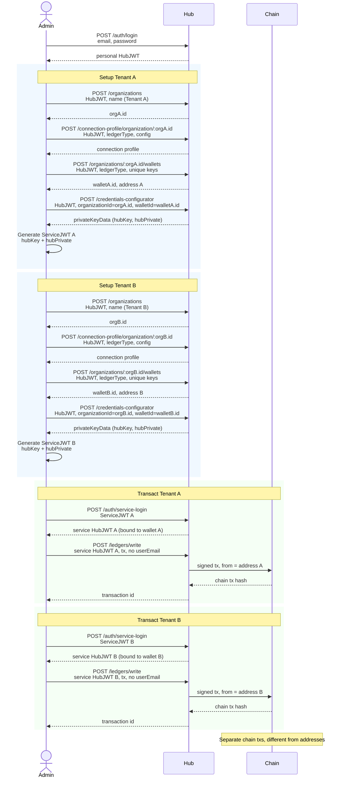
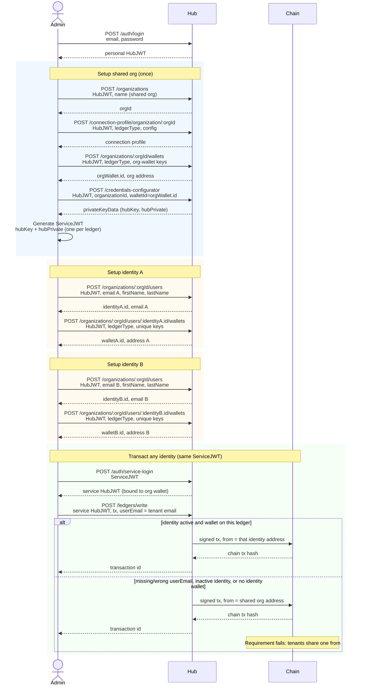

# Many organizations vs one organization with many identities

Two ways to model many blockchain actors on the Hub API:

1. **Many organizations** — one Hub organization per actor (or per customer / tenant). Each org has its own wallets, connection profiles, and ServiceJWT.
2. **One organization, many identities** — one shared org; each actor is an identity with its own per-ledger wallets. One ServiceJWT per org wallet / ledger; `userEmail` selects who signs.

Setup (orgs, identities, wallets, credentials) uses a **personal HubJWT**. Signing uses a **ServiceJWT** (`POST /auth/service-login`, then `/ledgers/*`). A ServiceJWT cannot create organizations or identities.

## Requirement: separate on-chain transactions per tenant

Each tenant’s activity must land as a **separate transaction on-chain**, from a **tenant-specific signer**.

Hub submits one chain transaction per `POST /ledgers/write`. It signs with exactly one wallet: the identity wallet if `userWallet.keys.encoded` is set, otherwise the org wallet. The chain `from` address is that wallet’s key.

Hub transaction rows, identity-summary reports, or `extraData` are **not** enough. Two Hub writes signed by the same key are two chain txs from the **same** account.

## Flows

Setup (personal HubJWT) and transact (ServiceJWT) are one path per case. Repeat the per-tenant slice for each additional tenant.

### 1) Many organizations

Each tenant is its own org. Setup creates a unique org wallet and ServiceJWT. Transact omits `userEmail`; Hub signs with that org wallet.

### 2) One organization, many identities

Shared org, connection profile, org wallet, and ServiceJWT are created once. Each tenant is an identity with its own wallet. Transact uses the same ServiceJWT plus `userEmail`.

| | Many organizations | One org, many identities |
| --- | --- | --- |
| **Distinct on-chain sender per tenant?** | Yes, if each org has its own org wallet with a **unique** key. ServiceJWT is bound to that wallet; omit `userEmail`. | Yes **only if** each identity has its own wallet with a **unique** key **and** every write passes that identity’s `userEmail`. |
| **What Hub broadcasts** | One `provider.write()` per call, locked on that org wallet. Separate txs, different `from` addresses. | Same: one write per call. `from` is the identity wallet when encoded keys exist; otherwise the **shared org wallet**. |
| **Requirement fails when** | Two orgs import the same private key (same on-chain address). | Missing/wrong `userEmail`, inactive identity, or no identity wallet on that ledger → Hub **falls back to the org wallet**. Those tenants share one `from`. |
| **Batch write** | Still one signer (that org wallet). Multiple payloads become sequential txs from the **same** address, not a merge of tenants. | Same: batch is per resolved wallet. It does not mix identities into one chain tx, but it will not split tenants if they all resolved to the org wallet. |

## Pros and cons

| Dimension | 1) Many organizations | 2) One org, many identities |
| --- | --- | --- |
| **On-chain separation** | Structurally safe: ServiceJWT → one org wallet, no email switch. Hard to accidentally sign as another tenant. | Possible, but easy to violate. One omitted `userEmail` and tenant traffic lands as the org. |
| **Isolation** | Strong. Each actor is its own tenant: org status, wallets, connection profiles, credentials, and permissions are separate. | Weak. Identities share one org, one connection profile per ledger, and one ServiceJWT per ledger. Any holder of that ServiceJWT can pass another identity’s `userEmail`. |
| **Blast radius** | A deactivated org, rotated hub key, or bad wallet affects only that org. | Deactivating the org, rotating the hub key, or breaking the org wallet / connection profile affects every identity. |
| **Setup cost** | High. Per actor: `POST /organizations`, connection profile(s), org wallet(s), `POST /credentials-configurator`, ServiceJWT. | Low after the first org. Per actor: `POST /organizations/:id/users` plus one identity wallet per ledger. One org wallet + one ServiceJWT per ledger covers all identities. |
| **Token / key sprawl** | One ServiceJWT (and hub key) per org wallet. Many actors ⇒ many tokens to store and rotate. | Few tokens: one ServiceJWT per ledger for the whole org. Easier to operate; easier to abuse if leaked. |
| **Signing** | ServiceJWT is bound to that org’s wallet. Omit `userEmail`; the org wallet signs. No cross-actor fallback. | Same ServiceJWT + `userEmail` selects the identity wallet of the **same** `ledgerType` as the ServiceJWT’s org wallet. If the email is missing, inactive, or has no matching wallet, Hub **falls back to the org wallet**. |
| **Multi-chain** | Repeat org wallet + credentials + ServiceJWT per ledger **per org**. | Repeat org wallet + credentials + ServiceJWT per ledger **once**. Each identity adds one wallet per ledger (`WALLET_ALREADY_EXIST_USER` if duplicated). |
| **Identity uniqueness** | Same email can exist in different orgs (separate identity rows). | Email is unique **inside** the org (`USERS_ALREADY_EXISTS_IN_ORGANIZATION`). |
| **Who can provision** | Org create: personal HubJWT + `system:Organization:Manage` (system admin). | Identity create: personal HubJWT + org user-create permissions. Org / system admins can create many identities. An Organization User can only create an identity matching their own email. |
| **Measurability / reporting** | Natural per-tenant reports (`/organizations/:id/transactions`, ledger summary). Cross-actor totals need aggregation across orgs. | Natural per-actor reports via identity summary (`/organizations/:id/transactions/identity-summary`) and shared org totals. |
| **Operational fit** | Real customers / legal entities that must not share keys, RPC config, or integration credentials. | Many measurable actors under one tenant (bots, test accounts, internal desks) that share infra and one integration. |
| **Failure mode to watch** | Provisioning and token rotation do not scale; easy to lose track of which ServiceJWT belongs to which org. | Silent wrong-signer: a typo or missing identity wallet signs as the **org**, not as the intended identity. |

## When to pick which

Given the on-chain separation requirement:

Use **many organizations** when a tenant is a real customer and must never share an on-chain identity with anyone else. The ServiceJWT is bound to one org wallet; there is no `userEmail` switch and no org-wallet fallback across tenants.

Use **one org + many identities** only if you treat each identity wallet as the tenant key, always pass `userEmail`, never reuse keys across identities, and treat org-wallet fallback as a production bug.

If “tenant” means a customer that must not share an on-chain signer, **many organizations is the safer default**.

## Related

- `docs/source/howto/external-service-auth.md`
- Generation of Service JWT in `../../../../README.md`
