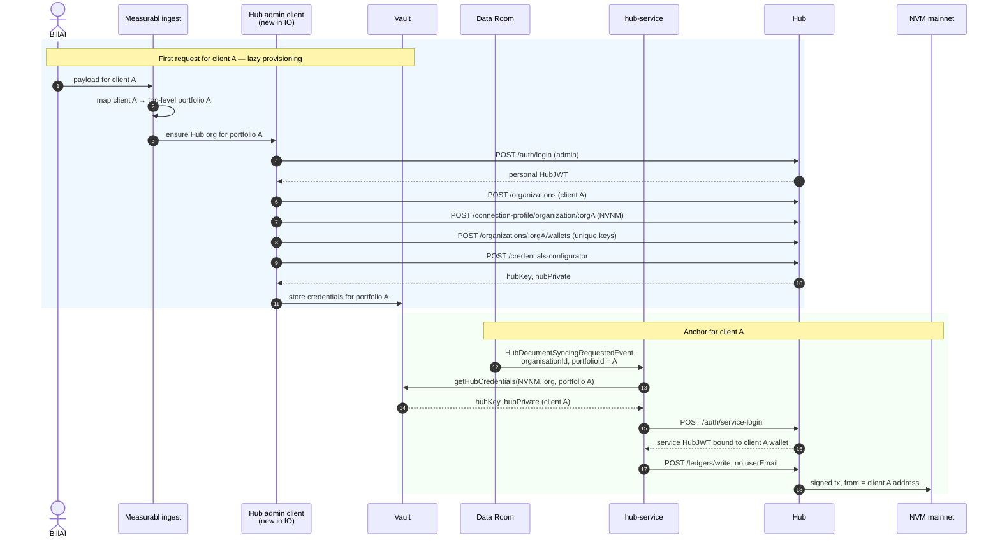
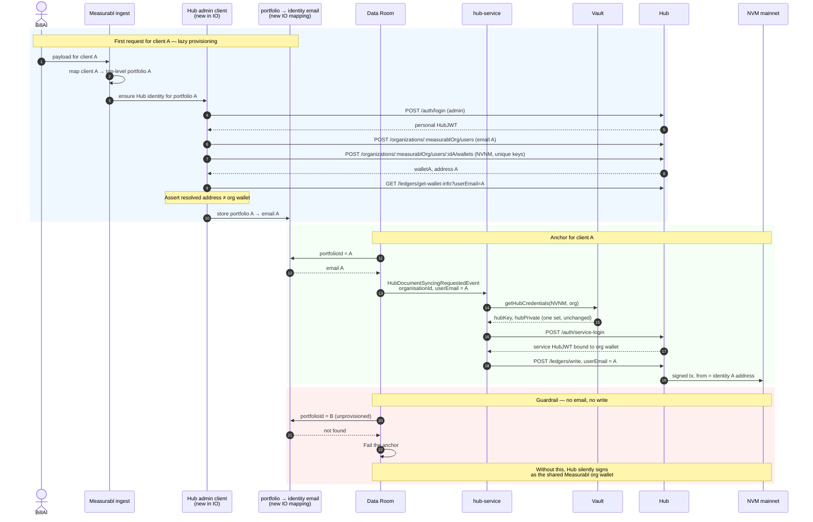

# IO side: per-client on-chain signer — Hub org per client vs Hub identity per client

Last updated: 2026-09-08

> **Decision (2026-09-08): Option 2 accepted** — [D6](../reference-docs/architectural-decisions.md#d6-per-client-on-chain-signer--one-hub-identity-per-measurabl-client). Two things moved since this research was written: (a) the "Measurabl ingest" participant in the sequence diagrams below is now **Sentinel's** (document-processing team) component (out of scope for anchoring, [D5](../reference-docs/architectural-decisions.md#d5-ingestion-is-out-of-scope-for-anchoring--anchoring-is-triggered-from-regular-data-room-ingestion)), and (b) lazy identity provisioning and the portfolio → identity record therefore live in **hub-service**, on the write path, keyed on the top-level portfolio id — not at ingest time. The current design is in [Measurabl document anchoring — embedded in existing services](../measurabl-anchoring-embedded-in-existing-services.md#hub-identity-per-client-d6--how-it-runs). The analysis below is unchanged and remains the rationale.

Companion to [Many organizations vs one organization with many identities](generated-on-hub-repo-context-application-multi-org-vs-multi-identity.md), which describes the **Hub** side of the choice. This doc describes the **Inveniam IO** side: what the current code resolves as the signer, and what each option costs to build in this repo.

## Constraints

1. **NVNM only.** Single ledger, mainnet. No multi-chain requirement.
2. **Exactly one IO organisation for Measurabl.** Not one per client.
3. **Each Measurabl client is a top-level portfolio** under that organisation; client structure below is nested portfolios ([Measurabl document anchoring — embedded in existing services](../measurabl-anchoring-embedded-in-existing-services.md)).
4. **IO does the Hub-side provisioning.** IO-side logic receives a Measurabl payload, extracts the per-client request, creates the Hub object for that client on first sight (lazy onboarding), then transacts on Hub **on behalf of** that client.
5. **Measurabl clients never touch IO.** They sit behind Measurabl's own infrastructure and may not know their documents are being processed. There are no real client mailboxes to use as Hub identifiers, and no client-side login to support.

Constraint 2 removes the shape where each Measurabl client becomes its own IO organisation. That would have needed no hub-service change at all, since IO's Hub credentials are already keyed by `organisationId`, but it breaks the client-as-portfolio mapping and the single-key ingest contract, so it is out of scope here.

What remains is exactly the choice in the Hub-side doc, now made **inside IO**: the per-client Hub object that IO lazily creates is either a Hub **organization** or a Hub **identity** inside Measurabl's single Hub organization.

## Requirement

Each Measurabl client's anchors must land as **separate chain transactions from a client-specific signer**. Hub submits one chain tx per `POST /ledgers/write` and signs with exactly one wallet. IO's `extraData` (`ledger-io.provider.ts:122-127`) carries `organization_id`, `organization_name`, `deal_id`, `deal_name` — it does not carry portfolio, and metadata is not a signer either way.

## What IO can do against Hub today

The whole Hub surface IO knows is service login plus ledger operations — `hub-tokenization.provider.ts:20-30`:

```ts
const LOGIN_ENDPOINT = '/auth/service-login';
const WRITE_ENDPOINT = '/ledgers/write';
const RESEND_ENDPOINT = '/ledgers/resend';
const CANCEL_ENDPOINT = '/ledgers/cancel/';
const READ_ENDPOINT = '/ledgers/read';
const PROFILE_ENDPOINT = '/ledgers/profile';
const TX_WALLET_ENDPOINT = '/ledgers/get-wallet-info';
```

There is **no Hub admin surface in IO at all**: no `/auth/login`, no `/organizations`, no `/organizations/:id/users`, no `/connection-profile`, no `/credentials-configurator`. Hub credentials are pasted in by an admin through an org-scoped REST API (`integration-keys.controller.ts:63-89`) and stored in Vault as ServiceJWT material only — `secure-storage.typings.ts:36-43`:

```ts
export interface HubCredentialsInterface {
  hubKey: string;
  hubPrivate: string;
  userId: string;
  updatedAt: string;
  userName: string;
  accessKey?: string;
}
```

Constraint 4 therefore lands on both options equally, and it is the largest single work item: **IO needs a new Hub admin client and somewhere to keep admin credentials.** Per the Hub-side doc, a ServiceJWT cannot create organizations or identities — setup needs a personal HubJWT from `POST /auth/login`. Nothing in IO holds or uses one today.

One Hub credential set exists per **(organisation, ledgerType, networkType)** — `vault.provider.ts:307-328`:

```ts
  private buildHubCredentialsPath(ledgerType: HubLedgerTypeEnum, organisationId: string): string {
    return this.buildPath({
      entity: EntityEnum.Credentials,
      organisation: organisationId,
      ledgerType,
      networkType: get(config, ['networkType', ledgerType], '')
    });
  }
  // ...
  private buildPath(path: PathBuilderInterface): string {
    return [this.vaultConfig.kv, 'data', path.entity, path.organisation, path.ledgerType, path.networkType]
      .join('/');
  }
```

`LedgerFactoryProvider` takes `organisationId` and nothing narrower — `ledger-factory.provider.ts:47-56`:

```ts
    const { hubKey: key, hubPrivate: secret, accessKey } = await secureStorageProvider.getHubCredentials(
      ledgerType,
      organisationId
    );
    const tokenizationProvider: TokenizationProviderInterface = await tokenizationService.hub({
      key,
      secret,
      accessKey
    });
```

`portfolioId` and `tenantId` appear nowhere in `../../../../apps/hub-service`.

## The NVNM anchor path today

Good news on the constraint that matters most: NVNM is wired end to end, and its codec forwards the signer selector.

| Fact | Where |
| --- | --- |
| Data-room's `LedgerTypes.NVNM` maps to `HubLedgerTypeEnum.NVNM` | `data-room.utils.ts:34-35` |
| The NVNM codec puts `userEmail` in the write body | `nvnm-payload-codec.service.ts:112-115` |
| Tezos, Accumulate, Provenance codecs drop it — irrelevant under constraint 1 | `tezos-payload-codec.service.ts:196`, `accumulate-payload-codec.service.ts:79`, `provenance-payload-codec.service.ts:59` |
| Resend body has **no** `userEmail`, and the transactions row stores none | `ethereum-payload-codec.service.ts:142-151`, `transactions.entity.ts` |

The gap is upstream. The anchor event carries no signer selector, because neither of its parents declares one — `shared-modules/Events/Hub/interfaces.ts:93-105`:

```ts
interface BaseHubInterface {
  ledgerType: HubLedgerTypeEnum;
  transactionType: TransactionTypeEnum;
  estimation?: TxCostEstimationType;
}

interface BaseDealInterface extends BaseHubInterface {
  dealId: string;
  // Should be changed to UUID Type when possible.
  userId: string;
  userEmail: string;
  organisationId: string;
}
```

```ts
export interface HubDocumentSyncingRequestedEventPayload extends BaseHubInterface, DLTRequestInterface {
  symbol: string;
  organisationId: string;
}
```

Data-room publishes it with `organisationId` and no email — `taxonomy/domain/entity.ts:222-230`:

```ts
      this.apply(new HubDocumentSyncingRequestedEvent(this.id, {
        ...this.payload,
        ledgerType,
        transactionType: TransactionTypeEnum.SyncDocument,
        userId,
        symbol,
        estimation,
        organisationId
      }));
```

So **every Measurabl client anchor today would sign with the one Measurabl org wallet.** That is the failure mode the Hub-side doc calls "silent wrong-signer", and in IO it is not a typo risk — it is the current default.

Note the contrast with deal tokenization, which does pass the acting IO user's real email looked up from IAM (`tokenization-bootstrap.service.ts:1168`, `hub-events-factory.ts`). Two IO write paths already resolve different signers against the same Hub org.

## Option 1: one Hub organization per Measurabl client

IO lazily creates a Hub org per client, mints a ServiceJWT for it, and stores that credential set keyed by the client's portfolio. Transact resolves credentials by portfolio and passes no email.



What has to be built:

| Change | Location |
| --- | --- |
| Hub admin client + admin credential storage | New. Needs `system:Organization:Manage` on the Hub side |
| Portfolio segment in the Vault path and in `getHubCredentials` | `vault.provider.ts:307-328`, `secure-storage-provider.interface.ts` |
| Thread `portfolioId` into ledger resolution | `ledger-factory.provider.ts:35-56`, `transactions.model.ts:1228-1261` |
| Add `portfolioId` to the anchor event payload | `shared-modules/Events/Hub/interfaces.ts:266-269` |
| Pass `portfolioId` at the publish site | `taxonomy/domain/entity.ts:206-230` |
| Portfolio-aware integration-keys API and per-client key rotation / deletion | `integration-keys.controller.ts` (currently `@OrgId()` only) |

The data-room side is cheap: `portfolioId` and `parentPortfolioIds` are already resolved at the exact call site that triggers the anchor, and are simply not forwarded — `verify-file-checksum.command.ts:59-75`:

```ts
  async executeTransactional(
    {
      symbol, isHubConnected, userId, estimation, organisationId, dealId, portfolioId, parentPortfolioIds
    }: TaxonomyRequestPayloadInterface,
    taxonomy: Taxonomy,
    file: File
  ): Promise<void> {
    // ...
    if (await file.isChecksumUnmodified(
      espService, userId, enableAutoIngestion, organisationId, dealId, portfolioId, parentPortfolioIds
    )) {
      taxonomy.requestLedgerSync(symbol, isHubConnected, userId, estimation, organisationId);
```

`data_rooms` also persists `portfolio_id` and `parent_portfolio_ids` (`room.entity.ts:66-70`), so the value is recoverable for paths that do not carry it.

The expensive part is not the plumbing. It is that an automated request-time code path now **mints and stores a new secret per client**, which brings rotation, revocation, and Vault-path lifecycle for every Measurabl client.

## Option 2: one Hub identity per Measurabl client

IO lazily creates a Hub identity plus identity wallet inside Measurabl's single Hub org, records the portfolio-to-email mapping, and passes that email on every write. One credential set, unchanged Vault schema.



What has to be built:

| Change | Location |
| --- | --- |
| Hub admin client + admin credential storage | New. Needs org user-create permission, not system admin |
| Mapping store: Measurabl client id → portfolio id → identity address, doubling as the lazy-provisioning idempotency record | New. IO users are real people in a shared FusionAuth application joined to orgs via `user_organisation_mapping`; there is no entity for a synthetic per-client signer identity |
| Add `userEmail` to the anchor event payload | `shared-modules/Events/Hub/interfaces.ts:266-269` |
| Resolve and pass it at the publish site, failing closed when unresolved | `taxonomy/domain/entity.ts:206-230`, `verify-file-checksum.command.ts:75` |
| Vault schema, credential lookup, ledger factory, keys API | **Unchanged** |

### The identity address is synthetic

Constraint 5 means the Hub identity address is a machine identifier, not a mailbox. Deriving it from the client's top-level portfolio id works and is the recommended scheme:

```
measurabl-client-<top-level-portfolio-uuid>@<inveniam-controlled-domain>
```

This fits IO and Hub as they are today:

- **Nothing validates it.** hub-service has no `@IsEmail()` on any Hub-bound DTO, no IAM lookup, and no FusionAuth check. `userEmail` is an opaque string passed into the NVNM write body (`nvnm-payload-codec.service.ts:112-115`).
- **Collision-free by construction.** Hub enforces email uniqueness only *inside* the org (`USERS_ALREADY_EXISTS_IN_ORGANIZATION`), and portfolio ids are UUIDs, so no two clients can collide.
- **Length is fine.** The prefix plus a UUID is 53 characters, inside the 64-character local-part limit.
- **No third-party PII.** Real client mailboxes would put Measurabl's customer data into Hub records and into write metadata. Synthetic ids avoid that entirely, which matters given clients are unaware their documents are processed.
- **Reporting comes for free.** Because the portfolio id is embedded, Hub's identity-summary rows map straight back to IO portfolios without needing a `portfolioId` column on `transactions`.

Two cautions:

**Use a domain Inveniam controls**, not `@measurabl.com`. Inveniam cannot control mail routing on a customer's domain, identity creation on Hub may send mail (IO's own FusionAuth registration sets `sendSetPasswordEmail: true`, so the pattern exists in adjacent systems), and asserting identifiers inside a customer's namespace collides if Measurabl staff later get real IO accounts on that domain — email is unique per Hub org.

**The portfolio id is the payload, not the idempotency root.** BillAI sends a Measurabl client identifier; IO resolves it to a top-level portfolio; only then does a portfolio id exist. If that resolution ever yields a second portfolio for the same Measurabl client, IO silently provisions a second identity and the client gets two on-chain addresses. So key the mapping on the **Measurabl client id**, and store the portfolio id and identity address alongside it. That record is also the lazy-provisioning idempotency key; Hub's `USERS_ALREADY_EXISTS_IN_ORGANIZATION` is a usable backstop but a poor primary signal. This depends on the stable-client-id question still open in [Measurabl document anchoring — embedded in existing services](../measurabl-anchoring-embedded-in-existing-services.md).

## Comparison

| | 1) Hub org per client | 2) Hub identity per client |
| --- | --- | --- |
| **Distinct on-chain sender per client** | Structural. The ServiceJWT is bound to that client's wallet; there is no email switch to get wrong | Conditional. Every write must carry the right `userEmail` |
| **Requirement fails when** | A client's credentials are missing and resolution falls back to the org | Email missing, wrong, or identity not provisioned → Hub signs as the shared org wallet |
| **Failure is detectable before chain** | N/A | Yes — `GET /ledgers/get-wallet-info?userEmail=` already exists in IO (`hub-tokenization.provider.ts:236-246`, `transactions.controller.ts:106-113`) |
| **Hub admin calls per new client** | 4 — org, connection profile, wallet, credentials-configurator | 2 — identity, identity wallet |
| **Hub privilege the automated path needs** | System admin (`system:Organization:Manage`) | Org-level user create |
| **New secret per client** | Yes — ServiceJWT material minted at request time, stored, rotated, revoked per client | No — one credential set for the Measurabl org |
| **hub-service changes** | Vault path, credential lookup, ledger resolution, event payload, keys API | Event payload only |
| **Blast radius** | Per client. One bad credential or wallet affects one client | Whole Measurabl org — one connection profile, one ServiceJWT, one org record |
| **Gas funding on NVNM** | Per-client wallet needs funding | Per-client identity wallet needs funding — same problem |
| **Resend keeps the client signer** | Yes, credential-bound | Unproven — no email in the resend body, none persisted on the transaction row |
| **Per-client reporting in IO** | `transactions` has no portfolio column; needs one, or a join through data-room | Same gap in IO, but the identity address embeds the portfolio id, so Hub's identity-summary maps back without a schema change |

## Recommendation

**Option 2, one Hub identity per Measurabl client, with a fail-closed guardrail.**

The constraints decide this. Under NVNM-only, the identity model's biggest technical objection disappears: the NVNM codec is one of the codecs that forwards `userEmail`, so the target chain supports identity selection natively. And once IO owns lazy provisioning, the per-client cost profile separates the options sharply — Option 1 has an automated request-time path minting and storing a fresh secret for every Measurabl client, with rotation and revocation to match, while Option 2 adds a mapping row and touches no credential storage at all. Option 2 also needs the weaker Hub privilege, which matters for a code path that runs unattended on external input.

This is the opposite of what the Hub-side doc concludes, and the difference is the definition of a tenant. That doc's "many organizations is the safer default" applies to tenants that are real customers and must never share integration credentials. Here the customer is Measurabl; its clients are subjects of anchored data under one contract, one IO organisation, and one integration. Measurable attribution per client is the requirement — not credential separation between paying customers.

Option 2's weakness is real and it is the same one the Hub-side doc names: the fallback to the shared org wallet is silent. In IO it is controllable, because IO owns the only code path that builds the anchor event. Three guardrails make it safe:

1. **Fail closed.** If the portfolio has no mapped identity email, fail the anchor. Never publish a Hub write without a resolved signer.
2. **Verify at provisioning.** After creating the identity wallet, call `GET /ledgers/get-wallet-info?userEmail=` and assert the resolved address is not the Measurabl org wallet address. The client for this already exists.
3. **Alert on the org wallet.** Treat any NVNM write whose resolved `from` is the shared org address as an incident, not a default.

Reach for Option 1 instead if any of these turns out to hold: Hub identity wallets cannot be funded or managed independently of the org wallet on NVNM; Measurabl clients must be portable to their own Hub org later without an address change; or the shared connection profile and single ServiceJWT are judged too large a blast radius for the client count in scope.

## Open questions

1. **Admin credentials** — which Hub account does IO's provisioning path authenticate as, and where does that credential live? Nothing in IO holds a personal HubJWT today.
2. **Identity address domain** — the scheme is settled (`measurabl-client-<portfolio-uuid>@…`), but which Inveniam-controlled domain or subdomain hosts it, and does Hub send mail on identity creation?
3. **Resend signer** — does Hub reuse the original signer for `/ledgers/resend`? IO cannot re-assert it: no email in the body, none on the transaction row.
4. **Wallet funding** — still open from the [meeting notes](../reference-docs/measurabl-integration-next-steps-2026-09-04.md): master wallet vs per-client top-up. Either option puts a client-specific wallet on NVNM, so this needs answering regardless.
5. **Per-client reporting** — add `portfolioId` to `transactions.entity.ts`, or rely on Hub's identity summary?
6. **Provisioning trigger and idempotency** — is "first request mentioning client X" the trigger, and is the mapping row the idempotency key?
7. **Smart accounts** — if enabled for the Measurabl org, `transactions.model.ts:1208-1251` bypasses Hub entirely and signs with one org-scoped session key, defeating both options. Confirm it stays off for this org.

## Related

- [Many organizations vs one organization with many identities](generated-on-hub-repo-context-application-multi-org-vs-multi-identity.md) — Hub-side analysis
- [Measurabl document anchoring — embedded in existing services](../measurabl-anchoring-embedded-in-existing-services.md) — domain mapping and ingest contract
- [Public API v2 — create portfolio, create deal, upload file, and anchor](v2-portfolios-and-deals-create-flows.md) — the anchor path in detail
- [Measurabl integration next steps](../reference-docs/measurabl-integration-next-steps-2026-09-04.md) — lazy onboarding and mainnet decisions
