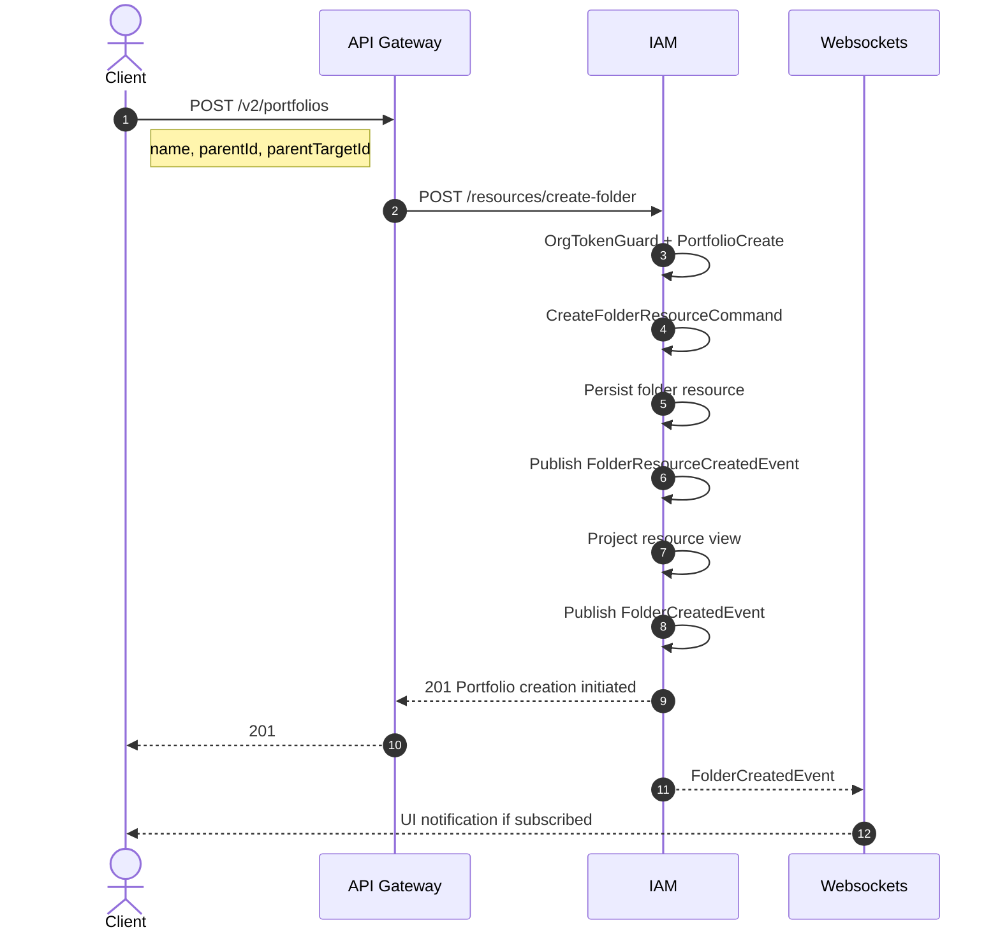
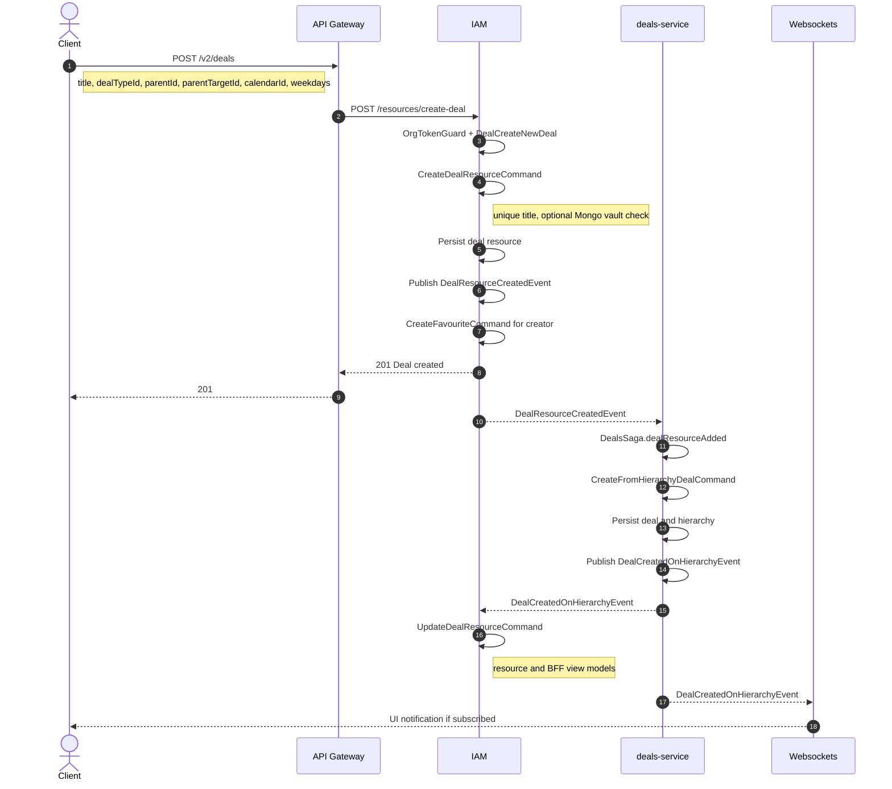
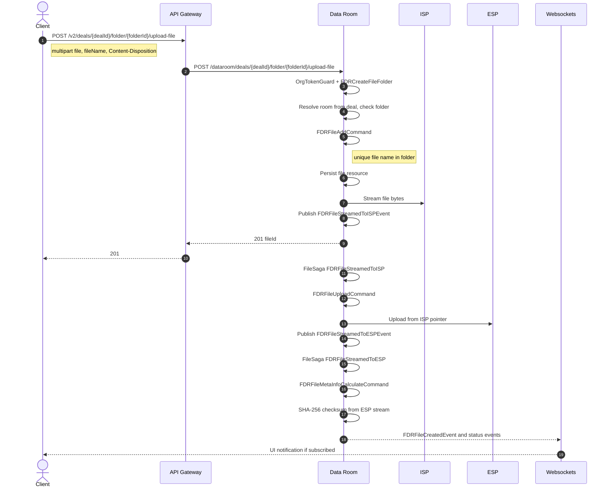
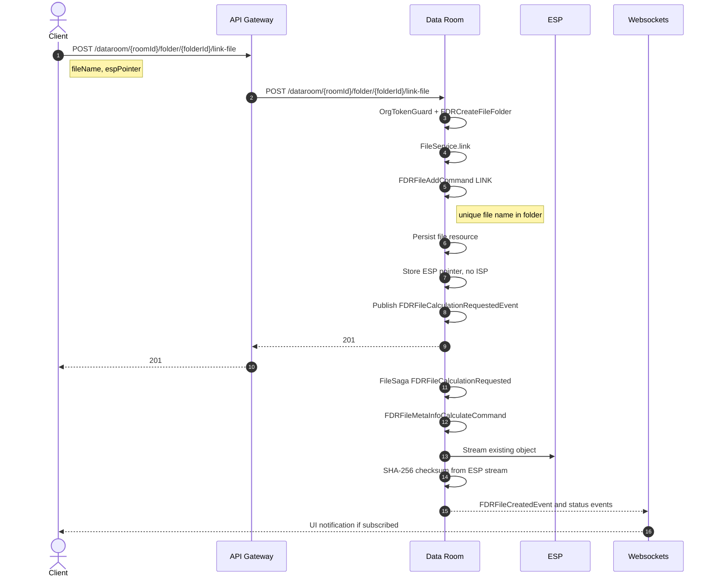
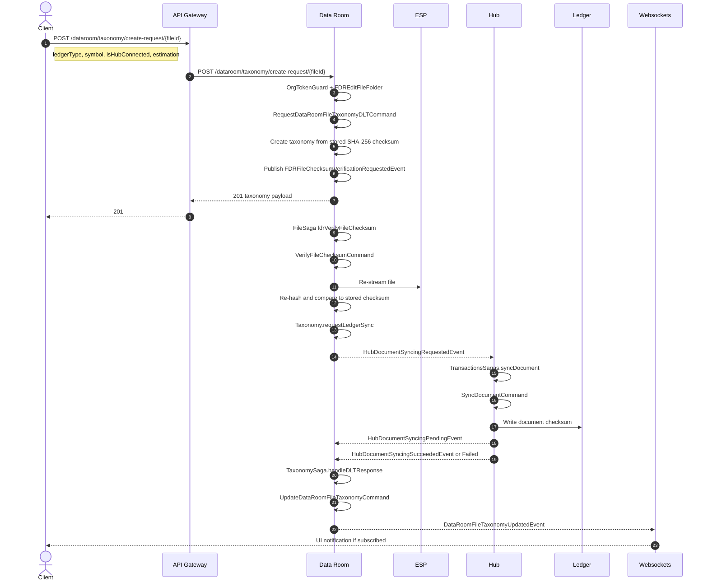

# Public API v2 — create portfolio, create deal, upload file, and anchor

Last updated: 2026-09-04

How `POST /v2/portfolios`, `POST /v2/deals`, `POST /v2/deals/{dealId}/folder/{folderId}/upload-file`, `POST /dataroom/{roomId}/folder/{folderId}/link-file`, and the data-room anchor write are processed today. These are the generic writes. BillAI does **not** call them; a future Measurabl ingest route would reuse the same internals. Companion: [Measurabl document anchoring — embedded in existing services](../measurabl-anchoring-embedded-in-existing-services.md).

Public `/v2` is the API-gateway contract. There is no Nest `@Post('v2/portfolios')` / `@Post('v2/deals')` / `@Post('v2/deals/:dealId/folder/:folderId/upload-file')` controller. Create portfolio and create deal land on IAM resource routes. Upload and link land on data-room. Link and anchor have **no** Public API v2 path today; the UI and any future ingest call the data-room routes directly.

| Public / owning path | Owning HTTP service | Downstream services |
| --- | --- | --- |
| `POST /v2/portfolios` | IAM | Websockets (UI notify only) |
| `POST /v2/deals` | IAM | deals-service, then IAM again; Websockets (UI notify only) |
| `POST /v2/deals/{dealId}/folder/{folderId}/upload-file` | data-room | ISP, then ESP, then SHA-256 checksum; Websockets (UI notify only) |
| `POST /dataroom/{roomId}/folder/{folderId}/link-file` | data-room | ESP (hash only, no ISP); Websockets (UI notify only) |
| `POST /dataroom/taxonomy/create-request/{fileId}` | data-room | ESP (re-hash check), then Hub, then the ledger; data-room again; Websockets (UI notify only) |

Not on create portfolio or create deal: dataio, data-room, hub, organisations, metachain. A data room is **not** created with the deal. Upload, link, and anchor require an existing data room and folder. Link also requires the file to already exist in ESP.

---

## `POST /v2/portfolios`

IAM is the only service that creates the portfolio. A portfolio is a folder resource (`ResourceType.FOLDER`). Permission: `PortfolioCreate`.



**IAM code:** `ResourceController.createFolder` → `CreateFolderResourceCommandHandler` → `ResourceModel.createFolderResource`.

---

## `POST /v2/deals`

IAM accepts the HTTP write and creates the deal resource. deals-service then materialises the deal. IAM updates the resource when deals-service confirms. Permission: `DealCreateNewDeal`.



**IAM code:** `ResourceController.createDeal` → `CreateDealResourceCommandHandler` → `ResourceModel.createDealResource`. Favourite is IAM-internal (`FavouritesSaga`).

**deals-service code:** `DealsSaga.dealResourceAdded` → `CreateFromHierarchyDealCommandHandler` → `DealModel.createHierarchy`.

On deals-service failure, `CreateDealOnHierarchyFailedEvent` goes back to IAM (`UpdateDealResourceCommand`) and Websockets (`CreateDealOnHierarchyFailedEvent`).

---

## `POST /v2/deals/{dealId}/folder/{folderId}/upload-file`

Data-room is the only service that accepts the HTTP write. It resolves the room from the deal, persists the file, streams bytes to ISP, then returns `201` with `fileId`. ESP upload and SHA-256 hashing run after the HTTP response. Permission: `FDRCreateFileFolder`. The deal must already have a data room and the folder must belong to that room (`404` otherwise).

Public `/v2` is the deal-based contract. The UI uses the room-based handler (`/dataroom/{roomId}/folder/{folderId}/upload-file`). Both call `FileService.upload`. Alternate public path: `POST /v2/dataroom/{roomId}/folder/{folderId}/upload-file`.



**data-room code:** `DataRoomController.uploadFileByDealId` → `FileService.uploadByDealId` → `FDRFileAddCommandHandler` → `File.uploadToISP`. Then `FileSaga` → `FDRFileUploadCommandHandler` (`uploadToESP`) → `FDRFileMetaInfoCalculateCommandHandler` (`FileSizeChecksumPipe`, SHA-256).

The HTTP `201` means the file record exists and ISP has the bytes. Checksum is stored later. Anchor must wait until that hash exists.

---

## `POST /dataroom/{roomId}/folder/{folderId}/link-file`

This is the write that adds an **existing** ESP object to the data room. The file never goes through ISP. The caller already has the object in ESP and passes `espPointer`. Data-room persists the file record, stores that pointer, and hashes the ESP object. Permission: `FDRCreateFileFolder`.

There is no Public API v2 path. The UI usually batches the same idea via `POST /dataroom/{roomId}/folder/{folderId}/link-entities`. Both skip ISP.

`link-file` does **not** connect storage. The folder already carries `storageProviderConfigId` from a prior ESP connect. Data-room uses that config to stream `espPointer` from ESP.

**Must already exist before this call**

1. Deal.
2. Data room — `POST /dataroom/create/{dealId}` (`{ "dealName": "..." }`).
3. ESP on that room — `POST /dataroom/connect/{roomId}`. Default Inveniam S3 can omit credentials. Customer S3 / Box / Drive / SharePoint / SFTP needs credentials (or `isOrgConnection` + `orgProviderId` after `POST /dataroom/org-provider/connect`). Connect usually creates the provider root folder.
4. Folder under that provider — often the default folder from connect, or `POST /dataroom/{roomId}/{storageProviderConfigId}/create-folders`.
5. The object already in that same ESP.

**`link-file` body** (path: `roomId`, `folderId`)

```json
{
  "fileName": "utility-bill-2026-08.pdf",
  "espPointer": "clients/acme/utility-bill-2026-08.pdf"
}
```

`espPointer` is the provider’s own id or path, not an Inveniam file id. S3 / S3Custom: object key. Box / Google Drive: file id. SharePoint: item id or path. SFTP: file path.

The UI batch twin is `link-entities` (field is `pointer`, not `espPointer`):

```json
{
  "espConfigId": "aaaaaaaa-bbbb-cccc-dddd-eeeeeeeeeeee",
  "files": [
    { "fileName": "utility-bill-2026-08.pdf", "pointer": "clients/acme/utility-bill-2026-08.pdf" }
  ],
  "folders": []
}
```

Example connect beforehand (customer S3). Do not put real keys in docs or git:

```json
{
  "storageProviderType": "S3Custom",
  "storageProviderName": "Measurabl S3",
  "credentials": {
    "accessKeyId": "<aws-access-key-id>",
    "secretAccessKey": "<aws-secret-access-key>",
    "region": "us-east-1",
    "bucket": "<customer-bucket>"
  }
}
```



**data-room code:** `DataRoomController.linkFile` → `FileService.link` → `FDRFileAddCommandHandler` (`RequestedOperations.LINK`) → `File.requestCalculation`. Then `FileSaga` → `FDRFileMetaInfoCalculateCommandHandler` (`File.calculateMetaInfo` from ESP, SHA-256).

The bytes stay in the customer ESP. Inveniam stores the pointer, metadata, and checksum. Anchor is the same as after upload: wait until the hash exists, then `POST /dataroom/taxonomy/create-request/{fileId}`.

---

## `POST /dataroom/taxonomy/create-request/{fileId}`

This is the write that anchors an already-uploaded file. There is no Public API v2 path for it. The UI uses this data-room route. Permission: `FDREditFileFolder`.

The SHA-256 checksum is **not** computed here for the first time. Upload already stored it. This route creates a taxonomy from that checksum, re-streams the ESP file and hashes it again, and only then asks Hub to write the checksum to the ledger.



**data-room code:** `DataRoomController.createTaxonomyRequest` → `TaxonomyCommandFactoryService.dispatchCreateDLTRequest` → `RequestDataRoomFileTaxonomyDLTHandler` → `TaxonomyFunctionalService.requestChecksumVerification` → `File.requestChecksumVerification`. Then `FileSaga.fdrVerifyFileChecksum` → `VerifyFileChecksumCommandHandler` → `Taxonomy.requestLedgerSync`.

**hub-service code:** `TransactionsSagas.syncDocument` → `SyncDocumentCommandHandler` → `TransactionsModel.syncDocument` → ledger `syncDocument` / `write`.

Hub is used when `isHubConnected` is true (Ethereum, Avalanche, Tezos, Quorum, HL Fabric via Hub). If Hub is not connected, data-room publishes a ledger-specific event instead (`MetaChainDocumentSyncingRequestedEvent`, QLDB, or HL Fabric) and Hub is not on the path.

If the ESP re-hash does not match the stored checksum, taxonomy sync fails and the file is unlinked as unmatched checksum. Hub is not called.
