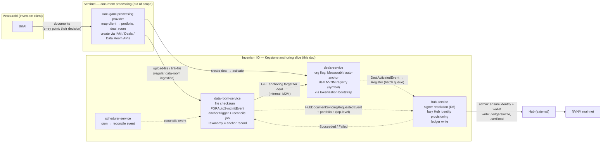
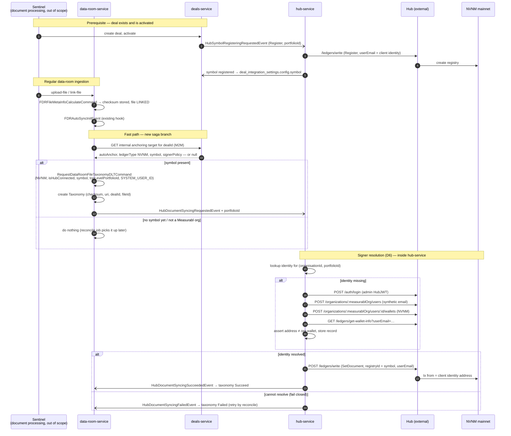

# Measurabl document anchoring — embedded in existing services

Last updated: 2026-09-09

Working design for how documents that Measurabl (an Inveniam client) brings into Inveniam IO get anchored on NVNM mainnet through the Hub.

**What changed on 2026-09-08.** The earlier revision of this doc covered the whole ingest slice, including the dedicated endpoint BillAI would call ([D1](reference-docs/architectural-decisions.md#d1-dedicated-ingest-endpoint-for-billai)) and the orchestration that creates IO entities. That work now belongs to **Sentinel** (the document-processing team), which receives Measurabl documents, runs them through a dedicated **Docugami processing provider**, and creates portfolios, deals, rooms and file records through the internal Deal and Data Room APIs ([D5](reference-docs/architectural-decisions.md#d5-ingestion-is-out-of-scope-for-anchoring--anchoring-is-triggered-from-regular-data-room-ingestion)). How documents enter IO — D1's endpoint, an existing ingestion point, or otherwise — is Sentinel's call. This doc is **Keystone**'s (the anchoring team): from Keystone's side, a Measurabl document is simply a **regular data-room file**, and the doc covers only what happens from that point on:

1. Recognise that a data-room file belongs to a Measurabl organisation.
2. Collect what anchoring needs from inside IO.
3. Anchor it on NVNM via the Hub, signed by a **per-client Hub identity** ([D6](reference-docs/architectural-decisions.md#d6-per-client-on-chain-signer--one-hub-identity-per-measurabl-client)), lazily and with retries, **without a new microservice** ([D7](reference-docs/architectural-decisions.md#d7-anchoring-processor-is-embedded-in-existing-services-no-new-microservice)).

Decisions: [D2](reference-docs/architectural-decisions.md#d2-anchoring-enters-io-only-through-the-data-room) (anchoring only through the Data Room), [D3](reference-docs/architectural-decisions.md#d3-data-residency--files-stay-on-the-measurabl-side) (files stay at Measurabl), [D4](reference-docs/architectural-decisions.md#d4-a-measurabl-client-is-a-top-level-portfolio) (client = top-level portfolio), [D5](reference-docs/architectural-decisions.md#d5-ingestion-is-out-of-scope-for-anchoring--anchoring-is-triggered-from-regular-data-room-ingestion), [D6](reference-docs/architectural-decisions.md#d6-per-client-on-chain-signer--one-hub-identity-per-measurabl-client), [D7](reference-docs/architectural-decisions.md#d7-anchoring-processor-is-embedded-in-existing-services-no-new-microservice). Signer research: [IO side: per-client on-chain signer](interim-research-docs/io-per-client-signer-multi-org-vs-multi-identity.md). Existing write flows Sentinel will use: [create portfolio, create deal, upload file, and anchor](interim-research-docs/v2-portfolios-and-deals-create-flows.md).

**Out of scope here.** Receiving and parsing Measurabl documents; the Docugami processing provider; creating portfolios, deals, rooms and files; the Measurabl-id → IO-id mapping store; results flowing back to BillAI; structured (Merkle-root) anchoring (dropped by D2). Where the anchoring path depends on Sentinel's work, that dependency is listed under [Interface with Sentinel (document-processing team)](#interface-with-sentinel-document-processing-team).

## Domain mapping

| Measurabl / BillAI | Inveniam IO | Notes |
| --- | --- | --- |
| Measurabl tenant | One organisation | Flagged as a Measurabl organisation in its Hub integration settings (see [Identifying a Measurabl organisation](#identifying-a-measurabl-organisation)) |
| Measurabl client | Top-level portfolio | [D4](reference-docs/architectural-decisions.md#d4-a-measurabl-client-is-a-top-level-portfolio). Created lazily by Sentinel. Its id keys the client's Hub identity ([D6](reference-docs/architectural-decisions.md#d6-per-client-on-chain-signer--one-hub-identity-per-measurabl-client)) |
| Measurabl sub-structure under a client | Nested portfolio | Irrelevant to anchoring; the signer is resolved from the top-level portfolio |
| Measurabl client files and folders | Deal + one data room per deal | Each deal gets one NVNM registry (`symbol`) via the existing tokenization bootstrap |
| Files referenced by BillAI | Data-room file records (checksum + metadata) | [D3](reference-docs/architectural-decisions.md#d3-data-residency--files-stay-on-the-measurabl-side). The checksum is what gets anchored |
| Client's on-chain signer | Hub identity + NVNM wallet inside the one Measurabl Hub organisation | [D6](reference-docs/architectural-decisions.md#d6-per-client-on-chain-signer--one-hub-identity-per-measurabl-client). Synthetic address `measurabl-client-<top-level-portfolio-uuid>@<inveniam-domain>` |

## What anchoring needs, and where IO already has it

The request was to double-check the list *dealID, clientID, URL, Hash, PortfolioID*. Against what actually reaches the NVNM write (`nvnm-payload-codec.service.ts`, `encodeSetDocument` + `encode`; `ledger-io.provider.ts`, `extraData`), the picture is:

| Field                           | Needed?                                                                  | Where it is in IO today                                                                                                                                                                                                                                                                                                       | Notes                                                                                                                                                                                                                                                                                                                                                                                                                                                                               |
| ------------------------------- | ------------------------------------------------------------------------ | ----------------------------------------------------------------------------------------------------------------------------------------------------------------------------------------------------------------------------------------------------------------------------------------------------------------------------- | ----------------------------------------------------------------------------------------------------------------------------------------------------------------------------------------------------------------------------------------------------------------------------------------------------------------------------------------------------------------------------------------------------------------------------------------------------------------------------------- |
| **Hash** (checksum + algo)      | **Yes** — the payload                                                    | `data_room_files.checksum` (SHA-256), copied into `data_room_file_taxonomies.document_checksum` / `document_checksum_algo` at anchor time                                                                                                                                                                                     | Computed asynchronously by `FDRFileMetaInfoCalculateCommand` after upload/link. Anchoring must wait for it; the hook below fires only once it exists                                                                                                                                                                                                                                                                                                                                |
| **URL** (`uri`)                 | **Yes** — the payload                                                    | Minted by data-room at anchor time: `TaxonomyFunctionalService.getDocumentShortLink()` → `${documentLocationHost}/dataroom/2/<flakeId>` (`taxonomy-functional.service.ts:104-110`)                                                                                                                                            | This is an **IO viewer short link**, not the Measurabl-side file location. If Measurabl wants its own pointer on chain it goes into the anchored `metadata` JSON as an extra field (needs Sentinel to store that pointer on the file record) — see OQ4                                                                                                                                                                                                                              |
| **dealID**                      | **Yes** — `extraData.deal_id` / `deal_name`, and the key to the registry | `data_rooms.deal_id`, `data_rooms.esp_config.dealName` (room is 1:1 with deal)                                                                                                                                                                                                                                                | Already how `Taxonomy` is built (`taxonomy-functional.service.ts:78-82`)                                                                                                                                                                                                                                                                                                                                                                                                            |
| **PortfolioID**                 | **Yes, the top-level one** — it is the signer key, not chain metadata    | `data_rooms.portfolio_id` (direct parent), `data_rooms.parent_portfolio_ids` (ancestors, deepest first), `data_rooms.resource_path` (ltree) (`room.entity.ts:66-73`). Top-level = last element of `parent_portfolio_ids`, or `portfolio_id` when that array is empty. IAM's `get_parent_portfolio_ids` returns the same shape | Not put on chain today (`extraData` has no portfolio). Attribution per client comes from the **signer address**, which embeds the portfolio id via the synthetic email. Optionally also add it to `metadata` for reporting                                                                                                                                                                                                                                                          |
| **clientID** (Measurabl's)      | **No**                                                                   | Not in IO. Lives in Sentinel's mapping store                                                                                                                                                                                                                                                                                  | Hub never sees it. The client is identified on chain by its identity wallet, keyed on the top-level portfolio uuid. If Measurabl wants its own client id in the anchored `metadata`, Sentinel would have to persist it on the portfolio/deal and we read it from there — not required for D6                                                                                                                                                                                        |
| **organisationId**              | **Yes** (missing from the list)                                          | `data_rooms.organisation_id`; also on the taxonomy                                                                                                                                                                                                                                                                            | Selects the Hub credential set (`LedgerFactoryProvider`, keyed by organisation) and lands in `extraData.organization_id` / `organization_name`                                                                                                                                                                                                                                                                                                                                      |
| **NVNM registry id (`symbol`)** | **Yes** (missing from the list)                                          | deals-service `deal_integration_settings.config.symbol` for provider `nvnm`, gateway `Hub`, status Active                                                                                                                                                                                                                     | The codec writes it as `registryId`; without it there is nothing to add the record to. It is created **lazily** by the tokenization bootstrap on `DealActivatedEvent` (`deal-activated-bootstrap.command.ts` → `bootstrapSingleDeal`, `tokenization-bootstrap.service.ts:367-409`) and only exists once the `Register` tx succeeds (`nvnm-ledger.provider.ts`, `onComplete`). This is the one input that may not be there yet when the file arrives — the reason processing is lazy |
| **userEmail** (signer selector) | **Yes** (missing from the list)                                          | Derived: `measurabl-client-<top-level-portfolio-uuid>@<inveniam-domain>`; the provisioning record lives in hub-service                                                                                                                                                                                                        | The NVNM codec forwards it to Hub (`nvnm-payload-codec.service.ts`, `encode`). Today the anchor event does not carry it (`shared-modules/Events/Hub/interfaces.ts`, `HubDocumentSyncingRequestedEventPayload`), so every anchor signs as the org wallet. D6 fixes this                                                                                                                                                                                                              |
| **fileId, taxonomyId**          | Yes, already there                                                       | Taxonomy entity                                                                                                                                                                                                                                                                                                               | Go into the anchored `metadata` JSON; taxonomy row is the anchor record and idempotency key per (file, ledger, checksum)                                                                                                                                                                                                                                                                                                                                                            |
| **userId**                      | Yes, already there                                                       | No human here; use the system user (`SYSTEM_USER_ID`, already used by the nightly check-status path)                                                                                                                                                                                                                          | Only for audit columns                                                                                                                                                                                                                                                                                                                                                                                                                                                              |

So: **drop `clientID`**, **keep `dealID`, `Hash`, `PortfolioID` (top-level), `URL`** (with the caveat that it is IO's link), and **add `organisationId`, `symbol` and `userEmail`**. Everything is available inside IO once Sentinel has created the deal and the file record; nothing needs an external payload.

## System context

Dashed edges are events, solid edges are HTTP. Metachain is untouched: the existing auto-sync to Metachain keeps running in parallel for every organisation that has it; the Measurabl path adds a second, NVNM-via-Hub taxonomy for the same file.

## How one document gets anchored

Steps 1–5 are the existing deal-activation path in deals-service; the only change there is passing the top-level `portfolioId` so the registry is signed by the client identity too (see OQ2 if NVNM does not require that). Steps 6–8 are unchanged data-room behaviour. The new work is steps 9–14 (data-room: anchoring-target lookup and the new saga branch) and steps 15–24 (hub-service: signer resolution, lazy identity provisioning, fail-closed write).

## Component placement and why

[D7](reference-docs/architectural-decisions.md#d7-anchoring-processor-is-embedded-in-existing-services-no-new-microservice). The logic is embedded in three existing services along the boundaries they already own.

**data-room-service — trigger, anchor record, retry.** It already has the exact hook: `File.triggerAutoSyncWithMetachain()` / `initAutoSyncWithoutVersionCheck()` (`file.model.ts:1113-1125`) publish `FDRAutoSyncInitEvent` when a file is `LINKED` and has a checksum, from every path a file can take — upload of a new version, the post-`FDRFileResourceAddedEvent` command for version 1 (`raise-fdr-file-auto-ingestion-and-sync.command.ts:49-51`), the nightly check-status pass (`fdr-file-check-status.command.ts:104-108`) and the manual auto-sync request. The saga that consumes it (`taxonomy.saga.ts:89-106`, `autoSyncTaxonomyPayloads`) currently hard-codes `LedgerTypes.Metachain, isHubConnected: false, symbol: ''`. The Measurabl path is a second branch off the same event: look up the deal's anchoring target and, if there is one, dispatch the same `RequestDataRoomFileTaxonomyDLTCommand` with `ledgerType: NVNM, isHubConnected: true, symbol, portfolioId`. The anchor record (`Taxonomy`: checksum, algo, uri, dealId, fileId, status, ledgerType) and the status feedback (`HubDocumentSyncingSucceeded/Failed` → `UpdateDataRoomFileTaxonomyCommand`) are already here, so "which files still need anchoring" is a query over tables data-room owns.

**deals-service — configuration and the per-deal registry.** `organisation_integration_settings` (gateway `Hub`, provider `nvnm`) is where an organisation is connected to NVNM, and `deal_integration_settings.config.symbol` is where a deal's registry id lands. The tokenization bootstrap already provisions that registry lazily and through a batch queue (`bootstrapSingleDeal` → `batchService.enqueueBatch`), with a connection-issues retry queue. Nothing new is needed for registry creation beyond a flag and passing `portfolioId`.

**hub-service — signer.** It is the only service that talks to Hub, holds Hub credentials and reads Vault. The Hub admin credential (personal HubJWT for the Measurabl Hub organisation), the identity ↔ portfolio record, and the "ensure identity, verify wallet, set `userEmail`" step belong here, in `TransactionsModel.syncDocument` / `register` before the ledger write. This keeps the fail-closed guardrail in the one place that builds every Hub write, and keeps admin credentials out of data-room.

**Why not a new microservice.** It would own no data — it would subscribe to data-room file events, read data-room and deals state, and call hub-service — and cost a deployment, a database and a set of cross-service reads for a few hundred lines that fit into three existing modules. Reconsider only if the Hub admin integration grows into a full Hub-organisation lifecycle (Option 1 territory), which D6 rules out.

**Alternatives considered for the trigger and rejected.** *Deals-service as the processor* — it does not see file events. *Hub-service resolving `symbol` itself by reading the deals DB* — hub-service does cross-read `deals` and `organisations` tables today, but extending that to `deal_integration_settings` widens a pattern that should shrink; one internal M2M read route on deals-service is cheaper and keeps ownership clear. *Data-room subscribing to `DealIntegrationSettingsSymbolRegisteredEvent` to cache symbols* — viable as a later optimisation for the backlog case; the reconcile job covers it for now.

## Lazy processing and retries

There are two independent lazy dependencies: the file's checksum (asynchronous, seconds) and the deal's NVNM registry (asynchronous, batch-queued, may be minutes or may fail on Hub connectivity). The design does not couple them.

- **Fast path (event).** `FDRAutoSyncInitEvent` → new saga branch → one internal read to deals-service → dispatch if `symbol` exists. If the deal is not registered yet, the branch logs and exits; no taxonomy is created, no failure recorded.
- **Backstop (cron).** Same pattern as the nightly `FDRRelinkFileRequestedEvent` (scheduler-service `rebuild-cron-rules/migration.module.ts:337-341` → `file.saga.ts:229-236` → `FDRReLinkFileCommand`): a new `FDRHubAutoAnchorReconcileRequestedEvent` on a schedule (hourly is enough; daily matches the existing job) handled by a data-room command that, for organisations flagged for auto-anchoring, selects linked files with a checksum whose latest NVNM taxonomy is **absent** or **Failed** and whose deal now has a `symbol`, and dispatches the same command for each. This covers: registry created after the file arrived, Hub outage, fail-closed signer resolution, and anything the fast path missed. Bound the batch size; the existing `FDRReLinkFileCommand` is the template.
- **Idempotency.** `TaxonomyFunctionalService.requestChecksumVerification` (`taxonomy-functional.service.ts:115-140`) already returns the previous payload when a Pending/Succeed taxonomy exists for the same checksum and ledger, so re-dispatching is safe.
- **Hub-side retries** stay in hub-service (pending-status polling, resend). One caution for D6: the resend body carries no `userEmail` and the `transactions` row stores none, so resend must re-resolve the signer from the stored `portfolioId` or persist `userEmail` on the transaction. Without this a resend would silently sign as the org wallet.

## Identifying a Measurabl organisation

The simplest place that already exists: the organisation's Hub integration setting for NVNM in deals-service (`organisation_integration_settings`, `blockchainGateway = Hub`, `providerType = nvnm`, status Active). Add two fields to its `config` jsonb:

- `autoAnchorDocuments: true` — every checksum-bearing file in every deal of this organisation is anchored automatically.
- `signerPolicy: 'perTopLevelPortfolio'` — Hub writes for this organisation must carry a per-client identity ([D6](reference-docs/architectural-decisions.md#d6-per-client-on-chain-signer--one-hub-identity-per-measurabl-client)); absent identity ⇒ fail closed.

Both are set by an admin when the Measurabl organisation is connected to Hub, the same way its Hub keys are entered. Both travel to consumers: data-room reads them through the new internal deals-service route; hub-service receives `signerPolicy` (or just `portfolioId` plus the org flag) on the event payload, so it never has to read deals-service configuration itself. Keeping the flag in deals-service makes "Measurabl organisation" a property of the organisation's ledger configuration rather than something hard-coded, and the same mechanism works for any future client with the same requirement.

Being an organisation with an active NVNM Hub connection is also what already makes deals-service register a registry for each activated deal (`resolveConnectedOrgLedgers`, `tokenization-bootstrap.service.ts:989-1042`), so the two behaviours — "deals get registries" and "documents get anchored" — are driven by one row.

## Hub identity per client (D6) — how it runs

Inside hub-service, in the path every Hub write goes through (`TransactionsModel` → ledger provider → `LedgerIOProvider.write`).

1. **Input.** The write payload carries `organisationId` and, for Measurabl-org writes, `portfolioId` (top-level) and the signer policy.
2. **Lookup.** New table, e.g. `hub_signer_identities (organisation_id, portfolio_id, user_email, wallet_address, status, created_at)`, unique on `(organisation_id, portfolio_id)`. Hit ⇒ set `userEmail` on the payload and continue.
3. **Provision (miss).** Using the organisation's Hub **admin** credential (new Vault entry alongside `HubCredentialsInterface`, entered by an admin, referenced as a vault path — never a literal):
   `POST /auth/login` → `POST /organizations/:measurablOrgId/users` with `email = measurabl-client-<portfolio-uuid>@<inveniam-domain>` → `POST /organizations/:measurablOrgId/users/:identityId/wallets` (NVNM). Treat Hub's `USERS_ALREADY_EXISTS_IN_ORGANIZATION` as success and look the user up.
4. **Verify.** `GET /ledgers/get-wallet-info?userEmail=…` (client exists: `hub-tokenization.provider.ts`, `getTxWalletInfo`). Assert the address differs from the org wallet address; store the record.
5. **Fail closed.** If steps 3–4 fail, do **not** write. Publish the `*FailedEvent` for the transaction type so data-room marks the taxonomy Failed and the reconcile job retries later. Alert on any NVNM write for a `signerPolicy` organisation whose resolved `from` equals the org wallet.
6. **Register too.** Apply the same resolution to the deal's `Register` transaction when deals-service passes `portfolioId`, so the registry itself is created by the client identity. Today `triggerRegister` resolves `userEmail` from the acting IO user via IAM (`tokenization-bootstrap.service.ts:1532-1542`, `requireUserEmail`) and throws when none exists — which is exactly what happens for deals created by an API-key token. For a `signerPolicy` organisation this must be replaced by "let hub-service resolve the signer from `portfolioId`".

The Hub admin surface used here is two org-level calls (user create, identity wallet create) plus login; no system-admin privilege, no new ServiceJWT per client, no Vault-path change for the write credentials — the reasons D6 chose this over Option 1.

## IO-side implementation notes

Concrete change list, by service. Line references are to the code as of this revision.

**shared-modules/Events**
- `HubDocumentSyncingRequestedEventPayload` (`Hub/interfaces.ts`): add optional `portfolioId` and `userEmail`. Consider the same on `HubSymbolRegisteringRequestedEventPayload`.
- New `FDRHubAutoAnchorReconcileRequestedEvent` (cron trigger, payload `{ organisationIds?: string[]; limit?: number }`), registered in scheduler-service's rebuild-cron-rules and excluded in metachain-service's `events-to-exclude.ts` like `FDRRelinkFileRequestedEvent`.

**deals-service**
- `config` jsonb of `organisation_integration_settings`: `autoAnchorDocuments`, `signerPolicy`. Expose through the existing org settings admin routes (`organisation-integration-settings.controller.ts`).
- New internal read route, M2M-guarded (pattern: `iam-users.client.ts` on the consuming side), e.g. `GET /internal/deals/:dealId/anchoring-target` → `{ ledgerType, symbol, isHubConnected, signerPolicy } | null`, resolved from `organisation_integration_settings` + `deal_integration_settings` (Active, provider `nvnm`, gateway `Hub`). The existing `GET :dealId/integration-settings` (`integration-settings.controller.ts:50`) is user-JWT + permission-guarded and cannot be called from a saga.
- Tokenization bootstrap: for `signerPolicy` organisations, pass the deal's top-level `portfolioId` on the `Register` request instead of resolving a human `userEmail` (`requireUserEmail`, `tokenization-bootstrap.service.ts:1532-1542`). Requires `enableTokenizationBootstrap` on (`:1841-1843`) in the Measurabl environment.

**data-room-service**
- `taxonomy.saga.ts:89-106`: second branch on `FDRAutoSyncInitEvent` (or a sibling saga) that calls the deals-service anchoring-target client and dispatches `RequestDataRoomFileTaxonomyDLTCommand` for NVNM with `autoSync: true`, `userId: SYSTEM_USER_ID`, `symbol`, `isHubConnected: true`, and the top-level `portfolioId` resolved from the room (`parent_portfolio_ids` last element, else `portfolio_id`).
- `request-data-room-file-taxonomy-dlt.command.ts:110-149`: the automated path has no HTTP request context, so `dealId`, `portfolioId`, `parentPortfolioIds` must come from the room, not `getContextData` (`:129-131`). Note the existing line `dealId: getContextData(CONTEXT_TYPE.USER_ID)` (`:129`) sets the deal id from the user id — a pre-existing bug that the automated path would otherwise inherit.
- `verify-file-checksum.command.ts:59-75` and `taxonomy/domain/entity.ts:206-230` (`requestLedgerSync`): forward `portfolioId` into `HubDocumentSyncingRequestedEvent`. `portfolioId` is already a parameter at the call site and is simply dropped today.
- New `FDRHubAutoAnchorReconcileCommand` on `FDRHubAutoAnchorReconcileRequestedEvent` (`file.saga.ts`, next to `FDRRelinkFileRequestedEvent`), plus the repository query described in [Lazy processing and retries](#lazy-processing-and-retries).
- New outbound client to deals-service (M2M). Data-room already calls IAM with an M2M key (`ApiClientService`), so the pattern exists; there is no deals-service client today.

**hub-service**
- `transactions.model.ts:594-600` (`syncDocument`) and the `register` path: signer resolution step before `ledgerProvider.*` when `portfolioId` and a per-portfolio policy are present; fail closed as above.
- New `hub_signer_identities` table + repository; new Hub admin client (`/auth/login`, `/organizations/:id/users`, `/organizations/:id/users/:id/wallets`) next to `hub-tokenization.provider.ts`; admin credential read from Vault via `SecureStorageProvider` (new key, vault path reference only).
- Resend: persist `user_email` (or `portfolio_id`) on `transactions` and include `userEmail` in the resend body for NVNM, or re-resolve before resend. Today neither exists.
- NVNM codec (`nvnm-payload-codec.service.ts`, `encodeSetDocument`): optionally add `portfolioId` to the `metadata` JSON for off-chain reporting; the signer already encodes it.

**Nothing changes** in Vault credential paths for the write credentials, in `LedgerFactoryProvider`, or in the integration-keys API — the Option 2 promise.

## Interface with Sentinel (document-processing team)

What Keystone assumes about Sentinel's work, so it is agreed rather than discovered:

1. **Deal activation.** The NVNM registry is created on `DealActivatedEvent`. Measurabl deals must be activated (or the bootstrap triggered explicitly via `POST /integration-settings/organisations/tokenization-bootstrap`) or their files will sit unanchored forever; the reconcile job will keep skipping them, silently unless it reports "deal has no registry" counts.
2. **One client → one top-level portfolio, stable.** The client's Hub identity is keyed on that uuid. A second top-level portfolio for the same client is a second on-chain identity. Idempotency of that mapping is theirs ([D4](reference-docs/architectural-decisions.md#d4-a-measurabl-client-is-a-top-level-portfolio) consequences).
3. **Files are normal data-room file records** (upload-file or link-file into the deal's room, whatever entry point the Docugami-based processing uses upstream) so `FDRFileMetaInfoCalculateCommand` runs and `FDRAutoSyncInitEvent` fires. A file that never reaches `LINKED` with a checksum is never anchored — same as today for every other organisation.
4. **Optional metadata.** If Measurabl wants its own file pointer or client id inside the anchored `metadata`, Sentinel has to persist it on the file/deal record; we read it from there. Not required for D6 attribution.
5. **Actor.** Files and deals created by an API-key token have a token id as `createdBy`. The anchoring path does not depend on it (it uses `SYSTEM_USER_ID` and derives the signer from the portfolio), but the tokenization bootstrap's current `requireUserEmail` does, which is why item 3 under deals-service above is required.

## Open questions

1. **Hub admin credential for the Measurabl Hub organisation** — who provisions it, which Hub role it needs (org-level user create + wallet create), and where the identity email domain (`<inveniam-controlled-domain>`) is decided.
2. **NVNM registry ownership** — does `addRecord` on a registry require the caller to be the registry's creator? If yes, the deal's `Register` must be signed by the client identity (as designed above). If no, `Register` may stay on the org wallet and only `SetDocument` needs the identity, which removes the deals-service bootstrap change.
3. **Wallet funding on NVNM** — per-client identity wallets need gas (or NVNM is gasless — to confirm). Who funds them and when (at provisioning, before first write)? Same question as the earlier OQ5; unchanged by D6.
4. **Anchored URI** — today it is IO's viewer short link. Does Measurabl need its own file location on chain, and in what form (pointer format is tied to the retention/handover question from the earlier OQ7)?
5. **Reconcile cadence and reporting** — hourly vs daily; how "deal has no registry" and "signer unresolved" counts surface to operators (log only vs metric/alert).
6. **Metachain in parallel** — Measurabl-org files will also get the existing Metachain auto-sync. Keep it (harmless, private ledger) or suppress it for `autoAnchorDocuments` organisations?
