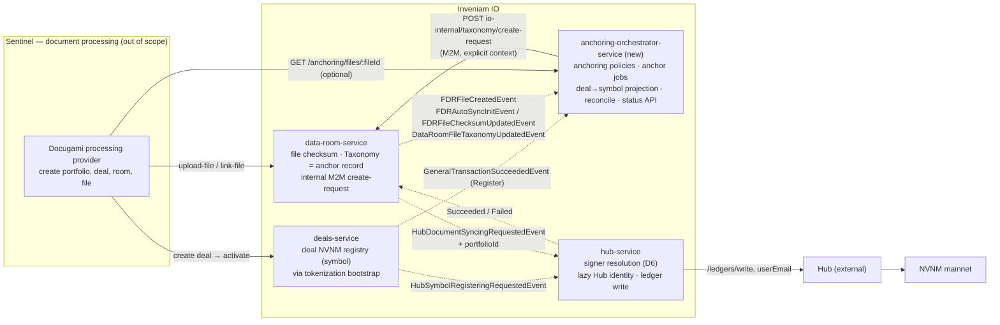
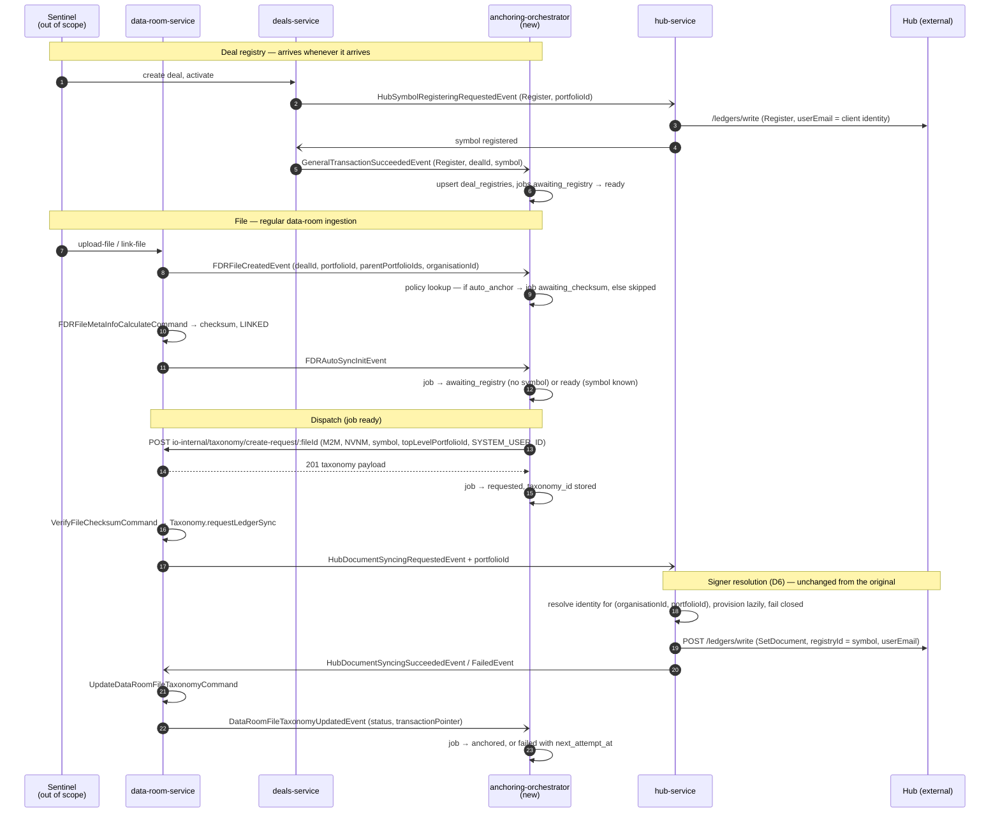

# Measurabl document anchoring — separate microservice (alternative to D7)

Last updated: 2026-09-09

**Status: exploratory. Not a decision.** This doc works out what the anchoring slice of [Measurabl document anchoring — embedded in existing services](measurabl-anchoring-embedded-in-existing-services.md) would look like if the processor lived in a **new service** instead of being embedded in data-room, deals and hub ([D7](reference-docs/architectural-decisions.md#d7-anchoring-processor-is-embedded-in-existing-services-no-new-microservice), currently *Proposed*). It exists so that D7 is accepted or rejected against a concrete alternative rather than against a one-paragraph dismissal. Every other decision — [D2](reference-docs/architectural-decisions.md#d2-anchoring-enters-io-only-through-the-data-room) (anchoring enters only through the Data Room), [D3](reference-docs/architectural-decisions.md#d3-data-residency--files-stay-on-the-measurabl-side), [D4](reference-docs/architectural-decisions.md#d4-a-measurabl-client-is-a-top-level-portfolio), [D5](reference-docs/architectural-decisions.md#d5-ingestion-is-out-of-scope-for-anchoring--anchoring-is-triggered-from-regular-data-room-ingestion), [D6](reference-docs/architectural-decisions.md#d6-per-client-on-chain-signer--one-hub-identity-per-measurabl-client) — is taken as given and honoured here.

The original design is referred to below as **embedded (D7)**. The alternative is referred to as the **orchestrator**. Working name for the new service: `anchoring-orchestrator-service`, gateway prefix `/anchoring`. Nothing in the name is decided.

## The claim being tested

D7 rejects a new service with one sentence: *"it would own no data — it would subscribe to data-room file events, read data-room and deals state, and call hub-service — and cost a deployment, a database and a set of cross-service reads for a few hundred lines."* That is true of a service that merely relays events. It is not true of a service that owns the things the embedded design scatters:

| Concern | Embedded (D7) puts it in | Orchestrator owns it |
| --- | --- | --- |
| Which organisations are auto-anchored, on which ledger, with which signer policy | two jsonb keys inside `organisation_integration_settings.config` (deals-service) | `anchoring_policies` table, admin API |
| Per-file anchoring lifecycle ("waiting for checksum", "waiting for registry", "requested", "anchored", "failed, retry at …") | implicit — a *query* over data-room taxonomy rows plus "absent" as a state | `anchor_jobs` table, explicit state machine, per-job backoff |
| Reconciliation | cron-driven scan over data-room tables (`FDRHubAutoAnchorReconcileCommand`) | local query over `anchor_jobs`; sources of truth consulted only for jobs that need them |
| Deal → NVNM registry (`symbol`) for anchoring purposes | synchronous M2M read to deals-service from inside a data-room saga, on every `FDRAutoSyncInitEvent` for every organisation | projection fed by deals-service's `GeneralTransactionSucceededEvent` (`transactionType = Register`); no read on the hot path |
| Anchoring status / evidence for an external party (Sentinel, BillAI, auditors) | none — would be assembled ad hoc from data-room taxonomies + hub transactions | `GET /anchoring/files/:fileId`, `GET /anchoring/clients/:portfolioId/summary` |
| Operational counters ("deals without registry", "signer unresolved", "anchored per client") | log lines in three services (OQ5 of the original) | metrics from one table |

So the honest framing is not "no data vs a database". It is **"anchoring policy and job lifecycle are a concern of their own vs they are a sub-feature of the data room"**. The rest of this doc makes the first option concrete enough to compare.

## Principles kept from the original

1. **D2 holds: the anchor record is the data-room `Taxonomy`.** The orchestrator never publishes `HubDocumentSyncingRequestedEvent` itself and never talks to Hub for a document write. It asks data-room to create the taxonomy request, exactly as the UI does today via `POST /dataroom/taxonomy/create-request/:fileId` (`data-room.controller.ts:1293`). The data room stays the system of record for "this file is anchored", the UI keeps showing it, and the existing `HubDocumentSyncingSucceeded/Failed → UpdateDataRoomFileTaxonomyCommand` feedback loop is untouched.
2. **hub-service remains the only Hub client and the only holder of Hub credentials.** Signer resolution and lazy identity provisioning (D6) stay in hub-service exactly as in the original ([Hub identity per client — how it runs](measurabl-anchoring-embedded-in-existing-services.md#hub-identity-per-client-d6--how-it-runs)). This is deliberate — see [Variant: orchestrator owns the Hub identity](#variant-orchestrator-owns-the-hub-identity) for why the alternative was not taken.
3. **Nothing is anchored synchronously and nothing depends on Hub availability on the ingest path.** Same lazy shape: fast path from events, backstop from scheduled reconciliation.
4. **Everything anchoring needs is collected from inside IO** ([What anchoring needs](measurabl-anchoring-embedded-in-existing-services.md#what-anchoring-needs-and-where-io-already-has-it)). The orchestrator collects it from events instead of from tables it does not own.

## System context



Dashed edges are events, solid edges are HTTP. Compared with the embedded design's context diagram: the `dr → deals` synchronous read is gone, scheduler-service is gone (the orchestrator schedules its own reconcile), and one new box appears with two inbound event sources and one outbound HTTP call.

## What the orchestrator owns

### Data

```
anchoring_policies
  organisation_id      uuid  PK
  ledger_type          enum  (NVNM)
  auto_anchor          bool
  signer_policy        enum  (orgWallet | perTopLevelPortfolio)
  enabled_at, disabled_at, updated_by

deal_registries                      -- projection, not source of truth
  deal_id              uuid  PK
  organisation_id      uuid  nullable  -- not on the source event; filled from the first job for the deal
  ledger_type          enum
  symbol               text
  registered_at        timestamptz
  source_event_id      uuid

anchor_jobs
  id                   uuid  PK
  file_id              uuid
  file_version         int
  organisation_id      uuid
  deal_id              uuid
  top_level_portfolio_id uuid
  checksum, checksum_algo   nullable until known
  ledger_type          enum
  state                enum  (awaiting_checksum | awaiting_registry | ready | requested |
                              pending | anchored | failed | skipped)
  attempts             int
  next_attempt_at      timestamptz
  taxonomy_id          uuid  nullable  -- set when data-room returns the taxonomy payload
  transaction_pointer  text  nullable  -- from DataRoomFileTaxonomyUpdatedEvent
  last_error           text
  UNIQUE (file_id, file_version, ledger_type)
```

`anchor_jobs` is the thing the embedded design does not have: an explicit record per (file, version, ledger) whose state says *why* a file is not anchored yet. In the embedded design "why" is reconstructed at reconcile time from the absence of a taxonomy row plus a live read of deals-service.

### Event subscriptions

All `@inveniam/events` classes are published to the shared bus and every service receives the full stream and filters with `ofType` (metachain-service does exactly this with an exclusion list, `events-provider.ts`). The orchestrator subscribes to four existing events and needs **no new event types** for the fast path:

| Event | Publisher | Used for | Payload check |
| --- | --- | --- | --- |
| `FDRFileCreatedEvent` | data-room, on file record creation | Open a job in `awaiting_checksum` with the full context: `roomId`, `dealId`, `organisationId`, `portfolioId`, `parentPortfolioIds` (`fdr-file-created.event.ts:6-29`). Top-level portfolio = last of `parentPortfolioIds`, else `portfolioId` | Rich enough. Fires before the checksum exists |
| `FDRAutoSyncInitEvent` | data-room, when a file is `LINKED` and has a checksum (`file.model.ts:2130-2139`) | Move the job to `awaiting_registry` or `ready`. Carries `aggregateId`, `fileVersion`, `organisationId` — enough to key the job | Same hook the embedded design uses; fires from every path (new version, version 1, nightly check-status, manual). `FDRFileChecksumUpdatedEvent` (`file.model.ts:1217-1225`) is the alternative trigger and carries the checksum value itself but no organisation |
| `GeneralTransactionSucceededEvent` with `transactionType = Register`, `providerType = nvnm` | deals-service, when the NVNM `Register` tx completes (`deal-integration-settings.model.ts:590-613` → `HubEventsFactory` inherits `symbolRegistered` from `events-factory-common.ts:37-57`) | Upsert `deal_registries`; promote every job for that deal from `awaiting_registry` to `ready` | Payload (`deal.interfaces.ts:166-177`): `dealId`, `symbol`, `providerType`, `transactionType`; **no `organisationId`** (optional in the type, not set by the factory) and `isHub` is hard-coded `false`. Key the projection on `dealId` only — the job already knows the organisation from `FDRFileCreatedEvent`. Note: `DealIntegrationSettingsSymbolRegisteredEvent` exists in shared-modules but is emitted nowhere in `../../apps`; the original doc's rejected alternative ("data-room subscribing to `DealIntegrationSettingsSymbolRegisteredEvent`") names an event that never fires |
| `DataRoomFileTaxonomyUpdatedEvent` | data-room, when the taxonomy status changes | Close the loop: `requested → pending → anchored` or `failed`; store `transactionPointer` (`data-room.interfaces.ts:35-48`: `fileId`, `dealId`, `status`, `ledgerType`, `transactionPointer`, `fileVersion`) | Sufficient. No taxonomy id → job correlation is by `(fileId, fileVersion, ledgerType)`, hence the unique key above |

Gap worth knowing: a policy change (organisation switched to `auto_anchor`) after files already exist. The events above only cover files created *after* the service is listening. That is the **backfill** case, handled under [Reconciliation and backfill](#reconciliation-and-backfill).

### Outbound calls

Exactly one on the write path: **data-room, internal M2M route** to create the taxonomy request. The existing `POST taxonomy/create-request/:fileId` takes `userId`, `organisationId`, `dealId`, `portfolioId` from the request context (`getContextData`, `request-data-room-file-taxonomy-dlt.command.ts:129-131`), which a machine caller does not have. Data-room therefore needs an `io-internal/` twin of that route, M2M-guarded (pattern: `@IgnoreOrgTokenGuard() @UseGuards(M2MApiKeyGuard)`, `data-room.controller.ts:245-247`, `:2708-2712`), that takes the context explicitly:

```
POST /dataroom/io-internal/taxonomy/create-request/:fileId
{ ledgerType: "NVNM", symbol, isHubConnected: true, autoSync: true,
  organisationId, dealId, topLevelPortfolioId, userId: SYSTEM_USER_ID }
→ 201 taxonomy payload (id, status)   |   409 if a Pending/Succeed taxonomy exists for the same checksum
```

Data-room resolves the room and re-verifies the checksum as it does today (`VerifyFileChecksumCommand`), then publishes `HubDocumentSyncingRequestedEvent` with `portfolioId` — the same forwarding change the embedded design needs (`verify-file-checksum.command.ts:59-75`, `taxonomy/domain/entity.ts:206-230`). The idempotency already in `TaxonomyFunctionalService.requestChecksumVerification` (`taxonomy-functional.service.ts:115-140`) makes re-requests safe.

Optional, read-only, for reconciliation only: `GET /dataroom/io-internal/deals/:dealId/files?linkedWithChecksum=true&since=…` (backfill) and `GET /new-deals/io-internal/deals/:dealId/anchoring-target` (registry lookup when the projection is empty). Neither is on the fast path.

### Inbound API (the surface the embedded design does not have)

| Route | Caller | Purpose |
| --- | --- | --- |
| `PUT /anchoring/policies/:organisationId` | Inveniam admin | Enable auto-anchoring, set ledger and signer policy. Replaces the two jsonb keys in deals-service |
| `GET /anchoring/files/:fileId` | Sentinel (M2M), UI | Job state, taxonomy id, transaction pointer, timestamps. Answers "is it anchored, and if not, why not" |
| `GET /anchoring/clients/:topLevelPortfolioId/summary` | Sentinel, reporting | Counts by state, last anchored at, identity address (from hub-service, cached) |
| `POST /anchoring/reconcile` | operator | Trigger a reconcile pass out of band |

Whether Sentinel or Measurabl actually want the read API is open (OQ2 below). If they do not, the routes shrink to the admin one and the case for the service weakens accordingly — this is the single largest swing factor in the comparison.

## How one document gets anchored



The steps in data-room and hub-service are the same as in the embedded design. What moved is steps 5–6, 9–12, 13–15 and 24: the decision *whether* and *when* to anchor, and the record of that decision.

## Reconciliation and backfill

Two mechanisms, both local to the orchestrator.

**Retry (per job).** `failed` jobs get exponential backoff in `next_attempt_at` (cap: hours). A scheduler inside the service (Nest `@Cron` or a scheduler-service event, either works) picks `ready` jobs and `failed` jobs whose `next_attempt_at` has passed, in bounded batches, and dispatches. `awaiting_registry` jobs are promoted by the deal event, not by polling; if a deal has been `awaiting_registry` longer than a threshold the job is flagged (`deal_without_registry` metric) — this is the "deal never activated" case from the original's Sentinel interface, now visible instead of silent.

**Backfill (per policy change / lost events).** When a policy is enabled or on demand, walk the organisation's deals and their linked files via the internal read routes above and open jobs for anything missing. This is also the recovery path if the bus dropped an event; the existing relay-service (replays EventStore rows onto the broker, `microservices.md`) is the other recovery path, since data-room and deals write to the shared EventStore.

Compared with the embedded design's `FDRHubAutoAnchorReconcileCommand`, which on every run scans data-room files for flagged organisations and asks deals-service for each deal's symbol, this does less work per run and can say what it is waiting on. It costs a second copy of file/deal state that can drift — the backfill walk is what corrects the drift.

## Change list, by component

**anchoring-orchestrator-service (new).** Scaffold from `../../apps/microservice-template`. Modules: `policies` (entity, admin controller), `registries` (projection + event handler), `jobs` (entity, state machine, sagas for the four events, dispatcher, scheduler), `data-room` client (M2M, `ApiClientService` pattern as data-room uses for IAM), `status` controller. Postgres DB `invanchoring`. Deployment wiring: `docker-compose.yml` service + volume, `dev-tools/local-proxy/nginx.conf` prefix, `dev-tools/inv-db/db-management/create-multiple-dbs.sh`, Helm component list and `deploy_helm_to_*_k8s.sh`, TeamCity build (`start_builds_in_TeamCity.sh`), `lerna.json` / root `package.json` workspace, `start_component_locally.sh`. Roughly the same list `automated-workflow-service` touches.

**data-room-service.**
- New `io-internal/taxonomy/create-request/:fileId` route (M2M, explicit context) delegating to `TaxonomyCommandFactoryService.dispatchCreateDLTRequest` with a context object instead of `getContextData`. This also sidesteps the pre-existing `dealId: getContextData(CONTEXT_TYPE.USER_ID)` bug noted in the original (`request-data-room-file-taxonomy-dlt.command.ts:129`) for the automated path.
- Forward `portfolioId` into `HubDocumentSyncingRequestedEvent` (`verify-file-checksum.command.ts`, `taxonomy/domain/entity.ts`) — identical to the original.
- Optional `io-internal/deals/:dealId/files` read for backfill.
- **Not** needed: the new saga branch on `FDRAutoSyncInitEvent`, the deals-service client, `FDRHubAutoAnchorReconcileCommand` and its repository query.

**deals-service.**
- Tokenization bootstrap: pass top-level `portfolioId` on `Register` for signer-policy organisations instead of `requireUserEmail` — identical to the original. The bootstrap needs to know which organisations have a signer policy; either it reads the orchestrator's policy (one M2M read at deal activation — off the hot path) or the flag stays as a jsonb key in `organisation_integration_settings` *as well*. The second is simpler and is the assumption here; it means "auto-anchor" moves to the orchestrator but "signer policy" is duplicated. See OQ3.
- **Not** needed: `autoAnchorDocuments` jsonb key, the `internal/deals/:dealId/anchoring-target` route (unless kept for backfill), admin exposure of the new keys.

**hub-service.** Identical to the original: signer resolution before the ledger write, `hub_signer_identities`, Hub admin client, Vault key for the admin credential (vault path reference only), resend fix, fail-closed guard, alert on org-wallet writes.

**shared-modules/Events.** `portfolioId` on `HubDocumentSyncingRequestedEventPayload` and `HubSymbolRegisteringRequestedEventPayload` — identical to the original. **Not** needed: `FDRHubAutoAnchorReconcileRequestedEvent`, its scheduler-service cron rule, its metachain exclusion.

**scheduler-service, metachain-service.** Untouched.

Net: hub-service and shared-modules changes are the same in both designs. data-room and deals changes shrink. A new service, its DB and its deployment wiring appear.

## Variant: orchestrator owns the Hub identity

The tempting version of this design has the orchestrator also own D6: the `portfolio → identity` record, the Hub admin client and the admin credential, passing a resolved `userEmail` on the create-request so hub-service only needs the payload change. That is what the [signer research](interim-research-docs/io-per-client-signer-multi-org-vs-multi-identity.md#option-2-one-hub-identity-per-measurabl-client) originally sketched (mapping outside hub-service) before D7 moved it in. It was **not** taken here, for two reasons:

1. **The manual path.** A Measurabl-org user (or an admin) can still anchor a file from the UI via `POST /dataroom/taxonomy/create-request/:fileId`. That request never passes through the orchestrator, so nothing would set `userEmail`, and Hub would silently sign as the org wallet — the exact failure D6's fail-closed rule exists to prevent. Keeping resolution in hub-service, keyed on `portfolioId` that data-room forwards on *every* path, closes this for both designs. The orchestrator cannot.
2. **A second Hub client and a second Hub credential holder.** Today only hub-service speaks Hub HTTP and holds Hub material in Vault. Splitting admin calls into another service doubles the surface that has to be audited for the "never sign as the org wallet" invariant.

The variant stays on the table only if hub-service is judged too hard to change, which nothing so far suggests.

## Pros and cons against the embedded design (D7)

| Dimension | Embedded (D7) | Orchestrator (this doc) |
| --- | --- | --- |
| **Services changed** | data-room, deals, hub, shared-modules, scheduler | data-room (less), deals (less), hub (same), shared-modules (less) **+ one new service** |
| **New deployables** | none | one service, one Postgres DB, gateway prefix, Helm, TeamCity, compose |
| **Hot-path impact on data-room** | new saga branch on `FDRAutoSyncInitEvent` with a synchronous M2M read to deals-service, for *every* linked file in *every* organisation (returns early for non-flagged orgs, but the call is made) | none on the ingest path; data-room only gains an internal route that is called when a job is ready |
| **Where "why is this file not anchored" lives** | derived at reconcile time from the absence of a taxonomy row + a live deals read | `anchor_jobs.state` (`awaiting_checksum`, `awaiting_registry`, `failed` + `last_error`) |
| **Reconciliation cost** | scan data-room files for flagged orgs, per-deal read to deals-service, every run | local query on `anchor_jobs`; source reads only for backfill |
| **Sources of truth** | none duplicated | `deal_registries` and job context are projections of deals/data-room state; can drift; backfill corrects |
| **Anchoring policy** | two jsonb keys in a deals-service integration setting; signer policy and auto-anchor coupled to the Hub connection row | first-class table with admin API; but signer policy is likely duplicated into deals-service for the `Register` path (OQ3) |
| **External status / evidence API** | none; would be assembled ad hoc | natural home; only valuable if someone asks for it (OQ2) |
| **Observability** | log counts across three services (original OQ5) | metrics from one table |
| **D6 guardrail (fail closed on every path)** | in hub-service, covers UI and automated paths | same — kept in hub-service deliberately |
| **Team ownership / release cadence** | Keystone changes land in three services owned by (or shared with) other teams | Keystone owns and deploys the orchestrator; still ships the hub-service and one data-room route change |
| **Testability of the orchestration** | saga branch + command inside data-room's test setup | isolated service with event fixtures |
| **Latency, file → anchor request** | one event hop + one HTTP read | two event hops + one HTTP write (ms; irrelevant against a batch-queued mainnet write) |
| **New privileged surface** | `internal/deals/:dealId/anchoring-target` read (M2M) | `io-internal/taxonomy/create-request` **write** acting as `SYSTEM_USER_ID` with caller-supplied context (M2M). Higher-value target; needs the same `/io-internal/` ingress block as existing routes |
| **Coupling to data-room's event vocabulary** | internal to data-room | orchestrator depends on `FDRFileCreatedEvent`, `FDRAutoSyncInitEvent`, `DataRoomFileTaxonomyUpdatedEvent` payload shapes; these are shared-module events consumed cross-service already (metachain, AI, batch), so not a new kind of coupling, but a new consumer to keep in mind when they change |
| **Backfill / policy enabled later** | reconcile scan handles it automatically | needs the explicit backfill walk and two read routes |
| **Fit for future clients with the same requirement** | driven by the same integration-settings row; works | driven by a policy row; works; also the natural home if Hub-org-per-client (Option 1) ever returns |
| **Lines of code** | a few hundred, in three services | a few hundred of logic + service scaffold + deployment wiring |
| **Reversibility** | low blast radius to remove | remove one service; data-room and hub changes stay useful |

### Where each one wins

**Embedded wins when** the anchoring slice is exactly what the original doc describes and nothing more: one client (Measurabl), one ledger, no external status API, and the Keystone team is comfortable landing changes in data-room, deals and hub. Then the orchestrator is a deployment for a state machine that a taxonomy query approximates well enough.

**Orchestrator wins when** at least two of these hold: (a) Sentinel or Measurabl need a status/evidence API; (b) operators need to answer "why is this file not anchored" without running SQL against data-room; (c) the data-room team does not want a cross-service read inside the file-linked saga; (d) more organisations or ledgers will be auto-anchored under policy; (e) Keystone needs to ship anchoring changes without coordinating three services' release trains.

### What does not differ

Both designs need the same hub-service work (signer resolution, identity provisioning, resend fix, fail-closed guard), the same `portfolioId` forwarding in data-room, the same tokenization-bootstrap change for `Register`, and answer the same open questions on Hub admin credential, registry ownership, wallet funding and the anchored URI ([original OQ1–OQ4](measurabl-anchoring-embedded-in-existing-services.md#open-questions)). The choice is about where the *decision to anchor* lives, not about how the anchor is written.

## Open questions specific to this alternative

1. **Is the status API wanted?** If Sentinel needs to report anchoring back to BillAI ("document X anchored, tx Y"), where does that read come from? Today: nowhere. This is the strongest single argument for the service; if nobody needs it, drop it from the comparison.
2. **Event payload completeness.** `GeneralTransactionSucceededEvent` (`Register`) is also emitted for non-NVNM providers and for other transaction types, so the handler must filter on `transactionType` and `providerType`; confirm the NVNM `Register` path reaches `sendSymbolRegisteredEvent` with `typedConfig.symbol` set (it is populated from Hub's `onComplete`). Confirm `FDRFileCreatedEvent` carries `parentPortfolioIds` on the link-file path, not only upload (`file.model.ts:470-490` is the single publish site, so it should).
3. **Signer policy in two places.** deals-service's `Register` path needs to know an organisation has a per-portfolio signer policy. Options: keep the jsonb key in deals-service for that one purpose (duplicate), or have the bootstrap read the orchestrator once per deal activation (runtime dependency deals → orchestrator). Neither is clean.
4. **Internal write route hardening.** `io-internal/taxonomy/create-request` lets an M2M caller act as `SYSTEM_USER_ID` in any organisation. Same trust level as the existing `io-internal/download-file-for-bulk-download`, but a write. Is the M2M key + ingress block sufficient, or does it need a per-service key?
5. **Job granularity.** Per (file, version, ledger) as above, or per file with the latest version only? The Metachain auto-sync anchors every version; Measurabl may only care about the current one.
6. **Ownership of the projection on failure.** If `deal_registries` and deals-service disagree (e.g. a registry re-created), which wins? Proposal: deals-service always; backfill overwrites.

## Related

- [Measurabl document anchoring — embedded in existing services](measurabl-anchoring-embedded-in-existing-services.md) — the embedded design this doc is compared against
- [Architectural decisions](reference-docs/architectural-decisions.md) — D2, D5, D6 taken as given; D7 is what this doc tests
- [IO side: per-client on-chain signer](interim-research-docs/io-per-client-signer-multi-org-vs-multi-identity.md) — why signer resolution stays in hub-service in both designs
- [Public API v2 — create portfolio, create deal, upload file, and anchor](interim-research-docs/v2-portfolios-and-deals-create-flows.md) — the `taxonomy/create-request` path the orchestrator reuses
- [Inveniam microservices architecture](misc/microservices.md) — deployment wiring a new service touches
