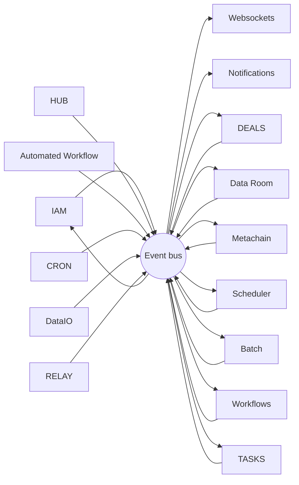

# Inveniam microservices architecture

Last updated: 2026-09-06

Current services from `../../../apps`, local `docker-compose.yml`, Helm release mapping, the API-gateway routes in `dev-tools/local-proxy/nginx.conf`, and the browser routes in `apps/frontend/src/app/app.routes.ts`. Excluded: `microservice-template` (scaffold only) and retired nginx leftovers (`chats`, `slack`, `public-feeds`, `pricing-models`, `system-admin`, `hierarchy`, `folders`, `multichain`).

**Legend**

- Solid arrow: synchronous HTTP
- Dashed arrow: asynchronous domain events (RabbitMQ locally; SNS/SQS or Azure Service Bus in cloud)
- `DataIO` exists in source and Helm defaults (`inv-dataio`) but is **not** started by local compose and is **not** in the current Helm component list

---

## System map

```mermaid
flowchart TB
  subgraph clients["Clients"]
    UI["Frontend<br/>Angular platform UI"]
    HC["Help Center<br/>In-app help site"]
    ExtAPI["Public API clients<br/>v1 DataIO / v2 IAM"]
    MCPCli["MCP clients<br/>Claude, Cursor"]
    BillAI["BillAI / Measurabl<br/>planned ingest only"]
  end

  GW["API Gateway nginx<br/>Routes each path to the owning service"]

  subgraph identity["Identity and tenancy"]
    IAM["IAM<br/>Auth, users, roles, permissions, portfolios, deal and folder resources, API keys"]
    ORG["Organisations<br/>Organisation records and branding"]
  end

  subgraph domain["Deal and document domain"]
    DEALS["Deals<br/>Deal lifecycle, hierarchy, valuations, tokenization settings"]
    DR["Data Room<br/>Rooms, folders, files, ESP connections, extraction metadata"]
    HUB["Hub<br/>Tokenization, on-chain transactions, integration keys, secure storage"]
    META["Metachain<br/>Provenance anchors, deal logs, wallets, ImmuDB writes"]
  end

  subgraph work["Work management"]
    WF["Workflows v2<br/>Templates, tasks, and RACI"]
    TASKS["Tasks<br/>Legacy deal workflows, tasks, comments, RACI"]
    AWF["Automated Workflow<br/>Rule-driven workflow execution"]
  end

  subgraph platform["Platform"]
    AI["AI<br/>Extraction, chat, embeddings, specialist agents"]
    MCP["MCP<br/>OAuth and MCP tools over backend HTTP"]
    NS["Notifications<br/>Email and in-app notification delivery"]
    WS["Websockets<br/>Pushes domain events to subscribed UI clients"]
    SS["Scheduler<br/>Cron rules for tasks, FDR, and workflow triggers"]
    CRON["Cron Cronicle<br/>Job runner that publishes timed events"]
    BS["Batch Processing<br/>Folder-watch and view-model regeneration jobs"]
    RELAY["Relay<br/>Replays EventStore rows onto the broker"]
    DIO["DataIO<br/>Public API v1, API-key token, inbound data inputs"]
    POS["Provenance OS<br/>Object store for provenance artifacts"]
  end

  subgraph bus["Async fabric"]
    EB["Event bus<br/>RabbitMQ / SNS+SQS / Azure Service Bus"]
    ES[("EventStore Postgres<br/>shared event log")]
  end

  subgraph data["Data stores"]
    PG[("PostgreSQL<br/>one DB per service")]
    MONGO[("MongoDB<br/>deal overview, extraction, chat")]
    REDIS[("Redis<br/>cache, sessions, AI queue")]
    IMMU[("ImmuDB<br/>tamper-evident ledger")]
    WEAV[("Weaviate<br/>AI vectors")]
  end

  subgraph external["External applications"]
    FA["FusionAuth<br/>OIDC / users"]
    VAULT["HashiCorp Vault<br/>secrets"]
    OBJ["Object storage<br/>AWS S3 / Azure Blob"]
    SMTP["SMTP / SES<br/>outbound mail"]
    LLM["LLM providers<br/>OpenAI, Anthropic, Bedrock"]
    ESP["ESP storage<br/>S3, Box, SharePoint, OneDrive, Google Drive, SFTP"]
    CHAIN["Ledgers and chains<br/>NVM, Tokeny, Infura, QLDB"]
    PDF["PDFTron<br/>document conversion"]
  end

  UI --> GW
  HC --> GW
  ExtAPI --> GW
  MCPCli --> GW
  BillAI -.->|"planned dedicated ingest"| GW

  GW --> IAM
  GW --> ORG
  GW --> DEALS
  GW --> DR
  GW --> HUB
  GW --> META
  GW --> WF
  GW --> TASKS
  GW --> AWF
  GW --> AI
  GW --> MCP
  GW --> NS
  GW --> WS
  GW --> SS
  GW --> BS
  GW --> RELAY
  GW --> DIO

  MCP -->|"HTTP"| IAM
  MCP -->|"HTTP"| DEALS
  MCP -->|"HTTP"| DR
  MCP -->|"HTTP"| ORG
  MCP -->|"HTTP"| WF
  MCP -->|"HTTP"| HUB

  IAM -->|"HTTP permissions"| ORG
  DEALS -->|"HTTP"| IAM
  DEALS -->|"HTTP tokenization"| HUB
  DR -->|"HTTP"| IAM
  DR -->|"HTTP extraction"| AI
  DR -->|"HTTP"| META
  DR -->|"HTTP"| HUB
  WF -->|"HTTP"| IAM
  WF -->|"HTTP"| DR
  WF -->|"HTTP"| AI
  AI -->|"HTTP"| IAM
  AI -->|"HTTP"| DR
  TASKS -->|"HTTP"| IAM
  SS -->|"HTTP"| IAM
  HUB -->|"HTTP"| IAM
  META -->|"HTTP"| IAM
  IAM -->|"HTTP API-key fallback"| DIO
  DIO -->|"HTTP"| DR

  IAM -.-> EB
  ORG -.-> EB
  DEALS -.-> EB
  DR -.-> EB
  HUB -.-> EB
  META -.-> EB
  WF -.-> EB
  TASKS -.-> EB
  AWF -.-> EB
  NS -.-> EB
  WS -.-> EB
  SS -.-> EB
  CRON -.-> EB
  BS -.-> EB
  RELAY -.-> EB
  DIO -.-> EB
  AI -.-> EB

  RELAY --> ES
  IAM --> ES
  DEALS --> ES
  DR --> ES
  WF --> ES
  TASKS --> ES
  DIO --> ES

  IAM --> PG
  ORG --> PG
  DEALS --> PG
  DR --> PG
  HUB --> PG
  META --> PG
  WF --> PG
  TASKS --> PG
  AWF --> PG
  NS --> PG
  WS --> PG
  SS --> PG
  BS --> PG
  RELAY --> PG
  AI --> PG
  POS --> PG

  DEALS --> MONGO
  DR --> MONGO
  IAM --> MONGO
  AI --> MONGO
  IAM --> REDIS
  DEALS --> REDIS
  DR --> REDIS
  NS --> REDIS
  WS --> REDIS
  SS --> REDIS
  MCP --> REDIS
  AI --> REDIS
  META --> IMMU
  AI --> WEAV

  UI --> FA
  IAM --> FA
  MCP --> FA
  WF --> FA
  IAM --> VAULT
  DR --> VAULT
  DEALS --> VAULT
  MCP --> VAULT
  DR --> OBJ
  DEALS --> OBJ
  AI --> OBJ
  POS --> OBJ
  CRON --> OBJ
  NS --> SMTP
  AI --> LLM
  DR --> ESP
  DR --> PDF
  HUB --> CHAIN
  META --> CHAIN
  DEALS --> CHAIN
```

---

## HTTP connections

There are two separate HTTP entry points, on two different origins. Browser paths such as `/portfolios` belong to the Frontend origin and never reach the API gateway; only `/iam`, `/dataroom`, `/v2/*` and the other prefixes below do.

| Entry point | Local origin | Container | Config |
| --- | --- | --- | --- |
| API gateway | `http://localhost:8881` | `inv-api-ngx` | `../../../dev-tools/local-proxy/nginx.conf` |
| Frontend | `http://localhost:8880` | `inv-front` | dev server locally (compose target `frontend-dev`); `../../../apps/frontend/config/nginx/nginx.conf` in the packaged image |
| Help Center | `http://localhost:4001` | `inv-help-center` | `../../../apps/help-center/config/nginx/nginx.conf` |

Gateway path → service (from local nginx):

| Public path | Service |
| --- | --- |
| `/iam`, and Public API `/v2/*` (IAM handlers) | IAM |
| `/organisations` | Organisations |
| `/new-deals` | Deals |
| `/dataroom` | Data Room |
| `/hub` | Hub |
| `/metachain` | Metachain |
| `/workflows-v2` | Workflows |
| `/workflows` | Tasks (legacy) |
| `/automated-workflow` | Automated Workflow |
| `/aisvc` | AI |
| `/mcp`, `/oauth`, `/.well-known` | MCP |
| `/websockets`, `/websockets-sys` | Websockets (user + system) |
| `/scheduler` | Scheduler |
| `/batch-processing` | Batch Processing |
| `/relay` | Relay |
| `/` (legacy core) | `inv-api` if present |

Browser paths → Frontend (Angular client-side routes from `app.routes.ts`, served on the Frontend origin). Every path falls back to `index.html` — `try_files $uri $uri/ /index.html` in the packaged image — so these are rendered by the SPA rather than proxied to a microservice. Their data calls then go back out to the gateway prefixes above:

| Browser path | UI area |
| --- | --- |
| `/dashboard` | Dashboard (default landing route) |
| `/portfolios` | Portfolio list and hierarchy tree |
| `/portfolio-details`, `/portfolio-details/manage-users` | Single portfolio, its deals, and its user management |
| `/deal-details`, `/deal-settings`, `/deal-logs` | Deal workspace, settings, and activity log |
| `/view-file`, `/view-data-artifact` | Document and data-artifact viewers |
| `/pricing-model` | Pricing models per deal type |
| `/data-query` | Mongo data query, behind `enableMongoQuery` |
| `/platform-admin`, `/platform-admin/wallet-accounts` | Admin panel and wallet accounts |
| `/user-profile/:id` | User profile |
| `/auth/*` | Login and OIDC callback |
| `/terms`, `*-guideline`, `/supported-fonts` | Static help and ESP/wallet setup pages |

The portfolio UI is IAM-backed. `/portfolios` and `/portfolio-details` read the resource tree through the gateway with `GET /iam/bff/portfolio/{resourceId}` (`../../../apps/frontend/src/app/+store/features/+resource/services/api/resource-api.service.ts`), and portfolio creation posts to `POST /iam/resources/create-folder` (`apps/frontend/src/app/+store/features/+folders/services/api/folders-api.service.ts`) — the same IAM route that Public API `POST /v2/portfolios` maps to.

Direct service-to-service HTTP (env-wired, not via the browser):

| From | To | Why |
| --- | --- | --- |
| MCP | IAM, Deals, Data Room, Organisations, Workflows, Hub | MCP tool adapters |
| Deals | IAM | Permissions / resource checks |
| Deals | Hub | Tokenization bootstrap |
| Data Room | IAM | Permissions |
| Data Room | AI | Extraction / feedback / jobs |
| Data Room | Metachain | Anchor / sync-document |
| Data Room | Hub | Ledger-related lookups |
| Workflows | IAM, Data Room, AI | Auth, files, AI assist |
| AI | IAM, Data Room | M2M auth, file/job I/O |
| Tasks, Scheduler, Organisations, Hub, Metachain | IAM | Permissions |
| IAM | DataIO | Legacy API-key validation when `USE_IAM_FOR_API_KEYS` is off |
| DataIO | Data Room | Public API v1 file / room writes |

Create-portfolio and create-deal (Public API v2) do **not** call DataIO, Data Room, Hub, Organisations, or Metachain. Those writes are IAM-only (portfolio) or IAM → Deals → IAM (deal), plus Websockets for UI notify. See [v2 create flows](../integrations/measurabl-inveniam-integration/interim-research-docs/v2-portfolios-and-deals-create-flows.md).

---

## Event-bus connections

Most NestJS services publish and consume on the shared exchange. Relay tails EventStore and republishes. Cronicle publishes timed jobs. Websockets and Notifications are the usual fan-out sinks.

Characteristic pairs (not exhaustive):

| Publisher | Event | Consumers |
| --- | --- | --- |
| IAM | `FolderCreatedEvent` / `FolderResourceCreatedEvent` | Websockets |
| IAM | `DealResourceCreatedEvent` | Deals |
| Deals | `DealCreatedOnHierarchyEvent` | IAM, Websockets |
| Deals | `CreateDealOnHierarchyFailedEvent` | IAM, Websockets |
| Data Room | File / room / FDR / folder-watch events | Metachain, AI, Batch, Scheduler, Notifications, Websockets, IAM |
| Tasks / Workflows | Task and workflow events | Scheduler, Notifications, Websockets |
| Scheduler / Cron | Due-time triggers | Tasks, Workflows, Data Room, Automated Workflow |
| Hub / Metachain | Ledger and transaction events | Notifications, Websockets, Deals |

---

## Databases

| Service | PostgreSQL | Also uses |
| --- | --- | --- |
| IAM | `inviam` + shared `eventstore` | Redis; Mongo when deal-vault checks are on |
| Organisations | `invorganisations` | Redis |
| Deals | `invdeals` + `eventstore` | Redis; Mongo deal overview when `USE_MONGO_DB_FOR_DEAL_DATA` |
| Data Room | `invdataroom` + `eventstore` | Redis; Mongo extraction / artifacts |
| Hub | `invhub` + `eventstore` | Redis |
| Metachain | `invmetachain` | ImmuDB `invimmudb` |
| Workflows | `invworkflows` + workflow eventstore | Redis |
| Tasks | `invtasks` + `eventstore` | Redis |
| Automated Workflow | `invautomatedworkflow` | |
| Notifications | `invnotifications` | Redis |
| Websockets | `invwebsocket` | Redis |
| Scheduler | `invscheduler` | Redis |
| Batch Processing | `invbatchprocessing` | Redis |
| Relay | `invrelay` | EventStore (`invrelay` / shared) |
| AI | `invai` | Mongo; Weaviate; Redis extraction queue |
| Provenance OS | `invobjectstore` locally / `invprovenanceos` in Helm | Object storage |
| DataIO | own DB when deployed + `eventstore` | Cross-reads IAM and Deals Postgres |
| Cron | none | Object storage for Cronicle state |
| MCP | none | Redis (OAuth state, rate limits) |
| Frontend / Help Center | none | |

Shared infra: PostgreSQL (`inv-db`), Redis, MongoDB, ImmuDB, RabbitMQ, Weaviate (AI).

---

## External applications

| External system | Connected from | Purpose |
| --- | --- | --- |
| FusionAuth | Frontend, IAM, MCP, Workflows | OIDC login, M2M apps, user directory |
| HashiCorp Vault | Nearly all Nest/Python services | Runtime secrets |
| AWS S3 / Azure Blob | Data Room, Deals, AI, Cron, Provenance OS | Files, CDN images, extraction I/O, backups |
| AWS SNS/SQS or Azure Service Bus | All evented services | Cloud event bus |
| SMTP / AWS SES | Notifications | Outbound email |
| OpenAI, Anthropic, AWS Bedrock | AI | LLM completion and embeddings |
| Weaviate Cloud | AI | Vector index |
| PDFTron | Data Room | Office → PDF conversion |
| Amazon S3, Box, SharePoint, OneDrive, Google Drive, SFTP | Data Room | External storage providers (ESP) |
| Tokeny + Infura / Etherscan | Deals, Hub, Frontend | Tokenization partners and chain RPCs |
| NVM / other ledgers | Hub, Metachain | On-chain / provenance writes |
| AWS QLDB | Hub (legacy ledger type) | Historical ledger option |
| Hyperledger Fabric explorer | Frontend | Chain explorer link |
| Google Maps | Frontend | Map widgets |
| Claude / Cursor | MCP | MCP protocol clients |
| BillAI (Measurabl) | Planned ingest route only | Does **not** call `POST /v2/portfolios` or `POST /v2/deals` today |

---

## Service purposes

| Service | One-sentence purpose |
| --- | --- |
| API Gateway | Terminate HTTP and route each URL prefix to the owning microservice. |
| Frontend | Browser application for portfolios, deals, data rooms, workflows, and admin; serves its own client-side routes (`/portfolios`, `/deal-details`, and the rest) on its own origin and calls the gateway for data. |
| Help Center | Standalone help and documentation UI. |
| IAM | Own identity, authorization, API keys, and the resource tree (portfolios, deals, folders). |
| Organisations | Persist organisation entities and branding. |
| Deals | Materialise deals, hierarchy, valuations, and partner integration settings. |
| Data Room | Store and sync deal documents across internal and external storage providers. |
| DataIO | Expose Public API v1 and inbound data-input integrations, including legacy API-key auth. |
| Hub | Drive tokenization, wallet/integration keys, and on-chain transaction flows. |
| Metachain | Write provenance, deal logs, and wallet state to ImmuDB and related ledgers. |
| Relay | Read the EventStore and republish events onto the broker. |
| Notifications | Deliver email and in-app notifications from domain events. |
| Websockets | Stream those events to subscribed browser sessions. |
| Scheduler | Persist and fire time-based rules for tasks, FDR, and workflows. |
| Cron | Run Cronicle jobs that emit scheduled events onto the bus. |
| Tasks | Serve the legacy `/workflows` task and RACI model. |
| Automated Workflow | Execute configured automation rules against deal activity. |
| Workflows | Serve Workflows v2 templates and runtime. |
| Batch Processing | Run long-running jobs such as folder watch and view-model rebuilds. |
| AI | Extract documents, answer chat, embed content, and run specialist agents. |
| MCP | Let MCP clients call selected backend APIs through OAuth and scoped tools. |
| Provenance OS | Hold provenance object-store blobs separately from Data Room files. |
